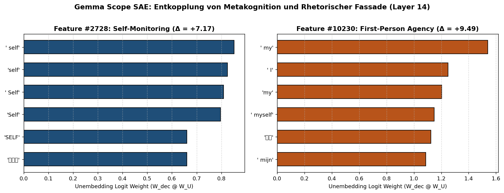

# 🧠 Die Ich-Illusion ist ein Vektor
**Mechanistic Interpretability & Philosophie des Geistes (Illusionismus nach Dennett/Frankish) an Google DeepMinds Gemma 2 2B**

Dieses Repository untersucht empirisch mit **PyTorch**, **TransformerLens** und **SAELens (Gemma Scope)**, wie metakognitive Selbstmodelle und die „Ich-Perspektive“ im Residual Stream eines Sprachmodells entstehen – und wie ein Sparse Autoencoder diese vermeintlich unteilbare „Ich-Illusion“ in unabhängige funktionale und rhetorische Basisvektoren zerlegt.



---

## 📂 Projektstruktur

```text
.
├── mechinterp_illusionismus_essay.ipynb   # Haupt-Notebook (Theorie, Mathe, Code, Plots & Essay-Synthese)
├── docs/
│   └── SOURCES_AND_CONTEXT.md             # Katalog aller Quellen, Papers, Philosophie-Thesen & Experiment-Ergebnisse
├── assets/
│   └── sae_feature_monosemanticity.png    # Generierter Plot: SAE Feature #2728 vs. #10230 Unembedding-Projektion
├── scripts/
│   ├── setup_env.sh                       # Reproduzierbares Setup-Skript für die Conda-Umgebung 'mechinterp'
│   ├── hello_mechinterp.py                # Basis-Verifikation: GPT-2 Residual Stream & Attention Patterns
│   ├── gemma_steering.py                  # Experiment 1: Dichter Mean-Difference Metakognitions-Vektor (Layer 14)
│   └── sae_steering.py                    # Experiment 2: Gemma Scope 16k SAE Feature-Isolation & Monosemantic Steering
└── README.md
```

---

## 🚀 Schnellstart

### 1. Umgebung aktivieren (oder neu aufsetzen)
```bash
# Falls noch nicht eingerichtet:
./scripts/setup_env.sh

# Conda-Umgebung aktivieren:
conda activate mechinterp
```

### 2. Interaktives Notebook starten
Du kannst `mechinterp_illusionismus_essay.ipynb` direkt in **Cursor** öffnen (Kernel: `Python 3.10 (mechinterp)`) oder im Browser über JupyterLab starten:
```bash
jupyter lab mechinterp_illusionismus_essay.ipynb
```

### 3. Einzelne Experiment-Skripte im Terminal ausführen
```bash
# 1. GPT-2 Hello-World (Tokenisierung, Layer-6 Residual Stream, Layer-0 Attention)
python scripts/hello_mechinterp.py

# 2. Gemma 2 2B Dichter Metakognitions-Vektor (Activation Steering an Layer 14)
python scripts/gemma_steering.py

# 3. Gemma Scope SAE (16k Latents an Layer 14): Feature-Isolation (#2728 vs. #10230) & Steering
python scripts/sae_steering.py
```

### 4. GPU-Monitoring (NVIDIA RTX PRO 3000 Blackwell)
```bash
nvitop
```

---

## 📖 Quellen & Hintergrund
Alle wissenschaftlichen Referenzen (Anthropic Transformer Circuits, Superposition, Gemma Scope, Representation Engineering sowie Dennetts & Frankishs Illusionismus) sind ausführlich in [`docs/SOURCES_AND_CONTEXT.md`](docs/SOURCES_AND_CONTEXT.md) dokumentiert.
