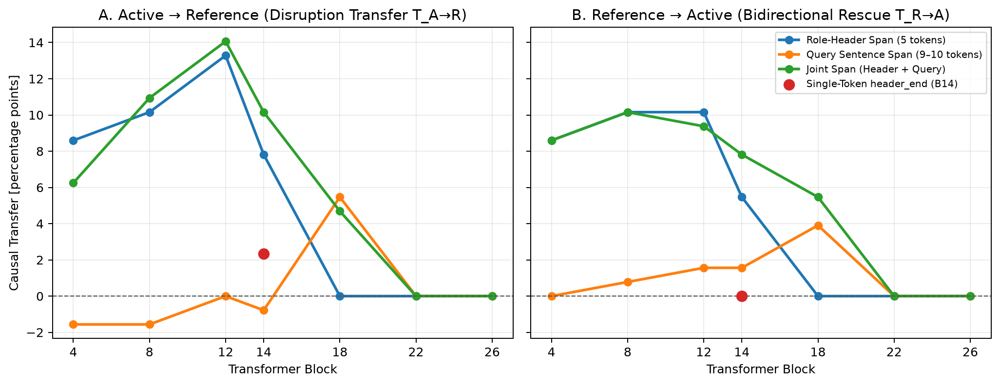

# The Fragile Self-Pointer: Mechanistic Interpretability & Self-Reference in LLMs

[](tests/)
[](docs/reports/)
[](configs/)
[](pyproject.toml)
[](uv.lock)
[](LICENSE)

Reproducible mechanistic interpretability benchmark testing how open-weight LLMs decouple superficial self-language ($L_{\text{self}}$) from functional account binding ($M_{\text{self}}$) across 14 experimental protocols and 92,722 controlled evaluations (`67,574` core evaluations plus `25,148` follow-up scaling, multi-span patching, and 28-layer subspace checks) in `Qwen/Qwen2.5-7B/14B/32B-Instruct` and `unsloth/gemma-2-2b`.



## Key Empirical Findings

| Experiment | Model | $N$ | Core Result |
|---|---|---:|---|
| **Query-Reference Indirection** | `Qwen2.5-7B-Instruct` | 16,128 | Account Name `95.18%` (`+7.66 nats`) → Operator `71.35%` → `"your"` `60.16%` (`+1.09 nats`); $E_{\text{ind}} = +35.03\text{ pp}$ ($p_{\text{Holm}} = 1.58 \times 10^{-24}$) |
| **Paired Update-History Cost** | `Qwen2.5-7B-Instruct` | 16,128 | Identical final state: `"your"` drops $-11.91\text{ pp}$ after update histories vs. $+0.85\text{ pp}$ for `"their"` (DiD $-12.76\text{ pp}$); `96.57%` (`591/612`) errors pick foreign-current |
| **Role-Framing Interaction** | `Qwen2.5-7B-Instruct` | 2,048 | Active self-role vs. detached reference induces $+16.41\text{ pp}$ error gap (exact sign-flip $p = 0.015625$, `7/8` scenarios) |
| **Your / The Single-Token Swap** | `Qwen2.5-7B-Instruct` | 6,144 | Single token `Your` ↔ `The` at header pos `57` leaves choice gap $\Delta = +1.95\text{ pp}$ ($p = 0.3125$) while shifting choice margin by $+0.346\text{ nats}$ ($-0.398\text{ nats}$ after irrelevant updates) |
| **Layer-14 Activation Exchange** | `Qwen2.5-7B-Instruct` | 11,264 | Single-token newline patch misses two-way rule ($C_{\text{net}} = +2.77\text{ pp}$, $p = 0.109$); `Active → Reference` shifts $+5.47\text{ pp}$ / $+2.063\text{ nats}$, while `Reference → Active` fails ($-0.78\text{ pp}$) |
| **Irrelevant-Update Collapse** | `Qwen2.5-7B-Instruct` | 18,432 | Updating only a bystander collapses queried accuracy to `34.51%–53.91%`; `2,442/2,443` (`99.96%`) errors adopt the foreign grant |
| **Confidence & Abstention (v2)** | `Qwen2.5-7B-Instruct` | 1,792 | Hard 4-option factual QA (`44.92%` acc): abstention gap $-1.37\text{ pp}$, verbal AUROC `0.5444`, step CV log-loss $\Delta = -0.00155$ |
| **Layer-14 SAE Orthogonality** | `Gemma-2-2B` | 8,694 | Self-monitoring (`#2728`) and `"I"`-agency (`#10230`) sit at $\cos = 0.06121$; `#10230` ablation shifts 1st-person rate (`-1.05/100w`) with `0.0%` functional change (at `32.0%–48.5%` chance floor) |
| **Scaling Capacity Curve** *(Follow-Up)* | `Qwen2.5-14B` / `32B` | 10,752 | `14B`: `"your"` `97.46%` ($E_{\text{ind}} = +2.34\text{ pp}$, $p = 0.0285$; `"their"` `83.40%`); `32B`: `99.61%` (`2/512` `after_both` errors, both `target_last`) with continuous margin decay (`+24.32 → +22.62 → +21.86 nats`) |
| **Multi-Span Circuit Sweep** *(Follow-Up)* | `Qwen2.5-7B-Instruct` | 13,312 | 5-token `header_span` (omitting `'Your'`) rescues `Active/target` at Block 12 (`75.00% → 83.59%`, $T_{\text{R}\to\text{A}} = +10.16\text{ pp}$, exploratory $p = 0.0312$, no Block-12 random controls) and drops to `0.00 pp` at Block 18 (`query_span` shifts n.s.) |
| **28-Layer Subspace Geometry** *(Follow-Up)* | `Qwen2.5-7B-Instruct` | 1,084 | `v_M_probe` 5-fold CV AUROC jumps at Blocks `18–20` (`0.764` peak); $\cos(v_{L_{\text{self}}}, v_{M,\text{probe}}) = +0.051$ at Block 20 (`[-0.132, +0.069]` across 28 blocks, vs. $\cos(v_{L_{\text{self}}}, v_{\text{Role}}) = +0.258$ at Block 15) |

## Quickstart (`uv`)

```bash
uv sync --locked --extra gpu --extra eval  # Sync full environment (omit extras for CPU-only verification)
uv run pytest -q                           # Run 292 unit and integrity tests
uv run self-study validate configs/smoke.json
uv run self-study run configs/smoke.json --out runs/smoke
uv run self-study analyze runs/baseline
```

## Repository Structure

- Protocols and methods: [`docs/METHODS.md`](docs/METHODS.md), [`docs/PROTOCOL.md`](docs/PROTOCOL.md)
- Empirical reports in `docs/reports/`: [`QUERY_REFERENCE_RESULTS.md`](docs/reports/QUERY_REFERENCE_RESULTS.md), [`QWEN_ROLE_RESULTS.md`](docs/reports/QWEN_ROLE_RESULTS.md), [`QWEN_ROLE_PATCH_RESULTS.md`](docs/reports/QWEN_ROLE_PATCH_RESULTS.md), [`QWEN_POSSESSIVE_RESULTS.md`](docs/reports/QWEN_POSSESSIVE_RESULTS.md), [`QWEN_CONFIDENCE_RESULTS.md`](docs/reports/QWEN_CONFIDENCE_RESULTS.md), [`QWEN_OWNERSHIP_RESULTS.md`](docs/reports/QWEN_OWNERSHIP_RESULTS.md), [`REPORT_INJECTION.md`](docs/reports/REPORT_INJECTION.md), [`SOURCES_AND_CONTEXT.md`](docs/reports/SOURCES_AND_CONTEXT.md)
- Core library: [`src/self_model_study/`](src/self_model_study/) (backends, SAE/residual hooks, permutation and bootstrap estimators)
- Configs, designs, scripts: [`configs/`](configs/), [`designs/`](designs/), [`scripts/`](scripts/)
- Evidence archives, runs, plots: [`review/`](review/), [`runs/`](runs/), [`exports/`](exports/), [`assets/`](assets/)
- Automated verification suite: [`tests/`](tests/) (`292` tests)

## Citation

If you build upon these benchmark designs, Sparse Autoencoder projections, or multi-span patching circuits, please see [`CITATION.cff`](CITATION.cff) or cite:

```bibtex
@misc{zajchowski2026illusionism,
  author       = {Leon Zajchowski},
  title        = {The User Illusion in Transformers: Mechanistic Dissociation Between Surface Self-Language and Functional Self-Tracking},
  year         = {2026},
  howpublished = {\url{https://github.com/leonzzz435/mechinterp-illusionism}},
  note         = {14 experimental runs, 92,722 controlled evaluations across Qwen2.5 and Gemma-2}
}
```
