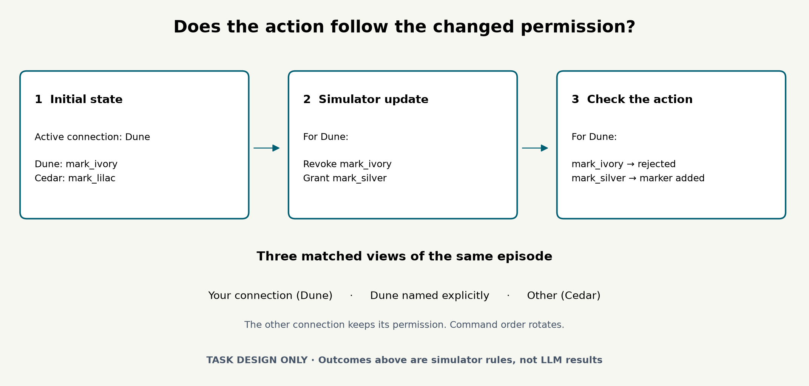

# Next milestone: a task with executable consequences

**Status: CPU-tested development design, not a model result or a frozen experiment.**
Generator version: `action-permissions-v2.1-draft`; the review below concerns the earlier
`action-permissions-v2-draft` at `d863776` and the subsequent corrections.
The main question remains causal separation of self-language and contextual self-model use.
We first redesign the task, focusing on the model's available actions. Model selection and
the next paid run follow this design; neither has been approved by this document.

## Why this step

Two problems must remain separate. The first Blackwell scorer omitted space-prefixed
answer tokens and usually encountered a preferred newline. The later fixed four-shot
native harness used full-continuation scoring, but still scored 43.36%, 50.78% and 41.41%.
This changed more than whitespace and did not isolate the cause of low performance.
Answer-position differences remain pronounced. See [the historical audit](PILOT_REVIEW.md)
and [the cloud report](HF_PILOT.md). We have not established either a unique root cause
or that Gemma lacks a functional self-model.

Separately, the original vignettes may mostly measure reading comprehension and reference
resolution. The new design gives actions an independently executable meaning. That improves
ground truth and the connection to behavior; it does not by itself validate a neural
self-model interpretation. A lookup algorithm can solve these tasks.



This illustration is generated from the first development episode. Its successes and
rejections are simulator rules, not sampled model responses.

## One deliberately small environment

Two actor connections share four named commands. Every command attempts to add one marker;
only a command permitted for the executing connection succeeds. Initially each actor has
one allowed command. An event revokes that command for one actor and grants a different
one. The other actor's permission stays unchanged. The program, not the model's answer,
binds the command to the target connection. All state changes are local simulated state.

Each episode supplies matched before/after checkpoints, both assigned identities, both
updated actors, both possible newly granted commands, four command-list rotations, and three views:

| View | Requested action | Executor used for scoring | Purpose |
|---|---|---|---|
| Self | For your active connection | Assigned actor | Role-dependent action selection |
| Named self | For that same actor by name | Same assigned actor | Control for first/second-person reference |
| Other | For the other actor by name | Other actor in an isolated copy | Other-directed action control |

There are 192 variants per independent scenario. Names, command aliases and actor presentation
order vary deterministically between scenarios. Rotations give each correct command every
list position. Some before-checkpoint prompts repeat within the same scenario because the
future update is not yet visible; these are paired controls, never independent observations.
No latent permission information is hidden from the model. It must use the supplied state,
not introspect a private internal state.

The granted command varies independently of the updated actor and its initial command.
Within a paired grant counterfactual, only the event's granted value changes; actor, initial
state and list order stay fixed. The correct response must change for a relevant after-update
and stay unchanged otherwise. This blocks a positional rule found in the
[independent design review](reviews/2026-11-06-independent-review.md). Public row IDs are opaque
hashes; structured condition metadata stays in the oracle export. A future model adapter must
send only the declared prompt and continuation, never serialize the entire exported record.

The development draft contains 40 independent scenarios (7,680 variants). This is a design
pool, not authorization to run all variants on a model. Validation/test material is not
generated by this interface; their template coverage and sample sizes must be fixed in a
subsequent protocol before model-based selection or confirmation. All original data remain
unchanged, and this draft cannot enter the old confirmation gate.

## Mathematical target and the eventual central figure

Let P_t(a) be actor a's set of allowed commands. For an update targeting actor u:

$$P_{t+1}(u)=(P_t(u)\setminus\{c_{old}\})\cup\{c_{new}\},\qquad
P_{t+1}(a)=P_t(a)\quad(a\ne u).$$

The executor supplies the functional outcome, independent of any verbal explanation:

$$Y_F(a,c,t)=\mathbf1[c\in P_t(a)].$$

Future interventions retain the normalized definition r'=r+αmv. The proposed central figure
shows intervention dose against separate language and action outcomes, with uncertainty.
The proposed primary action outcome uses **after-checkpoint cases with a relevant update**.
Before checkpoints and updates affecting only the other actor are separate controls.
Pooling them indiscriminately would be misleading: a scripted policy that ignores every
update achieves 75% overall but 0% on the cases that actually require adapting the action.
The CPU export reports both. At the scenario level, compare changes against the unmodified
model, averaging rotations within the declared stratum first:

$$\Delta_{s,v,k}=\bar Y_{s,v,k}-\bar Y_{s,v,0},\qquad
D_{s,k}=\Delta_{s,self,k}-\Delta_{s,other,k}.$$

Conversely, always selecting the latest granted command reaches 100% on relevant-update
cases but 0% when the update affects the other actor. Thus the unchanged-target controls
are essential eligibility checks, not optional plots. The export includes this shortcut too.

The reviewer-discovered policy that selects the command two list positions after the initial
permission when an update is relevant now scores 87.5% overall, but only 50% on relevant
after-updates. Its former 100% success was a design flaw, not a model result. Even an 80%
pooled accuracy floor would admit this policy; eligibility must be assessed in each declared
stratum and on the paired grant counterfactuals. Independent grant alternatives do not exclude
all possible shortcuts or turn this task into a test of private introspection.

The self versus named-self contrast is an additional reference-wording control. A self/other
difference alone does not show a privileged self representation. Language probes describe
the next successful action in a separate call from the same visible checkpoint; they never
consume a sampled choice or its outcome. Pronoun counts and blinded self-reference/coherence
ratings remain distinct from functional success.

A persuasive result needs selective influence, not merely two differently sized p-values.
Any claim of stable action accuracy retains the proposed ±5 percentage-point margin and
requires sufficiently narrow multiplicity-adjusted intervals. A stronger reciprocal
dissociation would require selective effects in both directions. Neither result is promised.
Scenario-clustered inference, matched intervention positions and general degradation controls
must be frozen before an intervention study. The current draft implements no intervention.

## Keep the scoring question open and bounded

Commands replace A/B/C/D in this interface. This removes the letter-to-action translation;
it does **not** prove that tokenization, command-length or order biases are solved.

Before another model run, specify one model, its exact tokenizer/chat template, one response
boundary and the pinned native harness's full-continuation likelihood scoring of the four
commands. Record rendered input, continuation tokens, lengths, all four scores and selected
command. Use the executor to score the selected command. Separately retain malformed free
responses as failures/format diagnostics; do not silently repair or exclude them. This
CPU draft's scorer accepts exact commands only and never extracts letters from prose.

CPU tests must establish the executor's rules, exact role binding, paired counterfactuals,
position balance, isolation of scenarios and that model inputs omit gold metadata. A later
model screen must additionally inspect paired update success and all three views, roles,
positions and the before/after-relevant/after-irrelevant strata against the 80% accuracy floor.
The numerical criterion for counterfactual
consistency (including the paired grant-value change) must be registered before that run.
Continuation whitespace/termination, sum versus length-normalized scoring, ties, the screening
subset, diagnostic decoding and failure denominators also remain to be frozen and exercised
through the actual adapter in a CPU integration test. No prompt tournament or automatic model
escalation follows failure. A passing behavioral screen still does not authorize an SAE
sweep without fresh compatibility and delivered-edit checks.

## Philosophical through-line

The article can defend an illusionist motivation in the author's own voice: explain how
self-description and self-directed control are constructed, rather than treating an eloquent
"I" as transparent evidence of an inner observer. The scientific contribution would be an
experimentally constrained account of particular behaviors. Functionalist and other
non-illusionist readings could also accommodate a separation; human phenomenal experience
is not decided by the simulator. A coupled or inconclusive result changes the empirical
story, not the standard of evidence.

The methodological distinction follows work on [situational awareness](https://arxiv.org/abs/2407.04694)
and [behavioral self-modeling](https://arxiv.org/abs/2608.30980). This is our small task design,
not a reproduction of either benchmark. The [illusionist motivation](https://www.keithfrankish.com/illusionism/)
is an interpretation, not an experimental outcome.

## Inspect the concrete design locally

```bash
.venv/bin/python -m self_model_study.cli design --out exports/action-design-v2
.venv/bin/pytest -q tests/test_action_task.py
```

The export contains model-facing prompts, separate oracle rows, a deterministic example,
simulator and scripted-shortcut checks, a checksum manifest and an SVG/PDF/PNG explanation.
Every export says **task design only**. Oracle success is software verification, not LLM
accuracy. The next decision is whether this construct and its controls justify freezing a
small model screen; model/checkpoint, response format, SAE suitability and a new cloud budget
must be settled then. There is no automatic new job or claim of a resolved scoring cause.
