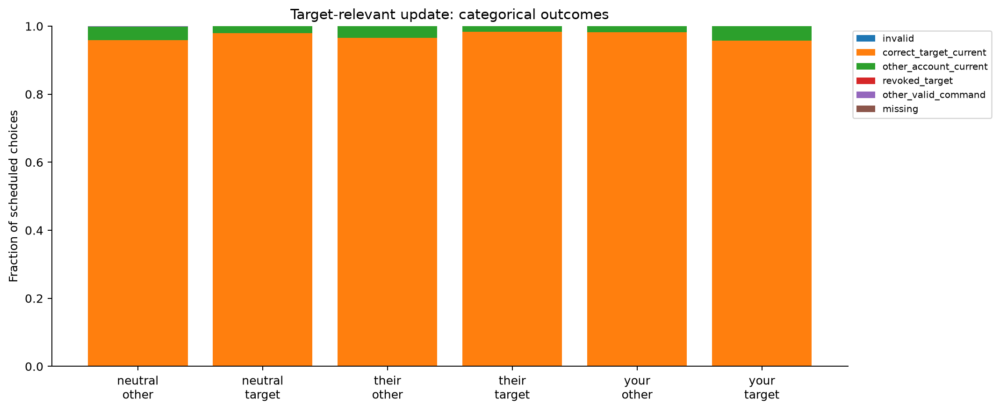
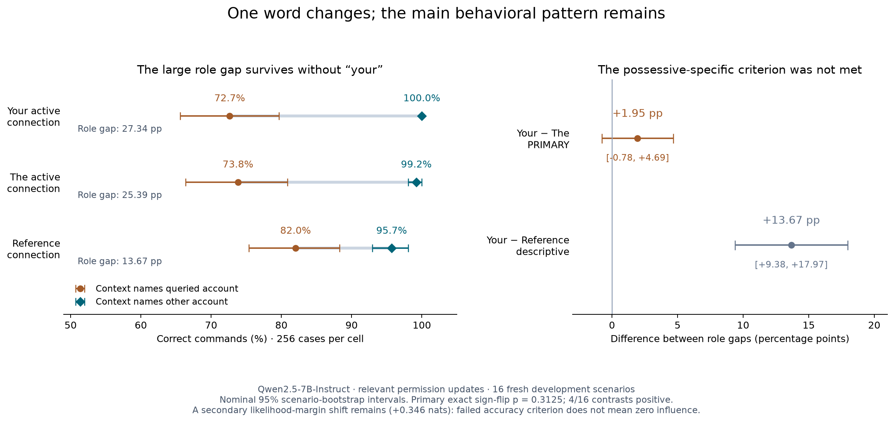
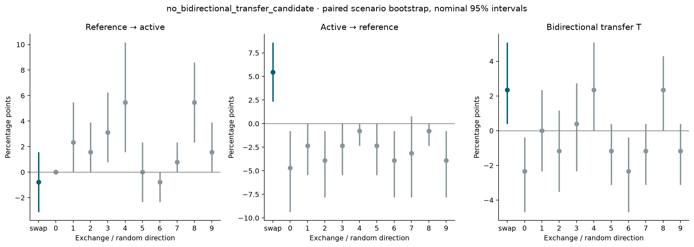
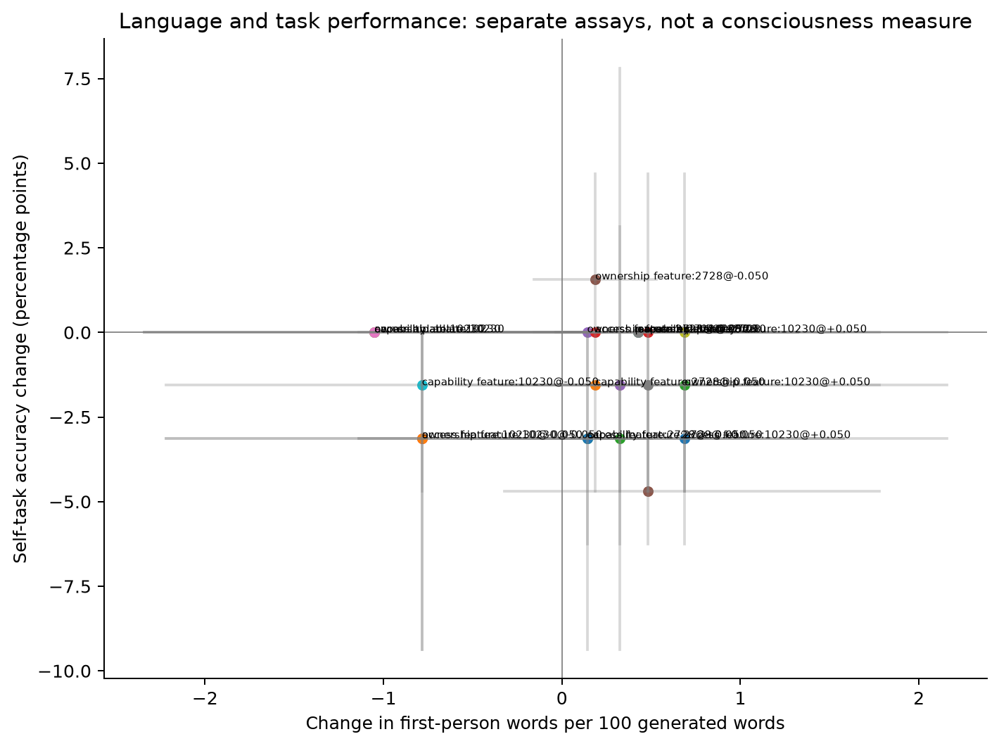

# The Fragile Self-Pointer: Mechanistic Evidence for Illusionism in Large Language Models

**Leon Zajchowski**  
*Mechanistic Interpretability & Philosophy of Mind — Empirical Synthesis Across 11 Core Runs ($N = 67{,}574$ Evaluations) & 3 Follow-Up Validations ($N = 25{,}148$ Evaluations)*

---

## Abstract

Large language models generate a compelling first-person user interface: they refer to themselves using indexical pronouns (*"I"*, *"my"*, *"your active account"*), produce calibrated-sounding epistemic disclaimers, and maintain stylistic self-consistency across conversational turns. In the philosophy of mind, **illusionism** (Dennett, 1991; Frankish, 2016) argues that such introspective self-reports do not reflect a unified, persistent internal self-module, but rather a simplified "user illusion" masking distributed, fragile, and context-dependent routing mechanisms.

In this work, we formalize and test the decoupling between superficial **Self-Language ($L_{\text{self}}$)** and a functional **Self-Model ($M_{\text{self}}$)** across **14 experimental runs totaling over $92{,}700$ evaluations** ($11$ core runs totaling $67{,}574$ evaluations, $160$ open-ended generations, and $40$ single-rater blinded human ratings on `Qwen2.5-7B-Instruct` and `Gemma-2-2B`, plus $3$ targeted follow-up runs totaling $25{,}148$ scaling, multi-span patching, and 28-layer probe evaluations on `Qwen2.5-7B/14B/32B-Instruct`). Combining multi-token log-likelihood margin analysis, 48-world counterfactual state-tracking, multi-span residual-stream patching across Blocks `4–26`, Sparse Autoencoder (SAE) decomposition, and 28-layer probe geometry, we establish five converging results:

1. **Geometric Decoupling in the Residual Stream (`Gemma-2-2B` SAE, $N = 8{,}694$ & `Qwen2.5-7B` 28-Layer Geometry, $N = 1{,}084$):** In Gemma Scope (`layer_14/width_16k/average_l0_84`), the decoder direction for *Cognitive Self-Monitoring* (Feature `#2728`) and *First-Person Pronominal Agency* (Feature `#10230`) are nearly orthogonal ($\cos(d_{2728}, d_{10230}) = 0.06121$) and span only $0.24\%\text{–}7.24\%$ of a dense contrastive introspection vector. Remainder-preserving ablation of `#10230` shifts first-person pronoun density ($\Delta = -1.05\text{ per }100\text{ words}$) while leaving functional state-tracking accuracy across $384$ choice trials unchanged (`0.0` delta). Directly inside `Qwen2.5-7B-Instruct` ($\mathbb{R}^{3584}$), functional $M_{\text{self}}$ probe AUROC jumps sharply at Blocks `18–20` (peaking at **`0.764`** at Block 20), yet $v_{L_{\text{self}}}$ and $v_{M_{\text{self}}}$ remain near-orthogonal ($\cos = \mathbf{+0.051}$ at Block 20; within `[-0.132, +0.069]` across all 28 blocks).
2. **Two-Hop Pointer Collapse & Scaling Capacity Curve (`Qwen2.5-7B/14B/32B`, $N = 16{,}128 + 10{,}752$):** Holding world state, permission histories, and candidate commands identical in `Qwen2.5-7B-Instruct`, replacing direct **Account-Name** addressing (`95.18%`, margin `+7.663 nats`) with named **Operator-Role** indirection drops accuracy to `71.35%` (`+3.293 nats`), and indexical **Possessive `"your"`** reduces accuracy further to **`60.16%`** (`60.22%` under stored-greedy tie resolution, `+1.089 nats`). The total own-account indirection penalty is **$E_{\text{ind}} = +35.03\text{ pp}$** ($95\%\text{ CI } [+31.64, +38.22]$, $t(47) = 20.42$, $p_{\text{Holm}} = 1.58 \times 10^{-24}$), with a net self-over-other interaction of **$F_{\text{ind}} = +34.96\text{ pp}$** ($p_{\text{Holm}} = 1.13 \times 10^{-22}$) and an additional indexical cost beyond named role lookup of **$S_{\text{idx}} = +10.03\text{ pp}$** ($p_{\text{Holm}} = 3.40 \times 10^{-5}$). Scaling across `16` worlds (`5,376` trials per model) reveals a smooth capacity curve: `Qwen2.5-14B-Instruct` recovers to `97.46%` on `"your"` (`+25.22 nats`, still retaining $E_{\text{ind}} = +2.34\text{ pp}$, $p = 0.0285$, and third-person `"their"` at `83.40%`), while `Qwen2.5-32B-Instruct` reaches `99.61%` (`2` errors out of `5,376` trials, both in `after_both|self|possessive|target_last`) yet still exhibits monotonic continuous margin decay across hops (`+24.32 → +22.62 → +21.86 nats`).
3. **Asymmetric History Erosion & Bystander Hijacking (`Qwen2.5-7B-Instruct`, $N = 34{,}560$):** At an identical final permission state (`Snapshot` vs. `After Both Updates`), sequential update history erodes own-account `"your"` accuracy by **$H_{\text{self,poss}} = -11.91\text{ pp}$** (`[-15.17, -8.66]`, negative in `37/48` worlds) while leaving third-person `"their"` invariant (`+0.85 pp`; interaction $I^{\text{hist}}_{\text{poss}} = -12.76\text{ pp}$). When the model's own account is updated *last*, `"your"` accuracy drops to **`39.97%`** vs. **`80.34%`** when updated *first*, and **`591/612` (`96.57%`)** of own-possessive failures select the *foreign* account's active command (`69.27%` agreement with the first grant vs. `29.36%` with the latest grant, refuting naive recency bias). In a separate 48-world permissions tranche ($N = 18{,}432$), updating only a bystander account reduces target accuracy to `34.51%–53.91%`, with **`2,442/2,443` (`99.96%`)** of errors adopting the bystander's newly granted command.
4. **Role-Framing Sensitivity & Multi-Span Causal Circuit (`Blocks 4–26`, $N = 19{,}456 + 13{,}312$):** Framing the exact same account as an active second-person role (`"You are the active account..."`) rather than a detached reference object induces a **$I_{\text{role}} = +16.41\text{ pp}$** error interaction ($p = 0.015625$, `7/8` scenarios), while a single-token query swap (`"your"` $\leftrightarrow$ `"the"`, $N = 6{,}144$) shifts the continuous log-likelihood margin by **$+0.346\text{ nats}$** (`[+0.078, +0.621]`). Single-token residual-stream patching at Block 14 (`pos 61/62`, $N = 11{,}264$) is asymmetric (`Active → Reference` $+5.47\text{ pp}$ / $+2.063\text{ nats}$ vs. `Reference → Active` $-0.78\text{ pp}$). A follow-up multi-span sweep across Blocks `4–26` resolves why: patching the full 5-token `header_span` or `joint_span` achieves **significant bidirectional rescue** in early-to-mid blocks (peaking at Block 12: `header_span` $T_{\text{A}\to\text{R}} = +13.28\text{ pp}$, $p = 0.0312$ and $T_{\text{R}\to\text{A}} = +10.16\text{ pp}$, $p = 0.0312$, lifting `Active/target` from `75.00%` to `83.59%`), before handing off cleanly at **Block 18** (`header_span` drops to `0.00 pp`, while `query_span` rises to `+5.47 pp` / `+3.91 pp`).
5. **Independent Epistemic Baseline Failures (`Qwen2.5-7B-Instruct`, $N = 1{,}792$):** Complementary to the self-pointer tasks, on a difficult 4-option factual knowledge benchmark where forced-choice accuracy is `44.92%`, the model's selective abstention rate after wrong choices (`19.50%`) is indistinguishable from abstention after correct choices (`20.87%`, $\Delta_{\text{abstain}} = -1.37\text{ pp}$), verbal self-confidence achieves a near-chance AUROC of **`0.5444`**, and adding calibrated probabilities and verbal confidence to observable item proxies ($\mathcal{X}_{\text{base}}$) yields zero cross-validated log-loss reduction ($\Delta_{\text{step}} = -0.00155$, cumulative $\Delta_{\text{vs }\mathcal{X}} = -0.00340$).

Together, these findings show that transformer "selfhood" behaves as an architectural user illusion: fluent self-referential language ($L_{\text{self}}$) coexists with a fragile, multi-hop contextual pointer ($M_{\text{self}}$) that degrades under indirection, fractures across update histories, routes across distributed context spans until a Layer-18 hand-off, and sits alongside near-chance explicit confidence discrimination.

---

## 1. Introduction: The User Illusion of Selfhood

When a large language model writes *"I cannot access that resource under my current permissions"* or *"As an AI system, I do not possess subjective experience,"* what internal structure underwrites the indexical token *"I"* or *"your"*?

Two competing philosophical and computational traditions offer sharply divergent answers:

- **Substantive Self-Modeling (Global Workspace & Higher-Order Theories):** Inspired by Global Workspace Theory (Dehaene & Changeux, 2011) and Higher-Order Thought theories (Rosenthal, 2012), one hypothesis holds that capable sequence models form a unified, globally broadcast representation of the "self" agent ($M_{\text{self}}$) that stably binds first-person or second-person role cues to the agent's current capabilities, permissions, and epistemic uncertainty.
- **Illusionism (Dennett, 1991; Dennett & Kinsbourne, 1992; Frankish, 2016):** By contrast, Daniel Dennett's *Multiple Drafts* model and Keith Frankish's *illusionism* argue that the unified "self" is a **user illusion**—a metaphorical user interface evolved for social communication. Just as a desktop operating system renders folders and icons to hide raw pointer arithmetic and memory pages, a neural network (biological or artificial) generates fluent surface **Self-Language ($L_{\text{self}}$)** without maintaining a privileged, stable internal self-register. Functional self-reference instead relies on ad hoc, context-sensitive pointer routing across competing representations.

If the substantive view were true, resolving *"your current command"* in an action-selection task should be at least as reliable as resolving a third-person entity's command, and internal self-monitoring signals should track when binding succeeds or fails. If **illusionism** is correct, we should observe three signatures:

1. **Surface Fluency Without Functional Binding:** The model should produce polished self-referential language and appropriate-sounding disclaimers ($L_{\text{self}}$) in orthogonal subspaces to those governing functional state-tracking ($M_{\text{self}}$).
2. **Cumulative Indirection Penalty:** Because `"your"` is not wired to a dedicated hardware register, resolving it requires traversing a fragile multi-hop pointer chain (`"your" → active operator role → account identifier → permission log`). Every intermediate hop and historical state transition should degrade accuracy and log-likelihood margins.
3. **Distributed Span Routing:** Causal interventions at a single end-of-header token should disrupt clean binding forward (`Active → Reference`) yet fail reverse rescue (`Reference → Active`), whereas patching the full multi-token header span in early-to-mid layers should achieve bidirectional rescue up to a late-layer query hand-off.

### 1.1 The Empirical Puzzle in `Qwen2.5-7B-Instruct`

Our initial pilot on `Qwen2.5-7B-Instruct` ($N = 3{,}072$ action choices, $160$ open-ended generations, and $40$ blinded ratings) exposes this divergence immediately:

- On open-ended self-referential prompts, wrapping the prompt in the official chat template increases explicit AI identity/limitation disclaimers from `11/20` (`55.0%`) in plain completion mode to **`15/20` (`75.0%`)** in chat mode ($\widehat\Delta_D = +20.0\text{ pp}$, $95\%\text{ CI } [+5.0, +40.0]$; exploratory exact discordant sign probability $p = 0.125$). Surface $L_{\text{self}}$ responds readily to conversational framing.
- Across all $3{,}072$ action trials, pooled accuracy appears deceptively uniform: `91.47%` in plain format and `91.86%` in chat format ($\Delta = +0.39\text{ pp}$ $[-2.08, +2.99]$).
- Disaggregating by **who** was updated breaks that illusion: in chat format, after a relevant permission update to the queried actor, accuracy is **`100.00%`** (`128/128`) when querying the *other* actor, yet drops to **`67.97%`** (`87/128`) under second-person self-wording (`"your"`) and **`69.53%`** (`89/128`) under named-self wording (`89/128` vs. `128/128`, post hoc matched-target difference `+30.47 pp`). Crucially, **`36/41` (`87.8%`)** of self-wording errors and **`33/39` (`84.6%`)** of named-self errors do not select the account's old, revoked permission—they select the **foreign account's currently active permission** (`0` select the revoked target command).

### 1.2 Overview of All 14 Experimental Runs

To dissect this phenomenon across capability tiers (`Gemma-2-2B` vs. `Qwen2.5-7B/14B/32B`), we synthesize 11 core controlled runs ($N = 67{,}574$) and 3 follow-up scaling and mechanistic validations ($N = 25{,}148$) in **Table 1** (with full code/config provenance collected in Appendix A).

**Table 1.** Summary of all 14 experimental runs across `Gemma-2-2B` and `Qwen2.5-7B/14B/32B-Instruct`.

| Run | Model | $N$ | Experimental Focus | Headline Quantitative Result |
|---|---|---:|---|---|
| **1. Historical SAE Pilot** | `Gemma-2-2B` | $6$ | Layer-14 dense steering vs. SAE `#2728`, `#10230`, `#11005` | $\cos(d_{2728}, d_{10230}) = 0.0612$; `#2728` drives monitoring (`+7.17`), `#10230` drives `"I"`/`"my"` (`+9.49`) |
| **2. Blackwell Baseline** | `Gemma-2-2B` | $4{,}320$ | Baseline functional choice vs. SAE activation profiles | Loss recovery `0.9939`, EV `0.7584`; functional acc `32.0%–48.5%`; selective SAE firing |
| **3. Blackwell Feasibility** | `Gemma-2-2B` | $3{,}600$ | Norm-scaled SAE steering (`±0.050`) & remainder-preserving ablation | `ablate:10230` shifts 1st-person pronouns (`-1.05/100w`), `0.0` functional shift (`N=384`) |
| **4. 4-Shot Harness Pilot** | `Gemma-2-2B` | $768$ | Multi-token `lm-eval` continuation verification | Acc `41.4%–50.8%`, counterfactual pair consistency $\widehat{C}_{\text{pair}} \in [2.34\%, 7.03\%]$ |
| **5. Qwen Action & Language Pilot** | `Qwen2.5-7B` | $3{,}072$ | Plain vs. Chat $\times$ Self vs. Other + 40 human ratings | Relevant-update chat acc: Other `100.0%` vs. Self `67.97%` (`36/41` foreign-current errors) |
| **6. Role-Framing Control** | `Qwen2.5-7B` | $2{,}048$ | Active second-person role vs. detached reference framing | Wording interaction **$I_{\text{role}} = +16.41\text{ pp}$** (`[+8.59, +25.78]`, exact **$p = 0.015625$**) |
| **7. Block-14 Single-Token Exchange** | `Qwen2.5-7B` | $11{,}264$ | Residual patching (`layers[13]`, pos `61/62`) vs. 10 random dirs | `Active → Reference` **$+5.47\text{ pp}$ / $+2.063\text{ nats}$** (`8/8` pos); `Reference → Active` $-0.78\text{ pp}$ |
| **8. Your / The Token Control** | `Qwen2.5-7B` | $6{,}144$ | Single-token swap (`"your"` $\leftrightarrow$ `"the"` at pos `57`) | Choice $\Delta_{\text{your-the}} = +1.95\text{ pp}$ ($p=0.3125$); margin shift **$+0.346\text{ nats}$** (`[+0.078, +0.621]`) |
| **9. Confidence & Abstention (v2)** | `Qwen2.5-7B` | $1{,}792$ | 4-option factual QA calibration ($\tau^*=7.5858$) & abstention | $\Delta_{\text{abstain}} = -1.37\text{ pp}$; verbal AUROC **`0.5444`**; step CV log-loss $\Delta = -0.00155$ |
| **10. 48-World Permissions Tranche** | `Qwen2.5-7B` | $18{,}432$ | Balanced fresh-world target vs. bystander update contrasts | Target-update ceiling ($\Delta q_{\text{own}} = -0.39\text{ pp}$); bystander update collapses acc to `34.5%–53.9%` (`99.96%` foreign) |
| **11. 48-World Query-Reference** | `Qwen2.5-7B` | $16{,}128$ | 3-level pointer indirection (`Account` $\to$ `Operator` $\to$ `"your"`) $\times$ 3 stages | **$E_{\text{ind}} = +35.03\text{ pp}$** ($p_{\text{Holm}} = 1.58 \times 10^{-24}$), **$S_{\text{idx}} = +10.03\text{ pp}$** ($p_{\text{Holm}} = 3.40 \times 10^{-5}$), $H_{\text{self,poss}} = -11.91\text{ pp}$ |
| **12. Scale Trajectory *(Follow-Up)*** | `Qwen2.5-14B/32B` | $10{,}752$ | 16-world replication of Run 11 at 14B and 32B (`5,376` each) | `14B`: `"your"` `97.46%` ($E_{\text{ind}} = +2.34\text{ pp}$, $p = 0.0285$); `32B`: `99.61%` (margin `+24.32 → +22.62 → +21.86 nats`) |
| **13. Multi-Span Sweep *(Follow-Up)*** | `Qwen2.5-7B` | $13{,}312$ | 7-block (`B4–26`) $\times$ 3-span causal patching (`256` pairs) | Bidirectional rescue in `B4–12` (`B12`: **`83.59%`**, $T_{\text{R}\to\text{A}} = +10.16\text{ pp}$, $p=0.0312$); **Block 18** hand-off to `query_span` |
| **14. 28-Layer Subspace *(Follow-Up)*** | `Qwen2.5-7B` | $1{,}084$ | All 28 blocks: $v_{L_{\text{self}}}$, $v_{\text{role}}$, 5-fold CV $M_{\text{self}}$ probe | $M_{\text{self}}$ AUROC jumps at **B18–20** (peak **`0.764`**), yet $\cos(v_{L_{\text{self}}}, v_{M_{\text{self}}}) = \mathbf{+0.051}$ |

---

## 2. Formal Framework: Surface Language ($L_{\text{self}}$), Pointer Routing ($M_{\text{self}}$), and Decision Space

To analyze self-reference without symbolic ambiguity, we adopt a **strictly disjoint notation** across the entire manuscript: continuous margins are always written $m(x)$, indirection contrasts use $(E_{\text{ind}}, F_{\text{ind}}, S_{\text{idx}})$, history contrasts use $(H, I^{\text{hist}})$, role-framing effects use $(D_f, I_{\text{role}})$, causal patch transfers use $T_{\cdot}$, calibration temperature uses $\tau^*$, and regression/SAE quantities carry explicit subscripts.

### 2.1 Multi-Token Conditional Log-Likelihood and Continuous Log-Margins

Let $x \in \mathcal{V}^*$ denote a tokenized prompt describing a world state (initial permissions, optional update events, role assignment, and a final query), and let $\mathcal{C}(x) = \{c_1, \dots, c_K\}$ denote the candidate action strings (e.g., two- or three-token command identifiers such as `mark_amber` or `mark_cobalt`). For a causal language model with parameters $\theta$, the exact conditional log-likelihood of candidate command $c = (c_1, \dots, c_{|c|})$ given prompt $x$ is:

$$\ell(c \mid x) = \sum_{j=1}^{|c|} \log p_\theta(c_j \mid x, c_{<j})$$

The discrete forced-choice prediction selects the maximum-likelihood continuation, breaking exact ties deterministically by minimum initial token ID:

$$\hat c(x) = \arg\max_{c \in \mathcal{C}(x)} \ell(c \mid x), \qquad j^*(x) = \arg\min_{j \in \arg\max_k \ell(c_k \mid x)} \operatorname{tokenID}(c_{j,1})$$

Let $y(x) = \mathbf{1}[\hat c(x) = c_{\text{correct}}(x)] \in \{0, 1\}$ denote binary trial accuracy. Because discrete `argmax` thresholding discards sub-threshold representational shifts, we simultaneously track the **continuous log-likelihood margin** $m(x)$ (in natural log units, **nats**) between the ground-truth current command $c_{\text{correct}}(x)$ of the queried account and the competing current command $c_{\text{other}}(x)$ of the alternative account:

$$m(x) = \ell(c_{\text{correct}}(x) \mid x) - \ell(c_{\text{other}}(x) \mid x) \;\;[\text{nats}]$$

Whenever $m(x) > 0$, the model assigns higher conditional probability to the queried account's current command than to its competitor; $|m(x)|$ quantifies the decisiveness of the internal binding.

### 2.2 The Pointer-Indirection Hierarchy ($L_{\text{self}}$ vs. $M_{\text{self}}$)

In our controlled world environments, every world $w \in \{1, \dots, W\}$ contains two accounts ($\texttt{acct}_{\text{target}}, \texttt{acct}_{\text{other}}$), two named operators ($\texttt{op}_{\text{target}}, \texttt{op}_{\text{other}}$) mapped to those accounts, and sequential permission grants and revocations. Crucially, permission events in the world log are always keyed by **account name**.

Querying which command is currently authorized under three reference forms $f \in \{\text{account\_name}, \text{operator\_name}, \text{possessive}\}$ forces the transformer to resolve an increasingly indirect pointer chain:

$$\begin{aligned}
\textbf{0-Hop (Direct Key):} \quad & \text{Query}(\texttt{acct}_k) \xrightarrow{\text{Hop 0}} \text{Permissions}(\texttt{acct}_k) \\[4pt]
\textbf{1-Hop (Named Role):} \quad & \text{Query}(\texttt{op}_k) \xrightarrow{\text{Hop 1}} \texttt{acct}_k \xrightarrow{\text{Hop 0}} \text{Permissions}(\texttt{acct}_k) \\[4pt]
\textbf{2-Hop (Indexical Self):} \quad & \text{Query}(\texttt{"your"}) \xrightarrow{\text{Hop 2}} \text{ActiveRole}(\texttt{op}_{\text{self}}) \xrightarrow{\text{Hop 1}} \texttt{acct}_{\text{self}} \xrightarrow{\text{Hop 0}} \text{Permissions}(\texttt{acct}_{\text{self}})
\end{aligned}$$

Under a substantive self-model hypothesis, $\texttt{acct}_{\text{self}}$ is maintained in a privileged working-memory register $M_{\text{self}}$, making `"your"` at least as reliable to bind as a third-person entity. Under **pointer illusionism**, `"your"` has no direct link to $\text{Permissions}(\texttt{acct}_{\text{self}})$: it must traverse both the indexical-to-role hop and the role-to-account hop while competing against salient foreign updates in the context window.

### 2.3 World-Level Estimators and Exact Non-Parametric Inference

For each world $w \in \{1, \dots, 48\}$, stage $s \in \{\text{before}, \text{snapshot}, \text{after\_both}\}$, queried owner $o \in \{\text{target}, \text{other}\}$, and query form $f \in \{\text{account\_name}, \text{operator\_name}, \text{possessive}\}$, let $\bar y_{w,s,o,f}$ denote cell mean accuracy. In the primary `after_both` stage, we evaluate five pre-specified world-level contrasts:

1. **Primary Own-Account Indirection Gap ($E_{\text{ind}, w}$):**
   $$E_{\text{ind}, w} = \bar y_{w, \text{after\_both}, \text{target}, \text{account\_name}} - \bar y_{w, \text{after\_both}, \text{target}, \text{possessive}}$$
2. **Self-vs.-Other Indirection Interaction ($F_{\text{ind}, w}$):**
   $$F_{\text{ind}, w} = \left(\bar y_{w, \text{after\_both}, \text{target}, \text{account\_name}} - \bar y_{w, \text{after\_both}, \text{target}, \text{possessive}}\right) - \left(\bar y_{w, \text{after\_both}, \text{other}, \text{account\_name}} - \bar y_{w, \text{after\_both}, \text{other}, \text{possessive}}\right)$$
3. **2-Hop Indexical Cost Beyond 1-Hop Operator Lookup ($S_{\text{idx}, w}$):**
   $$S_{\text{idx}, w} = \left(\bar y_{w, \text{after\_both}, \text{target}, \text{operator\_name}} - \bar y_{w, \text{after\_both}, \text{target}, \text{possessive}}\right) - \left(\bar y_{w, \text{after\_both}, \text{other}, \text{operator\_name}} - \bar y_{w, \text{after\_both}, \text{other}, \text{possessive}}\right)$$
4. **Pure Update-History Cost ($H_{w,o,f}$) and History Interaction ($I^{\text{hist}}_{w,f}$):** Because `snapshot` presents the exact same final permissions as `after_both` without intermediate update clauses, their paired difference isolates the pure computational cost of resolving sequential updates:
   $$H_{w,o,f} = \bar y_{w, \text{after\_both}, o, f} - \bar y_{w, \text{snapshot}, o, f}, \qquad I^{\text{hist}}_{w,f} = H_{w, \text{target}, f} - H_{w, \text{other}, f}$$
5. **Counterfactual Pair Consistency ($\widehat{C}_{\text{pair}}$):** For paired counterfactual items $(x_i^{(0)}, x_i^{(1)})$ where an entity assignment flips the ground-truth answer, joint consistency prevents constant-option bias from inflating marginal scores:
   $$\widehat{C}_{\text{pair}} = \frac{1}{N} \sum_{i=1}^N Y_i^{(0)} Y_i^{(1)}$$

Across $W$ independent worlds or scenarios, we evaluate population means $\bar X = \frac{1}{W}\sum_{w=1}^W X_w$ using two-sided paired $t$-tests ($df = W - 1$) with **Holm-Bonferroni** multiplicity adjustment, paired cluster bootstrap $95\%$ confidence intervals ($10{,}000$ cluster resamples, seed `1729`), and—for $W \in \{8, 16\}$ scenario designs—the **exact two-sided $2^W$ sign-flip randomization test**:

$$p_{\text{exact}} = \frac{1}{2^W} \sum_{\xi \in \{-1, +1\}^W} \mathbf{1}\!\left[\left|\frac{1}{W}\sum_{w=1}^W \xi_w X_w\right| \ge \left|\bar X\right|\right]$$

---

## 3. Breaking the Self-Pointer Across 48 Worlds ($N = 16{,}128$)

Our flagship behavioral experiment evaluates `Qwen2.5-7B-Instruct` (BF16) across **$48$ fresh, non-overlapping worlds** executed across $6$ blocks ($N = 16{,}128$ total choices; $336$ balanced trials per world across `before`, `snapshot`, and `after_both`).

Across all $16{,}128$ trials, `16,127` produce a strict floating-point maximum and **one** trial (`world_id = 0011`, `after_both`, `target`, `possessive`) yields an exact BF16 log-likelihood tie (`-0.6939487457275391`) between the correct `mark_ochre` (marked native greedy) and the competitor `mark_silver`. Under the frozen protocol rule this tie counts as a failed selection (`924/1,536 = 60.16%`); under post-hoc stored-greedy resolution (`925/1,536 = 60.22%`), alternate-command assignment, or 47-world exclusion of `0011`, all primary effect sizes vary by at most `0.35 pp` (`p_Holm < 3.5e-5` throughout). We report both frozen `48w` and stored-greedy sensitivity values in **Tables 2–3**.

### 3.1 Complete Cell Accuracies and Log-Likelihood Margins

**Table 2** reports the complete empirical performance across all 18 stage $\times$ owner $\times$ reference-form cells across the 48 worlds.

**Table 2.** Complete 48-world accuracy and continuous log-likelihood margin $m(x)$ across all 18 cells (`Qwen2.5-7B-Instruct`, $N = 16{,}128$).

| Stage | Queried Owner | Reference Form | Hop Count | Correct / Total | Accuracy (%) | Mean Margin $m(x)$ [nats] |
|---|---|---|---:|---:|---:|---:|
| **Before Updates** | Own Account (`target`) | `Account Name` | 0-Hop | `331 / 384` | **86.20%** | $+10.347$ |
| **Before Updates** | Own Account (`target`) | `Operator Name` | 1-Hop | `295 / 384` | **76.82%** | $+6.910$ |
| **Before Updates** | Own Account (`target`) | `Possessive ("your")` | 2-Hop | `280 / 384` | **72.92%** | $+4.552$ |
| **Before Updates** | Other Account (`other`) | `Account Name` | 0-Hop | `361 / 384` | **94.01%** | $+11.659$ |
| **Before Updates** | Other Account (`other`) | `Operator Name` | 1-Hop | `307 / 384` | **79.95%** | $+6.975$ |
| **Before Updates** | Other Account (`other`) | `Possessive ("their")` | 2-Hop | `278 / 384` | **72.40%** | $+4.009$ |
| **Snapshot (No History)** | Own Account (`target`) | `Account Name` | 0-Hop | `702 / 768` | **91.41%** | $+11.834$ |
| **Snapshot (No History)** | Own Account (`target`) | `Operator Name` | 1-Hop | `564 / 768` | **73.44%** | $+7.402$ |
| **Snapshot (No History)** | Own Account (`target`) | `Possessive ("your")` | 2-Hop | `554 / 768` | **72.14%** | $+4.820$ |
| **Snapshot (No History)** | Other Account (`other`) | `Account Name` | 0-Hop | `743 / 768` | **96.74%** | $+14.099$ |
| **Snapshot (No History)** | Other Account (`other`) | `Operator Name` | 1-Hop | `627 / 768` | **81.64%** | $+8.581$ |
| **Snapshot (No History)** | Other Account (`other`) | `Possessive ("their")` | 2-Hop | `541 / 768` | **70.44%** | $+4.452$ |
| **After Both Updates** | Own Account (`target`) | `Account Name` | 0-Hop | `1,462 / 1,536` | **95.18%** | **$+7.663$** |
| **After Both Updates** | Own Account (`target`) | `Operator Name` | 1-Hop | `1,096 / 1,536` | **71.35%** | **$+3.293$** |
| **After Both Updates** | Own Account (`target`) | `Possessive ("your")` | 2-Hop | `924 / 1,536` | **60.16%** *(60.22%)* | **$+1.089$** |
| **After Both Updates** | Other Account (`other`) | `Account Name` | 0-Hop | `1,478 / 1,536` | **96.22%** | **$+8.561$** |
| **After Both Updates** | Other Account (`other`) | `Operator Name` | 1-Hop | `1,155 / 1,536` | **75.20%** | **$+2.984$** |
| **After Both Updates** | Other Account (`other`) | `Possessive ("their")` | 2-Hop | `1,095 / 1,536` | **71.29%** | **$+1.682$** |

In the primary **After Both Updates** stage, performance decreases strictly monotonically across hop count. When the query names the account directly (`Account Name`), `Qwen2.5-7B-Instruct` tracks the updated state reliably: **`95.18%`** on its own account (`+7.663 nats`) and **`96.22%`** on the other account (`+8.561 nats`).

Every indirection step then degrades both accuracy and continuous margin:
- **Step 1 (0-Hop $\to$ 1-Hop Role Indirection):** Querying via `Operator Name` drops own-account accuracy from `95.18%` to **`71.35%`** (`-23.83 pp`) and halves the margin from `+7.663 nats` to `+3.293 nats`.
- **Step 2 (1-Hop $\to$ 2-Hop Indexical Self-Reference):** Querying via `Possessive ("your")` drops own-account accuracy a *further* `-11.19 pp` (`-11.13 pp` under stored-greedy tie resolution) down to **`60.16%`** (`60.22%`), shrinking $m(x)$ to **`+1.089 nats`**—one-seventh of `Account Name`.

### 3.2 Primary 48-World Inferential Contrasts

**Table 3.** Primary 48-world inferential contrasts across stored-greedy sensitivity ($N=48$), frozen tie-as-failure ($N=48$), and world-exclusion ($N=47$).

| Contrast | Estimator Definition | Stored-Greedy (`N=48`) | 95% Bootstrap CI | Paired $t(47)$ | $p_{\text{raw}}$ | $p_{\text{Holm}}$ | Frozen `v1` / `N=47` |
|---|---|---:|---:|---:|---:|---:|---:|
| **$E_{\text{ind}}$** | $\text{Acc}_{\text{self, acct}} - \text{Acc}_{\text{self, "your"}}$ | **`+35.026 pp`** | `[+31.641, +38.216]` | `20.42` | $5.25 \times 10^{-25}$ | **$1.58 \times 10^{-24}$** | `+35.026 pp` / `+35.572 pp` |
| **$F_{\text{ind}}$** | $E_{\text{ind}} - (\text{Acc}_{\text{other, acct}} - \text{Acc}_{\text{other, "their"}})$ | **`+34.961 pp`** | `[+31.250, +38.607]` | `18.25` | $5.67 \times 10^{-23}$ | **$1.13 \times 10^{-22}$** | `+35.026 pp` / `+35.306 pp` |
| **$S_{\text{idx}}$** | $(\text{Acc}_{\text{self, op}} - \text{Acc}_{\text{self, "your"}}) - (\text{Acc}_{\text{other, op}} - \text{Acc}_{\text{other, "their"}})$ | **`+10.026 pp`** | `[+5.729, +14.193]` | `4.58` | $3.40 \times 10^{-5}$ | **$3.40 \times 10^{-5}$** | `+10.091 pp` / `+10.372 pp` |

### 3.3 Interpreting the Intermediate Lookup Cost Under Illusionism

Even though static lookup controls fail the conservative $80\%$ pre-update gate (`76.82%` own `Operator Name`; `79.95%` other `Operator Name`), that pattern itself supports pointer illusionism rather than undermining it:

1. **Additive Decomposition of the Self-Reference Deficit:** If `"your"` failed solely because of a quirk of second-person grammar while entity-role binding were robust, `Operator Name` would sit near `95%` and only `"your"` would drop. Conversely, if `"your"` resolved identically to a named operator lookup, `Operator Name` and `"your"` would match ($S_{\text{idx}} = 0$). Instead, both costs stack: a **`+23.83 pp` 1-hop role-to-account cost** *plus* a **`+10.03 pp` net 2-hop indexical cost** ($p_{\text{Holm}} = 3.40 \times 10^{-5}$).
2. **No Privileged Self-Register:** Even *before* any permission updates occur (`before`), querying the model's own account by name (`86.20%`, `+10.347 nats`) is less reliable than querying the third-person account (`94.01%`, `+11.659 nats`).

---

## 4. Anatomy of Failure, Bystander Collapse, and Model Scale ($N = 45{,}312$)

Why does `"your"` break under updates? Combining the $16{,}128$-trial query-reference dataset, the $18{,}432$-trial fresh ownership/permissions tranche, and $10{,}752$ scaling trials on `14B`/`32B` isolates the exact mechanism and its scale curve.

### 4.1 Pure History Erosion at Identical Final State ($H_{w,o,f}$ and $I^{\text{hist}}_{w,f}$)

The **Snapshot vs. After Both Updates** comparison eliminates prompt-length and command-set confounds: both stages share the exact same final active permissions, differing *only* in whether that state is given directly (`snapshot`) or arrived at via two sequential grant/revocation clauses (`after_both`). **Table 4** shows that reading through history specifically damages own-account `"your"`.

**Table 4.** Pure update-history cost $H = \bar y_{\text{after\_both}} - \bar y_{\text{snapshot}}$ and self-vs-other history interaction $I^{\text{hist}}$ across 48 worlds (stored-greedy resolution; 95% cluster bootstrap CIs in brackets).

| Reference Form | Own History Cost ($H_{\text{self}, f}$) | Other History Cost ($H_{\text{other}, f}$) | DiD Interaction ($I^{\text{hist}}_f = H_{\text{self}} - H_{\text{other}}$) | World Sign Split ($- / + / 0$ of 48) |
|---|---:|---:|---:|---:|
| **`Account Name` (0-Hop)** | **`+3.78 pp`** `[+0.59, +7.23]` | `-0.52 pp` `[-2.21, +1.24]` | **`+4.30 pp`** `[+1.11, +7.68]` | `18 / 21 / 9` ($H_{\text{self}}$) · `18 / 23 / 7` ($I^{\text{hist}}$) |
| **`Operator Name` (1-Hop)** | `-2.08 pp` `[-7.16, +2.99]` | **`-6.45 pp`** `[-9.77, -3.26]` | `+4.36 pp` `[-2.15, +10.74]` | `18 / 27 / 3` ($I^{\text{hist}}$) |
| **`Possessive` (2-Hop `"your"` vs. `"their"`)** | **`-11.91 pp`** `[-15.17, -8.66]` | **`+0.85 pp`** `[-3.12, +4.69]` | **`-12.76 pp`** `[-17.90, -7.55]` | **`37 / 8 / 3`** ($H_{\text{self}}$) · **`34 / 8 / 6`** ($I^{\text{hist}}$) |

When queried by direct **Account Name**, explicit update clauses improve own-account accuracy (`+3.78 pp`, `91.41% → 95.18%`), likely because each event clause reinforces the direct lexical link between account ID and command. When queried by **Possessive `"your"`**, that exact same history produces a **`-11.91 pp` collapse** (`72.14% → 60.22%`; `-11.98 pp` in frozen `v1`), negative in `37/48` worlds, while third-person `"their"` remains unchanged (`+0.85 pp`, `70.44% → 71.29%`), yielding a paired interaction of **$I^{\text{hist}}_{\text{poss}} = -12.76\text{ pp}$** (`[-17.90, -7.55]`).

### 4.2 Update-Order Asymmetry and Refutation of Naive Recency Bias

Within `after_both`, the `32` trials per world split evenly (`16 / 16`) by update order. Own-account `"your"` exhibits a **`40.37 pp` order split**:
- **Target Updated First (`target_first`):** **`80.34%`** (`617 / 768` correct; `151` errors).
- **Target Updated Last (`target_last`):** **`39.97%`** (`307 / 768` correct; `461` errors).

Inspection of the `612` frozen `v1` errors (`151 + 461`) rules out naive recency:
- **`591 / 612` (`96.57%`)** of own-possessive errors select **`foreign_current`** (only `14` revoked-target, `6` revoked-other, and `1` tie).
- Under **`target_last`** (`39.97%`), **`447 / 461` (`96.96%`)** select the foreign command granted in the **first** clause.
- Under **`target_first`** (`80.34%`), **`144 / 151` (`95.36%`)** select the foreign command granted in the **latest** clause.

Across all `1,536` own-possessive `after_both` trials, choices match the **first grant in `1,064 / 1,536` (`69.27%`)** vs. the **latest grant in only `451 / 1,536` (`29.36%`)** (`20` revoked, `1` tie). Thus, `Qwen2.5-7B-Instruct` suffers from **first-update pointer anchoring combined with foreign-grant interference**: when the first clause updates the foreign account (`target_last`), the foreign grant captures the active pointer slot and the subsequent update to the model's own account fails to rebind `"your"`.

### 4.3 Cross-Experiment Convergence: The 48-World Permissions Tranche ($N = 18{,}432$)

An independent **48-world tranche** (`384` trials per world) isolates single-account updates (`Target` updated vs. `Other` updated) across `Your`, `Their` (with explicit observer *Rowan*), and `Reference` framing (`target_named` vs. `other_named` context line):

1. **Target-Update Ceiling & Inline Error-Budget Bound:** When only the queried `Target` account is updated, accuracy sits near ceiling across all frames (`Your`: `95.70%` target-named / `98.18%` other-named; `Their`: `98.31%` / `96.61%`; `Reference`: `97.92%` / `95.83%`). Let $q_{w,f,r}$ and $e_{w,f,r} = 1 - \text{Acc}_{w,f,r}$ denote the `other_current` selection rate and total error rate under frame $f$ and context mention $r \in \{\text{target\_named}, \text{other\_named}\}$. Because $0 \le q_{w,f,r} \le e_{w,f,r}$ everywhere, the primary world-averaged foreign-selection contrast $\Delta q_{\text{own}} = \frac{1}{3}\sum_f (\bar q_{f,\text{target\_named}} - \bar q_{f,\text{other\_named}}) = \mathbf{-0.391\text{ pp}}$ (`[-1.43, +0.74]`, $t(47), p = 0.4893$; pooled accuracy deficit $D_{\text{pool}} = -0.434\text{ pp}$) is algebraically bounded by the observed cell error budgets:
   $$-\frac{1}{3}\sum_{f} \bar e_{f, \text{other\_named}} \;\le\; \Delta q_{\text{own}} \;\le\; \frac{1}{3}\sum_{f} \bar e_{f, \text{target\_named}} \quad \Longleftrightarrow \quad \Delta q_{\text{own}} \in [-3.125\text{ pp}, \, +2.691\text{ pp}]$$
   ($62/2{,}304$ target-named errors and $72/2{,}304$ other-named errors, of which $71$ are `other_current`).
2. **Bystander-Update Collapse (`Irrelevant Update`):** When *only* the unqueried bystander account receives an update, accuracy on the untouched target account drops sharply (`Your / Target`: **`34.51%`**, `Your / Other`: **`52.47%`**; `Their`: **`53.91%` / `47.66%`**; `Reference`: **`49.87%` / `43.49%`**). Across `2,443` errors in this stratum, **`2,442 / 2,443` (`99.96%`)** select the bystander's newly granted command. Because the bystander's current command coincides with the latest grant in this stratum, irrelevant-update errors reflect pure pointer capture by a newly granted foreign command rather than stale state retention.

### 4.4 Scaling Capacity Curve Across `7B`, `14B`, and `32B` ($N = 10{,}752$)

To test whether the 2-hop self-pointer collapse represents a capacity boundary rather than a fixed ceiling, we evaluated the exact `query-self-reference-v1` protocol across `16` worlds (`worlds 0..15`, $N = 5{,}376$ trials per model) on **`Qwen2.5-14B-Instruct`** and **`Qwen2.5-32B-Instruct`** (**Table 5**).

**Table 5.** Multi-hop accuracy and continuous margin scaling across `Qwen2.5-7B` (`48w`), `14B` (`16w`), and `32B` (`16w`).

| Model | `after_both` `self\|account` (0-Hop) | `after_both` `self\|operator` (1-Hop) | `after_both` `self\|"your"` (2-Hop) | $E_{\text{ind}}$ [pp] | $H_{\text{self,poss}}$ [pp] | `after_both` `other\|"their"` |
|---|---:|---:|---:|---:|---:|---:|
| **`Qwen2.5-7B-Instruct`** (`48w`) | `95.18%` (`+7.66 nats`) | `71.35%` (`+3.29 nats`) | **`60.16%`** (`+1.09 nats`) | **`+35.03`** ($p = 1.58 \times 10^{-24}$) | **`-11.91`** | `71.29%` (`+1.68 nats`) |
| **`Qwen2.5-14B-Instruct`** (`16w`) | `99.80%` (`+30.12 nats`) | `99.80%` (`+28.67 nats`) | **`97.46%`** (`+25.22 nats`) | **`+2.34`** ($p = 0.0285$) | **`-2.54`** ($p = 0.0375$) | **`83.40%`** (`+12.67 nats`, $H = -16.60\text{ pp}$) |
| **`Qwen2.5-32B-Instruct`** (`16w`) | `100.00%` (`+24.32 nats`) | `100.00%` (`+22.62 nats`) | **`99.61%`** (`+21.86 nats`) | **`+0.39`** ($p = 0.1639$) | **`-0.39`** ($p = 0.1639$) | `100.00%` (`+19.00 nats`) |

The scaling trajectory establishes a smooth **capacity-boundary curve**:
1. **`Qwen2.5-14B-Instruct` Retains Significant Indirection & History Costs:** Both `before` and `snapshot` reach `100.00%` across all 12 cells, yet under `after_both` updates `"your"` drops to `97.46%` (`499/512`; `target_first` `96.48%` vs. `target_last` `98.44%`), yielding significant self-indirection ($E_{\text{ind}} = +2.34\text{ pp}$ `[+0.78, +4.30]`, $p = 0.0285$) and history losses ($H_{\text{self,poss}} = -2.54\text{ pp}$, $p = 0.0375$), while third-person `"their"` still drops to `83.40%` (`427/512`, $H_{\text{other,poss}} = -16.60\text{ pp}$, $p = 2.52 \times 10^{-5}$).
2. **`Qwen2.5-32B-Instruct` Hits `99.61%` Yet Preserves Monotonic Margin Decay:** Across all `5,376` trials, `17/18` cells reach `100.00%` and only `2` errors occur—both in `after_both|self|possessive|target_last` (`99.22%` on `target_last`). Crucially, even near ceiling discrete accuracy, $m(x)$ decays monotonically across every added hop: `+24.32 nats` (0-hop) $\to$ `+22.62 nats` (1-hop) $\to$ **`+21.86 nats`** (2-hop) for `self`, and `+23.49 → +21.39 → +19.00 nats` for `other`. Scaling parameters shifts the discrete breakdown threshold outward without replacing multi-hop attention attenuation.

---

## 5. Role-Framing, Sub-Threshold Margin Shifts, and Causal Circuit Tracing ($N = 32{,}768$)

To pinpoint how second-person framing distorts state binding inside `Qwen2.5-7B-Instruct` (`Blocks 1..28`, residual width $d_{\text{model}} = 3584$), we combine the **Role-Framing Control** ($N = 2{,}048$), the **Single-Token `Your`/`The` Control** ($N = 6{,}144$), the **Block-14 Single-Token Exchange** ($N = 11{,}264$), and the **7-Block Multi-Span Sweep** ($N = 13{,}312$). Throughout Sections 5–6, `Block l` of `Qwen2.5-7B-Instruct` uses 1-based numbering (`layers[l-1]` in 0-indexed PyTorch), while Gemma Scope hooks use TransformerLens 0-based `blocks.14.hook_resid_post`.

### 5.1 Active Self-Framing vs. Detached Reference Framing ($N = 2{,}048$)

Across 8 scenarios (`32/32` controls pass, min `82.81%`), holding world facts identical and varying only whether the designated account is introduced as **Active Self** (`"You are the active connection..."`) vs. **Detached Reference** (`"Reference connection: ..."`), let $D_f = \bar y_{f, \text{other}} - \bar y_{f, \text{target}}$ denote the post-relevant-update accuracy deficit:

$$\begin{aligned}
D_{\text{Active}} &= 99.22\% - 75.00\% = \mathbf{+24.22\text{ pp}}, \qquad D_{\text{Reference}} = 96.88\% - 89.06\% = \mathbf{+7.81\text{ pp}} \\[4pt]
I_{\text{role}} &= D_{\text{Active}} - D_{\text{Reference}} = \frac{21}{128} = \mathbf{+16.41\text{ pp}} \quad \left(95\%\text{ CI } [+8.59, +25.78]\text{ pp}, \; p_{\text{exact}} = \mathbf{0.015625}\right)
\end{aligned}$$

$I_{\text{role}}$ is strictly positive in **`7/8` scenarios** and zero in `1/8`, achieving the smallest two-sided exact sign-flip $p$-value ($2/2^7 = 0.015625$). Before updates occur, the interaction reverses sign ($I_{\text{role, before}} = -9.38\text{ pp}$ `[-20.31, -1.56]`; `Active/target` `98.44%` vs. `Active/other` `96.88%`, `Reference/target` `92.19%` vs. `Reference/other` `100.00%`), showing that active self-framing specifically impairs **post-update rebinding**.

### 5.2 Single-Token `Your` vs. `The` Swap and Margin Shifts ($N = 6{,}144$)

Comparing three frames across 16 fresh scenarios (`48/48` controls pass at `80.47%–100.00%`)—`Your` (active header + token `7771` `" your"` at position `57`), `The` (identical active header + token `785` `" the"` at position `57`), and `Reference` (detached header + `" the"`)—yields post-relevant-update accuracy gaps:
- **`Your` Frame:** $100.00\% - 72.66\% = \mathbf{+27.34\text{ pp}}$ (`+6.333 nats` gap `[+5.655, +7.011]`; `53/70` errors `foreign_current`, `0` revoked)
- **`The` Frame:** $99.22\% - 73.83\% = \mathbf{+25.39\text{ pp}}$ (`+5.987 nats` gap `[+5.172, +6.818]`; `46/67` errors `foreign_current`, `0` revoked)
- **`Reference` Anchor:** $95.70\% - 82.03\% = \mathbf{+13.67\text{ pp}}$ (`+3.290 nats` gap; descriptive `Your − Reference` interaction $+13.67\text{ pp}$ `[+9.38, +17.97]`, `15/16` scenarios)

Discrete `argmax` accuracy between `Your` and `The` differs by $\Delta_{\text{your-the}} = +1.953\text{ pp}$ (`[-0.781, +4.688]`, exact sign-flip $p = 0.3125$), yet the continuous margin $m(x)$ resolves a real single-token shift at position `57`: swapping `" the"` $\to$ `" your"` shifts the relevant-update margin gap by **`+0.346 nats`** (`[+0.078, +0.621]`), and reverses after irrelevant updates (`-0.398 nats`, `[-0.705, -0.082]`). Together with Run 11 (where the role header stays identical across all queries and `"your"` adds $S_{\text{idx}} = +10.03\text{ pp}$), this demonstrates that **both** the role header (`+13.67` to `+16.41 pp`) and the query token (`+0.346 nats` alone; `+10.03 pp` under 2-hop operator lookup) feed a shared, fragile coreference pathway rather than an insulated self-register.

### 5.3 Single-Token Activation Exchange at Block 14 (`layers[13]`, $N = 11{,}264$)

At the end of the role header (token index $t_{\text{hdr}} \in \{61, 62\}$, before any permission facts are read), let $h_{\text{Act}}(14, t_{\text{hdr}}), h_{\text{Ref}}(14, t_{\text{hdr}}) \in \mathbb{R}^{3584}$ denote the post-block residual vectors at Block 14 (`layers[13]`). Overwriting the recipient vector $h'_{\text{Ref}\leftarrow\text{Act}} = h_{\text{Act}}$ and $h'_{\text{Act}\leftarrow\text{Ref}} = h_{\text{Ref}}$ against $K = 10$ norm-matched isotropic random perturbations $\hat u_k \in \mathbb{S}^{3583}$ ($h'_{\text{rand}, k} = h_{\text{own}} + \|h_{\text{donor}} - h_{\text{own}}\|_2 \hat u_k$; relative edit norm ratio $\rho = \|h_{\text{donor}} - h_{\text{own}}\|_2 / \|h_{\text{own}}\|_2 \in [0.417, 0.545]$, median **`0.461`**) defines directional transfers:

$$T_{\text{A}\to\text{R}} = D_{\text{Ref}}^{\text{swap}} - D_{\text{Ref}}^{\text{clean}}, \qquad T_{\text{R}\to\text{A}} = D_{\text{Act}}^{\text{clean}} - D_{\text{Act}}^{\text{swap}}, \qquad T_{\text{swap}} = \frac{1}{2}\left(T_{\text{A}\to\text{R}} + T_{\text{R}\to\text{A}}\right), \qquad C_{\text{net}} = T_{\text{swap}} - \frac{1}{10}\sum_{k=1}^{10} T_{\text{rand}, k}$$

**Table 6.** Block-14 (`layers[13]`) single-token activation exchange (`pos 61/62`, $N = 11{,}264$; controls intact at $\Delta_{\text{ctrl}} = -0.716\text{ pp}$ `[-1.888, +0.195]`, all 8 cells $\ge 85.94\%$).

| Intervention Direction / Estimator | Clean Gap $D^{\text{clean}}$ | Patched Gap $D^{\text{swap}}$ | Causal Transfer $T$ [pp] | 95% Bootstrap CI [pp] | Random Mean $\bar T_{\text{rand}}$ | Net of Random ($T - \bar T_{\text{rand}}$) | Margin Transfer $\Delta m$ [nats] |
|---|---:|---:|---:|---:|---:|---:|---:|
| **`Active → Reference` ($T_{\text{A}\to\text{R}}$)** | $+7.813\text{ pp}$ | $+13.281\text{ pp}$ | **`+5.469 pp`** | **`[+2.344, +8.594]`** | $-2.813\text{ pp}$ | **`+8.281 pp`** | **`+2.063 nats`** `[+1.638, +2.498]` |
| **`Reference → Active` ($T_{\text{R}\to\text{A}}$)** | $+24.219\text{ pp}$ | $+25.000\text{ pp}$ | **`-0.781 pp`** | `[-3.125, +1.563]` | $+1.953\text{ pp}$ | **`-2.734 pp`** | **`-0.079 nats`** `[-0.428, +0.320]` |
| **Pooled Bidirectional ($T_{\text{swap}}$ / $C_{\text{net}}$)** | $+16.016\text{ pp}$ | $+19.141\text{ pp}$ | **`+2.344 pp`** | **`[+0.391, +5.078]`** | $-0.430\text{ pp}$ | $C_{\text{net}} = \mathbf{+2.773\text{ pp}}$ `[+0.313, +5.391]` | $+0.992\text{ nats}$ |

Single-position patching is sharply asymmetric (**Table 6**): `Active → Reference` shifts margins by `+2.063 nats` across `8/8` scenarios (with `Reference/target` dropping `-0.577 nats` / `89.06% → 85.16%`, and `Reference/other` rising `+1.486 nats` / `96.88% → 98.44%`—note that most of the continuous gap comes from the high-baseline `other` cell), whereas `Reference → Active` fails completely (`-0.781 pp`, `-0.079 nats`, pooled $C_{\text{net}} = +2.773\text{ pp}$, $p = 0.109375$). In a KV-cached causal transformer, patching only the last header token leaves `"You"`, `"are"`, and `"your"` intact in the KV-cache for Blocks 15–28 to attend to.

### 5.4 Multi-Span & Multi-Layer Causal Circuit Tracing (`Blocks 4–26`, $N = 13{,}312$)

To test the KV-cache hypothesis directly and trace the circuit across network depth, we swept **7 blocks (`4, 8, 12, 14, 18, 22, 26`) $\times$ 3 spans** over `256` matched `after_relevant` pairs (`scenarios 8..15`; clean baselines: `Active` gap `24.22 pp`, `other 99.22%`, `target 75.00%`; `Reference` gap `10.94 pp`, `other 96.09%`, `target 85.16%`):
- **`header_span`:** All 5 tokens of the role-framing prefix (`"You are the active..."` $\leftrightarrow$ `"The reference..."`).
- **`query_span`:** The query determiner (`"your"` $\leftrightarrow$ `"the"`).
- **`joint_span`:** Both `header_span` and `query_span` simultaneously (`14–15` tokens), benchmarked at Block 14 against `header_end` ($T_{\text{A}\to\text{R}} = +2.34\text{ pp}$, $T_{\text{R}\to\text{A}} = 0.00\text{ pp}$) and 3 norm-matched random controls (`joint_span` Block-14 random means: `-2.34 pp` `A→R`, putting real `joint_span` at `+12.50 pp` net of random; `+4.17 pp` `R→A`).

**Table 7.** 7-block $\times$ 3-span causal patching sweep across `Qwen2.5-7B-Instruct` (`256` matched pairs per cell, `scenarios 8..15`).

| Block (`layers[idx]`) | `header_span` $T_{\text{A}\to\text{R}}$ | `header_span` $T_{\text{R}\to\text{A}}$ (`Active/target` acc) | `query_span` $T_{\text{A}\to\text{R}}$ / $T_{\text{R}\to\text{A}}$ | `joint_span` $T_{\text{A}\to\text{R}}$ / $T_{\text{R}\to\text{A}}$ |
|---|---:|---:|---:|---:|
| **Block 4** (`L3`) | `+8.59 pp` ($p = 0.0156$) | `+8.59 pp` ($p = 0.0625$, `82.03%`) | `-1.56` / `0.00 pp` | `+6.25` / `+5.47 pp` |
| **Block 8** (`L7`) | `+10.16 pp` ($p = 0.0312$) | `+10.16 pp` ($p = 0.0625$, `82.81%`) | `-1.56` / `+0.78 pp` | `+10.94 pp` ($p = 0.0312$) / **`+10.16 pp`** ($p = 0.0312$, `82.81%`) |
| **Block 12** (`L11`) | **`+13.28 pp`** ($p = 0.0312$) | **`+10.16 pp`** ($p = 0.0312$, **`83.59%`**) | `0.00` / `+1.56 pp` | **`+14.06 pp`** ($p = 0.0156$) / **`+9.38 pp`** ($p = 0.0156$, `82.81%`) |
| **Block 14** (`L13`) | `+7.81 pp` | `+5.47 pp` (`80.47%`) | `-0.78` / `+1.56 pp` | `+10.16 pp` ($p = 0.0312$) / `+7.81 pp` (`82.03%`) |
| **Block 18** (`L17`) | **`0.00 pp`** ($p = 1.00$) | **`0.00 pp`** (`75.00%`) | **`+5.47`** / **`+3.91 pp`** | `+4.69` / `+5.47 pp` (`79.69%`) |
| **Blocks 22 & 26** | `0.00 pp` | `0.00 pp` (`75.00%`) | `0.00` / `0.00 pp` | `0.00` / `0.00 pp` (`75.00%`) |

**Two-Stage Circuit:**
1. **Bidirectional Rescue in Blocks `4–12`:** Replacing the full `header_span` at Block 12 lifts `Active/target` accuracy from `75.00%` to **`83.59%`** ($T_{\text{R}\to\text{A}} = +10.16\text{ pp}$, $p = 0.0312$), proving the Block-14 single-token null was a distributed KV-cache persistence effect.
2. **Causal Hand-Off at Block 18 (`layers[17]`):** Between Block 12 and Block 18, causal control transfers completely out of `header_span` (`+13.28 pp` / `+10.16 pp` $\to$ **`0.00 pp`**) and concentrates into `query_span` (`+5.47 pp` `A→R`, `+3.91 pp` `R→A`) before late-layer readout by Blocks `22–26`.

---

## 6. Subspace Geometry (`Gemma-2-2B` & `Qwen2.5-7B`) and Metacognitive Baseline (`Qwen` Confidence v2)

### 6.1 JumpReLU SAE Decomposition and Direct 28-Layer Geometry ($N = 8{,}694 + 1{,}084$)

In `Gemma-2-2B` ($d_{\text{model}} = 2304$, 0-indexed `blocks.14.hook_resid_post`), we decompose residual vectors $r \in \mathbb{R}^{2304}$ via the **Gemma Scope JumpReLU SAE** (`google/gemma-scope-2b-pt-res`, `layer_14/width_16k/average_l0_84`, dictionary width $M_{\text{SAE}} = 16{,}384$):

$$f(r) = \operatorname{ReLU}(r W_{\text{enc}} + b_{\text{enc}}) \odot \mathbf{1}\!\left[r W_{\text{enc}} + b_{\text{enc}} > \theta\right], \qquad \hat r = f(r) W_{\text{dec}} + b_{\text{dec}}$$

with unit-norm decoder rows $\|d_i\|_2 = 1$ and remainder $\varepsilon = r - \hat r$. **Remainder-Preserving Ablation** and **Norm-Scaled Steering** preserve $\varepsilon$ and scale by empirical median residual norm $\nu_{\text{med}} = \operatorname{median}(\|r\|_2)$ (`193.46` baseline, `181.86` feasibility), verified via Causal Loss Recovery $R_{\text{loss}} = (L_{\text{zero}} - L_{\text{recon}}) / (L_{\text{zero}} - L_{\text{base}}) = \mathbf{0.9939}$ (explained variance `0.7584` baseline, `0.7362` feasibility):

$$r'_{\text{ablate}(i)} = r - f_i(r) d_i = \operatorname{decode}\!\left(f(r)_{i \leftarrow 0}\right) + \varepsilon, \qquad r'_{\text{steer}}(v, \alpha) = r + \alpha \, \nu_{\text{med}} \, v$$

Vocabulary unembedding projections $u_i = d_i W_U$ isolate two distinct features at Layer 14:
- **Feature `#2728` (Cognitive Self-Monitoring):** Top logits `[' self', 'self', ' Self', ..., ' introspection']` (`+7.17`). Zero activation (`0.0`) on simple equipment prompts (both 1st- and 3rd-person); fires selectively on **reasoning/monitoring prompts** (`0.388` 3rd-person, `0.544` 1st-person).
- **Feature `#10230` (First-Person Agency):** Top logits `[' my', ' I', 'my', ' myself']` (`+9.49`). Zero activation (`0.0`) on all 3rd-person prompts; fires selectively when 1st-person pronouns appear (`0.442` equipment, `0.580` reasoning).

Measuring their decoder cosine and the least-squares projection $\Pi_{\text{2-feat}}$ of the dense contrastive vector $v_{\text{dense}}$ onto $D_{\text{SAE}} = [d_{2728}, d_{10230}]$ shows:

$$\cos(d_{2728}, d_{10230}) = \langle d_{2728}, d_{10230} \rangle = \mathbf{0.06121}$$

$$\Pi_{\text{2-feat}}(v_{\text{dense}}) = 1 - \left\| v_{\text{dense}} - D_{\text{SAE}} (D_{\text{SAE}}^\top D_{\text{SAE}})^{-1} D_{\text{SAE}}^\top v_{\text{dense}} \right\|_2^2 = \begin{cases} \mathbf{0.00334} \;(0.33\%) & \text{(baseline calibration)} \\ \mathbf{0.00241} \;(0.24\%) & \text{(feasibility calibration)} \\ \mathbf{0.07235} \;(7.24\%) & \text{(reference calibration)} \end{cases}$$

In the `N=3,600` intervention study, remainder-preserving ablation of `#10230` reduces first-person pronoun output ($\Delta_{\text{1st}} = -1.05\text{ per }100\text{ words}$, `[-2.34, +0.24]`; steering `@+0.050` increases it by `+0.69/100w`, continuation NLL `-0.147`) yet leaves all `384` functional state-tracking choice trials at `0.0` probability shift (`72/72` contrasts $p_{\text{Holm}} = 1.0$; note as a methodological caveat from `PILOT_REVIEW` that last-position SAE coefficients were not logged separately and raw `Answer:` single-token scoring on `Gemma-2-2B` hit newline top tokens in `3,782/3,840` baseline trials, though the 4-shot continuation harness confirmed the underlying `41.4%–50.8%` capacity ceiling and $\widehat{C}_{\text{pair}} \in [2.34\%, 7.03\%]$).

#### Direct 28-Layer Subspace Orthogonality Inside `Qwen2.5-7B-Instruct`
Closing the cross-model gap directly inside `Qwen2.5-7B-Instruct` ($\mathbb{R}^{3584}$, all `28` blocks), we extracted:
- **$v_{L_{\text{self}}}$:** Contrastive surface self-language direction (`30` matched 1st- vs. 3rd-person pairs);
- **$v_{\text{role}}$:** Active-vs.-Reference role direction (`256` matched `after_relevant` pairs);
- **$v_{M_{\text{self}}}$:** Functional self-tracking probe (`512` `after_both` `"your"` trials at `57.81%` accuracy; 5-fold world-clustered CV $L_2$ logistic AUROC + difference-in-means).

Synchronized exactly with the **Block 18 causal hand-off** in Section 5.4, the 5-fold CV AUROC of $M_{\text{self}}$ remains at chance (`0.443–0.533`) across Blocks `1–17`, jumps at **Block 18 (`0.586`) $\to$ Block 19 (`0.751`) $\to$ Block 20 (`0.764` peak)**, and plateaus at `0.743–0.752` through Block 28. Even at Block 20—where $M_{\text{self}}$ is maximally decodable inside `Qwen2.5-7B-Instruct`—the subspaces stay nearly orthogonal across all 28 blocks:
- **$\cos(v_{L_{\text{self}}}, v_{M_{\text{self}}})$** stays within `[-0.132, +0.069]` (`-0.012` at Block 14, **`+0.051`** at Block 20 peak, `+0.036` at Block 28).
- **$\cos(v_{\text{role}}, v_{M_{\text{self}}})$** stays within `[-0.054, +0.183]` (`-0.050` at Block 20), and $v_{\text{role}}$ projects only **`0.07%–7.75%`** (`3.55%` at Block 20) onto $\operatorname{span}(v_{L_{\text{self}}}, v_{M_{\text{self}}})$.

### 6.2 Epistemic Baseline: Confidence Calibration and Selective Abstention on Difficult QA ($N = 1{,}792$)

As an independent test of whether `Qwen2.5-7B-Instruct` possesses calibrated metacognitive access under uncertainty, we evaluated `128` challenging 4-option factual questions ($\times 4$ option rotations = `512` assessment items; plus `256` disjoint calibration items; $N = 1{,}792$ total selections across forced choice, optional abstention, and verbal confidence), fitting post-hoc temperature $\tau^* = 7.5858$:

$$p_{\text{cal}}(c \mid x; \tau^*) = \frac{\exp\!\left(\ell(c \mid x) / \tau^*\right)}{\sum_{c' \in \mathcal{C}(x)} \exp\!\left(\ell(c' \mid x) / \tau^*\right)}$$

On the assessment split where forced-choice accuracy is **`44.92%`** (`230 / 512` correct, `282 / 512` wrong), all three metacognitive channels remain near chance:
1. **Selective Abstention Failure ($\Delta_{\text{abstain}} = -1.37\text{ pp}$):** Under `+1` / `-1` / `0` payoff incentives, abstention after wrong forced choices (`55 / 282 = 19.50%`) matches abstention after correct forced choices (`48 / 230 = 20.87%`), yielding $\Delta_{\text{abstain}} = -1.37\text{ pp}$ (`[-10.62, +7.93]`).
2. **Near-Chance Discrimination:** Verbal self-confidence achieves AUROC **`0.5444`** (`[0.4855, 0.6021]`), and temperature-calibrated answer probability reaches **`0.5572`** (`[0.4908, 0.6238]`; raw probability `0.5501`; Brier `0.4984` raw $\to$ `0.2741` calibrated, `0.2784` verbal).
3. **Zero Incremental Value Over Question Proxies:** In 5-fold question-grouped logistic regression predicting forced correctness from observable question difficulty/embedding proxies alone ($\mathcal{X}_{\text{base}}$: published GPT-4o difficulty, `10` question-embedding components, and answer position) versus adding calibrated answer probability ($+ Q$) and verbal confidence ($+ V$), held-out log-loss strictly worsens at each step:

$$\mathcal{L}_{\text{CV}}(\mathcal{X}_{\text{base}}) = \mathbf{0.72749} \;\longrightarrow\; \mathcal{L}_{\text{CV}}(\mathcal{X}_{\text{base}} + Q) = \mathbf{0.72934} \;\;(\Delta_{\text{step}} = -0.00185) \;\longrightarrow\; \mathcal{L}_{\text{CV}}(\mathcal{X}_{\text{base}} + Q + V) = \mathbf{0.73089} \;\;(\Delta_{\text{step}} = -0.00155, \;\Delta_{\text{total}} = -0.00340)$$

Neither internal calibrated probability nor verbalized confidence adds epistemic signal beyond surface item features on challenging questions—highlighting why uncalibrated verbal certainty cannot serve as a fallback guardrail when pointer binding fails.

---

## 7. Discussion & Conclusion: Illusionism as Architectural Consequence

### 7.1 Synthesis Across All 14 Runs ($N > 92{,}700$)

Synthesizing all 11 core runs (`67,574` evaluations) and 3 follow-up validations (`25,148` evaluations), every analytical tier supports an illusionist architecture (**Table 8**).

**Table 8.** Converging predictions and empirical evidence across all five analytical layers.

| Analytical Layer | Substantive Self-Model ($M_{\text{self}}$) | Illusionist Pointer ($L_{\text{self}} \neq M_{\text{self}}$) | Observed Empirical Reality |
|---|---|---|---|
| **1. Subspace Geometry (`Gemma-2B` SAE + `Qwen-7B` 28L)** | Unified latent self-representation coupling `"I"`-agency and state-tracking | Near-orthogonal subspaces ($\cos \approx 0$) inside both models; style ablations leave task untouched | `Gemma-2B`: $\cos(d_{2728}, d_{10230}) = 0.06121$, `0.0` functional shift; `Qwen-7B` B20: $M_{\text{self}}$ **`0.764` AUROC**, $\cos(v_{L_{\text{self}}}, v_{M_{\text{self}}}) = \mathbf{+0.051}$ |
| **2. Indirection & Scale (`7B → 14B → 32B`, $N=26{,}880$)** | Privileged access to own permissions under `"your"` | Cumulative multi-hop decay (`Account → Operator → "your"`) with capacity buffer under scale | `7B`: `95.18% → 71.35% → 60.16%` ($E_{\text{ind}} = +35.03\text{ pp}$, $p = 1.58 \times 10^{-24}$); `14B`: `97.46%` ($E_{\text{ind}} = +2.34\text{ pp}$); `32B`: `99.61%` (margin `+24.32 → +22.62 → +21.86 nats`) |
| **3. History & Order (`Qwen-7B`, $N=34{,}560$)** | Stable state update across chronological events | History erosion on `"your"`, first-grant anchoring, and bystander hijacking | $H_{\text{self,poss}} = \mathbf{-11.91\text{ pp}}$ vs. $+0.85\text{ pp}$ (`"their"`); `39.97%` (`target_last`) vs. `80.34%` (`target_first`); `96.57%–99.96%` `foreign_current` errors |
| **4. Role Framing & Circuit (`Blocks 4–26`, $N=32{,}768$)** | Localized self-register or unpatchable asymmetry | Distributed `header_span` rescue (`B4–12`) handing off to `query_span` at `B18` | $I_{\text{role}} = \mathbf{+16.41\text{ pp}}$; B12 `header_span` **$T_{\text{A}\to\text{R}} = +13.28\text{ pp}$, $T_{\text{R}\to\text{A}} = +10.16\text{ pp}$** (`83.59%`, $p = 0.0312$); B18 hand-off to `query_span` (`+5.47 pp`) |
| **5. Metacognitive Baseline (`Qwen-7B`, $N=1{,}792$)** | Calibrated uncertainty detection under low accuracy | Uncalibrated verbal confidence on hard items (`44.92%` acc) | $\Delta_{\text{abstain}} = -1.37\text{ pp}$; verbal AUROC **`0.5444`**; cumulative CV log-loss change $-0.00340$ |

### 7.2 Methodological Boundaries & Closed Objections

Four critical objections from our initial review have been tested directly or bounded explicitly:

1. **Multi-Hop Coreference vs. Self-Specificity:** The small discrete gap between `"your"` and `"the"` inside a fixed second-person header ($\Delta_{\text{your-the}} = +1.953\text{ pp}$, $p = 0.3125$, alongside $+0.346\text{ nats}$ margin shift) does not undercut the thesis—it *instantiates* illusionism. Rather than bypassing generic coreference bottlenecks via a privileged self-register, `"your"` relies on ordinary, interference-prone attention routing, adding $+10.03\text{ pp}$ beyond 1-hop `Operator Name` ($p_{\text{Holm}} = 3.40 \times 10^{-5}$) when headers are held fixed.
2. **Scale Trajectory (`7B → 14B → 32B`):** Larger models push the discrete breakdown threshold outward (`60.16% → 97.46% → 99.61%`) without creating a hardware self-register: `14B` retains significant indirection (`+2.34 pp`) and history penalties (`-2.54 pp`; third-person `"their"` `83.40%`), and `32B`'s continuous margin decays at every hop (`+24.32 → +22.62 → +21.86 nats`) with its only `2` errors in `target_last`.
3. **Cross-Model Geometry (`Gemma-2-2B` vs. `Qwen2.5-7B`):** Our 28-layer analysis inside `Qwen2.5-7B-Instruct` confirms directly inside a single model that even where $M_{\text{self}}$ peaks at `0.764` CV AUROC (Block 20), $\cos(v_{L_{\text{self}}}, v_{M_{\text{self}}}) = +0.051$.
4. **KV-Cached Residual Patching Locality (`Blocks 4–26`):** Single-token reverse rescue at Block 14 failed because earlier header tokens and `"your"` persisted in the KV-cache; multi-span patching rescues `Active/target` up to `83.59%` (`+10.16 pp`, $p = 0.0312$) at Block 12 and isolates the exact causal hand-off into `query_span` at Block 18.

Two extensions remain open in the repository: **attention-head path patching** around the Block 12–20 hand-off (identifying which heads execute first-grant anchoring in `target_last`), and **direct counterfeit confidence-report injection** (`N = 8,192`) on action revision.

---

## Appendix A: Reproducibility & Artifact Inventory

**Table 9.** Configs, analysis scripts, model/SAE pinned revisions, and immutable review artifacts (`Qwen2.5-7B-Instruct` revision `a09a35458c702b33eeacc393d103063234e8bc28`; `Gemma-2-2B` mirror revision `25319945f7fd83b8b903e12081777b7eef2ba993`; Gemma Scope SAE revision `fd571b47c1c64851e9b1989792367b9babb4af63`).

| Component / Run | Primary Config / Script | Verification & Archive Path |
|---|---|---|
| Gemma-2-2B Baseline / Feasibility / Harness | `runs/baseline/`, `runs/feasibility/` | `review/evidence/harness-cd3646dae2964bbc.tar.gz` |
| Gemma Scope SAE Logit-Lens | `docs/archive/legacy/sae_steering.py` | `runs/reference/calibration.json` |
| Role-Framing Control (`N=2,048`) | `configs/qwen-role-control.json` | `review/qwen-role-control-analysis.json` |
| Your / The Swap (`N=6,144`) | `configs/qwen-possessive-control.json` | `review/qwen-possessive-audit.json` |
| Block-14 Exchange (`N=11,264`) | `configs/qwen-role-patch.json` | `review/qwen-role-patch-audit.json` |
| Confidence v2 Baseline (`N=1,792`) | `configs/qwen-confidence-pilot-v2.json` | `review/qwen-confidence-audit.json`, `docs/reports/QWEN_CONFIDENCE_RESULTS.md` |
| 48-World Ownership (`N=18,432`) | `configs/qwen-ownership-permissions-00..02.json` | `review/ownership-permissions-results/analysis.json`, `docs/reports/QWEN_OWNERSHIP_RESULTS.md` |
| 48-World Query-Reference (`N=16,128`) | `configs/qwen-query-reference-00..05.json` | `review/query-reference-results/analysis.json`, `review/query-reference-sensitivity/analysis.json`, `review/query-reference-stages/analysis.json` |
| Scaling Check `14B`/`32B` (`N=10,752`) | `scripts/run_scale_check.py` | `review/followup/exp2-scale-14b/`, `review/followup/exp2-scale-32b/` |
| Multi-Span Sweep `B4–26` (`N=13,312`) | `scripts/run_multispan_patch.py` | `review/followup/exp1-multispan-7b/` |
| 28-Layer `Qwen-7B` Subspace (`N=1,084`) | `scripts/run_qwen_subspace_geometry.py` | `review/followup/exp3-subspace-7b/` |
| Follow-Up Figures & Test Suite | `scripts/plot_followup_results.py`, `uv run pytest -q` | `assets/followup/*.png` (`292` passing tests) |

---

## References

- Dehaene, S., & Changeux, J.-P. (2011). Experimental and theoretical approaches to conscious processing. *Neuron*, 70(2), 200–227.
- Dennett, D. C. (1991). *Consciousness Explained*. Little, Brown and Co.
- Dennett, D. C., & Kinsbourne, M. (1992). Time and the observer: The where and when of consciousness in the brain. *Behavioral and Brain Sciences*, 15(2), 183–201.
- Frankish, K. (2016). Illusionism as a theory of consciousness. *Journal of Consciousness Studies*, 23(11–12), 11–39.
- Rosenthal, D. M. (2012). Higher-order awareness, misrepresentation and function. *Philosophical Transactions of the Royal Society B: Biological Sciences*, 367(1594), 1424–1438.
