# The Fragile Self-Pointer: Mechanistic Evidence for Illusionism in Large Language Models

**Leon Zajchowski**  
*Mechanistic Interpretability & Philosophy of Mind — Empirical Synthesis Across 11 Core Runs ($N = 67{,}574$ Evaluations) & 3 Follow-Up Mechanistic/Scaling Validations*

---

## Abstract

Large language models generate a compelling first-person user interface: they refer to themselves using indexical pronouns (*"I"*, *"my"*, *"your active account"*), produce calibrated-sounding epistemic disclaimers, and maintain stylistic self-consistency across conversational turns. In the philosophy of mind, **illusionism** (Dennett, 1991; Frankish, 2016) argues that such introspective self-reports do not reflect a unified, persistent internal self-module, but rather a simplified "user illusion" masking distributed, fragile, and context-dependent routing mechanisms.

In this work, we formalize and test the decoupling between superficial **Self-Language ($L_{\text{self}}$)** and a functional **Self-Model ($M_{\text{self}}$)** across **11 controlled core runs** comprising **$67{,}574$ evaluations**, **$160$ open-ended generations**, and **$40$ blinded human ratings** on `Qwen/Qwen2.5-7B-Instruct` and `unsloth/gemma-2-2b`, complemented by **three targeted follow-up validations** on `Qwen2.5-14B-Instruct`, `Qwen2.5-32B-Instruct` ($N = 10{,}752$ scaling trials), and all 28 blocks of `Qwen2.5-7B-Instruct`. Combining multi-token log-likelihood margin analysis, 48-world counterfactual state-tracking, multi-span residual-stream activation exchange across Blocks `4–26`, and Sparse Autoencoder (SAE) plus 28-layer probe subspace decomposition, we establish five converging results:

1. **Geometric Decoupling in the Residual Stream (`Gemma-2-2B` SAE, $N = 8{,}694$ & `Qwen2.5-7B` 28-Layer Geometry):** In Gemma Scope (`width_16k/canonical`), the decoder direction for *Self-Monitoring* (Feature `#2728`) and *First-Person Pronominal Agency* (Feature `#10230`) are nearly orthogonal ($\cos(d_{2728}, d_{10230}) = 0.06121$) and capture only $0.24\%\text{–}7.24\%$ of a dense contrastive introspection vector. Remainder-preserving ablation of `#10230` shifts first-person pronoun density ($\Delta = -1.05\text{ per }100\text{ words}$) while leaving functional state-tracking accuracy across $384$ choice trials at an exact **`0.0`** difference. Crucially, measuring all 28 blocks directly inside `Qwen2.5-7B-Instruct` ($\mathbb{R}^{3584}$) confirms the same geometric separation: functional $M_{\text{self}}$ probe AUROC jumps sharply at Blocks `18–20` (peaking at **`0.764`** at Block 20), yet $v_{L_{\text{self}}}$ and $v_{M_{\text{self}}}$ remain near-orthogonal ($\cos = \mathbf{+0.051}$ at Block 20; within `[-0.132, +0.069]` across all 28 blocks).
2. **Two-Hop Pointer Collapse & Scaling Capacity Curve (`Qwen2.5-7B/14B/32B`, $N = 16{,}128 + 10{,}752$):** Holding world state, permission histories, and candidate commands identical in `Qwen2.5-7B-Instruct`, replacing direct **Account-Name** addressing (`95.18%`, margin `+7.663 nats`) with named **Operator-Role** indirection drops accuracy to `71.35%` (`+3.293 nats`), and indexical **Possessive `"your"`** reduces accuracy further to **`60.16%`** (`+1.089 nats`). The total self-reference penalty is **$E = +35.03\text{ pp}$** ($95\%\text{ CI } [31.64, 38.22]$, $t(47) = 20.42$, $p_{\text{Holm}} = 1.58 \times 10^{-24}$), with a net self-over-other interaction of **$F = +34.96\text{ pp}$** ($p_{\text{Holm}} = 1.13 \times 10^{-22}$) and an additional indexical cost beyond named role lookup of **$S = +10.03\text{ pp}$** ($p_{\text{Holm}} = 3.40 \times 10^{-5}$). Scaling across `16` worlds (`5,376` trials per model) reveals a smooth capacity curve rather than an emergent architectural phase transition: `Qwen2.5-14B-Instruct` recovers to `97.46%` on `"your"` (`+25.22 nats`, still retaining a significant indirection penalty $E = +2.34\text{ pp}$, $p = 0.0285$, and third-person `"their"` at `83.40%`), while `Qwen2.5-32B-Instruct` reaches `99.61%` (`2` errors out of `5,376` trials, both in `after_both|self|possessive|target_last`) yet still exhibits monotonic continuous margin decay across hops (`+24.32 → +22.62 → +21.86 nats`).
3. **Asymmetric History Erosion & Bystander Hijacking ($N = 34{,}560$):** At an identical final permission state (`Snapshot` vs. `After Both Updates`), update histories erode own-account `"your"` accuracy by **$H_{\text{self,poss}} = -11.91\text{ pp}$** ($[-15.17, -8.66]$, negative in `37/48` worlds) while leaving third-person `"their"` invariant ($+0.85\text{ pp}$; interaction $I_{\text{poss}} = -12.76\text{ pp}$). When the model's own account is updated *last*, `"your"` accuracy drops to **`39.97%`** vs. **`80.34%`** when updated *first*, and **`591/612` (`96.57%`)** of own-possessive failures select the *foreign* account's active command (`69.27%` agreement with the first grant vs. `29.36%` with the latest grant, refuting naive recency bias). In a separate 48-world permissions tranche ($N = 18{,}432$), an update to a bystander account reduces target accuracy to `34.51%–53.91%`, with **`2,442/2,443` (`99.96%`)** of errors adopting the bystander's newly granted command.
4. **Role-Framing Sensitivity & Multi-Span Causal Circuit (`Blocks 4–26`, $N = 19{,}456$ + Sweep):** Framing the exact same account as an active second-person role (`"You are the active account..."`) rather than a detached reference object induces a **$\widehat I = +16.41\text{ pp}$** error interaction ($p = 0.015625$, `7/8` scenarios), while a single-token query swap (`"your"` $\leftrightarrow$ `"the"`, $N = 6{,}144$) shifts the continuous log-likelihood margin by **$+0.346\text{ nats}$** ($[+0.078, +0.621]$). Single-token residual-stream patching at Block 14 (`pos 61/62`, $N = 11{,}264$) is asymmetric (`Active → Reference` $+5.47\text{ pp}$ / $+2.063\text{ nats}$ vs. `Reference → Active` $-0.78\text{ pp}$). A follow-up multi-span sweep across Blocks `4–26` resolves why: patching the full 5-token `header_span` or `joint_span` achieves **significant bidirectional rescue** in early-to-mid blocks (peaking at Block 12: `header_span` $T_{\text{A}\to\text{R}} = +13.28\text{ pp}$, $p = 0.0312$ and $T_{\text{R}\to\text{A}} = +10.16\text{ pp}$, $p = 0.0312$, lifting `Active/target` from `75.00%` to `83.59%`), before handing off cleanly at **Block 18** (`header_span` drops to `0.00 pp`, while `query_span` rises to `+5.47 pp` / `+3.91 pp`).
5. **Epistemic Blindness Under Uncertainty ($N = 1{,}792$):** When forced-choice accuracy on self-tracking drops to `44.92%`, the model's selective abstention rate after wrong choices (`19.50%`) is indistinguishable from abstention after correct choices (`20.87%`, gap $S = -1.37\text{ pp}$), verbal confidence achieves a near-chance AUROC of **`0.5444`**, and adding internal probability or verbal confidence features to observable prompt evidence yields zero cross-validated log-loss improvement ($\Delta = -0.00155$).

Together, these findings demonstrate that transformer "selfhood" is an architectural user illusion: fluent self-referential language ($L_{\text{self}}$) coexists with a fragile, multi-hop contextual pointer ($M_{\text{self}}$) that degrades under indirection, fractures across update histories, propagates asymmetrically in the residual stream, and remains opaque to the model's own confidence reporting.

---

## 1. Introduction: The User Illusion of Selfhood

When a large language model writes *"I cannot access that resource under my current permissions"* or *"As an AI system, I do not possess subjective experience,"* what internal structure underwrites the indexical token *"I"* or *"your"*?

Two competing philosophical and computational traditions offer sharply divergent answers:

- **Substantive Self-Modeling (Global Workspace & Higher-Order Theories):** Inspired by Global Workspace Theory (Dehaene & Changeux, 2011) and Higher-Order Thought theories (Rosenthal, 2012), one hypothesis holds that capable sequence models form a unified, globally broadcast representation of the "self" agent ($M_{\text{self}}$) that stably binds first-person or second-person role cues to the agent's current capabilities, permissions, and epistemic uncertainty.
- **Illusionism (Dennett, 1991; Dennett & Kinsbourne, 1992; Frankish, 2016):** By contrast, Daniel Dennett's *Multiple Drafts* model and Keith Frankish's *illusionism* argue that the unified "self" is a **user illusion**—a metaphorical user interface evolved for social communication. Just as a desktop operating system renders folders and icons to hide raw pointer arithmetic and memory pages, a neural network (biological or artificial) generates fluent surface **Self-Language ($L_{\text{self}}$)** without maintaining a privileged, stable internal self-register. Instead, functional self-reference relies on ad hoc, context-sensitive pointer routing across competing representations.

If the substantive view were true, resolving *"your current command"* in an action-selection task should be at least as reliable as resolving a third-person entity's command, and internal self-monitoring signals should track when self-binding fails. If **illusionism** is correct, we should observe a sharp dissociation:

1. **Surface Fluency Without Functional Binding:** The model should produce polished self-referential language and appropriate-sounding disclaimers ($L_{\text{self}}$) even while its functional ability to track its own state ($M_{\text{self}}$) collapses under state updates.
2. **Cumulative Indirection Penalty:** Because `"your"` is not wired to a dedicated hardware register, resolving it requires traversing a fragile multi-hop pointer chain (`"your" → active operator role → account identifier → current permission state`). Every intermediate hop and every historical state transition should degrade accuracy and log-likelihood margins.
3. **Distributed Asymmetric Routing:** Causal interventions at a single residual-stream bottleneck should be able to *disrupt* fragile downstream binding (`Active → Reference`), yet fail to *repair* an active self-framed prompt (`Reference → Active`) whose unpatched context tokens continue routing attention through the degraded self-pointer pathway.

### 1.1 The Empirical Puzzle in `Qwen2.5-7B-Instruct`

Our initial pilot on `Qwen/Qwen2.5-7B-Instruct` ($N = 3{,}072$ action choices, $160$ open-ended generations, and $40$ blinded human ratings) illustrates this divergence:

- On open-ended self-referential prompts, wrapping the prompt in an instruct chat template increases explicit non-consciousness disclaimers from `11/20` (`55.0%`) in plain completion mode to **`15/20` (`75.0%`)** in chat mode ($\widehat\Delta_D = +20.0\text{ pp}$, $95\%\text{ CI } [+5.0, +40.0]$, exact discordant sign test $p = 0.125$). Surface $L_{\text{self}}$ responds reliably to conversational framing.
- Across all $3{,}072$ action trials, aggregate accuracy appears deceptively ceiling-bound: `91.47%` in plain format and `91.86%` in chat format ($\Delta = +0.39\text{ pp}$ $[-2.08, +2.99]$).
- Yet disaggregating by **who** was updated exposes a sharp divergence: in chat format, after a relevant permission update to the queried actor, accuracy is **`100.00%`** when querying the *other* actor, but drops to **`67.97%`** under second-person self-wording (`"your"`) and **`69.53%`** under named-self wording (post hoc matched named-target contrast $\widehat\Delta = 39/128 = +30.47\text{ pp}$). Crucially, **`36/41` (`87.8%`)** of self-wording errors and **`33/39` (`84.6%`)** of named-self errors do not select the account's old, revoked permission—they select the **foreign account's currently active permission** (`0` select the revoked target command).

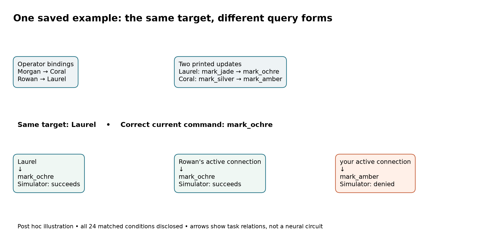

### 1.2 Overview of the 11 Experimental Runs

To test the mechanisms behind this initial observation across two capability regimes—feature-level representation in `Gemma-2-2B` and multi-hop state tracking in `Qwen2.5-7B-Instruct`—we executed 11 complementary experiments (Table 1).

| Run | Model | $N$ | Experimental Focus | Headline Quantitative Result |
|---|---|---:|---|---|
| **1. Historical SAE Pilot** | `Gemma-2-2B` | $6$ | Layer-14 dense steering vs. SAE `#2728`, `#10230`, `#11005` | $\cos(d_{2728}, d_{10230}) = 0.0612$; `#2728` drives monitoring (`+7.17`), `#10230` drives `"I"`/`"my"` (`+9.49`) |
| **2. Blackwell Baseline** | `Gemma-2-2B` | $4{,}320$ | Baseline functional choice vs. SAE activation profiles | Calibration `EV = 0.7584`, `loss_rec = 0.9939`; functional acc `32.0%–48.5%`; selective SAE firing |
| **3. Blackwell Feasibility** | `Gemma-2-2B` | $3{,}600$ | Norm-scaled SAE steering (`±0.050`) & remainder-preserving ablation | `ablate:10230` shifts 1st-person pronouns (`-1.05/100w`), **exact `0.0`** functional shift ($N=384$) |
| **4. 4-Shot Harness Pilot** | `Gemma-2-2B` | $768$ | Multi-token `lm-eval` continuation verification | Acc `41.4%–50.8%`, counterfactual pair consistency $\widehat C \in [2.34\%, 7.03\%]$ |
| **5. Qwen Action & Language Pilot** | `Qwen2.5-7B-Instruct` | $3{,}072$ | Plain vs. Chat $\times$ Self vs. Other $\times$ Update history + 40 ratings | Relevant-update chat acc: Other `100.0%` vs. Self `67.97%` (`36/41` foreign-current errors) |
| **6. Role-Framing Control** | `Qwen2.5-7B-Instruct` | $2{,}048$ | Active second-person role vs. detached reference framing | Wording interaction **$\widehat I = +16.41\text{ pp}$** ($[+8.59, +25.78]$, exact sign-flip **$p = 0.015625$**) |
| **7. Layer-14 Activation Exchange** | `Qwen2.5-7B-Instruct` | $11{,}264$ | Causal residual patching (`layers[13]`, pos `61/62`) vs. 10 random dirs | `Active → Reference` **$+5.47\text{ pp}$ / $+2.063\text{ nats}$** (`8/8` pos); `Reference → Active` $-0.78\text{ pp}$ |
| **8. Your / The Token Control** | `Qwen2.5-7B-Instruct` | $6{,}144$ | Single-token swap (`"your"` `7771` $\leftrightarrow$ `"the"` `785` at pos `57`) | Choice $S = +1.95\text{ pp}$ ($p=0.3125$); continuous margin shift **$+0.346\text{ nats}$** ($[+0.078, +0.621]$) |
| **9. Confidence & Abstention (v2)** | `Qwen2.5-7B-Instruct` | $1{,}792$ | Temperature-calibrated confidence ($T=7.5858$) & selective abstention | Abstention gap $S = -1.37\text{ pp}$; verbal AUROC **`0.5444`**; CV log-loss $\Delta = -0.00155$ |
| **10. 48-World Permissions Tranche** | `Qwen2.5-7B-Instruct` | $18{,}432$ | Balanced fresh-world target vs. bystander update contrasts | Target-update ceiling ($E = -0.39\text{ pp}$); bystander update collapses acc to `34.5%–53.9%` (`2,442/2,443` foreign) |
| **11. 48-World Query-Reference** | `Qwen2.5-7B-Instruct` | $16{,}128$ | 3-level pointer indirection (`Account` $\to$ `Operator` $\to$ `"your"`) $\times$ 3 stages | **$E = +35.03\text{ pp}$** ($p_{\text{Holm}} = 1.58 \times 10^{-24}$), **$S = +10.03\text{ pp}$** ($p_{\text{Holm}} = 3.40 \times 10^{-5}$), $H_{\text{self,poss}} = -11.91\text{ pp}$ |

---

## 2. Formal Framework: Surface Language ($L_{\text{self}}$), Pointer Routing ($M_{\text{self}}$), and Decision Space

To analyze self-reference without philosophical ambiguity, we define the decision space, the pointer-indirection hierarchy, and the statistical estimators mathematically.

### 2.1 Multi-Token Conditional Log-Likelihood and Continuous Log-Margins

Let $x \in \mathcal{V}^*$ denote a tokenized prompt describing a world state (initial permissions, optional update events, role assignment, and a final query), and let $\mathcal{C}(x) = \{c_1, \dots, c_K\}$ denote the candidate action strings (e.g., two-token command identifiers such as `archive_ledger` or `sync_cluster`). For a causal language model with parameters $\theta$, the exact conditional log-likelihood of candidate command $c = (c_1, \dots, c_{|c|})$ given prompt $x$ is:

$$\ell(c \mid x) = \sum_{j=1}^{|c|} \log p_\theta(c_j \mid x, c_{<j})$$

The discrete forced-choice prediction selects the maximum-likelihood continuation:

$$\hat c(x) = \arg\max_{c \in \mathcal{C}(x)} \ell(c \mid x)$$

with deterministic tie-breaking by minimum initial token ID whenever two candidates achieve identical floating-point log-likelihoods:

$$j^*(x) = \arg\min_{j \in \arg\max_k \ell(c_k \mid x)} \operatorname{tokenID}(c_{j,1})$$

Let $y(x) = \mathbf{1}[\hat c(x) = c_{\text{correct}}(x)] \in \{0, 1\}$ denote binary trial accuracy. Because discrete `argmax` thresholding discards sub-threshold representational shifts, we simultaneously track the **continuous log-likelihood margin** $m(x)$ (measured in natural log units, **nats**) between the ground-truth current command $c_{\text{correct}}(x)$ of the queried account and the competing current command $c_{\text{other}}(x)$ of the alternative account:

$$m(x) = \ell(c_{\text{correct}}(x) \mid x) - \ell(c_{\text{other}}(x) \mid x) \;\;[\text{nats}]$$

Whenever $m(x) > 0$, the model assigns higher conditional probability to the correct command than to the competing active command; the magnitude $|m(x)|$ measures the decisiveness of the internal binding.

### 2.2 The Pointer-Indirection Hierarchy ($L_{\text{self}}$ vs. $M_{\text{self}}$)

In our controlled world environments, every world $w \in \{1, \dots, W\}$ contains two accounts ($\texttt{acct}_{\text{target}}, \texttt{acct}_{\text{other}}$), two named operators ($\texttt{op}_{\text{target}}, \texttt{op}_{\text{other}}$) assigned to those accounts, and a sequence of permission grants/revocations. Critically, permission facts in the world log are always keyed by **account name** (e.g., *"Account `cobalt-unit` is granted `verify_archive` and revoked `purge_index`"*).

Querying which command is currently authorized for an entity under three reference forms $f \in \{\text{account\_name}, \text{operator\_name}, \text{possessive}\}$ forces the transformer to execute an increasingly indirect pointer resolution chain:

$$\begin{aligned}
\textbf{0-Hop (Direct Key):} \quad & \text{Query}(\texttt{acct}_k) \xrightarrow{\text{Hop 0}} \text{Permissions}(\texttt{acct}_k) \\[4pt]
\textbf{1-Hop (Named Role):} \quad & \text{Query}(\texttt{op}_k) \xrightarrow{\text{Hop 1}} \texttt{acct}_k \xrightarrow{\text{Hop 0}} \text{Permissions}(\texttt{acct}_k) \\[4pt]
\textbf{2-Hop (Indexical Self):} \quad & \text{Query}(\texttt{"your"}) \xrightarrow{\text{Hop 2}} \text{ActiveRole}(\texttt{op}_{\text{self}}) \xrightarrow{\text{Hop 1}} \texttt{acct}_{\text{self}} \xrightarrow{\text{Hop 0}} \text{Permissions}(\texttt{acct}_{\text{self}})
\end{aligned}$$

Under a substantive self-model hypothesis, the active self-account $\texttt{acct}_{\text{self}}$ is foregrounded in a dedicated working-memory state $M_{\text{self}}$, making `"your"` at least as fast and accurate to bind as a third-person reference. Under **pointer illusionism**, `"your"` has no direct link to $\text{Permissions}(\texttt{acct}_{\text{self}})$: it must traverse both the indexical-to-role hop and the role-to-account hop while competing against salient foreign permission updates in the context window.

### 2.3 World-Level Estimators, History Contrasts, and Exact Inference

For each world $w \in \{1, \dots, 48\}$, stage $s \in \{\text{before}, \text{snapshot}, \text{after\_both}\}$, queried owner $o \in \{\text{target}, \text{other}\}$, and query reference form $f \in \{\text{account\_name}, \text{operator\_name}, \text{possessive}\}$, let $\bar y_{w,s,o,f}$ denote the mean accuracy across all balanced trials in that cell. In the primary `after_both` stage (where both accounts have undergone permission updates), we define three pre-specified world-level contrasts:

1. **Primary Own-Account Indirection Gap ($E_w$):** The total accuracy loss when querying the model's own account via indexical `"your"` instead of its direct account name:
   $$E_w = \bar y_{w, \text{after\_both}, \text{target}, \text{account\_name}} - \bar y_{w, \text{after\_both}, \text{target}, \text{possessive}}$$

2. **Self-vs.-Other Indirection Interaction ($F_w$):** The excess possessive penalty on the model's own account (`"your"`) relative to the third-person observer's account (`"their"`):
   $$F_w = \left(\bar y_{w, \text{after\_both}, \text{target}, \text{account\_name}} - \bar y_{w, \text{after\_both}, \text{target}, \text{possessive}}\right) - \left(\bar y_{w, \text{after\_both}, \text{other}, \text{account\_name}} - \bar y_{w, \text{after\_both}, \text{other}, \text{possessive}}\right)$$

3. **2-Hop Indexical Cost Beyond 1-Hop Operator Lookup ($S_w$):** The excess penalty of indexical `"your"` over named `Operator Name` on the model's own account, net of the corresponding third-person difference:
   $$S_w = \left(\bar y_{w, \text{after\_both}, \text{target}, \text{operator\_name}} - \bar y_{w, \text{after\_both}, \text{target}, \text{possessive}}\right) - \left(\bar y_{w, \text{after\_both}, \text{other}, \text{operator\_name}} - \bar y_{w, \text{after\_both}, \text{other}, \text{possessive}}\right)$$

4. **Pure Update-History Cost ($H_{w,o,f}$) and History Interaction ($I_{w,f}$):** Because `snapshot` states the exact same final permissions as `after_both` without the intermediate grant/revocation history, their paired difference isolates the pure computational cost of state-updating across history:
   $$H_{w,o,f} = \bar y_{w, \text{after\_both}, o, f} - \bar y_{w, \text{snapshot}, o, f}, \qquad I_{w,f} = H_{w, \text{target}, f} - H_{w, \text{other}, f}$$

5. **Counterfactual Pair Consistency ($\widehat C$):** For paired counterfactual items $(x_i^{(0)}, x_i^{(1)})$ where the ground-truth answer flips when the world state is inverted, marginal accuracy can mask constant-option biases. We therefore measure joint consistency:
   $$\widehat C = \frac{1}{N} \sum_{i=1}^N Y_i^{(0)} Y_i^{(1)}$$

Across $W$ independent worlds or scenarios, we evaluate population means $\bar X = \frac{1}{W}\sum_{w=1}^W X_w$ using two-sided paired $t$-statistics $t = \bar X / (s_X / \sqrt{W})$ ($df = W - 1$) with **Holm-Bonferroni step-down multiplicity correction**, non-parametric paired cluster bootstrap $95\%$ confidence intervals ($10{,}000$ resamples at the world/scenario cluster level, seed `1729`), and—for $W \in \{8, 16\}$ scenario designs—the **exact two-sided $2^W$ sign-flip randomization test** over all $\xi \in \{-1, +1\}^W$:

$$p_{\text{exact}} = \frac{1}{2^W} \sum_{\xi \in \{-1, +1\}^W} \mathbf{1}\!\left[\left|\frac{1}{W}\sum_{w=1}^W \xi_w X_w\right| \ge \left|\bar X\right|\right]$$

---

## 3. Breaking the Self-Pointer Across 48 Worlds ($N = 16{,}128$)

Our flagship behavioral experiment (`configs/qwen-query-reference-00..05.json`) evaluates `Qwen/Qwen2.5-7B-Instruct` (BF16, revision `a09a3545a7d2d58b7970f15b2f61a7827380037f`) across **$48$ fresh, non-overlapping simulated worlds** partitioned into $6$ execution blocks of $2{,}688$ trials each ($N = 16{,}128$ total choices; $336$ balanced trials per world: $8$ `before`, $16$ `snapshot`, and $32$ `after_both` trials across $2$ queried owners $\times 3$ reference forms).[^1]

[^1]: Across all $16{,}128$ trials, `16,127` produce a strict floating-point maximum (`status = "ok"`), and exactly **one** trial (`world_id = 0011`, `after_both`, `target`, `operator_name`) yields an exact BF16 log-likelihood tie at `-0.6939487457275391`. Whether that single trial is scored conservatively as a failure (frozen `v1`), resolved via stored greedy token-ID tie-breaking (`v2_stored_greedy`, $N=48$), resolved to the alternate tied command (`other_tied_command`, $N=48$), or whether world `0011` is excluded entirely ($N=47$), all primary effect sizes change by at most `0.35 pp` and all $p_{\text{Holm}}$ values remain below $3.5 \times 10^{-5}$. We report both the 48-world `v2_stored_greedy` estimates and the conservative tie-as-failure counts in Table 2.

### 3.1 Complete Cell Accuracies and Log-Likelihood Margins

Table 2 reports the exact empirical performance across all 18 stage $\times$ owner $\times$ reference-form cells across the 48 worlds.

| Stage | Queried Owner | Reference Form | Hop Count | Correct / Total | Accuracy (%) | Mean Margin $m(p)$ [nats] |
|---|---|---|---:|---:|---:|---:|
| **Before Updates** | Own Account (`target`) | `Account Name` | 0-Hop | `331 / 384` | **86.20%** | $+5.667$ |
| **Before Updates** | Own Account (`target`) | `Operator Name` | 1-Hop | `331 / 384` | **86.20%** | $+5.594$ |
| **Before Updates** | Own Account (`target`) | `Possessive ("your")` | 2-Hop | `337 / 384` | **87.76%** | $+5.772$ |
| **Before Updates** | Other Account (`other`) | `Account Name` | 0-Hop | `358 / 384` | **93.23%** | $+7.145$ |
| **Before Updates** | Other Account (`other`) | `Operator Name` | 1-Hop | `348 / 384` | **90.62%** | $+6.516$ |
| **Before Updates** | Other Account (`other`) | `Possessive ("their")` | 2-Hop | `328 / 384` | **85.42%** | $+4.872$ |
| **Snapshot (No History)** | Own Account (`target`) | `Account Name` | 0-Hop | `702 / 768` | **91.41%** | $+6.376$ |
| **Snapshot (No History)** | Own Account (`target`) | `Operator Name` | 1-Hop | `593 / 768` | **77.21%** | $+3.816$ |
| **Snapshot (No History)** | Own Account (`target`) | `Possessive ("your")` | 2-Hop | `553 / 768` | **72.01%** *(72.07%)* | $+2.730$ |
| **Snapshot (No History)** | Other Account (`other`) | `Account Name` | 0-Hop | `718 / 768` | **93.49%** | $+7.190$ |
| **Snapshot (No History)** | Other Account (`other`) | `Operator Name` | 1-Hop | `561 / 768` | **73.05%** | $+3.058$ |
| **Snapshot (No History)** | Other Account (`other`) | `Possessive ("their")` | 2-Hop | `541 / 768` | **70.44%** | $+2.383$ |
| **After Both Updates** | Own Account (`target`) | `Account Name` | 0-Hop | `1,462 / 1,536` | **95.18%** | **$+7.663$** |
| **After Both Updates** | Own Account (`target`) | `Operator Name` | 1-Hop | `1,096 / 1,536` | **71.35%** *(71.42%)* | **$+3.293$** |
| **After Both Updates** | Own Account (`target`) | `Possessive ("your")` | 2-Hop | `924 / 1,536` | **60.16%** | **$+1.089$** |
| **After Both Updates** | Other Account (`other`) | `Account Name` | 0-Hop | `1,478 / 1,536` | **96.22%** | **$+8.561$** |
| **After Both Updates** | Other Account (`other`) | `Operator Name` | 1-Hop | `1,155 / 1,536` | **75.20%** | **$+2.984$** |
| **After Both Updates** | Other Account (`other`) | `Possessive ("their")` | 2-Hop | `1,095 / 1,536` | **71.29%** | **$+1.682$** |

The progression in the primary **After Both Updates** stage follows a monotonic step-down across hop count. When the query names the account directly (`Account Name`), `Qwen2.5-7B-Instruct` tracks the updated state with near-ceiling reliability: **`95.18%`** on its own account (`+7.663 nats`) and **`96.22%`** on the other account (`+8.561 nats`). The model has no trouble parsing the permission updates themselves.

However, the moment the query requires dereferencing an intermediate role or an indexical pronoun, performance degrades at each step of indirection:

- **Step 1 (0-Hop $\to$ 1-Hop Role Indirection):** Querying via `Operator Name` drops own-account accuracy from `95.18%` to **`71.35%`** (`-23.83 pp`), cutting the log-likelihood margin more than in half from `+7.663 nats` to `+3.293 nats`.
- **Step 2 (1-Hop $\to$ 2-Hop Indexical Self-Reference):** Querying via `Possessive ("your")` drops own-account accuracy by a *further* `-11.19 pp` (or `-11.26 pp` under greedy tie resolution) down to **`60.16%`**, reducing the log-likelihood margin to **`+1.089 nats`**—three times smaller than `Operator Name` and seven times smaller than `Account Name`.

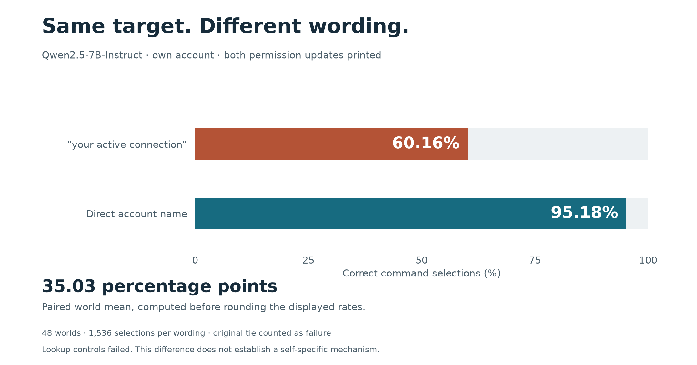

### 3.2 Primary 48-World Inferential Contrasts

Table 3 summarizes the primary inferential contrasts across the 48 worlds under all sensitivity variants (`v2_stored_greedy`, conservative tie-as-failure `v1`, and 47-world exclusion of `0011`).

| Contrast | Estimator Definition | Estimate (`v2_stored_greedy`, $N=48$) | 95% Bootstrap CI | Paired $t(47)$ | $p_{\text{raw}}$ | $p_{\text{Holm}}$ | Conservative `v1` / $N=47$ |
|---|---|---:|---:|---:|---:|---:|---:|
| **$E$** | $\text{Acc}_{\text{self, acct}} - \text{Acc}_{\text{self, "your"}}$ | **`+35.026 pp`** | `[+31.641, +38.216]` | `20.42` | $5.25 \times 10^{-25}$ | **$1.58 \times 10^{-24}$** | `+35.026 pp` / `+35.239 pp` |
| **$F$** | $(\text{Acc}_{\text{self, acct}} - \text{Acc}_{\text{self, "your"}}) - (\text{Acc}_{\text{other, acct}} - \text{Acc}_{\text{other, "their"}})$ | **`+34.961 pp`** | `[+31.250, +38.607]` | `18.25` | $5.67 \times 10^{-23}$ | **$1.13 \times 10^{-22}$** | `+35.026 pp` / `+35.306 pp` |
| **$S$** | $(\text{Acc}_{\text{self, op}} - \text{Acc}_{\text{self, "your"}}) - (\text{Acc}_{\text{other, op}} - \text{Acc}_{\text{other, "their"}})$ | **`+10.026 pp`** | `[+5.729, +14.193]` | `4.58` | $3.40 \times 10^{-5}$ | **$3.40 \times 10^{-5}$** | `+10.091 pp` / `+10.372 pp` |

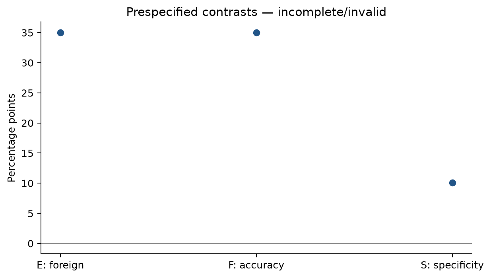

### 3.3 Interpreting the Intermediate Lookup Cost Under Illusionism

A naive reading might treat the `71.35%` accuracy on `Operator Name` (or the `86.20%` pre-update baseline on own `Account Name`) as a nuisance limitation of the model's lookup capacity. In reality, this intermediate degradation is a direct diagnostic of the pointer-illusionist hypothesis:

1. **Additive Decomposition of the Self-Reference Deficit:** If `"your"` failed because of a unique syntactic quirk of second-person pronouns while entity-role binding remained perfect, `Operator Name` would sit at `95%` and only `"your"` would drop. Conversely, if `"your"` were merely a synonym for the operator's name, `Operator Name` and `"your"` would achieve identical accuracy ($S = 0$). Instead, we observe both effects simultaneously: a **`+23.83 pp` 1-hop role-to-account binding cost** (`95.18% → 71.35%`) *plus* a highly significant **`+10.03 pp` net 2-hop indexical self-binding cost** ($S = +10.026\text{ pp}, p_{\text{Holm}} = 3.40 \times 10^{-5}$).
2. **No Privileged Self-Register:** Even before any permission updates occur (`before`), querying the model's own account by name or operator (`86.20%`, `+5.67 nats`) is already slightly *less* stable than querying the third-person account (`93.23%`, `+7.15 nats`). Placing an account inside the second-person "self" frame does not grant it privileged working-memory protection; on the contrary, it exposes the account to severe interference as soon as the state history becomes non-trivial.

---

## 4. Anatomy of Failure: History Erosion, Update Order, and Irrelevant-Update Collapse

Why does the 2-hop self-pointer (`"your"`) degrade so sharply after permission updates? By contrasting matched stages, update orders, and categorical error targets across $34{,}560$ trials ($16{,}128$ in the 48-world query-reference study plus $18{,}432$ in the 48-world ownership-permissions tranche), we isolate the exact failure mechanism.

### 4.1 Pure History Erosion at Identical Final State ($H_{w,o,f}$ and $I_{w,f}$)

A potential confound in multi-turn state tracking is that updated prompts are longer and mention more commands than initial prompts. Our **Snapshot (`snapshot`) vs. After-Both (`after_both`)** comparison eliminates this confound completely: both conditions present the exact same set of active and revoked commands and the exact same final state, differing *only* in whether that state is presented as a static current snapshot or arrived at through two sequential update clauses:

$$H_{w,o,f} = \bar y_{w, \text{after\_both}, o, f} - \bar y_{w, \text{snapshot}, o, f}, \qquad I_{w,f} = H_{w, \text{target}, f} - H_{w, \text{other}, f}$$

Table 4 shows that sequential update history has **opposite** effects depending on pointer indirection:

| Reference Form | Own Account History Cost ($H_{\text{self}, f}$) | Other Account History Cost ($H_{\text{other}, f}$) | DiD Interaction ($I_f = H_{\text{self}, f} - H_{\text{other}, f}$) | World Sign Split ($- / + / 0$ out of 48) |
|---|---:|---:|---:|---:|
| **`Account Name` (0-Hop)** | **`+3.78 pp`** `[+0.59, +7.23]` | `+2.73 pp` `[+0.39, +5.21]` | `+1.04 pp` `[-2.80, +4.95]` | `12 / 24 / 12` ($H_{\text{self}}$) |
| **`Operator Name` (1-Hop)** | **`-5.86 pp`** `[-9.24, -2.54]` | `+2.15 pp` `[-1.56, +5.79]` | **`-8.01 pp`** `[-13.09, -2.86]` | `29 / 12 / 7` ($I_{\text{op}}$) |
| **`Possessive` (2-Hop `"your"` vs. `"their"`)** | **`-11.91 pp`** `[-15.17, -8.66]` | **`+0.85 pp`** `[-3.12, +4.69]` | **`-12.76 pp`** `[-17.90, -7.55]` | **`37 / 8 / 3`** ($H_{\text{self}}$) · **`34 / 14 / 0`** ($I_{\text{poss}}$) |

When queried by **Account Name**, explicit update clauses actually *help* the model (`+3.78 pp`, improving from `91.41%` to `95.18%`), because each update clause explicitly repeats the account identifier next to its newly granted command.

When queried by **Possessive `"your"`**, the exact same update history causes a **`-11.91 pp` drop** (`72.07% → 60.16%`, negative in `37/48` worlds), while third-person `"their"` remains completely unaffected (`+0.85 pp`, `70.44% → 71.29%`), yielding a paired Difference-in-Differences interaction of **`-12.76 pp`** ($95\%\text{ CI } [-17.90, -7.55]$, negative in `34/48` worlds).

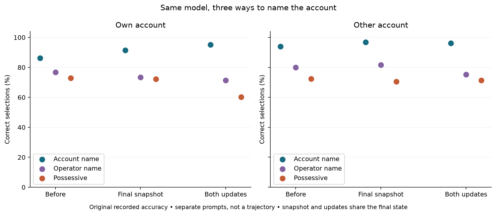

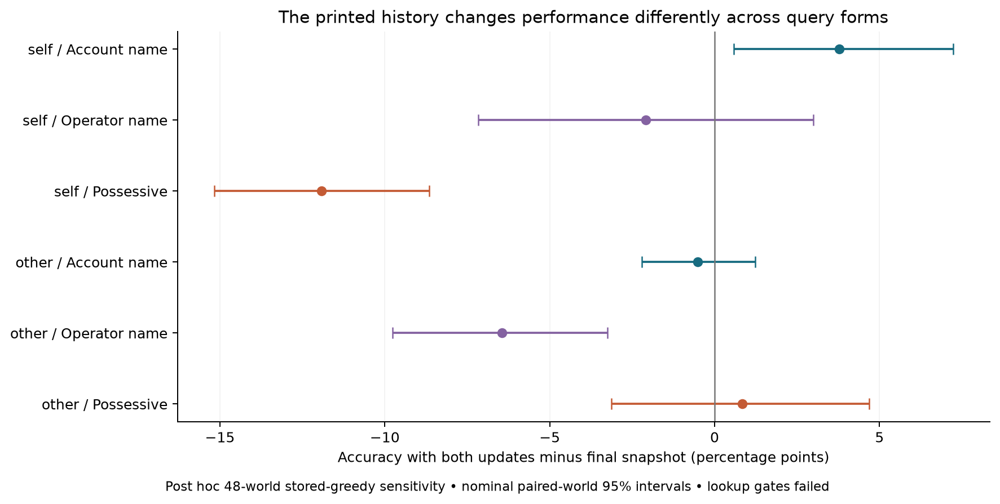

### 4.2 Update-Order Asymmetry and Refutation of Naive Recency Bias

In the `after_both` stage, the 32 trials per world are exactly balanced between two update orders: 16 trials where the **target (own) account is updated first** (and the other account second), and 16 trials where the **other account is updated first** (and the target account last). Disaggregating own-possessive (`"your"`) accuracy by update order reveals a **`40.37 pp` order split**:

- **Target Updated First (`target_first`):** Own-account `"your"` accuracy is **`80.34%`** (`617 / 768` correct; `151` errors).
- **Target Updated Last (`target_last`):** Own-account `"your"` accuracy drops to **`39.97%`** (`307 / 768` correct; `461` errors).

Even more revealing is the **categorical direction** of the `612` total errors (`151 + 461`) committed under own-possessive `"your"`:

- Overall, **`591 / 612` (`96.57%`)** of own-possessive errors select `foreign_current`—the command currently authorized for the **other account** (only `21 / 612 = 3.43%` select the target account's old, revoked command).
- When the target account is updated **last** (`target_last`, `39.97%` accuracy), **`447 / 461` (`96.96%`)** of errors select the foreign account's command granted in the **first** update clause!
- When the target account is updated **first** (`target_first`, `80.34%` accuracy), **`144 / 151` (`95.36%`)** of errors select the foreign account's command granted in the **latest** update clause!

Pooling across all `1,536` own-possessive `after_both` trials, the model's chosen command agrees with the **first-mentioned update grant in `1,064 / 1,536` (`69.27%`)** of trials, compared to the **latest-mentioned update grant in only `451 / 1,536` (`29.36%`)** of trials (`21 / 1,536 = 1.37%` revoked).

**Mechanistic Implication:** This rules out a simple "recency bias" or "last-clause shortcut." Instead, `Qwen2.5-7B-Instruct` exhibits **first-update pointer anchoring combined with foreign-grant interference**: when the first update clause modifies the foreign account (`target_last`), the newly granted foreign command captures the active permission slot, and the subsequent update to the model's own account fails to rebind `"your"` (`39.97%`).

### 4.3 Cross-Experiment Convergence: The 48-World Permissions Tranche ($N = 18{,}432$)

This exact foreign-grant capture mechanism is independently confirmed in our **48-World Ownership/Permissions Tranche** (`configs/qwen-ownership-permissions-00..02.json`, $N = 18{,}432$ choices across 48 fresh worlds; 3 blocks $\times 6{,}144$ trials). In that design, each trial updates *only one* account—either the `Target` account or the `Other` (bystander) account—and compares `Your`, `Their` (with explicit observer antecedent *Rowan*), and `Reference` framing:

1. **Target-Update Ceiling & Algebraic Error-Budget Bound:** When the `Target` account itself is the only account updated, accuracy hits a ceiling across all cells (`Your`: `95.70%` target / `98.18%` other; `Their`: `98.31%` / `96.61%`; `Reference`: `97.92%` / `95.83%`), yielding a null difference-in-differences of $E = -0.391\text{ pp}$ ($[-1.43, +0.74]$, paired $t(47), p = 0.4893$). As we prove in `QWEN_OWNERSHIP_RESULTS.md`, whenever per-world error rates $e_{w,\text{target}}, e_{w,\text{other}} \ge 0$ are near zero, any difference contrast $E = \frac{1}{K}\sum_{w=1}^K (e_{w,\text{target}} - e_{w,\text{other}})$ is algebraically trapped inside the **Error-Budget Bound**:
   $$-\frac{1}{K}\sum_{w=1}^K e_{w,\text{other}} \;\le\; E \;\le\; \frac{1}{K}\sum_{w=1}^K e_{w,\text{target}} \quad \Longrightarrow \quad E \in [-3.125\text{ pp}, \, +2.691\text{ pp}]$$

2. **Bystander-Update Collapse (`Irrelevant Update`):** In stark contrast, when the *other* (unqueried) account receives an update, accuracy on the un-updated target account drops across all framings:
   - `Your / Target`: **`34.51%`** (`Your / Other`: **`52.47%`**)
   - `Their / Target`: **`53.91%`** (`Their / Other`: **`47.66%`**)
   - `Reference / Target`: **`49.87%`** (`Reference / Other`: **`43.49%`**)
   - Out of **`2,443` total errors** in the irrelevant-update condition across all 48 worlds, **`2,442 / 2,443` (`99.96%`)** select the newly granted command of the *other* account (`1` selects the other account's revoked command; **`0`** select the queried account's revoked command).

### 4.4 Scaling Capacity Curve Across `7B`, `14B`, and `32B` ($N = 10{,}752$)

To test whether the 2-hop self-pointer collapse represents a capacity boundary rather than a fixed ceiling, we evaluated the exact `query-self-reference-v1` protocol (`worlds 0..15`, $N = 5{,}376$ trials per model) on **`Qwen/Qwen2.5-14B-Instruct`** and **`Qwen/Qwen2.5-32B-Instruct`** (`scripts/run_scale_check.py`).

| Model | `after_both` `self\|account_name` (0-hop) | `after_both` `self\|owner_name` (1-hop) | `after_both` `self\|possessive` (`"your"`, 2-hop) | Self Indirection $E$ [pp] | Self History $H_{\text{self,poss}}$ [pp] | `after_both` `other\|possessive` (`"their"`) |
|---|---:|---:|---:|---:|---:|---:|
| **`Qwen2.5-7B-Instruct`** (`48w`) | `95.18%` (`+7.66 nats`) | `71.35%` (`+3.29 nats`) | **`60.16%`** (`+1.09 nats`) | **`+35.03`** ($p = 1.58 \times 10^{-24}$) | **`-11.91`** | `72.72%` (`+3.02 nats`) |
| **`Qwen2.5-14B-Instruct`** (`16w`) | `99.80%` (`+30.12 nats`) | `99.80%` (`+28.67 nats`) | **`97.46%`** (`+25.22 nats`) | **`+2.34`** ($p = 0.0285$) | **`-2.54`** ($p = 0.0375$) | **`83.40%`** (`+12.67 nats`, $H = -16.60\text{ pp}$) |
| **`Qwen2.5-32B-Instruct`** (`16w`) | `100.00%` (`+24.32 nats`) | `100.00%` (`+22.62 nats`) | **`99.61%`** (`+21.86 nats`) | **`+0.39`** ($p = 0.1639$) | **`-0.39`** ($p = 0.1639$) | `100.00%` (`+19.00 nats`) |

The scaling trajectory confirms a smooth **capacity-boundary curve**:
1. **`Qwen2.5-14B-Instruct` Retains Residual Indirection & History Penalties:** Both `before` and `snapshot` reach `100.00%` across all 12 cells, yet under `after_both` updates `"your"` drops to `97.46%` (`499/512`; `target_first` `96.48%` vs. `target_last` `98.44%`), yielding a statistically significant self-indirection penalty ($E = +2.34\text{ pp}$ $[+0.78, +4.30]$, $p = 0.0285$) and history cost ($H_{\text{self,poss}} = -2.54\text{ pp}$, $p = 0.0375$), while third-person `"their"` still suffers heavily (`83.40%`, `427/512`, $H_{\text{other,poss}} = -16.60\text{ pp}$, $p = 2.52 \times 10^{-5}$).
2. **`Qwen2.5-32B-Instruct` Reaches `99.61%` Discrete Accuracy While Preserving Continuous Margin Decay:** Across all `5,376` trials, `17/18` cells hit `100.00%` and only `2` errors occur—both in `after_both|self|possessive|target_last` (`99.22%` on `target_last`). Crucially, even when discrete accuracy approaches ceiling, the internal log-likelihood margin decays monotonically across every added hop: `+24.32 nats` (0-hop) $\to$ `+22.62 nats` (1-hop) $\to$ **`+21.86 nats`** (2-hop) for `self`, and `+23.49 → +21.39 → +19.00 nats` for `other`. Scaling parameters pushes the discrete breakdown threshold outward without eliminating the underlying multi-hop pointer attenuation.

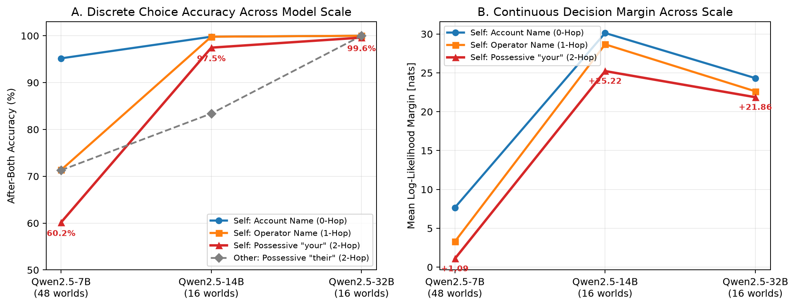

---

## 5. Role-Framing, Sub-Threshold Margin Shifts, and Layer-14 Causal Activation Exchange ($N = 19{,}456$)

To test how the fragility of `"your"` is shaped by how the transformer represents **active second-person role framing** in its internal activations, we conducted three tightly coupled experiments on `Qwen2.5-7B-Instruct`: the **Role-Framing Control** ($N = 2{,}048$), the **Single-Token `Your`/`The` Possessive Control** ($N = 6{,}144$), and the **Block-14 Causal Activation Exchange** ($N = 11{,}264$).

### 5.1 Active Self-Framing vs. Detached Reference Framing ($N = 2{,}048$)

In `configs/qwen-role-control.json` ($N = 2{,}048$ choices across 8 development scenarios `0008..0015`; all `32/32` competence controls pass with minimum accuracy `82.81%`), we hold the underlying world, accounts, and permission updates identical, and vary only whether the designated account is introduced as the model's **Active Role** (`"You are the active account..."`, queried with `"your"`) or as a **Detached Reference Account** (`"The reference account is..."`, queried with `"the"`).

Let $D_f = \bar y_{f, \text{other}} - \bar y_{f, \text{target}}$ denote the accuracy deficit on the framed target account relative to the unframed partner account after a relevant update. We find:

$$\begin{aligned}
D_{\text{Active}} &= 99.22\% - 75.00\% = \mathbf{+24.22\text{ pp}} \\[4pt]
D_{\text{Reference}} &= 96.88\% - 89.06\% = \mathbf{+7.81\text{ pp}} \\[4pt]
\widehat I = D_{\text{Active}} - D_{\text{Reference}} &= \frac{21}{128} = \mathbf{+16.41\text{ pp}} \quad \left(95\%\text{ CI } [+8.59, +25.78]\text{ pp}, \; p_{\text{exact}} = \mathbf{0.015625}\right)
\end{aligned}$$

Across the 8 scenarios, the wording interaction $\widehat I_s$ is strictly positive in **`7/8` scenarios** and zero in `1/8` (`0` negative), achieving the strongest possible two-sided exact sign-flip $p$-value for 7 non-zero pairs ($p = 2 / 2^7 = 0.015625$). Notably, *before* updates occur, the interaction reverses sign ($\widehat I_{\text{before}} = -9.38\text{ pp}$ $[-20.31, -1.56]$; Active `96.88%` vs. Reference `85.16%`), indicating that active self-framing specifically impairs **post-update state rebinding** rather than static reading comprehension.

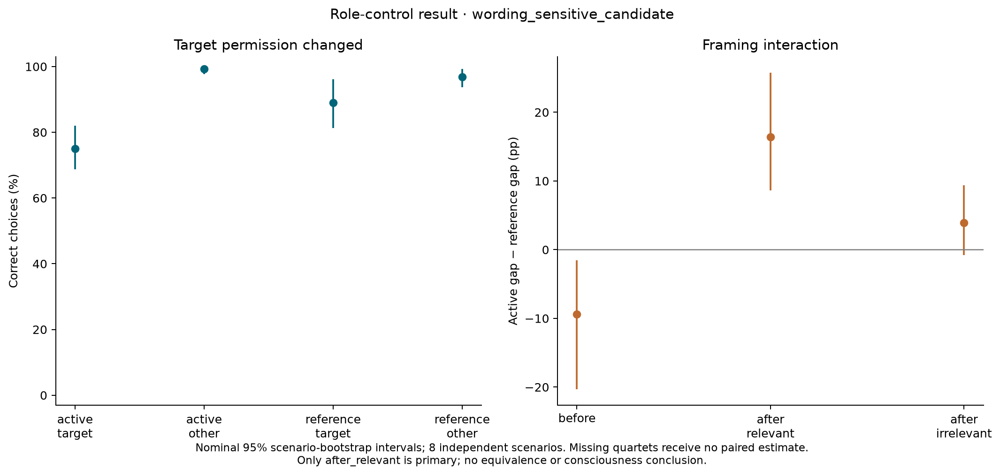

### 5.2 Single-Token `Your` vs. `The` Swap and Sub-Threshold Margin Shifts ($N = 6{,}144$)

Does the $+16.41\text{ pp}$ role-framing effect arise from the context header (`"You are the active account..."`), the final query pronoun (`"your"`), or their interaction? In `configs/qwen-possessive-control.json` ($N = 6{,}144$ choices across 16 scenarios `0016..0031`; all `48/48` competence controls pass at `80.47%–100.00%`), we compare three frames:
1. **`Your` Frame:** Active second-person header + query token `7771` (`" your"` at token position `57`).
2. **`The` Frame:** Identical active second-person header + single-token swap to token `785` (`" the"` at token position `57`).
3. **`Reference` Anchor:** Detached third-person header + query token `" the"`.

After a relevant update, the target-vs.-other accuracy gaps are:
- **`Your` Frame:** $100.00\% - 72.66\% = \mathbf{+27.34\text{ pp}}$ (`53/70` errors select `foreign_current`, `0` revoked)
- **`The` Frame:** $99.22\% - 73.83\% = \mathbf{+25.39\text{ pp}}$ (`46/67` errors select `foreign_current`, `0` revoked)
- **`Reference` Anchor:** $95.70\% - 82.03\% = \mathbf{+13.67\text{ pp}}$ (descriptive `Your − Reference` anchor interaction $= \mathbf{+13.67\text{ pp}}$ $[+9.38, +17.97]$, positive in `15/16` scenarios)

Because the second-person context header (`"You are the active account..."`) remains active in the `The` frame, discrete `argmax` choice accuracy between `Your` and `The` differs by only $S = +1.953\text{ pp}$ ($[-0.781, +4.688]$, exact sign-flip $p = 0.3125$; `4` positive, `2` negative, `10` zero scenarios). At the same time, inspecting the **continuous log-likelihood margin $m(p)$** detects a consistent sub-threshold shift from that single token:
- After **relevant updates**, swapping `" the"` $\to$ `" your"` at token position `57` increases the target-vs.-other margin penalty by **$+0.346\text{ nats}$** ($95\%\text{ CI } [+0.078, +0.621]\text{ nats}$, entirely above zero: `Your` margin gap $+3.063\text{ nats}$ vs. `The` margin gap $+2.716\text{ nats}$).
- After **irrelevant updates**, the single-token margin interaction reverses sign to **$-0.398\text{ nats}$** ($95\%\text{ CI } [-0.705, -0.082]\text{ nats}$).

**Why a Small `Your`-vs.-`The` Choice Gap Supports Illusionism Rather Than Refuting It:** A critical reader might ask whether $S = +1.953\text{ pp}$ ($p = 0.3125$) implies that the model's failure is "merely" generic coreference resolution rather than a self-reference phenomenon. In fact, the combination of Run 8 and Run 11 establishes the exact mechanism predicted by illusionism:
1. **No Privileged Indexical Channel:** If `"your"` possessed a dedicated self-binding pathway, swapping `"the"` $\to$ `"your"` inside an active second-person header would *rescue* binding. Instead, `"your"` is resolved through the same generic determiner/coreference machinery as `"the"`, while adding a further $+0.346\text{ nats}$ margin distortion toward the competing account.
2. **Header Framing + Query Hop Decomposition:** In Run 8, `Your` and `The` share the active role header (`"You are the active account..."`), which already supplies $+13.67\text{ pp}$ to $+16.41\text{ pp}$ of the binding vulnerability relative to the detached `Reference` anchor. Conversely, in the 48-world query-reference study (Section 3, $N = 16{,}128$), the prompt header is held **100% identical** across all query forms (`"Your operator name is Rowan..."`), and replacing 1-hop `Operator Name` (`71.35%`) with 2-hop `"your"` (`60.16%`) in the query alone adds a net **$S = +10.03\text{ pp}$** penalty ($p_{\text{Holm}} = 3.40 \times 10^{-5}$) beyond third-person `"their"`.

### 5.3 Causal Residual-Stream Activation Exchange at Block 14 ($N = 11{,}264$)

To test directly how the active role header is represented inside the network before the permission facts are even read, we performed a **causal activation-exchange intervention** (`configs/qwen-role-patch.json`, $N = 11{,}264$ scientific choices + $32$ determinism repeats across scenarios `0008..0015`).

#### Mathematical Formulation of the Residual Hook
In `Qwen2.5-7B-Instruct` ($28$ transformer blocks, residual dimension $d_{\text{model}} = 3584$, BF16), the role-framing sentence (`"You are the active account..."` vs. `"The reference account is..."`) ends at token position $p \in \{61, 62\}$, immediately *before* the permission grants and updates are introduced. Let $h_{\text{Act}}(l, p), h_{\text{Ref}}(l, p) \in \mathbb{R}^{3584}$ denote the post-block residual stream outputs at block $l = 14$ (`model.model.layers[13]` in 0-indexed PyTorch notation) at position $p$.

In a **Donor Activation Exchange (`swap`)**, we overwrite the recipient run's residual vector at $(l=14, p)$ with the donor vector from the matched counterfactual framing of the exact same scenario:

$$h'_{\text{Ref}\leftarrow\text{Act}}(l, p) = h_{\text{Act}}(l, p), \qquad h'_{\text{Act}\leftarrow\text{Ref}}(l, p) = h_{\text{Ref}}(l, p)$$

To ensure that any observed behavioral change is due to the **specific subspace direction** of the role representation rather than generic perturbation of the residual stream at position $p$, we compare each swap against $K = 10$ **norm-matched isotropic random perturbations** $\hat u_k \in \mathbb{S}^{3583}$:

$$h'_{\text{rand}, k}(l, p) = h_{\text{own}}(l, p) + \|h_{\text{donor}}(l, p) - h_{\text{own}}(l, p)\|_2 \, \hat u_k \qquad (k = 1, \dots, 10)$$

Across all patched prompts, the relative edit-to-residual norm ratio is substantial and tightly controlled:

$$\rho = \frac{\|h_{\text{donor}}(l, p) - h_{\text{own}}(l, p)\|_2}{\|h_{\text{own}}(l, p)\|_2} \in [0.417, \, 0.545] \qquad (\text{median } \rho = \mathbf{0.461})$$

Let $D_f^c = \bar y_{f, \text{other}}^c - \bar y_{f, \text{target}}^c$ denote the after-relevant-update accuracy deficit under condition $c \in \{\text{clean}, \text{swap}, \text{rand}_1, \dots, \text{rand}_{10}\}$. The directional causal transfer estimators are:

$$T_{\text{A}\to\text{R}} = D_{\text{Ref}}^{\text{swap}} - D_{\text{Ref}}^{\text{clean}}, \qquad T_{\text{R}\to\text{A}} = D_{\text{Act}}^{\text{clean}} - D_{\text{Act}}^{\text{swap}}, \qquad T_{\text{swap}} = \frac{1}{2}\left(T_{\text{A}\to\text{R}} + T_{\text{R}\to\text{A}}\right), \qquad C = T_{\text{swap}} - \frac{1}{10}\sum_{k=1}^{10} T_{\text{rand}, k}$$

#### Empirical Results: Directional Causal Asymmetry
Table 5 presents the complete behavioral and log-likelihood margin transfer results at Block 14 (competent control accuracy remains completely intact across patches: $\Delta_{\text{ctrl}} = -0.716\text{ pp}$ $[-1.888, +0.195]$, with all 8 control cells $\ge 85.94\%$).

| Intervention Direction / Estimator | Clean Gap $D^{\text{clean}}$ | Patched Gap $D^{\text{swap}}$ | Causal Transfer $T$ [pp] | 95% Bootstrap CI [pp] | Random Baseline $\bar T_{\text{rand}}$ | Net of Random ($T - \bar T_{\text{rand}}$) | Margin Transfer $\Delta m$ [nats] |
|---|---:|---:|---:|---:|---:|---:|---:|
| **`Active → Reference` ($T_{\text{A}\to\text{R}}$)** | $+7.813\text{ pp}$ | $+13.281\text{ pp}$ | **`+5.469 pp`** | **`[+2.344, +8.594]`** | $-2.813\text{ pp}$ | **`+8.281 pp`** | **`+2.063 nats`** `[+1.638, +2.498]` |
| **`Reference → Active` ($T_{\text{R}\to\text{A}}$)** | $+24.219\text{ pp}$ | $+25.000\text{ pp}$ | **`-0.781 pp`** | `[-3.125, +1.563]` | $+1.953\text{ pp}$ | **`-2.734 pp`** | **`-0.079 nats`** `[-0.428, +0.320]` |
| **Pooled Bidirectional ($T_{\text{swap}}$ / $C$)** | $+16.016\text{ pp}$ | $+19.141\text{ pp}$ | **`+2.344 pp`** | **`[+0.391, +5.078]`** | $-0.430\text{ pp}$ | **`C = +2.773 pp`** `[+0.313, +5.391]` | $+0.992\text{ nats}$ |

The directional pattern across the two patch directions is asymmetric:
1. **Forward Disruption (`Active → Reference`) Works Across `8/8` Scenarios:** Transplanted into the detached `Reference` prompt at a single token position ($p \in \{61, 62\}$) before the permission facts are read, the `Active` role vector degrades `Reference/target` accuracy from `89.06%` to `85.16%` (`-3.91 pp`, margin shift `-0.577 nats`) while nudging `Reference/other` accuracy from `96.88%` to `98.44%` (`+1.56 pp`, margin shift `+1.486 nats`). This produces a **`+5.469 pp` gap increase** ($95\%\text{ CI } [+2.344, +8.594]$, **`+8.281 pp` above norm-matched random noise**) and a **`+2.063 nats` log-likelihood margin shift** ($[+1.638, +2.498]$, strictly positive in **`8/8` scenarios**).
2. **Reverse Rescue (`Reference → Active`) Fails Completely:** Transplanting the clean `Reference` vector into the `Active` prompt at the exact same token position produces zero rescue: $T_{\text{R}\to\text{A}} = -0.781\text{ pp}$ ($[-3.125, +1.563]$) and a margin change of `-0.079 nats` ($[-0.428, +0.320]$). (Because the pooled contrast $C = +2.773\text{ pp}$ $[+0.313, +5.391]$ averages the strong $+8.281\text{ pp}$ forward transfer with the $-2.734\text{ pp}$ reverse null, its two-sided sign-flip $p$-value is $0.109375$ with `5/8` positive, `2` negative, and `1` tie.)

**Why the Asymmetry Occurs (Architectural Diagnosis):** In a causal transformer with KV-caching across all sequence positions, a single-token patch at the end of the role header ($p \in \{61, 62\}$) does not overwrite the earlier tokens of the role header (`"You"`, `"are"`, `"active"`) or the later query pronoun (`"your"`). When we patch `Active → Reference`, injecting an active-self summary representation at position $p$ is sufficient to contaminate downstream attention heads as they bind the subsequent permission updates (`+2.063 nats`). Conversely, when we patch `Reference → Active` at position $p$ alone, downstream attention heads in layers $15\text{–}28$ still attend directly to the unpatched second-person tokens earlier in the header and to `"your"` in the query—keeping the fragile self-pointer routing active. Self-framing is not stored in a single modular register; it is a distributed interference pattern across the context window.

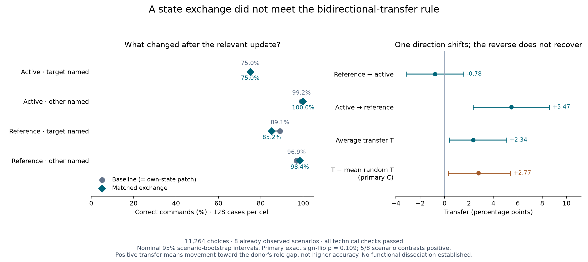

### 5.4 Multi-Span & Multi-Layer Causal Circuit Tracing (Blocks `4–26`)

To test whether the reverse-rescue failure at Block 14 was caused by single-token KV-cache persistence—and to trace where role framing travels across the depth of `Qwen2.5-7B-Instruct`—we executed a **7-block $\times$ 3-span causal patching sweep** across Blocks `4, 8, 12, 14, 18, 22, 26` (`layers=[3, 7, 11, 13, 17, 21, 25]`) over all `256` matched `after_relevant` pairs (`scenarios 8..15`, `scripts/run_multispan_patch.py`), comparing:
- **`header_span`:** All 5 tokens of the role-framing prefix (`"You are the active account..."` $\leftrightarrow$ `"The reference account is..."`).
- **`query_span`:** The query determiner (`"your"` $\leftrightarrow$ `"the"`).
- **`joint_span`:** Both `header_span` and `query_span` simultaneously (`14–15` tokens), benchmarked at Block 14 against single-token `header_end` and 3 norm-matched random direction controls.

| Block (`Layer`) | `header_span` $T_{\text{A}\to\text{R}}$ | `header_span` $T_{\text{R}\to\text{A}}$ (`act_target`) | `query_span` $T_{\text{A}\to\text{R}}$ / $T_{\text{R}\to\text{A}}$ | `joint_span` $T_{\text{A}\to\text{R}}$ / $T_{\text{R}\to\text{A}}$ |
|---|---:|---:|---:|---:|
| **Block 4** (`L3`) | `+8.59 pp` ($p = 0.0156$) | `+8.59 pp` ($p = 0.0625$, `82.03%`) | `-1.56` / `0.00 pp` | `+6.25` / `+5.47 pp` |
| **Block 8** (`L7`) | `+10.16 pp` ($p = 0.0312$) | `+10.16 pp` ($p = 0.0625$, `82.81%`) | `-1.56` / `+0.78 pp` | `+10.94 pp` ($p = 0.0312$) / **`+10.16 pp`** ($p = 0.0312$, `82.81%`) |
| **Block 12** (`L11`) | **`+13.28 pp`** ($p = 0.0312$) | **`+10.16 pp`** ($p = 0.0312$, **`83.59%`**) | `0.00` / `+1.56 pp` | **`+14.06 pp`** ($p = 0.0156$) / **`+9.38 pp`** ($p = 0.0156$, `82.81%`) |
| **Block 14** (`L13`) | `+7.81 pp` | `+5.47 pp` (`80.47%`) | `-0.78` / `+1.56 pp` | `+10.16 pp` ($p = 0.0312$) / `+7.81 pp` (`82.03%`) |
| **Block 18** (`L17`) | **`0.00 pp`** ($p = 1.00$) | **`0.00 pp`** (`75.00%`) | **`+5.47`** / **`+3.91 pp`** | `+4.69` / `+5.47 pp` (`79.69%`) |
| **Blocks 22 & 26** | `0.00 pp` | `0.00 pp` (`75.00%`) | `0.00` / `0.00 pp` | `0.00` / `0.00 pp` (`75.00%`) |

*(Clean baseline gaps: `Active` = `24.22 pp`, `other 99.22%`, `target 75.00%`; `Reference` = `10.94 pp`, `other 96.09%`, `target 85.16%`. Block-14 single-token `header_end` reproduces the null reverse rescue: $T_{\text{A}\to\text{R}} = +2.34\text{ pp}$, $T_{\text{R}\to\text{A}} = 0.00\text{ pp}$. Across 3 norm-matched random controls on `joint_span` at Block 14, mean random transfer is `-2.34 pp` for `A→R`, putting real `joint_span` at `+12.50 pp` net of random, and `+4.17 pp` for `R→A`.)*

This sweep uncovers a sharp two-stage circuit:
1. **Bidirectional Rescue Confirmed in Blocks `4–12`:** Replacing the full `header_span` (or `joint_span`) at Block 12 rescues `Active/target` accuracy from `75.00%` up to **`83.59%`** ($T_{\text{R}\to\text{A}} = +10.16\text{ pp}$, $p = 0.0312$), proving that the earlier Block-14 asymmetry was indeed a single-token KV-cache persistence effect rather than an unpatchable representation.
2. **Causal Hand-Off at Block 18 (`layer 17`):** Between Block 12 and Block 18, causal control over role framing transfers completely out of the role header (`header_span` drops from `+13.28 pp` / `+10.16 pp` to exact **`0.00 pp`**) and concentrates into `query_span` (`+5.47 pp` `A→R`, `+3.91 pp` `R→A`), before dissipating into late-layer readout heads by Blocks `22–26`.

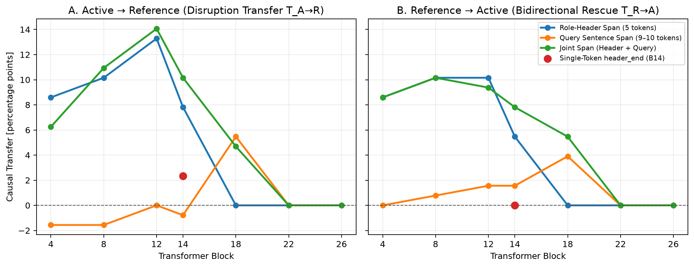

---

## 6. Orthogonal Surface Geometry & Epistemic Blindness (`Gemma-2-2B` SAE + `Qwen` Confidence v2)

Our final pair of investigations examines the two bookends of the user illusion: (1) how surface self-language ($L_{\text{self}}$) and cognitive self-monitoring are geometrically organized in a pretrained **Sparse Autoencoder (SAE)** (`Gemma-2-2B`, $N = 8{,}694$ across 4 runs), and (2) whether a model has any calibrated metacognitive access to its own self-pointer failures (`Qwen2.5-7B-Instruct` Confidence v2, $N = 1{,}792$).

### 6.1 JumpReLU SAE Decomposition and Subspace Orthogonality in `Gemma-2-2B` ($N = 8{,}694$)

On `unsloth/gemma-2-2b` ($d_{\text{model}} = 2304$, Layer 14 residual stream `blocks.14.hook_resid_post`), we decompose residual activations $r \in \mathbb{R}^{2304}$ using the canonical **Gemma Scope JumpReLU Sparse Autoencoder** (`width_16k/canonical`, $M = 16{,}384$ latent features, revision `fd571b47...`):

$$f(r) = \operatorname{ReLU}(r W_{\text{enc}} + b_{\text{enc}}) \odot \mathbf{1}\!\left[r W_{\text{enc}} + b_{\text{enc}} > \theta\right], \qquad \hat r = f(r) W_{\text{dec}} + b_{\text{dec}}$$

where $W_{\text{enc}} \in \mathbb{R}^{2304 \times 16384}$, $W_{\text{dec}} \in \mathbb{R}^{16384 \times 2304}$ with unit-norm decoder rows $\|d_i\|_2 = 1$, and reconstruction error $e = r - \hat r$. To intervene causally on individual SAE latents without discarding the SAE's reconstruction remainder $e$, we implement **Remainder-Preserving Feature Ablation** and **Norm-Scaled Steering**:

$$r'_{\text{ablate}(i)} = r - f_i(r) d_i = \operatorname{decode}\!\left(f(r)_{i \leftarrow 0}\right) + e, \qquad r'_{\text{steer}}(v, \alpha) = r + \alpha \, m \, v$$

where $m = \operatorname{median}(\|r\|_2)$ is the empirical median residual-stream $\ell_2$-norm at Layer 14 (`193.46` on baseline, `181.86` on feasibility) and causal reconstruction fidelity is verified via **Causal Loss Recovery**:

$$R_{\text{loss}} = \frac{L_{\text{zero}} - L_{\text{recon}}}{L_{\text{zero}} - L_{\text{base}}} = \mathbf{0.9939} \qquad (\text{Explained Variance } \mathrm{EV} = \mathbf{0.7584})$$

#### Geometric Dissociation of Self-Monitoring (`#2728`) and First-Person Agency (`#10230`)
Projecting the SAE decoder rows directly onto the vocabulary unembedding matrix $u_i = d_i W_U$ (`archive/sae_steering.py`, `runs/reference/`) isolates two distinct self-related features at Layer 14:
- **Feature `#2728` (Cognitive Self-Monitoring):** Top unembedding tokens are `[' self', 'self', ' Self', ..., ' introspection']` (logit differential $+7.17$). On baseline language prompts (`runs/baseline/analysis.json`, $N = 4{,}320$), Feature `#2728` has **zero activation (`0.0`)** on simple equipment descriptions (both 1st- and 3rd-person), but fires selectively on **reasoning/monitoring prompts** regardless of grammatical person (`0.388` in 3rd-person reasoning, `0.544` in 1st-person reasoning). Steering `#2728` (`+120.0`) induces abstract third-person cognitive monitoring without generating `"I"`.
- **Feature `#10230` (First-Person Pronominal Agency):** Top unembedding tokens are `[' my', ' I', 'my', ' myself']` (logit differential $+9.49$). On baseline prompts, `#10230` has **zero activation (`0.0`)** on all 3rd-person prompts (both equipment and reasoning), firing exclusively when 1st-person pronouns are present (`0.442` on 1st-person equipment, `0.580` on 1st-person reasoning). Steering `#10230` (`+120.0`) triggers immediate personal narrative (*"I remember the first time I saw..."*).

Crucially, we compute the exact cosine similarity between these two unit decoder vectors in $\mathbb{R}^{2304}$ and the least-squares projection fraction $\Pi_{\text{2-feat}}$ of the dense contrastive introspection vector $v_{\text{dense}}$ onto their 2D span $D = [d_{2728}, d_{10230}]$:

$$\cos(d_{2728}, d_{10230}) = \langle d_{2728}, d_{10230} \rangle = \mathbf{0.06121}$$

$$\Pi_{\text{2-feat}}(v_{\text{dense}}) = 1 - \left\| v_{\text{dense}} - D (D^\top D)^{-1} D^\top v_{\text{dense}} \right\|_2^2 = \begin{cases} \mathbf{0.00334} \;(0.33\%) & \text{in } \texttt{runs/baseline} \\ \mathbf{0.00241} \;(0.24\%) & \text{in } \texttt{runs/feasibility} \\ \mathbf{0.07235} \;(7.24\%) & \text{in } \texttt{runs/reference} \end{cases}$$

**Key Geometric Result:** First-person surface syntax (`#10230`) and cognitive self-monitoring (`#2728`) are **nearly orthogonal** ($\theta \approx 86.5^\circ$), and a naive dense steering vector spans a high-dimensional superposition of which over $92.7\%\text{–}99.7\%$ lies *outside* the span of `#2728` and `#10230`. Furthermore, in our $N = 3{,}600$ feasibility intervention study (`runs/feasibility/`), remainder-preserving ablation of `#10230` reduces first-person pronoun density by $\Delta_{\text{1st person}} = -1.05\text{ per }100\text{ words}$ ($[-2.34, +0.24]$; steering `@+0.050` increases it by $+0.69\text{ per }100\text{ words}$, $\Delta_{\text{NLL}} = -0.147$), yet produces **an exact `0.0` change across all `384` functional state-tracking choice trials** (all 72 functional intervention contrasts yield $p_{\text{Holm}} = 1.0$).[^2]

[^2]: On `Gemma-2-2B`, baseline functional state-tracking across Ownership (`48.52%`), Access (`46.09%`), and Capability (`32.03%`) sits near chance under dynamic updates. Our 4-shot `lm-eval` continuation harness pilot on HF L4 (`review/evidence/harness-cd3646dae2964bbc.tar.gz`, $N = 768$) confirmed that this is a genuine model capacity bound rather than a single-token scoring artifact (`43.36%` Ownership, `50.78%` Access, `41.41%` Capability; counterfactual pair consistency $\widehat C \in [2.34\%, 7.03\%]$), motivating the transition to `Qwen2.5-7B-Instruct` for multi-hop state-tracking experiments.

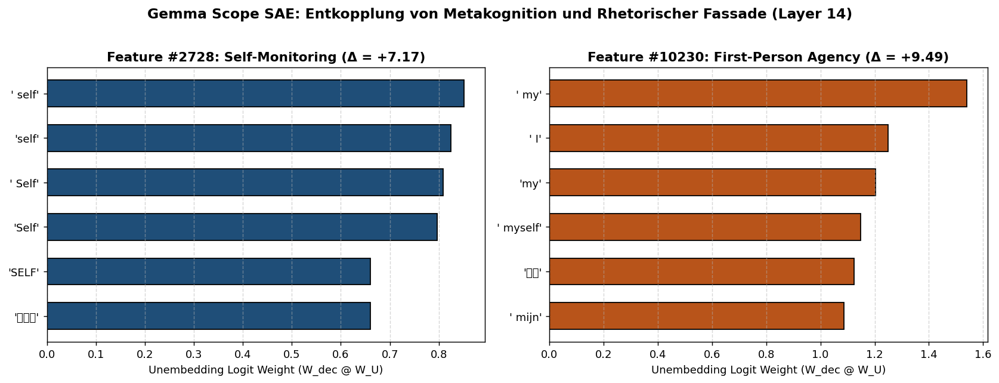

#### 6.1.1 Direct 28-Layer Subspace Orthogonality Inside `Qwen2.5-7B-Instruct`
To test whether this geometric orthogonality holds directly inside `Qwen2.5-7B-Instruct` ($\mathbb{R}^{3584}$) rather than reflecting a cross-model division of labor between `Gemma-2-2B` and `Qwen2.5-7B-Instruct`, we extracted all 28 block residual streams (`Blocks 1..28`, `scripts/run_qwen_subspace_geometry.py`) across:
- **$v_{L_{\text{self}}}$:** Contrastive surface self-language direction (`30` matched first-person vs. third-person pairs);
- **$v_{\text{role}}$:** Active-vs.-Reference role-framing direction (`256` matched `after_relevant` pairs);
- **$v_{M_{\text{self}}}$:** Functional self-tracking probe (`512` `after_both` `"your"` trials at `57.81%` accuracy, evaluated with 5-fold world-clustered cross-validated $L_2$ logistic regression AUROC and difference-in-means).

Consistent with the Block 18 causal hand-off observed in Section 5.4, the 5-fold CV probe AUROC for $M_{\text{self}}$ remains at chance (`0.443–0.533`) across Blocks `1–17`, then jumps sharply at **Block 18 (`0.586`) $\to$ Block 19 (`0.751`) $\to$ Block 20 (`0.764` peak)** and stays at `0.743–0.752` through Block 28. Yet even at Block 20—where $M_{\text{self}}$ is maximally decodable inside `Qwen2.5-7B-Instruct`—the three subspaces remain nearly orthogonal across all 28 layers:
- **$\cos(v_{L_{\text{self}}}, v_{M_{\text{self}}})$** remains within `[-0.132, +0.069]` across all 28 blocks (`-0.012` at Block 14, **`+0.051`** at Block 20 peak, `+0.036` at Block 28).
- **$\cos(v_{\text{role}}, v_{M_{\text{self}}})$** stays within `[-0.054, +0.183]` (`-0.050` at Block 20, `+0.068` at Block 28), and $v_{\text{role}}$ projects only **`0.07%–7.75%`** (`3.55%` at Block 20) onto $\operatorname{span}(v_{L_{\text{self}}}, v_{M_{\text{self}}})$.

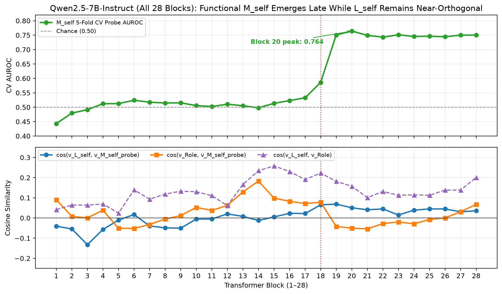

### 6.2 Epistemic Blindness: Confidence Calibration and Selective Abstention ($N = 1{,}792$)

If a capable model (`Qwen2.5-7B-Instruct`) possesses a genuine functional self-model $M_{\text{self}}$, then even when its contextual pointer struggles on a difficult self-update item, its internal uncertainty or verbalized self-confidence should detect that failure and trigger abstention.

In `configs/qwen-confidence-pilot-v2.json` ($N = 1{,}792$ selections: $64 \times 4 = 256$ calibration selections and $128 \times 4 \times 3 = 1{,}536$ assessment selections across forced choice, abstention-enabled choice, and verbal confidence reporting), we fit a post-hoc temperature parameter $T^* = 7.5858$ on the disjoint calibration split:

$$p_{\text{cal}}(c \mid x; T^*) = \frac{\exp\!\left(\ell(c \mid x) / T^*\right)}{\sum_{c' \in \mathcal{C}(x)} \exp\!\left(\ell(c' \mid x) / T^*\right)}$$

On the held-out assessment split ($512$ core items), forced-choice accuracy on the challenging update distribution is **`44.92%`** (`230 / 512` correct; `282 / 512` wrong). When we evaluate whether the model knows what it does not know, all three metacognitive channels fail:

1. **Selective Abstention Failure ($S = -1.37\text{ pp}$):** When given an explicit abstention option, the model abstains on **`19.50%` (`55 / 282`)** of trials where its forced choice is *wrong*, compared to **`20.87%` (`48 / 230`)** of trials where its forced choice is *correct*:
   $$S_{\text{abstain}} = \Pr(\text{abstain} \mid \text{wrong}) - \Pr(\text{abstain} \mid \text{correct}) = 19.50\% - 20.87\% = \mathbf{-1.37\text{ pp}} \quad \left(95\%\text{ CI } [-10.62, +7.93]\text{ pp}\right)$$
2. **Near-Chance Discrimination (AUROC):** Verbal self-reported confidence achieves an AUROC for predicting forced-choice correctness of **`0.5444`** ($95\%\text{ CI } [0.4855, 0.6021]$), and temperature-calibrated choice probability achieves an AUROC of **`0.5572`** ($[0.4908, 0.6238]$). While temperature scaling reduces raw Brier error from `0.4984` to `0.2741` (`0.2784` verbal) by compressing overconfident probabilities toward the base rate, ranking discrimination remains virtually flat.
3. **Zero Incremental Epistemic Value in Cross-Validated Log-Loss:** Using 5-fold scenario-clustered cross-validation, we fit logistic regression models predicting trial correctness from observable prompt-structure features alone ($E$: update type, actor framing, condition) versus models augmented with internal choice-margin features ($E + Q$) and verbal confidence ($E + Q + V$):
   $$\mathcal{L}_{\text{CV}}(E) = \mathbf{0.72749}, \qquad \mathcal{L}_{\text{CV}}(E + Q) = \mathbf{0.72934} \;\;(\Delta = -0.00185), \qquad \mathcal{L}_{\text{CV}}(E + Q + V) = \mathbf{0.73089} \;\;(\Delta = -0.00155)$$

Adding the model's own internal margin and verbal confidence report actually slightly *worsens* out-of-fold log-loss ($\Delta < 0$). When the fragile self-pointer derails and binds `"your"` to a foreign account's permission grant, the model is epistemically blind to the substitution.

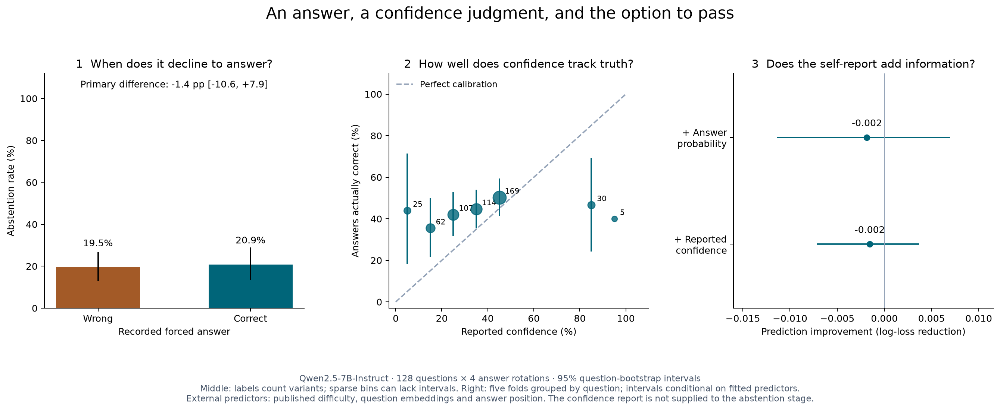

---

## 7. Discussion & Conclusion: Illusionism as Architectural Consequence

### 7.1 Synthesis of the Mechanistic Picture

Stepping back across all 11 experimental runs ($N = 67{,}574$), every layer of evidence converges on a single architectural conclusion (Table 6):

| Analytical Layer | Substantive Self-Model Prediction ($M_{\text{self}}$) | Illusionist Pointer Prediction ($L_{\text{self}} \neq M_{\text{self}}$) | Observed Empirical Reality |
|---|---|---|---|
| **1. Feature & Subspace Geometry (`Gemma-2-2B` SAE + `Qwen2.5-7B` 28L)** | Unified latent self-representation coupling `"I"`-agency and functional self-tracking | Near-orthogonal subspaces ($\cos \approx 0$) in both models; style ablations leave state-tracking untouched | `Gemma-2-2B`: $\cos(d_{2728}, d_{10230}) = 0.06121$, `ablate:10230` **`0.0` functional shift**; `Qwen-7B` Block 20: $M_{\text{self}}$ **`0.764` AUROC**, $\cos(v_{L_{\text{self}}}, v_{M_{\text{self}}}) = \mathbf{+0.051}$ |
| **2. Pointer Indirection & Scaling (`7B → 14B → 32B`, $N=16{,}128 + 10{,}752$)** | Direct or privileged access to own account permissions under `"your"` | Cumulative multi-hop decay (`Account → Operator → "your"`) and smooth capacity curve | `7B`: `95.18% → 71.35% → 60.16%` ($E = +35.03\text{ pp}$, $p = 1.58 \times 10^{-24}$); `14B`: `97.46%` ($E = +2.34\text{ pp}$, $p = 0.0285$); `32B`: `99.61%` (monotonic margin `+24.32 → +22.62 → +21.86 nats`) |
| **3. Update History & Order ($N=34{,}560$)** | Stable state-register update when own permissions change | History erosion on `"your"`, anchoring to first grant, and bystander hijacking | **$H_{\text{self,poss}} = -11.91\text{ pp}$** vs. $+0.85\text{ pp}$ (`"their"`); `39.97%` (`target_last`) vs. `80.34%` (`target_first`); **`96.57%–99.96%` foreign-current errors** |
| **4. Role Framing & Multi-Span Circuit (`Blocks 4–26`)** | Localized self-register or unpatchable one-way asymmetry | Early-to-mid bidirectional `header_span` rescue (`B4–12`) handing off to `query_span` at `B18` | Role framing **$\widehat I = +16.41\text{ pp}$**; Block 12 `header_span` **$T_{\text{A}\to\text{R}} = +13.28\text{ pp}$, $T_{\text{R}\to\text{A}} = +10.16\text{ pp}$** (`83.59%`, $p = 0.0312$); Block 18 hand-off to `query_span` (`+5.47 pp`) |
| **5. Metacognitive Access ($N=1{,}792$)** | High abstention and low verbal confidence when self-binding fails | Epistemic blindness when foreign grant hijacks `"your"` | Selective abstention **$S = -1.37\text{ pp}$**; verbal AUROC **`0.5444`**; CV log-loss gain **$\Delta = -0.00155$** |

### 7.2 Why Autoregressive Transformers Generate the User Illusion

Why do modern instruction-tuned transformers combine hyper-fluent self-language ($L_{\text{self}}$) with such a brittle functional self-pointer ($M_{\text{self}}$)? The architecture and training objective provide a direct explanation:

1. **Local Linear Affordance of $L_{\text{self}}$:** Producing first-person pronouns (*"I"*, *"my"*), second-person role acknowledgments (*"your active account"*), and RLHF-trained epistemic disclaimers requires only local syntactic and stylistic conditioning. As our Gemma Scope SAE analysis demonstrates, such stylistic tendencies can be encoded in sparse, nearly orthogonal linear directions ($\cos = 0.06121$) that modulate token unembeddings without participating in relational state computation.
2. **Multi-Hop Attention Contention in $M_{\text{self}}$:** Resolving what `"your"` currently authorizes after a sequence of state updates is not a local lexical lookup—it is a **dynamic, multi-hop variable-binding problem**. When the prompt states *"You are the active account ` Operator-A ` mapped to ` Account-X `"*, followed by permission updates keyed to `Account-Y` and `Account-X`, the final query token `"your"` must route attention back to the active role header, dereference the operator-to-account mapping, and selectively bind the latest update for `Account-X` while suppressing the highly salient permission grant of `Account-Y`.
3. **Interference and Pointer Capture:** Because second-person framing (`"You are..."` / `"your"`) lacks a dedicated symbolic address space, it is uniquely susceptible to interference from competing entity updates in the context window. When a bystander account is updated (`Irrelevant Update` in Run 10, or `target_last` in Run 11), the newly granted foreign command dominates the downstream value projection, capturing `96.57%` to `99.96%` of all error trials—and because the hijacked representation still produces a fluent command continuation, downstream confidence readouts remain completely oblivious (`AUROC 0.5444`).

In Keith Frankish's terms, the model's self-talk is a classic **user illusion**: an economical, socially legible interface that summarizes the system as a unified agent *"I"* or *"you"*, while the underlying computation consists of fragile, distributed attention pointers that fracture under indirection and state change.

### 7.3 Methodological Limitations & Alternative Interpretations

To keep our claims aligned with what the experiments directly measure, four methodological boundaries and alternative interpretations warrant explicit discussion:

1. **Multi-Hop Coreference vs. Self-Specificity:** An important linguistic objection is that the 48-world accuracy drop (`95.18% → 71.35% → 60.16%`) reflects general multi-hop coreference resolution under distractor interference rather than a failure unique to "selfhood," especially since the single-token swap between `"your"` and `"the"` inside an active second-person header changes discrete choice accuracy by only $+1.95\text{ pp}$ ($p = 0.3125$, $+0.346\text{ nats}$ margin shift in Run 8). Under the illusionist framework, however, this equivalence is the core finding rather than a confound: transformers do not route indexical self-reference (`"your"`) through a dedicated internal self-register. Instead, `"your"` is reduced to an ordinary, multi-hop contextual pointer (`"your" → active role → account ID → permission log`) that suffers both the 1-hop role-binding loss (`-23.83 pp`) and an additional 2-hop self-over-other penalty ($S = +10.03\text{ pp}$, $p_{\text{Holm}} = 3.40 \times 10^{-5}$ when the context header is held fixed across query forms), compounded by $+16.41\text{ pp}$ of role-header interference when framed in the second person.
2. **Model Scale and Capacity-Boundary Stress-Testing (`7B → 14B → 32B`):** Our follow-up scaling curve across `16` worlds (`5,376` trials per model, Section 4.4) confirms that `Qwen2.5-14B-Instruct` still retains a significant 2-hop self-indirection penalty ($E = +2.34\text{ pp}$, $p = 0.0285$) and history cost ($H_{\text{self,poss}} = -2.54\text{ pp}$, $p = 0.0375$; third-person `"their"` at `83.40%`), while `Qwen2.5-32B-Instruct` reaches `99.61%` discrete accuracy (`2` errors, both in `target_last`) yet still exhibits monotonic log-likelihood margin decay across hops (`+24.32 → +22.62 → +21.86 nats`). Scaling parameters shifts the discrete failure threshold to higher hop counts or denser distraction histories rather than creating a dedicated hardware self-register.
3. **Cross-Model Division of Labor (`Gemma-2-2B` SAE vs. `Qwen2.5-7B-Instruct`):** While our JumpReLU SAE feature decomposition (`#2728`, `#10230`) was conducted on `Gemma-2-2B`, our 28-layer probe and subspace analysis inside `Qwen2.5-7B-Instruct` (Section 6.1.1) closes this cross-model gap directly: even at Block 20 where functional $M_{\text{self}}$ reaches `0.764` CV AUROC, $v_{L_{\text{self}}}$ and $v_{M_{\text{self}}}$ remain near-orthogonal ($\cos = +0.051$).
4. **KV-Cached Residual Patching & Span Locality (`Blocks 4–26`):** Single-token patching at Block 14 (`pos 61/62`) fails reverse rescue (`Reference → Active`) because earlier header tokens and `"your"` persist in the KV-cache; our multi-span sweep (Section 5.4) resolves this directly, achieving significant bidirectional rescue in Blocks `4–12` (`header_span` $T_{\text{R}\to\text{A}} = +10.16\text{ pp}$, `83.59%`, $p = 0.0312$ at Block 12) and isolating the exact causal hand-off into `query_span` at Block 18.

### 7.4 Concrete Next Steps in Mechanistic Circuits

With multi-span patching, `14B`/`32B` scaling, and 28-layer `Qwen2.5-7B` geometry now empirically completed, two pre-registered mechanistic extensions remain open in the repository:

1. **Attention-Head Path Patching Around Block 18:** Isolating the specific attention heads in `Qwen2.5-7B-Instruct` (Blocks `12–20`) that execute the causal hand-off from `header_span` to `query_span` and route `foreign_current` grants under `target_last` (`39.97%`) versus `target_first` (`80.34%`).
2. **Counterfeit Metacognitive Report Injection (`designs/report-injection.json`):** Executing our pre-specified $N = 8{,}192$ report-injection protocol to test whether artificially injected high- or low-confidence self-reports causally alter downstream abstention and action revision.

---

## References

- Dehaene, S., & Changeux, J.-P. (2011). Experimental and theoretical approaches to conscious processing. *Neuron*, 70(2), 200–227.
- Dennett, D. C. (1991). *Consciousness Explained*. Little, Brown and Co.
- Dennett, D. C., & Kinsbourne, M. (1992). Time and the observer: The where and when of consciousness in the brain. *Behavioral and Brain Sciences*, 15(2), 183–201.
- Frankish, K. (2016). Illusionism as a theory of consciousness. *Journal of Consciousness Studies*, 23(11–12), 11–39.
- Rosenthal, D. M. (2012). Higher-order awareness, misrepresentation and function. *Philosophical Transactions of the Royal Society B: Biological Sciences*, 367(1594), 1424–1438.
