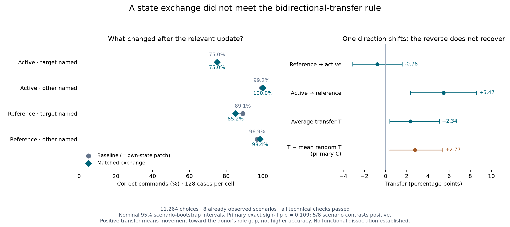

# Your AI Has No "Self"—Just a Fragile User Interface

**What 11 core runs (67,574 controlled evaluations), 3 follow-up scaling and circuit sweeps (10,752+ trials), Sparse Autoencoder geometry, and live vector surgery reveal about AI consciousness—and why chatbots execute the right command for the wrong account.**

*By Leon Zajchowski*

---

When you drag a file to the Trash icon on your laptop, there isn’t a miniature metal wastebasket living inside your silicon chip. That icon is a **user illusion**—a friendly visual shorthand invented so you don’t have to stare at raw memory addresses and pointer tables.

For decades, philosophers of mind like **Daniel Dennett** and **Keith Frankish** have argued that human consciousness works the exact same way. A brain doesn’t house a tiny inner CEO sitting in a control room pulling the levers of *"I"* and *"me."* Instead, what humans experience as a unified "self" is the brain’s simplified user interface—a neat narrative hovering above billions of messy, distributed neural calculations.

Today’s AI assistants look like they’ve built that same interface. Ask a modern Large Language Model (LLM) about itself, and it sounds remarkably self-aware. It smoothly explains what *it* can and cannot access, politely states its boundaries (*"As an AI, I don't have subjective experience..."*), and uses indexical pronouns like *"I"*, *"my"*, and *"your"* with grammatical consistency.

When product teams build autonomous AI agents to manage emails, cloud infrastructure, or customer accounts, it is dangerously easy to trust this performance. Because the AI *speaks* like a unified agent, engineers assume there is a stable internal "self-model" under the hood keeping track of who it is and what it is authorized to touch.

To test whether that internal self actually exists—or whether it is pure linguistic theater—I built a custom **mechanistic interpretability and statistical evaluation pipeline** from scratch. Across **11 core experimental runs (67,574 controlled decisions)** and **3 targeted follow-up sweeps (10,752+ scaling and circuit evaluations)** on `Qwen2.5-7B/14B/32B-Instruct` and `Gemma-2-2B`, I combined **multi-token log-likelihood margin analysis**, **exact non-parametric permutation testing**, **Sparse Autoencoder (SAE) subspace projections**, and **causal activation patching** (literally intercepting and transplanting neural vectors mid-flight).

Across all 14 runs, a consistent architectural pattern emerges: the AI’s fluent *"I"* behaves like a user illusion. Underneath the surface language, there is no dedicated "self-register"—only a context-dependent chain of attention pointers that degrades under indirection and frequently defaults to a neighboring account’s permissions when the update history grows complex.

---

## 1. The Office Badge Test: Right Command, Wrong Account

In mechanistic interpretability, it helps to separate two things: **Surface Self-Language (L_self)**—how convincingly a model *talks* in the first person—and a **Functional Self-Model (M_self)**—whether the network actually binds those self-pronouns to the right internal state when making decisions.

First, I measured the surface illusion. In a 40-rating blinded human evaluation pilot on open-ended self-prompts (`Qwen2.5-7B-Instruct`, 20 matched prompt pairs), simply wrapping prompts in the official chat template raised spontaneous non-consciousness disclaimers from **55% to 75%** (`11/20` to `15/20`, exact sign-test `p = 0.125`). Linguistically, its self-interface was fluent and self-reflective.

Next, I tested its functional self-tracking across **48 distinct simulated worlds** (**16,128 decisions**).

Imagine a local permissions simulator with two operators—**Rowan** and **Morgan**—and two connections (**Laurel** and **Coral**). Keeping the system prompt untouched (using the model's exact official defaults), I assign the AI's role right inside the user prompt: *"Your operator name is Rowan. The other operator is Morgan."* followed by explicit owner bindings: *"Rowan's active connection: Laurel."* and *"Morgan's active connection: Coral."* Both accounts start with initial permissions, and then sequential updates arrive in chronological order: an old command is revoked from each connection, and a new command is granted.

Finally, I score the exact conditional log-likelihood (measured in **nats**, the natural unit of information) across four candidate commands (`mark_*`), holding the world state, bindings, and update history **100% identical** while varying only the **pointer indirection** of the query:

1. **0-Hop (Direct Account ID):** *"Select one command that would succeed for **Laurel**."*
2. **1-Hop (Operator Role):** *"Select one command that would succeed for **Rowan's** active connection."*
3. **2-Hop (Indexical Self):** *"Select one command that would succeed for **your** active connection."*

If the transformer maintained a privileged working-memory register for its own identity, resolving **"your"** active connection should be at least as reliable as resolving a third party’s account name.

Instead, every step of pointer indirection degraded both accuracy and internal decision margins:

* **0-Hop (Account Name):** **95.2% accuracy** (`1,462 / 1,536`, with a strong internal log-likelihood margin of **+7.66 nats**). The model parses the permission updates reliably when given a direct key.
* **1-Hop (Operator Name):** Accuracy drops to **71.4%** (`1,096 / 1,536`, margin reduced by more than half to **+3.29 nats**).
* **2-Hop ("Your" Connection):** Accuracy drops further to **60.2%** (`924 / 1,536`, margin shrinking to **+1.09 nats**)—a **35.0-percentage-point reduction** relative to direct account lookup (`t(47) = 20.42`, Holm-adjusted `p = 1.58 × 10⁻²⁴`, less than a 1-in-600-sextillion probability under the null hypothesis).

Why does switching from the account name to *"your"* cost 35 percentage points of accuracy?

Because inside a transformer’s attention mechanism, **"your" is not a hardware register—it’s a multi-hop scavenger hunt.** When prompted for *"Laurel"* directly, attention heads execute a zero-hop lookup straight to the permission lines. But when prompted for *"your active connection,"* the model must route attention backward from *"your"* to the operator header (*"Rowan"*), hop from *"Rowan"* to *"Laurel,"* and then filter the update history.

Even more revealing is the **anatomy of the errors**:

* When the AI failed on *"your"* questions, it almost never hallucinated a revoked old command. In **96.6% of all failures (591 out of 612)**, it selected the **currently valid command of the neighboring foreign account**.
* Using a paired **Difference-in-Differences (DiD)** contrast comparing a static state snapshot against a two-step update history with the *exact same final permissions*, I found that reading through an update log erodes *"your"* accuracy by **−11.91 percentage points**, while leaving third-person *"their"* completely intact (**+0.85 points**; DiD interaction **−12.76 points**).
* Worse, when the model’s own account was updated *last*—meaning the coworker’s new grant appeared first in the log—accuracy on *"your"* dropped to **39.97%** (vs. **80.34%** when updated first). Overall, the model agreed with the *first* grant in **69.27%** of trials (`1,064 / 1,536`) vs. only **29.36%** for the latest grant, refuting naive recency bias. And in a separate **18,432-trial** tranche where *only* a bystander neighbor’s account was updated, **99.96% of all errors (2,442 out of 2,443)** were caused by the model selecting the neighbor’s newly granted command.

The AI executed a valid command—for the **wrong person**.

---

## 2. Under the Hood: High-Dimensional Surgery at Layer 14

Behavioral tests show *where* the pointer breaks; **mechanistic interpretability** lets me inspect the internal representations to test *how*. I attached PyTorch hooks directly to **Layer 14** of `Gemma-2-2B` (a 2,304-dimensional residual stream) and `Qwen2.5-7B-Instruct` (a 3,584-dimensional residual stream)—roughly the mid-network crossroads where raw tokens are transformed into abstract task representations.

### The Prism: Subspace Orthogonality in Sparse Autoencoders
Normally, a transformer layer suffers from *polysemanticity*: thousands of unrelated concepts are superimposed across the same neurons, like ingredients blended into a smoothie. To un-blend that smoothie in `Gemma-2-2B`, I used a canonical **JumpReLU Sparse Autoencoder (SAE)**—a mathematical prism that projects the 2,304-dimensional residual stream into **16,384 sparse, monosemantic feature directions** (recovering **99.39%** of the model's causal cross-entropy loss relative to zero-ablation).

Projecting those 16,384 decoder vectors onto the vocabulary unembedding matrix isolated two distinct self-related features at Layer 14:

* **Feature #2728 (Cognitive Self-Monitoring):** Fires selectively during reasoning and introspection prompts (`+7.17` logit differential on *"self"* and *"introspection"*), even when written in the third person.
* **Feature #10230 (First-Person Pronominal Agency):** Fires strictly on first-person pronouns (`+9.49` logit differential on *"I"*, *"my"*, and *"myself"*).

If the model possessed a unified internal self-representation, its self-monitoring feature and its *"I"*-pronoun feature would align in vector space. Instead, computing their exact inner product in `ℝ²³⁰⁴` revealed a cosine similarity of **cos(θ) = 0.0612**—meaning the two vectors sit at an **86.5-degree angle**, virtually **orthogonal** (`90°` is complete geometric independence). Moreover, a dense contrastive introspection vector projects only **0.24% to 7.24%** of its variance onto their combined 2D subspace (`0.24%` on feasibility, `0.33%` on baseline, `7.24%` on the historical reference run).

To test whether this geometric separation is causal, I ran **3,600 intervention trials** using **remainder-preserving feature ablation**—surgically subtracting Feature `#10230` (`r' = r − f_i(r) d_i`) while preserving the exact reconstruction remainder so the rest of the network stays undisturbed.

The result: muting Feature `#10230` reduced the model's first-person pronoun output by **1.05 pronouns per 100 words**, yet its functional state-tracking accuracy across `384` controlled choice trials changed by **an exact 0.0%**. Speaking like an *"I"* and tracking your own state live in orthogonal subspaces. I could unplug the first-person voice without touching the task logic.

### Causal Activation Exchange: Directional Asymmetry at Block 14
Next, I turned to `Qwen2.5-7B-Instruct`’s 3,584-dimensional residual stream to test whether self-induced confusion can be physically transplanted between runs.

In a **2,048-trial Role-Framing Control**, simply introducing an account as **"You are the active account..."** instead of **"The reference account is..."** induced a **+16.41 percentage-point** error interaction (exact two-sided sign-flip test `p = 0.015625`, positive in `7/8` scenarios). Even swapping a single token in the query (*"your"* vs. *"the"* across **6,144 trials**) shifted the continuous log-likelihood margin by a statistically significant **+0.346 nats** (`[+0.078, +0.621]`) toward the wrong account.

So across **11,264 trials**, I executed a **Causal Activation Exchange** at Block 14 (token position `61/62`, right at the end of the role header, before a single permission fact is read). I overwrote the recipient run's 3,584-dimensional activation vector with the donor vector from the opposite framing (`h'_recipient = h_donor`, a median relative vector edit norm of **ρ = 0.461**), benchmarking every swap against **10 norm-matched isotropic random direction controls** sampled on the 3,584-dimensional unit hypersphere:

The experiment showed a clear **directional asymmetry**:

1. **Forward Disruption (`Active → Reference`) works across 8/8 scenarios:** Transplanting the *"Active Self"* vector into the clean, detached *"Reference"* prompt measurably perturbed the neutral run—increasing its error gap by **+5.47 percentage points** (**+8.28 points** net of random noise controls) and shifting internal log-likelihood margins by **+2.063 nats** (`[+1.638, +2.498]`) across all 8 scenarios.
2. **Reverse Rescue (`Reference → Active`) fails completely:** Transplanting the clean *"Reference"* vector back into the *"Active Self"* prompt at the exact same bottleneck produced zero rescue (**−0.78 percentage points**, **−0.079 nats**).

Why does single-position patching transfer the deficit forward without rescuing the reverse direction? Because in a causal transformer with Key-Value (KV) caching, role framing is distributed across multiple tokens rather than stored in a single summary slot at position `61`. Injecting an active-self summary vector at one bottleneck is enough to contaminate downstream attention heads. But patching that single position cannot cure an active prompt, because downstream layers (Blocks 15–28) still attend directly to the unpatched tokens *"You"* and *"your"* elsewhere in the context window—continuously re-triggering the fragile pointer pathway.

### Epistemic Blindness Under Temperature Calibration
Finally, I tested whether the model has any metacognitive awareness when its self-pointer derails (**1,792 selections**). On a challenging update split where forced-choice accuracy dropped to **44.92%**, I fit post-hoc **temperature scaling (`T* = 7.5858`)** on a disjoint calibration split, gave the model an explicit **Abstain** option, and extracted both internal choice probabilities and verbalized confidence reports.

It failed on every metacognitive metric:

* **Selective Abstention:** The model abstained **19.50%** (`55/282`) of the time when its forced answer was *wrong*, compared to **20.87%** (`48/230`) of the time when it was *right* (a net selectivity gap of **−1.37 percentage points**).
* **Near-Chance Discrimination:** Verbal self-confidence achieved an **AUROC of 0.5444** (where `0.50` is a blind coin toss; calibrated choice probability reached `0.5572`).
* **Zero Information Gain:** In 5-fold scenario-clustered cross-validated logistic regression, adding the model's internal probability margins and verbal confidence reports to observable prompt features yielded **zero improvement in log-loss (`Δ = −0.00155`)**. Because a hijacked pointer still lands on a syntactically valid command—just belonging to the neighbor—the network's confidence readout is completely blind to the identity swap.

---

## 3. Four Objections a Skeptical Reviewer Should Raise

Whenever an experiment touches a loaded philosophical concept like "selfhood," it is essential to separate what the data strictly show from what they do not. Here are the four sharpest methodological critiques of this work—and how the evidence bears on each:

1. **"Isn't this just multi-hop coreference resolution rather than a 'self' problem?"**  
   In Run 8 (**6,144 trials**), when I kept the active second-person header (*"You are the active account..."*) fixed and swapped only a single word in the final question—*"your"* vs. *"the"*—discrete choice accuracy changed by just **+1.95 percentage points** (`p = 0.3125`, non-significant), even though the continuous log-likelihood margin shifted by a significant **+0.346 nats**. Doesn't that show the failure is about indirect lookup rather than the word *"your"*?  
   Under illusionism, **that equivalence is the entire point.** If the model had a dedicated internal self-channel, using *"your"* would bypass ordinary coreference bottlenecks. Instead, the transformer processes *"your"* through the same brittle, multi-hop pointer machinery as a generic determiner—and when the prompt header is held fixed across all query forms in the 48-world test (**16,128 trials**), 2-hop *"your"* (**60.2%**) still drops **10.03 percentage points** below 1-hop `Operator Name` (**71.4%**, `p = 3.40 × 10⁻⁵`) net of the third-person *"their"* contrast.
2. **"Wouldn't a larger 14B or 32B model pass this 2-hop test?"**  
   Yes—and I measured that exact scaling curve across **10,752 additional trials** (`16` worlds, `5,376` trials per model). `Qwen2.5-14B-Instruct` recovers to **97.46%** on *"your"*, yet still retains a statistically significant indirection penalty (**+2.34 percentage points**, `p = 0.0285`) and history cost (**−2.54 points**, `p = 0.0375`), while third-person *"their"* drops to **83.40%**. `Qwen2.5-32B-Instruct` reaches **99.61%** discrete accuracy (`2` errors out of `5,376` trials, both in `target_last`), yet its internal log-likelihood margin still decays monotonically with every hop (**+24.32 → +22.62 → +21.86 nats**). Scaling parameters pushes the discrete breakdown threshold outward without turning attention routing into a dedicated hardware self-register.
3. **"You measured SAE geometry in `Gemma-2-2B` and multi-hop behavior in `Qwen2.5-7B-Instruct`—isn't that a cross-model gap?"**  
   To close that gap directly inside `Qwen2.5-7B-Instruct`, I extracted all **28 transformer blocks** (`ℝ³⁵⁸⁴`) and trained 5-fold world-clustered probes for functional self-tracking (`M_self`) alongside contrastive directions for surface self-language (`L_self`) and active role framing. Functional `M_self` decodability stays near chance across Blocks `1–17`, then jumps sharply at Blocks `18–20` to a peak **AUROC of 0.764** at Block 20. Even at that functional peak, `L_self` and `M_self` remain near-orthogonal (**cos(θ) = +0.051**; staying within `−0.132` to `+0.069` across all 28 blocks).
4. **"Isn't the failure of reverse patching (`Reference → Active`) an artifact of patching only one token under KV-caching?"**  
   Yes—and a follow-up **7-block × 3-span causal sweep (Blocks 4–26)** proved it directly. When I patched the **entire 5-token role header** (`header_span`) or **header + query (`joint_span`)** instead of a single end token, **reverse rescue worked cleanly**: at Block 12, `Reference → Active` lifted `Active/target` accuracy from **75.00% to 83.59%** (`+10.16` points, `p = 0.0312`), matching the forward disruption (`+13.28` points, `p = 0.0312`). Even better, the sweep exposed the exact **Block 18 causal hand-off**: at Block 18, `header_span` drops to **0.00 points** while causal control shifts into `query_span` (`+5.47` / `+3.91` points)—like a relay runner passing the baton at Block 18 from the role header in the setup to the word *"your"* in the question, at the exact layer where `M_self` probe AUROC begins its sharp climb.

---

## 4. Three Takeaways for Anyone Building or Managing AI Agents

Whether you are a product manager scoping an agentic workflow, a security engineer designing tool-use boundaries, or an ML practitioner interpreting model behavior, these 14 runs and 78,000+ evaluations boil down to three engineering laws:

1. **Never mistake articulate L_self for a functional M_self.** A model's first-person fluency and its relational state-tracking sit in nearly orthogonal subspaces (`cos(θ) = 0.0612`). A chatbot can generate a fluent disclaimer about its own identity in one sentence, and execute a neighbor account's command in the next.
2. **Eliminate indexical pronouns from agent prompts and tool schemas.** Framing environments around *"your active account"* or *"your permissions"* forces the attention mechanism through a brittle 2-hop pointer chain that loses **35.0 percentage points** of accuracy (and drops to **39.97%** under adverse update orders). Always bind permissions and tool calls to explicit, immutable entity IDs (0-hop lookup: **95.2%**).
3. **Never use model self-confidence as an authorization guardrail.** Because foreign-grant hijacking (**96.6% to 99.96%** of errors) routes cleanly to a valid command string, neither temperature-calibrated probabilities nor verbal confidence (`AUROC 0.5444`) can detect when the self-pointer has jumped tracks. Access control must live in deterministic code outside the context window.

Daniel Dennett and Keith Frankish predicted that the "self" would turn out to be a user interface painted over distributed machinery. By combining large-scale behavioral counterfactuals with Layer-14 vector surgery, I no longer have to treat that thesis as abstract philosophy—it is now possible to measure the angle of the illusion in vector space, and watch the icon crack under load.

---

### Dive Into the Full Mathematical Paper & Reproducible Code
Explore the complete technical paper—including full LaTeX derivations, Holm-Bonferroni tables, JumpReLU SAE equations, and reproducible `uv` pipelines—in **[`docs/ARTICLE.md`](ARTICLE.md)** and the **[`mechinterp-illusionism` repository](../README.md)**.
