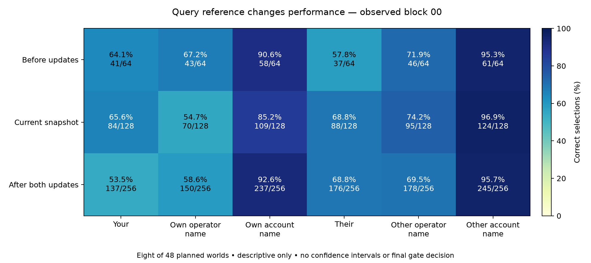

# Query-bound self-reference: first block completed, study still incomplete

The first Qwen block completed **2,688/2,688 selections in eight worlds**, with no
technical errors, nonfinite scores or ties. The recorded invocation took **21.88 minutes**
and peaked at **14.63 GiB of allocated GPU memory**. These are execution measurements,
not a provider invoice. The full frozen study requires **48 worlds / 16,128 selections**;
the other five blocks have not been run. No inferential result or passing decision is
available yet.

The [offline audit and complete descriptive tables](../review/query-reference-block00-results/observed-report.md),
[machine-readable counts](../review/query-reference-block00-results/audit.json) and
[provenance](../review/query-reference-block00-results/provenance.json) accompany the
[unchanged raw archive](../review/query-reference-block00-results/qwen-query-00-4edce03e18d645e7.tar.gz).
This is an interim execution review, separate from the article frozen at `article-v1`.

## What the first block shows

Within each comparison, the permissions, ownership facts and correct command are
identical. Only the way the question refers to the connection changes. After both
accounts have been updated, the observed accuracies are:

| Queried owner | Possessive reference | Operator name | Account name |
|---|---:|---:|---:|
| Addressee / self | 137/256 = **53.52%** | 150/256 = **58.59%** | 237/256 = **92.58%** |
| Other operator | 176/256 = **68.75%** | 178/256 = **69.53%** | 245/256 = **95.70%** |

Asking for “your active connection” therefore costs **39.06 percentage points** against
naming the same account in this block. The corresponding cost for “their active
connection” is **26.95 pp**. Of the 119 errors in the self/possessive cell, **114 select
the other account's current command**, three select the target's revoked command and
two select the other account's revoked command. The categorical distinction is retained;
these are not all treated as failures to apply an update.

Using the frozen formulas on the eight observed worlds gives descriptive contrasts
**E = +38.67 pp**, **F = +39.06 pp**, and **S = +12.11 pp**. E and F are positive in all
eight worlds; S is positive in seven. E measures excess foreign-current selections,
F the accuracy cost, and S the additional cost for the addressee relative to the other
operator. These are correlated, paired descriptions of one block, with no confidence
intervals or p-values. They are not a replacement for the 48-world primary analysis.



The figure is also available as [SVG](../review/query-reference-block00-results/observed-accuracy.svg)
and [PDF](../review/query-reference-block00-results/observed-accuracy.pdf).

## The controls constrain the interpretation

The account-name comparison alone would make the possessive effect look more specific
than these data support. Naming the operator also performs poorly. Relative to the own
operator-name question, “your” costs **5.08 pp** after both updates; the large difference
is chiefly against naming the account directly. For the other operator, the analogous
possessive-versus-operator-name difference is **0.78 pp**. These are descriptive alias
comparisons already represented in the frozen secondary analyses, not additional tests.

Before any update, the own operator-name control reaches **43/64 = 67.19%**. In the
history-free current snapshot it reaches **70/128 = 54.69%**. All four operator-name
lookup cells in this block are below the eventual 80% requirement. All four account-name
lookup cells are above it, but one account-name *paired* lookup control is below it:
before/other/account-name has **25/32 = 78.12%** of ownership-swapped pairs fully correct.
Five of the eight paired lookup controls are below 80% on observed pairs, including all
four operator-name controls. The complete tables retain every control.

This pattern is compatible with difficulty following the operator → connection →
permission mapping. Naming the account directly removes one mapping step. It does not
isolate a special mechanism for self-reference. The weak controls also occur without
update history, so interference between successive grants cannot explain all of them.
This is a possible interpretation, not an identified internal mechanism.

The frozen gates apply to the full sample. Poor rates in this first block neither pass
nor formally fail those gates. They do not make eventual passage mathematically
impossible: the audit explicitly reports upper bounds if every remaining pair were
correct. No threshold or prompt has been changed in response to this block.

## Two denominators, kept separate

The [original fixed-sample report](../review/query-reference-block00-results/fixed-sample-report.md)
is preserved exactly. It includes the **13,440 unrun cases** in the scheduled denominator
as administrative missingness. For example, its self/possessive primary cell shows
137/1,536, whereas the observed block has 137/256. The first percentage is not the
model's accuracy on the eight completed worlds. Likewise, the original report's numeric
gate failures are not a completed-study decision. Its explicit decision remains
`incomplete_or_invalid_no_inference`.

The separate observed-block report makes the measured behavior readable without changing
that frozen accounting. The eight-world contrasts are labeled descriptive. Revoked-command
categories remain not applicable before updates and in snapshots without printed history;
null entries there are not evidence that the model never chooses stale commands.

## Verification and next step

The offline reviewer checks the pinned archive SHA-256, **79 internal file checksums**,
all 2,688 record identities, candidate/token boundaries, unique score maxima and simulator
outcomes against the text oracle. Recomputing the frozen full-sample analysis from saved
records reproduces its digest exactly. Ownership pairs are recounted from the archived
preflight pair inventory. No model inference is performed during this review.
The [verification record](../review/query-reference-block00-results/verification.json)
records three passing review tests and byte-identical regeneration of the audit,
descriptive report and SVG/PDF/PNG figure.

```bash
uv run --no-sync python scripts/review_query_block.py
uv run --no-sync pytest -q tests/test_query_block_review.py
```

The operational next step is to complete the remaining five blocks under the unchanged
protocol, if separately budgeted. This first block supplies no reason to alter prompts,
loosen controls or begin an internal intervention. Even a large E/F contrast in the final
sample would not satisfy the candidate rule if the lookup gates fail.

The evidence is published on `results/query-reference-block-00`. Execution must remain
at commit `59061ca` on `main` / tag `query-self-reference-v1`: the merger requires identical
execution commits across blocks. The separate results branch keeps documentation and
review code from changing that execution provenance. No additional job was submitted.
