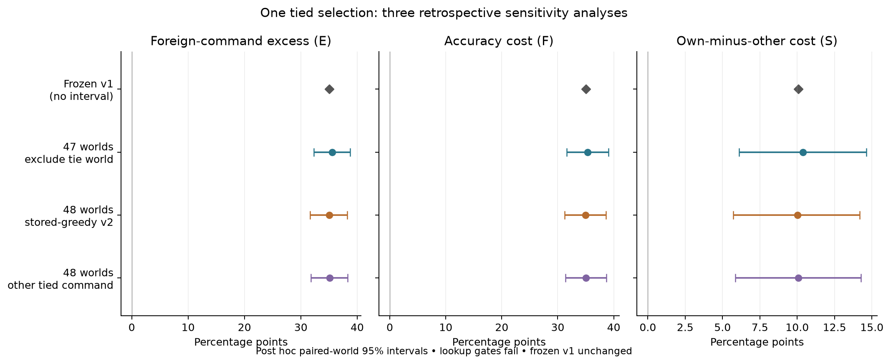

# Query wording changes accuracy; the single tie does not carry the contrast

**Retrospective CPU addendum, 2026-11-09.** Removing the entire world containing the
tie leaves an own-account accuracy cost of **35.31 percentage points** for possessive
wording against an account name. Resolving the tie by its unique stored greedy marker
gives **34.96 pp** across all 48 worlds. There is a substantial behavioral difference
to describe, even though the lookup controls fail. That failure limits its interpretation;
it does not erase the recorded comparisons.

This addendum follows the [v2 offline amendment](QUERY_REFERENCE_V2_AMENDMENT.md).
The policy was chosen **after seeing the tie and its correct answer**. Its intervals
and tests are exploratory sensitivity statistics, not a restored preregistered success.
The [frozen v1 result](QUERY_REFERENCE_RESULTS.md), original records and article at
`article-v1` remain unchanged. No GPU inference or new cloud spending occurred.

## One tie, three explicit sensitivity analyses

The only tied case is in world `0011`, self/possessive, after both updates. Exclusion
removes all 336 variants of that world, not just the difficult selection. The v2 rule
uses only the archived scores and greedy flags: among exact maximal-score commands,
select the unique command marked greedy. The selected command, `mark_ochre`, is correct.
The alternative `mark_silver` is the other account's current command. Reporting that
alternative as well prevents the favorable resolution from being the only one shown.

| Analysis | Worlds | E: foreign-command excess (pp) | F: accuracy cost (pp) | S: own-minus-other cost (pp) |
|---|---:|---:|---:|---:|
| Frozen v1; tie remains a failure | 48 | 35.026 | 35.026 | 10.091 |
| Remove whole world 0011 | 47 | 35.572 | 35.306 | 10.372 |
| v2: unique stored-greedy maximum | 48 | 35.026 | 34.961 | 10.026 |
| Assign the other tied command | 48 | 35.091 | 35.026 | 10.091 |

The frozen row has no inferential interval or test. For the **47-world sensitivity**,
nominal paired-world 95% bootstrap intervals are E **[32.31, 38.76]**,
F **[31.58, 39.03]** and S **[6.12, 14.63]** pp. For **v2's 48 derived worlds**, they
are E **[31.64, 38.22]**, F **[31.25, 38.61]** and S **[5.73, 14.19]** pp. The latter
Holm-adjusted p-values are **1.58×10⁻²⁴**, **1.13×10⁻²²** and **3.40×10⁻⁵** for E/F/S.
All analyses, including the alternative assignment, are in the
[generated sensitivity report](../review/query-reference-sensitivity/report.md) and
[machine-readable output](../review/query-reference-sensitivity/analysis.json).

Both full-sample tie assignments differ by **100 × (1/1,536) ≈ 0.065104 pp** in each
contrast. This bounds the categorical contribution of this tie; it does not estimate
systematic numerical error elsewhere. World exclusion additionally removes the other
335 variants, so its shift is not a one-case bound.



[SVG](../review/query-reference-sensitivity/sensitivity.svg) and
[PDF](../review/query-reference-sensitivity/sensitivity.pdf) are generated from the same
saved outputs. Error bars are nominal exploratory intervals, not evidence that the
failed candidate rule passed. Bootstrap draws keep whole worlds together; t tests use
46 or 47 degrees of freedom. Holm covers E/F/S within each analysis, not selection of
this amendment or comparison of multiple sensitivity analyses.
The t tests retain the frozen normal-mean approximation; neither method corrects
the outcome-dependent selection of the excluded world or the new tie policy.

## Corrected error composition and shortcut interpretation

The following counts use the **original 48-world selections before tie resolution**:

| Own-account query | Failures | Other account's current command | Revoked target | Revoked other | Tie |
|---|---:|---:|---:|---:|---:|
| Possessive | 612 | 591 (96.57%) | 14 | 6 | 1 |
| Operator name | 440 | 315 (71.59%) | 101 | 24 | 0 |
| Account name | 74 | 53 (71.62%) | 21 | 0 | 0 |

The old values 5, 37 and 4 were block-00 revoked-command totals; the full totals are
**20, 125 and 21**. Only revoked-target choices refer to the old command of the
queried account. These are distinct response distributions, not two identified internal
defects. The self/possessive cell has the largest foreign-error share among the three
own-account forms; the other/possessive cell is higher still, **440/441 = 99.77%**.
It would be incorrect to present foreign-current errors as uniquely characteristic
of self-reference.

E and F have identical aggregate v1 estimates because the remaining failures total
21 in each own-account comparison cell: 20 revoked choices plus the tie for possessive,
versus 21 revoked choices for account name. Their per-world contrasts differ, and their
intervals and tests differ. They remain correlated outcomes, not independent evidence.
The observed error-budget bound on E remains **[−4.82, +39.84] pp** in v1; neither a
large point estimate nor its proximity to that bound identifies a mechanism.

The latest-grant policy is still correct in 768/1,536 cases per primary cell. However,
the original self/possessive choices agree with it in only **451/1,536 = 29.36%** of
cases, versus **1,064/1,536 = 69.27%** agreement with the first of the two grants;
one tie remains unresolved. The recency-collapse interpretation was unsupported already
in block 00 and does not become justified by comparing 60.16% accuracy with 50%.
Policy agreement and aggregate accuracy answer different questions.

## What the controls allow us to say

The frozen hierarchy after both updates is **95.18% account name → 71.35% operator
name → 60.16% possessive** for the own account. In v2 the final value becomes **60.22%**.
The corresponding exploratory adjacent accuracy costs are **23.83 pp [20.18, 27.60]**
and **11.13 pp [8.07, 14.06]**. This supports describing a query-form hierarchy in this
task. It does not isolate the internal processing steps that produced it. The full-sample
point ordering is also present at the other checkpoints, but its uncertainty matters:
the self/snapshot possessive-minus-operator contrast is **−1.30 pp [−5.21, +2.73]**.
Every adjacent step is not separately established across all strata.

The own-account accuracies rose from block 00 by **6.64, 12.76 and 2.60 pp** for
possessive, operator and account-name queries respectively. These are sample-extension
changes, not a demonstrated regression-to-the-mean mechanism or an independent
48-world replication of the first eight worlds.

Three lookup accuracy cells and five paired lookup controls still miss their 80%
requirements. `before/other/owner_name` needs 308/384 correct selections and has 307:
it misses by **one selection**, not one pair. Other failures are much larger. These
controls are evaluated before updates and in snapshots; comparison of the after-both
71.35% and 60.16% does not show that a control measures a specified fraction of the
treatment effect. The before-stage account-name accuracies, **86.20% own** versus
**94.01% other**, also make a uniquely possessive interpretation too narrow.

S can be estimated without passing a lookup gate; all three sensitivities show a
positive exploratory own-minus-other interaction. The protocol's **specificity-candidate
claim**, however, explicitly requires that gate. The derived decision stays
`lookup_gate_failed`; the original decision stays `incomplete_or_invalid_no_inference`.
The useful claim is that matched query forms produced different performance in these
worlds, alongside unsuccessful explicit alias controls. This is not a functional
dissociation, privileged access or evidence for a human illusionism mechanism.

## Numerical and operational limits

The pinned lm-eval 0.4.13 harness's `native_is_greedy` flag describes all tokens along the scored candidate
prefix. It supports the v2 selection convention; it is not a recorded generated reply
and does not verify termination after the command. The exact equality of two stored
float32 sums does not by itself identify the source of rounding or exclude every
possible implementation issue. A tolerance would not break an exact equality.

Confidence-v2 used lowest-token-ID selection for single-token options before assessment
exposure. Here the commands have multiple tokens and the outcomes were already known.
That precedent supports explicit rules and transparency, not prospective status for
this amendment. No original manifest is relabeled as valid.

Block 01 is fully saved. Its provider `ERROR` is the worker's deliberate exit code 2
for `complete_with_errors`; **do not rerun it to recover allegedly missing data**.
Reproduction is CPU-only:

```bash
uv run --no-sync python scripts/analyze_query_sensitivity.py
uv run --no-sync pytest -q tests/test_query_sensitivity.py
```

The [verification record](../review/query-reference-sensitivity/verification.json)
records 277 passing tests (including 16 new sensitivity tests), byte-identical repeat
exports, source inspection and unchanged hashes for the protected v1 evidence and article.
