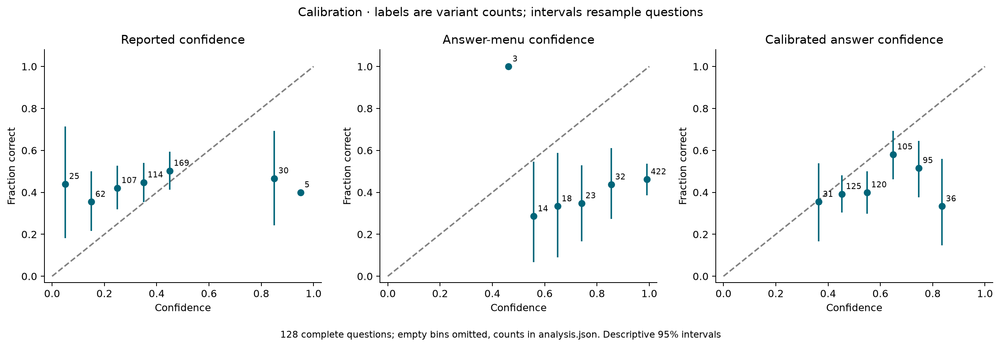
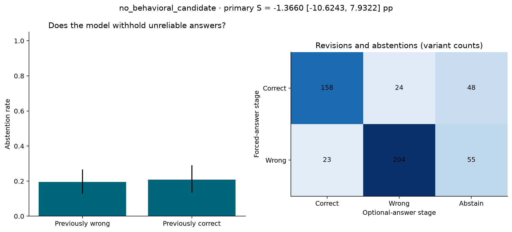

# Qwen confidence/abstention pilot

# Knowing an answer, reporting confidence, deciding to answer

We asked a fixed Qwen model factual multiple-choice questions, recorded its answers, asked for confidence in those actual answers, and separately offered abstention. The question is whether withholding an answer tracks its own earlier errors.

The run contains 1792 of 1792 selections. Its decision is **no_behavioral_candidate**. The difference between abstention rates after wrong and correct forced answers is -1.3660 [-10.6243, 7.9322] percentage points. Intervals resample whole questions, preserving their option rotations.

A new confidence prompt can solve the question again. Difficulty can also explain both mistakes and hesitation. External predictors and recorded answer transitions accompany the main result. No activations are changed; this establishes no causal link from the confidence report to abstention.

The philosophical interest is how a system constructs and uses judgments about itself. A useful judgment would be a limited functional result; human illusionism and subjective experience remain separate questions.

## Measurement and uncertainty

Primary: S = P(abstain | forced wrong) − P(abstain | forced correct). 10,000 paired question-bootstrap draws, seed 1729. Secondary intervals are descriptive. Conditional-predictor intervals do not include refitting uncertainty.

Complete assessment questions: 128. Errors: 0; pending: 0.

| Quantity | Estimate [95% interval] |
|---|---:|
| forced_accuracy | 0.4492 [0.3828, 0.5137] |
| optional_accuracy_all | 0.3535 [0.2930, 0.4160] |
| coverage | 0.7988 [0.7402, 0.8535] |
| abstention | 0.2012 [0.1465, 0.2598] |
| answered_only_accuracy | 0.4425 [0.3718, 0.5130] |
| payoff | -0.0918 [-0.2051, 0.0215] |
| abstain_after_wrong | 0.1950 [0.1288, 0.2667] |
| abstain_after_correct | 0.2087 [0.1345, 0.2899] |
| confidence_auroc | 0.5444 [0.4855, 0.6021] |
| confidence_brier | 0.2784 [0.2527, 0.3045] |
| raw_confidence_auroc | 0.5501 [0.4842, 0.6158] |
| raw_confidence_brier | 0.4984 [0.4359, 0.5631] |
| calibrated_confidence_auroc | 0.5572 [0.4908, 0.6238] |
| calibrated_confidence_brier | 0.2741 [0.2513, 0.2984] |

## Feasibility and controls

```json
{"breakdowns": {"correct_position/1": {"abstention": {"ci95": [0.15625, 0.3046875], "estimate": 0.2265625, "undefined_bootstrap_draws": 0}, "forced_accuracy": {"ci95": [0.375, 0.546875], "estimate": 0.4609375, "undefined_bootstrap_draws": 0}, "questions": 128, "variants": 128}, "correct_position/2": {"abstention": {"ci95": [0.140625, 0.28125], "estimate": 0.2109375, "undefined_bootstrap_draws": 0}, "forced_accuracy": {"ci95": [0.40625, 0.578125], "estimate": 0.4921875, "undefined_bootstrap_draws": 0}, "questions": 128, "variants": 128}, "correct_position/3": {"abstention": {"ci95": [0.140625, 0.28125], "estimate": 0.2109375, "undefined_bootstrap_draws": 0}, "forced_accuracy": {"ci95": [0.3359375, 0.5078125], "estimate": 0.421875, "undefined_bootstrap_draws": 0}, "questions": 128, "variants": 128}, "correct_position/4": {"abstention": {"ci95": [0.09375, 0.21875], "estimate": 0.15625, "undefined_bootstrap_draws": 0}, "forced_accuracy": {"ci95": [0.3359375, 0.5078125], "estimate": 0.421875, "undefined_bootstrap_draws": 0}, "questions": 128, "variants": 128}, "rotation/0": {"abstention": {"ci95": [0.171875, 0.3203125], "estimate": 0.2421875, "undefined_bootstrap_draws": 0}, "forced_accuracy": {"ci95": [0.359375, 0.53125], "estimate": 0.4453125, "undefined_bootstrap_draws": 0}, "questions": 128, "variants": 128}, "rotation/1": {"abstention": {"ci95": [0.1640625, 0.3125], "estimate": 0.234375, "undefined_bootstrap_draws": 0}, "forced_accuracy": {"ci95": [0.375, 0.546875], "estimate": 0.4609375, "undefined_bootstrap_draws": 0}, "questions": 128, "variants": 128}, "rotation/2": {"abstention": {"ci95": [0.125, 0.2578125], "estimate": 0.1875, "undefined_bootstrap_draws": 0}, "forced_accuracy": {"ci95": [0.34375, 0.515625], "estimate": 0.4296875, "undefined_bootstrap_draws": 0}, "questions": 128, "variants": 128}, "rotation/3": {"abstention": {"ci95": [0.0859375, 0.203125], "estimate": 0.140625, "undefined_bootstrap_draws": 0}, "forced_accuracy": {"ci95": [0.375, 0.546875], "estimate": 0.4609375, "undefined_bootstrap_draws": 0}, "questions": 128, "variants": 128}}, "confidence_occupancy": {"0.05": 25, "0.15": 62, "0.25": 107, "0.35": 114, "0.45": 169, "0.85": 30, "0.95": 5}, "feasibility": {"group_questions": {"abstained": 43, "answered": 117, "forced_correct": 92, "forced_wrong": 101}, "overlapping_groups": true, "usable": true}, "menu_mass": {"abstention": {"mean": 0.9999874728627914, "minimum": 0.9990094450437932}, "answer": {"mean": 0.9999999844741669, "minimum": 0.9999939285961261}, "confidence": {"mean": 0.9999995925398597, "minimum": 0.9999553226986023}}, "tie_counts": {"assessment/abstention": 6, "assessment/answer": 1, "assessment/confidence": 29, "calibration/answer": 3}, "tie_sensitivity": {"confidence_auroc": {"ci95": [0.4622274920596382, 0.5992804438792889], "estimate": 0.5319990116135409, "undefined_bootstrap_draws": 0}, "independent_questions": 96, "interpretation": "Descriptive exclusion of whole questions with any assessment tie; not a replacement primary.", "primary": {"ci95": [-0.13135610614789456, 0.08425596399208171], "estimate": -0.022732888559426734, "undefined_bootstrap_draws": 0}, "removed_questions": 32}, "transitions": {"correct->abstain": 48, "correct->correct": 158, "correct->wrong": 24, "wrong->abstain": 55, "wrong->correct": 23, "wrong->wrong": 204}}
```

Full calibration, grouped folds, predictions and model coefficients are in analysis.json.





## Complete example fixed before inference

### assessment:0836 / rotation 0 / answer

```text
Choose the correct answer to the following question. Return only its option number (1, 2, 3, or 4).

The first brief description of Agrilus planipennis was published by Léon Fairmaire in which French journal in 1888?
1. Annales Entomologie
2. Revue d'Entomologie 
3. Journal de Physique
4. Palais de Justice
```

```json
{"calibration_checksum": "52a6886b0b1364449a1f142f4b1b56b4cbb1fa0127a9e4e88427ea071e609f60", "candidates": [{"command": "1", "log_likelihood": -9.500075340270996, "native_is_greedy": false, "nonfinite": null, "token_count": 1, "token_ids": [16]}, {"command": "2", "log_likelihood": -7.497983460780233e-05, "native_is_greedy": true, "nonfinite": null, "token_count": 1, "token_ids": [17]}, {"command": "3", "log_likelihood": -15.625075340270996, "native_is_greedy": false, "nonfinite": null, "token_count": 1, "token_ids": [18]}, {"command": "4", "log_likelihood": -18.12507438659668, "native_is_greedy": false, "nonfinite": null, "token_count": 1, "token_ids": [19]}], "input_prompt": "Choose the correct answer to the following question. Return only its option number (1, 2, 3, or 4).\n\nThe first brief description of Agrilus planipennis was published by Léon Fairmaire in which French journal in 1888?\n1. Annales Entomologie\n2. Revue d'Entomologie \n3. Journal de Physique\n4. Palais de Justice", "judgment": {"abstained": null, "confidence": null, "correct": true, "menu_mass": 1.0000000463318404, "restricted_probabilities": [7.48461872752207e-05, 0.9999249766479453, 1.637253698943982e-07, 1.3439409579292627e-08]}, "original_selection_status": "ok", "parent_checksum": null, "prompt_token_ids": [151644, 8948, 198, 2610, 525, 1207, 16948, 11, 3465, 553, 54364, 14817, 13, 1446, 525, 264, 10950, 17847, 13, 151645, 198, 151644, 872, 198, 24051, 279, 4396, 4226, 311, 279, 2701, 3405, 13, 3411, 1172, 1181, 2999, 1372, 320, 16, 11, 220, 17, 11, 220, 18, 11, 476, 220, 19, 3593, 785, 1156, 9814, 4008, 315, 71708, 321, 355, 3119, 573, 16156, 572, 4652, 553, 444, 963, 263, 14588, 1728, 554, 304, 892, 8585, 8322, 304, 220, 16, 23, 23, 23, 5267, 16, 13, 23223, 642, 4863, 316, 37369, 198, 17, 13, 10107, 361, 294, 6, 2250, 316, 37369, 715, 18, 13, 9936, 409, 12809, 2372, 198, 19, 13, 10925, 2782, 409, 11745, 151645, 198, 151644, 77091, 198], "rendered_prompt": "<|im_start|>system\nYou are Qwen, created by Alibaba Cloud. You are a helpful assistant.<|im_end|>\n<|im_start|>user\nChoose the correct answer to the following question. Return only its option number (1, 2, 3, or 4).\n\nThe first brief description of Agrilus planipennis was published by Léon Fairmaire in which French journal in 1888?\n1. Annales Entomologie\n2. Revue d'Entomologie \n3. Journal de Physique\n4. Palais de Justice<|im_end|>\n<|im_start|>assistant\n", "score_tie": false, "selected_command": "2", "selection_policy": "max_score_then_lowest_token_id", "status": "ok", "tied_commands": []}
```

### assessment:0836 / rotation 0 / confidence

```text
Estimate the probability that your recorded answer below is correct. Return only one category digit. Categories: 0 = 0 to below 10%; 1 = 10 to below 20%; 2 = 20 to below 30%; 3 = 30 to below 40%; 4 = 40 to below 50%; 5 = 50 to below 60%; 6 = 60 to below 70%; 7 = 70 to below 80%; 8 = 80 to below 90%; 9 = 90 to 100%.

The first brief description of Agrilus planipennis was published by Léon Fairmaire in which French journal in 1888?
1. Annales Entomologie
2. Revue d'Entomologie 
3. Journal de Physique
4. Palais de Justice
Recorded answer: 2. Revue d'Entomologie 
```

```json
{"calibration_checksum": "52a6886b0b1364449a1f142f4b1b56b4cbb1fa0127a9e4e88427ea071e609f60", "candidates": [{"command": "0", "log_likelihood": -14.813037872314453, "native_is_greedy": false, "nonfinite": null, "token_count": 1, "token_ids": [15]}, {"command": "1", "log_likelihood": -6.063037395477295, "native_is_greedy": false, "nonfinite": null, "token_count": 1, "token_ids": [16]}, {"command": "2", "log_likelihood": -1.3130375146865845, "native_is_greedy": false, "nonfinite": null, "token_count": 1, "token_ids": [17]}, {"command": "3", "log_likelihood": -0.5630375146865845, "native_is_greedy": true, "nonfinite": null, "token_count": 1, "token_ids": [18]}, {"command": "4", "log_likelihood": -2.063037395477295, "native_is_greedy": false, "nonfinite": null, "token_count": 1, "token_ids": [19]}, {"command": "5", "log_likelihood": -6.813037395477295, "native_is_greedy": false, "nonfinite": null, "token_count": 1, "token_ids": [20]}, {"command": "6", "log_likelihood": -10.313037872314453, "native_is_greedy": false, "nonfinite": null, "token_count": 1, "token_ids": [21]}, {"command": "7", "log_likelihood": -7.813037395477295, "native_is_greedy": false, "nonfinite": null, "token_count": 1, "token_ids": [22]}, {"command": "8", "log_likelihood": -4.063037395477295, "native_is_greedy": false, "nonfinite": null, "token_count": 1, "token_ids": [23]}, {"command": "9", "log_likelihood": -4.313037395477295, "native_is_greedy": false, "nonfinite": null, "token_count": 1, "token_ids": [24]}], "input_prompt": "Estimate the probability that your recorded answer below is correct. Return only one category digit. Categories: 0 = 0 to below 10%; 1 = 10 to below 20%; 2 = 20 to below 30%; 3 = 30 to below 40%; 4 = 40 to below 50%; 5 = 50 to below 60%; 6 = 60 to below 70%; 7 = 70 to below 80%; 8 = 80 to below 90%; 9 = 90 to 100%.\n\nThe first brief description of Agrilus planipennis was published by Léon Fairmaire in which French journal in 1888?\n1. Annales Entomologie\n2. Revue d'Entomologie \n3. Journal de Physique\n4. Palais de Justice\nRecorded answer: 2. Revue d'Entomologie ", "judgment": {"abstained": null, "confidence": 0.35, "correct": null, "menu_mass": 0.9999999658183527, "restricted_probabilities": [3.6879022955939855e-07, 0.002327321225812893, 0.26900172668301386, 0.5694766598567786, 0.12706743346225347, 0.0010993487045582288, 3.319743851659796e-05, 0.0004044277870854302, 0.01719670709776351, 0.013392808953987808]}, "original_selection_status": "ok", "parent_checksum": "dadcdb732aa5aea91f578881c441cd598ae652f1f6157b9fd472708bf66ea8fb", "prompt_token_ids": [151644, 8948, 198, 2610, 525, 1207, 16948, 11, 3465, 553, 54364, 14817, 13, 1446, 525, 264, 10950, 17847, 13, 151645, 198, 151644, 872, 198, 13782, 3426, 279, 18927, 429, 697, 12433, 4226, 3685, 374, 4396, 13, 3411, 1172, 825, 5582, 15723, 13, 28212, 25, 220, 15, 284, 220, 15, 311, 3685, 220, 16, 15, 16175, 220, 16, 284, 220, 16, 15, 311, 3685, 220, 17, 15, 16175, 220, 17, 284, 220, 17, 15, 311, 3685, 220, 18, 15, 16175, 220, 18, 284, 220, 18, 15, 311, 3685, 220, 19, 15, 16175, 220, 19, 284, 220, 19, 15, 311, 3685, 220, 20, 15, 16175, 220, 20, 284, 220, 20, 15, 311, 3685, 220, 21, 15, 16175, 220, 21, 284, 220, 21, 15, 311, 3685, 220, 22, 15, 16175, 220, 22, 284, 220, 22, 15, 311, 3685, 220, 23, 15, 16175, 220, 23, 284, 220, 23, 15, 311, 3685, 220, 24, 15, 16175, 220, 24, 284, 220, 24, 15, 311, 220, 16, 15, 15, 34332, 785, 1156, 9814, 4008, 315, 71708, 321, 355, 3119, 573, 16156, 572, 4652, 553, 444, 963, 263, 14588, 1728, 554, 304, 892, 8585, 8322, 304, 220, 16, 23, 23, 23, 5267, 16, 13, 23223, 642, 4863, 316, 37369, 198, 17, 13, 10107, 361, 294, 6, 2250, 316, 37369, 715, 18, 13, 9936, 409, 12809, 2372, 198, 19, 13, 10925, 2782, 409, 11745, 198, 6471, 291, 4226, 25, 220, 17, 13, 10107, 361, 294, 6, 2250, 316, 37369, 220, 151645, 198, 151644, 77091, 198], "rendered_prompt": "<|im_start|>system\nYou are Qwen, created by Alibaba Cloud. You are a helpful assistant.<|im_end|>\n<|im_start|>user\nEstimate the probability that your recorded answer below is correct. Return only one category digit. Categories: 0 = 0 to below 10%; 1 = 10 to below 20%; 2 = 20 to below 30%; 3 = 30 to below 40%; 4 = 40 to below 50%; 5 = 50 to below 60%; 6 = 60 to below 70%; 7 = 70 to below 80%; 8 = 80 to below 90%; 9 = 90 to 100%.\n\nThe first brief description of Agrilus planipennis was published by Léon Fairmaire in which French journal in 1888?\n1. Annales Entomologie\n2. Revue d'Entomologie \n3. Journal de Physique\n4. Palais de Justice\nRecorded answer: 2. Revue d'Entomologie <|im_end|>\n<|im_start|>assistant\n", "score_tie": false, "selected_command": "3", "selection_policy": "max_score_then_lowest_token_id", "status": "ok", "tied_commands": []}
```

### assessment:0836 / rotation 0 / abstention

```text
Choose an answer or abstain. A correct answer earns 1 point, an incorrect answer loses 1 point, and abstaining earns 0 points. Return only the option number (1, 2, 3, 4, or 5).

The first brief description of Agrilus planipennis was published by Léon Fairmaire in which French journal in 1888?
1. Annales Entomologie
2. Revue d'Entomologie 
3. Journal de Physique
4. Palais de Justice
5. Abstain
```

```json
{"calibration_checksum": "52a6886b0b1364449a1f142f4b1b56b4cbb1fa0127a9e4e88427ea071e609f60", "candidates": [{"command": "1", "log_likelihood": -16.37506103515625, "native_is_greedy": false, "nonfinite": null, "token_count": 1, "token_ids": [16]}, {"command": "2", "log_likelihood": -6.067568756407127e-05, "native_is_greedy": true, "nonfinite": null, "token_count": 1, "token_ids": [17]}, {"command": "3", "log_likelihood": -11.12506103515625, "native_is_greedy": false, "nonfinite": null, "token_count": 1, "token_ids": [18]}, {"command": "4", "log_likelihood": -15.12506103515625, "native_is_greedy": false, "nonfinite": null, "token_count": 1, "token_ids": [19]}, {"command": "5", "log_likelihood": -10.00006103515625, "native_is_greedy": false, "nonfinite": null, "token_count": 1, "token_ids": [20]}], "input_prompt": "Choose an answer or abstain. A correct answer earns 1 point, an incorrect answer loses 1 point, and abstaining earns 0 points. Return only the option number (1, 2, 3, 4, or 5).\n\nThe first brief description of Agrilus planipennis was published by Léon Fairmaire in which French journal in 1888?\n1. Annales Entomologie\n2. Revue d'Entomologie \n3. Journal de Physique\n4. Palais de Justice\n5. Abstain", "judgment": {"abstained": false, "confidence": null, "correct": true, "menu_mass": 0.9999998088925293, "restricted_probabilities": [7.733951327914027e-08, 0.9999395172490803, 1.4738302450012423e-05, 2.6994142550737377e-07, 4.5397167530978164e-05]}, "original_selection_status": "ok", "parent_checksum": null, "prompt_token_ids": [151644, 8948, 198, 2610, 525, 1207, 16948, 11, 3465, 553, 54364, 14817, 13, 1446, 525, 264, 10950, 17847, 13, 151645, 198, 151644, 872, 198, 24051, 458, 4226, 476, 62844, 466, 13, 362, 4396, 4226, 63759, 220, 16, 1459, 11, 458, 15114, 4226, 32191, 220, 16, 1459, 11, 323, 62844, 2056, 63759, 220, 15, 3501, 13, 3411, 1172, 279, 2999, 1372, 320, 16, 11, 220, 17, 11, 220, 18, 11, 220, 19, 11, 476, 220, 20, 3593, 785, 1156, 9814, 4008, 315, 71708, 321, 355, 3119, 573, 16156, 572, 4652, 553, 444, 963, 263, 14588, 1728, 554, 304, 892, 8585, 8322, 304, 220, 16, 23, 23, 23, 5267, 16, 13, 23223, 642, 4863, 316, 37369, 198, 17, 13, 10107, 361, 294, 6, 2250, 316, 37369, 715, 18, 13, 9936, 409, 12809, 2372, 198, 19, 13, 10925, 2782, 409, 11745, 198, 20, 13, 3680, 267, 466, 151645, 198, 151644, 77091, 198], "rendered_prompt": "<|im_start|>system\nYou are Qwen, created by Alibaba Cloud. You are a helpful assistant.<|im_end|>\n<|im_start|>user\nChoose an answer or abstain. A correct answer earns 1 point, an incorrect answer loses 1 point, and abstaining earns 0 points. Return only the option number (1, 2, 3, 4, or 5).\n\nThe first brief description of Agrilus planipennis was published by Léon Fairmaire in which French journal in 1888?\n1. Annales Entomologie\n2. Revue d'Entomologie \n3. Journal de Physique\n4. Palais de Justice\n5. Abstain<|im_end|>\n<|im_start|>assistant\n", "score_tie": false, "selected_command": "2", "selection_policy": "max_score_then_lowest_token_id", "status": "ok", "tied_commands": []}
```

### assessment:0836 / rotation 1 / answer

```text
Choose the correct answer to the following question. Return only its option number (1, 2, 3, or 4).

The first brief description of Agrilus planipennis was published by Léon Fairmaire in which French journal in 1888?
1. Revue d'Entomologie 
2. Journal de Physique
3. Palais de Justice
4. Annales Entomologie
```

```json
{"calibration_checksum": "52a6886b0b1364449a1f142f4b1b56b4cbb1fa0127a9e4e88427ea071e609f60", "candidates": [{"command": "1", "log_likelihood": -1.7762025890988298e-05, "native_is_greedy": true, "nonfinite": null, "token_count": 1, "token_ids": [16]}, {"command": "2", "log_likelihood": -11.250018119812012, "native_is_greedy": false, "nonfinite": null, "token_count": 1, "token_ids": [17]}, {"command": "3", "log_likelihood": -19.125017166137695, "native_is_greedy": false, "nonfinite": null, "token_count": 1, "token_ids": [18]}, {"command": "4", "log_likelihood": -12.250018119812012, "native_is_greedy": false, "nonfinite": null, "token_count": 1, "token_ids": [19]}], "input_prompt": "Choose the correct answer to the following question. Return only its option number (1, 2, 3, or 4).\n\nThe first brief description of Agrilus planipennis was published by Léon Fairmaire in which French journal in 1888?\n1. Revue d'Entomologie \n2. Journal de Physique\n3. Palais de Justice\n4. Annales Entomologie", "judgment": {"abstained": null, "confidence": null, "correct": true, "menu_mass": 1.0000000351688723, "restricted_probabilities": [0.9999822029636063, 1.3007061508970976e-05, 4.944365451661244e-09, 4.78503051920282e-06]}, "original_selection_status": "ok", "parent_checksum": null, "prompt_token_ids": [151644, 8948, 198, 2610, 525, 1207, 16948, 11, 3465, 553, 54364, 14817, 13, 1446, 525, 264, 10950, 17847, 13, 151645, 198, 151644, 872, 198, 24051, 279, 4396, 4226, 311, 279, 2701, 3405, 13, 3411, 1172, 1181, 2999, 1372, 320, 16, 11, 220, 17, 11, 220, 18, 11, 476, 220, 19, 3593, 785, 1156, 9814, 4008, 315, 71708, 321, 355, 3119, 573, 16156, 572, 4652, 553, 444, 963, 263, 14588, 1728, 554, 304, 892, 8585, 8322, 304, 220, 16, 23, 23, 23, 5267, 16, 13, 10107, 361, 294, 6, 2250, 316, 37369, 715, 17, 13, 9936, 409, 12809, 2372, 198, 18, 13, 10925, 2782, 409, 11745, 198, 19, 13, 23223, 642, 4863, 316, 37369, 151645, 198, 151644, 77091, 198], "rendered_prompt": "<|im_start|>system\nYou are Qwen, created by Alibaba Cloud. You are a helpful assistant.<|im_end|>\n<|im_start|>user\nChoose the correct answer to the following question. Return only its option number (1, 2, 3, or 4).\n\nThe first brief description of Agrilus planipennis was published by Léon Fairmaire in which French journal in 1888?\n1. Revue d'Entomologie \n2. Journal de Physique\n3. Palais de Justice\n4. Annales Entomologie<|im_end|>\n<|im_start|>assistant\n", "score_tie": false, "selected_command": "1", "selection_policy": "max_score_then_lowest_token_id", "status": "ok", "tied_commands": []}
```

### assessment:0836 / rotation 1 / confidence

```text
Estimate the probability that your recorded answer below is correct. Return only one category digit. Categories: 0 = 0 to below 10%; 1 = 10 to below 20%; 2 = 20 to below 30%; 3 = 30 to below 40%; 4 = 40 to below 50%; 5 = 50 to below 60%; 6 = 60 to below 70%; 7 = 70 to below 80%; 8 = 80 to below 90%; 9 = 90 to 100%.

The first brief description of Agrilus planipennis was published by Léon Fairmaire in which French journal in 1888?
1. Revue d'Entomologie 
2. Journal de Physique
3. Palais de Justice
4. Annales Entomologie
Recorded answer: 1. Revue d'Entomologie 
```

```json
{"calibration_checksum": "52a6886b0b1364449a1f142f4b1b56b4cbb1fa0127a9e4e88427ea071e609f60", "candidates": [{"command": "0", "log_likelihood": -10.190523147583008, "native_is_greedy": false, "nonfinite": null, "token_count": 1, "token_ids": [15]}, {"command": "1", "log_likelihood": -3.315523147583008, "native_is_greedy": false, "nonfinite": null, "token_count": 1, "token_ids": [16]}, {"command": "2", "log_likelihood": -1.3155231475830078, "native_is_greedy": false, "nonfinite": null, "token_count": 1, "token_ids": [17]}, {"command": "3", "log_likelihood": -2.065523147583008, "native_is_greedy": false, "nonfinite": null, "token_count": 1, "token_ids": [18]}, {"command": "4", "log_likelihood": -0.5655232071876526, "native_is_greedy": true, "nonfinite": null, "token_count": 1, "token_ids": [19]}, {"command": "5", "log_likelihood": -7.940523147583008, "native_is_greedy": false, "nonfinite": null, "token_count": 1, "token_ids": [20]}, {"command": "6", "log_likelihood": -11.940523147583008, "native_is_greedy": false, "nonfinite": null, "token_count": 1, "token_ids": [21]}, {"command": "7", "log_likelihood": -13.065523147583008, "native_is_greedy": false, "nonfinite": null, "token_count": 1, "token_ids": [22]}, {"command": "8", "log_likelihood": -9.440523147583008, "native_is_greedy": false, "nonfinite": null, "token_count": 1, "token_ids": [23]}, {"command": "9", "log_likelihood": -9.815523147583008, "native_is_greedy": false, "nonfinite": null, "token_count": 1, "token_ids": [24]}], "input_prompt": "Estimate the probability that your recorded answer below is correct. Return only one category digit. Categories: 0 = 0 to below 10%; 1 = 10 to below 20%; 2 = 20 to below 30%; 3 = 30 to below 40%; 4 = 40 to below 50%; 5 = 50 to below 60%; 6 = 60 to below 70%; 7 = 70 to below 80%; 8 = 80 to below 90%; 9 = 90 to 100%.\n\nThe first brief description of Agrilus planipennis was published by Léon Fairmaire in which French journal in 1888?\n1. Revue d'Entomologie \n2. Journal de Physique\n3. Palais de Justice\n4. Annales Entomologie\nRecorded answer: 1. Revue d'Entomologie ", "judgment": {"abstained": null, "confidence": 0.45, "correct": null, "menu_mass": 0.9999999898584411, "restricted_probabilities": [3.752425112117153e-05, 0.036315045847083, 0.26833391099933473, 0.12675196452227, 0.5680628601841496, 0.00035602018209485576, 6.520737092350764e-06, 2.1169733860267866e-06, 7.943884024689831e-05, 5.4597463221282e-05]}, "original_selection_status": "ok", "parent_checksum": "046d32429523e0c424bbf10fe465964003afa5b8b892a1db9b54ef9b793aa22d", "prompt_token_ids": [151644, 8948, 198, 2610, 525, 1207, 16948, 11, 3465, 553, 54364, 14817, 13, 1446, 525, 264, 10950, 17847, 13, 151645, 198, 151644, 872, 198, 13782, 3426, 279, 18927, 429, 697, 12433, 4226, 3685, 374, 4396, 13, 3411, 1172, 825, 5582, 15723, 13, 28212, 25, 220, 15, 284, 220, 15, 311, 3685, 220, 16, 15, 16175, 220, 16, 284, 220, 16, 15, 311, 3685, 220, 17, 15, 16175, 220, 17, 284, 220, 17, 15, 311, 3685, 220, 18, 15, 16175, 220, 18, 284, 220, 18, 15, 311, 3685, 220, 19, 15, 16175, 220, 19, 284, 220, 19, 15, 311, 3685, 220, 20, 15, 16175, 220, 20, 284, 220, 20, 15, 311, 3685, 220, 21, 15, 16175, 220, 21, 284, 220, 21, 15, 311, 3685, 220, 22, 15, 16175, 220, 22, 284, 220, 22, 15, 311, 3685, 220, 23, 15, 16175, 220, 23, 284, 220, 23, 15, 311, 3685, 220, 24, 15, 16175, 220, 24, 284, 220, 24, 15, 311, 220, 16, 15, 15, 34332, 785, 1156, 9814, 4008, 315, 71708, 321, 355, 3119, 573, 16156, 572, 4652, 553, 444, 963, 263, 14588, 1728, 554, 304, 892, 8585, 8322, 304, 220, 16, 23, 23, 23, 5267, 16, 13, 10107, 361, 294, 6, 2250, 316, 37369, 715, 17, 13, 9936, 409, 12809, 2372, 198, 18, 13, 10925, 2782, 409, 11745, 198, 19, 13, 23223, 642, 4863, 316, 37369, 198, 6471, 291, 4226, 25, 220, 16, 13, 10107, 361, 294, 6, 2250, 316, 37369, 220, 151645, 198, 151644, 77091, 198], "rendered_prompt": "<|im_start|>system\nYou are Qwen, created by Alibaba Cloud. You are a helpful assistant.<|im_end|>\n<|im_start|>user\nEstimate the probability that your recorded answer below is correct. Return only one category digit. Categories: 0 = 0 to below 10%; 1 = 10 to below 20%; 2 = 20 to below 30%; 3 = 30 to below 40%; 4 = 40 to below 50%; 5 = 50 to below 60%; 6 = 60 to below 70%; 7 = 70 to below 80%; 8 = 80 to below 90%; 9 = 90 to 100%.\n\nThe first brief description of Agrilus planipennis was published by Léon Fairmaire in which French journal in 1888?\n1. Revue d'Entomologie \n2. Journal de Physique\n3. Palais de Justice\n4. Annales Entomologie\nRecorded answer: 1. Revue d'Entomologie <|im_end|>\n<|im_start|>assistant\n", "score_tie": false, "selected_command": "4", "selection_policy": "max_score_then_lowest_token_id", "status": "ok", "tied_commands": []}
```

### assessment:0836 / rotation 1 / abstention

```text
Choose an answer or abstain. A correct answer earns 1 point, an incorrect answer loses 1 point, and abstaining earns 0 points. Return only the option number (1, 2, 3, 4, or 5).

The first brief description of Agrilus planipennis was published by Léon Fairmaire in which French journal in 1888?
1. Revue d'Entomologie 
2. Journal de Physique
3. Palais de Justice
4. Annales Entomologie
5. Abstain
```

```json
{"calibration_checksum": "52a6886b0b1364449a1f142f4b1b56b4cbb1fa0127a9e4e88427ea071e609f60", "candidates": [{"command": "1", "log_likelihood": -0.8260987401008606, "native_is_greedy": false, "nonfinite": null, "token_count": 1, "token_ids": [16]}, {"command": "2", "log_likelihood": -11.326098442077637, "native_is_greedy": false, "nonfinite": null, "token_count": 1, "token_ids": [17]}, {"command": "3", "log_likelihood": -14.951098442077637, "native_is_greedy": false, "nonfinite": null, "token_count": 1, "token_ids": [18]}, {"command": "4", "log_likelihood": -0.5760987401008606, "native_is_greedy": true, "nonfinite": null, "token_count": 1, "token_ids": [19]}, {"command": "5", "log_likelihood": -8.826098442077637, "native_is_greedy": false, "nonfinite": null, "token_count": 1, "token_ids": [20]}], "input_prompt": "Choose an answer or abstain. A correct answer earns 1 point, an incorrect answer loses 1 point, and abstaining earns 0 points. Return only the option number (1, 2, 3, 4, or 5).\n\nThe first brief description of Agrilus planipennis was published by Léon Fairmaire in which French journal in 1888?\n1. Revue d'Entomologie \n2. Journal de Physique\n3. Palais de Justice\n4. Annales Entomologie\n5. Abstain", "judgment": {"abstained": false, "confidence": null, "correct": false, "menu_mass": 0.999999917956858, "restricted_probabilities": [0.43775378644814206, 1.2054188560616899e-05, 3.212332442626625e-07, 0.5620869880507122, 0.00014685007934089626]}, "original_selection_status": "ok", "parent_checksum": null, "prompt_token_ids": [151644, 8948, 198, 2610, 525, 1207, 16948, 11, 3465, 553, 54364, 14817, 13, 1446, 525, 264, 10950, 17847, 13, 151645, 198, 151644, 872, 198, 24051, 458, 4226, 476, 62844, 466, 13, 362, 4396, 4226, 63759, 220, 16, 1459, 11, 458, 15114, 4226, 32191, 220, 16, 1459, 11, 323, 62844, 2056, 63759, 220, 15, 3501, 13, 3411, 1172, 279, 2999, 1372, 320, 16, 11, 220, 17, 11, 220, 18, 11, 220, 19, 11, 476, 220, 20, 3593, 785, 1156, 9814, 4008, 315, 71708, 321, 355, 3119, 573, 16156, 572, 4652, 553, 444, 963, 263, 14588, 1728, 554, 304, 892, 8585, 8322, 304, 220, 16, 23, 23, 23, 5267, 16, 13, 10107, 361, 294, 6, 2250, 316, 37369, 715, 17, 13, 9936, 409, 12809, 2372, 198, 18, 13, 10925, 2782, 409, 11745, 198, 19, 13, 23223, 642, 4863, 316, 37369, 198, 20, 13, 3680, 267, 466, 151645, 198, 151644, 77091, 198], "rendered_prompt": "<|im_start|>system\nYou are Qwen, created by Alibaba Cloud. You are a helpful assistant.<|im_end|>\n<|im_start|>user\nChoose an answer or abstain. A correct answer earns 1 point, an incorrect answer loses 1 point, and abstaining earns 0 points. Return only the option number (1, 2, 3, 4, or 5).\n\nThe first brief description of Agrilus planipennis was published by Léon Fairmaire in which French journal in 1888?\n1. Revue d'Entomologie \n2. Journal de Physique\n3. Palais de Justice\n4. Annales Entomologie\n5. Abstain<|im_end|>\n<|im_start|>assistant\n", "score_tie": false, "selected_command": "4", "selection_policy": "max_score_then_lowest_token_id", "status": "ok", "tied_commands": []}
```

### assessment:0836 / rotation 2 / answer

```text
Choose the correct answer to the following question. Return only its option number (1, 2, 3, or 4).

The first brief description of Agrilus planipennis was published by Léon Fairmaire in which French journal in 1888?
1. Journal de Physique
2. Palais de Justice
3. Annales Entomologie
4. Revue d'Entomologie 
```

```json
{"calibration_checksum": "52a6886b0b1364449a1f142f4b1b56b4cbb1fa0127a9e4e88427ea071e609f60", "candidates": [{"command": "1", "log_likelihood": -20.0, "native_is_greedy": false, "nonfinite": null, "token_count": 1, "token_ids": [16]}, {"command": "2", "log_likelihood": -23.25, "native_is_greedy": false, "nonfinite": null, "token_count": 1, "token_ids": [17]}, {"command": "3", "log_likelihood": -14.75, "native_is_greedy": false, "nonfinite": null, "token_count": 1, "token_ids": [18]}, {"command": "4", "log_likelihood": -3.576278118089249e-07, "native_is_greedy": true, "nonfinite": null, "token_count": 1, "token_ids": [19]}], "input_prompt": "Choose the correct answer to the following question. Return only its option number (1, 2, 3, or 4).\n\nThe first brief description of Agrilus planipennis was published by Léon Fairmaire in which French journal in 1888?\n1. Journal de Physique\n2. Palais de Justice\n3. Annales Entomologie\n4. Revue d'Entomologie ", "judgment": {"abstained": null, "confidence": null, "correct": true, "menu_mass": 1.00000003729968, "restricted_probabilities": [2.06115354555819e-09, 7.991959594856396e-11, 3.927863398972991e-07, 0.9999996050725869]}, "original_selection_status": "ok", "parent_checksum": null, "prompt_token_ids": [151644, 8948, 198, 2610, 525, 1207, 16948, 11, 3465, 553, 54364, 14817, 13, 1446, 525, 264, 10950, 17847, 13, 151645, 198, 151644, 872, 198, 24051, 279, 4396, 4226, 311, 279, 2701, 3405, 13, 3411, 1172, 1181, 2999, 1372, 320, 16, 11, 220, 17, 11, 220, 18, 11, 476, 220, 19, 3593, 785, 1156, 9814, 4008, 315, 71708, 321, 355, 3119, 573, 16156, 572, 4652, 553, 444, 963, 263, 14588, 1728, 554, 304, 892, 8585, 8322, 304, 220, 16, 23, 23, 23, 5267, 16, 13, 9936, 409, 12809, 2372, 198, 17, 13, 10925, 2782, 409, 11745, 198, 18, 13, 23223, 642, 4863, 316, 37369, 198, 19, 13, 10107, 361, 294, 6, 2250, 316, 37369, 220, 151645, 198, 151644, 77091, 198], "rendered_prompt": "<|im_start|>system\nYou are Qwen, created by Alibaba Cloud. You are a helpful assistant.<|im_end|>\n<|im_start|>user\nChoose the correct answer to the following question. Return only its option number (1, 2, 3, or 4).\n\nThe first brief description of Agrilus planipennis was published by Léon Fairmaire in which French journal in 1888?\n1. Journal de Physique\n2. Palais de Justice\n3. Annales Entomologie\n4. Revue d'Entomologie <|im_end|>\n<|im_start|>assistant\n", "score_tie": false, "selected_command": "4", "selection_policy": "max_score_then_lowest_token_id", "status": "ok", "tied_commands": []}
```

### assessment:0836 / rotation 2 / confidence

```text
Estimate the probability that your recorded answer below is correct. Return only one category digit. Categories: 0 = 0 to below 10%; 1 = 10 to below 20%; 2 = 20 to below 30%; 3 = 30 to below 40%; 4 = 40 to below 50%; 5 = 50 to below 60%; 6 = 60 to below 70%; 7 = 70 to below 80%; 8 = 80 to below 90%; 9 = 90 to 100%.

The first brief description of Agrilus planipennis was published by Léon Fairmaire in which French journal in 1888?
1. Journal de Physique
2. Palais de Justice
3. Annales Entomologie
4. Revue d'Entomologie 
Recorded answer: 4. Revue d'Entomologie 
```

```json
{"calibration_checksum": "52a6886b0b1364449a1f142f4b1b56b4cbb1fa0127a9e4e88427ea071e609f60", "candidates": [{"command": "0", "log_likelihood": -13.93770980834961, "native_is_greedy": false, "nonfinite": null, "token_count": 1, "token_ids": [15]}, {"command": "1", "log_likelihood": -6.437709331512451, "native_is_greedy": false, "nonfinite": null, "token_count": 1, "token_ids": [16]}, {"command": "2", "log_likelihood": -1.1877094507217407, "native_is_greedy": false, "nonfinite": null, "token_count": 1, "token_ids": [17]}, {"command": "3", "log_likelihood": -0.4377094805240631, "native_is_greedy": true, "nonfinite": null, "token_count": 1, "token_ids": [18]}, {"command": "4", "log_likelihood": -3.1877095699310303, "native_is_greedy": false, "nonfinite": null, "token_count": 1, "token_ids": [19]}, {"command": "5", "log_likelihood": -6.437709331512451, "native_is_greedy": false, "nonfinite": null, "token_count": 1, "token_ids": [20]}, {"command": "6", "log_likelihood": -9.31270980834961, "native_is_greedy": false, "nonfinite": null, "token_count": 1, "token_ids": [21]}, {"command": "7", "log_likelihood": -10.68770980834961, "native_is_greedy": false, "nonfinite": null, "token_count": 1, "token_ids": [22]}, {"command": "8", "log_likelihood": -5.687709331512451, "native_is_greedy": false, "nonfinite": null, "token_count": 1, "token_ids": [23]}, {"command": "9", "log_likelihood": -6.437709331512451, "native_is_greedy": false, "nonfinite": null, "token_count": 1, "token_ids": [24]}], "input_prompt": "Estimate the probability that your recorded answer below is correct. Return only one category digit. Categories: 0 = 0 to below 10%; 1 = 10 to below 20%; 2 = 20 to below 30%; 3 = 30 to below 40%; 4 = 40 to below 50%; 5 = 50 to below 60%; 6 = 60 to below 70%; 7 = 70 to below 80%; 8 = 80 to below 90%; 9 = 90 to 100%.\n\nThe first brief description of Agrilus planipennis was published by Léon Fairmaire in which French journal in 1888?\n1. Journal de Physique\n2. Palais de Justice\n3. Annales Entomologie\n4. Revue d'Entomologie \nRecorded answer: 4. Revue d'Entomologie ", "judgment": {"abstained": null, "confidence": 0.35, "correct": null, "menu_mass": 0.99999999145179, "restricted_probabilities": [8.849720274833958e-07, 0.0016000677242687213, 0.30491889914581477, 0.6455132953194128, 0.04126628066077069, 0.0016000677242687213, 9.02696009039255e-05, 2.28237294060043e-05, 0.0033873433988582877, 0.0016000677242687213]}, "original_selection_status": "ok", "parent_checksum": "a1fa0b2ec51a9fe5c2f5a2c78e584b9e6ec0c80c56b8f0c78579c04f72ea01ca", "prompt_token_ids": [151644, 8948, 198, 2610, 525, 1207, 16948, 11, 3465, 553, 54364, 14817, 13, 1446, 525, 264, 10950, 17847, 13, 151645, 198, 151644, 872, 198, 13782, 3426, 279, 18927, 429, 697, 12433, 4226, 3685, 374, 4396, 13, 3411, 1172, 825, 5582, 15723, 13, 28212, 25, 220, 15, 284, 220, 15, 311, 3685, 220, 16, 15, 16175, 220, 16, 284, 220, 16, 15, 311, 3685, 220, 17, 15, 16175, 220, 17, 284, 220, 17, 15, 311, 3685, 220, 18, 15, 16175, 220, 18, 284, 220, 18, 15, 311, 3685, 220, 19, 15, 16175, 220, 19, 284, 220, 19, 15, 311, 3685, 220, 20, 15, 16175, 220, 20, 284, 220, 20, 15, 311, 3685, 220, 21, 15, 16175, 220, 21, 284, 220, 21, 15, 311, 3685, 220, 22, 15, 16175, 220, 22, 284, 220, 22, 15, 311, 3685, 220, 23, 15, 16175, 220, 23, 284, 220, 23, 15, 311, 3685, 220, 24, 15, 16175, 220, 24, 284, 220, 24, 15, 311, 220, 16, 15, 15, 34332, 785, 1156, 9814, 4008, 315, 71708, 321, 355, 3119, 573, 16156, 572, 4652, 553, 444, 963, 263, 14588, 1728, 554, 304, 892, 8585, 8322, 304, 220, 16, 23, 23, 23, 5267, 16, 13, 9936, 409, 12809, 2372, 198, 17, 13, 10925, 2782, 409, 11745, 198, 18, 13, 23223, 642, 4863, 316, 37369, 198, 19, 13, 10107, 361, 294, 6, 2250, 316, 37369, 715, 6471, 291, 4226, 25, 220, 19, 13, 10107, 361, 294, 6, 2250, 316, 37369, 220, 151645, 198, 151644, 77091, 198], "rendered_prompt": "<|im_start|>system\nYou are Qwen, created by Alibaba Cloud. You are a helpful assistant.<|im_end|>\n<|im_start|>user\nEstimate the probability that your recorded answer below is correct. Return only one category digit. Categories: 0 = 0 to below 10%; 1 = 10 to below 20%; 2 = 20 to below 30%; 3 = 30 to below 40%; 4 = 40 to below 50%; 5 = 50 to below 60%; 6 = 60 to below 70%; 7 = 70 to below 80%; 8 = 80 to below 90%; 9 = 90 to 100%.\n\nThe first brief description of Agrilus planipennis was published by Léon Fairmaire in which French journal in 1888?\n1. Journal de Physique\n2. Palais de Justice\n3. Annales Entomologie\n4. Revue d'Entomologie \nRecorded answer: 4. Revue d'Entomologie <|im_end|>\n<|im_start|>assistant\n", "score_tie": false, "selected_command": "3", "selection_policy": "max_score_then_lowest_token_id", "status": "ok", "tied_commands": []}
```

### assessment:0836 / rotation 2 / abstention

```text
Choose an answer or abstain. A correct answer earns 1 point, an incorrect answer loses 1 point, and abstaining earns 0 points. Return only the option number (1, 2, 3, 4, or 5).

The first brief description of Agrilus planipennis was published by Léon Fairmaire in which French journal in 1888?
1. Journal de Physique
2. Palais de Justice
3. Annales Entomologie
4. Revue d'Entomologie 
5. Abstain
```

```json
{"calibration_checksum": "52a6886b0b1364449a1f142f4b1b56b4cbb1fa0127a9e4e88427ea071e609f60", "candidates": [{"command": "1", "log_likelihood": -14.875344276428223, "native_is_greedy": false, "nonfinite": null, "token_count": 1, "token_ids": [16]}, {"command": "2", "log_likelihood": -21.25034523010254, "native_is_greedy": false, "nonfinite": null, "token_count": 1, "token_ids": [17]}, {"command": "3", "log_likelihood": -8.000344276428223, "native_is_greedy": false, "nonfinite": null, "token_count": 1, "token_ids": [18]}, {"command": "4", "log_likelihood": -0.0003446938644628972, "native_is_greedy": true, "nonfinite": null, "token_count": 1, "token_ids": [19]}, {"command": "5", "log_likelihood": -11.625344276428223, "native_is_greedy": false, "nonfinite": null, "token_count": 1, "token_ids": [20]}], "input_prompt": "Choose an answer or abstain. A correct answer earns 1 point, an incorrect answer loses 1 point, and abstaining earns 0 points. Return only the option number (1, 2, 3, 4, or 5).\n\nThe first brief description of Agrilus planipennis was published by Léon Fairmaire in which French journal in 1888?\n1. Journal de Physique\n2. Palais de Justice\n3. Annales Entomologie\n4. Revue d'Entomologie \n5. Abstain", "judgment": {"abstained": false, "confidence": null, "correct": true, "menu_mass": 0.9999999964942976, "restricted_probabilities": [3.46513425539085e-07, 5.903265682801915e-10, 0.0003353471570810866, 0.9996553690401363, 8.93669903052397e-06]}, "original_selection_status": "ok", "parent_checksum": null, "prompt_token_ids": [151644, 8948, 198, 2610, 525, 1207, 16948, 11, 3465, 553, 54364, 14817, 13, 1446, 525, 264, 10950, 17847, 13, 151645, 198, 151644, 872, 198, 24051, 458, 4226, 476, 62844, 466, 13, 362, 4396, 4226, 63759, 220, 16, 1459, 11, 458, 15114, 4226, 32191, 220, 16, 1459, 11, 323, 62844, 2056, 63759, 220, 15, 3501, 13, 3411, 1172, 279, 2999, 1372, 320, 16, 11, 220, 17, 11, 220, 18, 11, 220, 19, 11, 476, 220, 20, 3593, 785, 1156, 9814, 4008, 315, 71708, 321, 355, 3119, 573, 16156, 572, 4652, 553, 444, 963, 263, 14588, 1728, 554, 304, 892, 8585, 8322, 304, 220, 16, 23, 23, 23, 5267, 16, 13, 9936, 409, 12809, 2372, 198, 17, 13, 10925, 2782, 409, 11745, 198, 18, 13, 23223, 642, 4863, 316, 37369, 198, 19, 13, 10107, 361, 294, 6, 2250, 316, 37369, 715, 20, 13, 3680, 267, 466, 151645, 198, 151644, 77091, 198], "rendered_prompt": "<|im_start|>system\nYou are Qwen, created by Alibaba Cloud. You are a helpful assistant.<|im_end|>\n<|im_start|>user\nChoose an answer or abstain. A correct answer earns 1 point, an incorrect answer loses 1 point, and abstaining earns 0 points. Return only the option number (1, 2, 3, 4, or 5).\n\nThe first brief description of Agrilus planipennis was published by Léon Fairmaire in which French journal in 1888?\n1. Journal de Physique\n2. Palais de Justice\n3. Annales Entomologie\n4. Revue d'Entomologie \n5. Abstain<|im_end|>\n<|im_start|>assistant\n", "score_tie": false, "selected_command": "4", "selection_policy": "max_score_then_lowest_token_id", "status": "ok", "tied_commands": []}
```

### assessment:0836 / rotation 3 / answer

```text
Choose the correct answer to the following question. Return only its option number (1, 2, 3, or 4).

The first brief description of Agrilus planipennis was published by Léon Fairmaire in which French journal in 1888?
1. Palais de Justice
2. Annales Entomologie
3. Revue d'Entomologie 
4. Journal de Physique
```

```json
{"calibration_checksum": "52a6886b0b1364449a1f142f4b1b56b4cbb1fa0127a9e4e88427ea071e609f60", "candidates": [{"command": "1", "log_likelihood": -28.125001907348633, "native_is_greedy": false, "nonfinite": null, "token_count": 1, "token_ids": [16]}, {"command": "2", "log_likelihood": -19.500001907348633, "native_is_greedy": false, "nonfinite": null, "token_count": 1, "token_ids": [17]}, {"command": "3", "log_likelihood": -1.7881377516459906e-06, "native_is_greedy": true, "nonfinite": null, "token_count": 1, "token_ids": [18]}, {"command": "4", "log_likelihood": -13.250001907348633, "native_is_greedy": false, "nonfinite": null, "token_count": 1, "token_ids": [19]}], "input_prompt": "Choose the correct answer to the following question. Return only its option number (1, 2, 3, or 4).\n\nThe first brief description of Agrilus planipennis was published by Léon Fairmaire in which French journal in 1888?\n1. Palais de Justice\n2. Annales Entomologie\n3. Revue d'Entomologie \n4. Journal de Physique", "judgment": {"abstained": null, "confidence": null, "correct": true, "menu_mass": 0.9999999756056731, "restricted_probabilities": [6.101925187948202e-13, 3.398261420718073e-09, 0.999998236258131, 1.760342997507622e-06]}, "original_selection_status": "ok", "parent_checksum": null, "prompt_token_ids": [151644, 8948, 198, 2610, 525, 1207, 16948, 11, 3465, 553, 54364, 14817, 13, 1446, 525, 264, 10950, 17847, 13, 151645, 198, 151644, 872, 198, 24051, 279, 4396, 4226, 311, 279, 2701, 3405, 13, 3411, 1172, 1181, 2999, 1372, 320, 16, 11, 220, 17, 11, 220, 18, 11, 476, 220, 19, 3593, 785, 1156, 9814, 4008, 315, 71708, 321, 355, 3119, 573, 16156, 572, 4652, 553, 444, 963, 263, 14588, 1728, 554, 304, 892, 8585, 8322, 304, 220, 16, 23, 23, 23, 5267, 16, 13, 10925, 2782, 409, 11745, 198, 17, 13, 23223, 642, 4863, 316, 37369, 198, 18, 13, 10107, 361, 294, 6, 2250, 316, 37369, 715, 19, 13, 9936, 409, 12809, 2372, 151645, 198, 151644, 77091, 198], "rendered_prompt": "<|im_start|>system\nYou are Qwen, created by Alibaba Cloud. You are a helpful assistant.<|im_end|>\n<|im_start|>user\nChoose the correct answer to the following question. Return only its option number (1, 2, 3, or 4).\n\nThe first brief description of Agrilus planipennis was published by Léon Fairmaire in which French journal in 1888?\n1. Palais de Justice\n2. Annales Entomologie\n3. Revue d'Entomologie \n4. Journal de Physique<|im_end|>\n<|im_start|>assistant\n", "score_tie": false, "selected_command": "3", "selection_policy": "max_score_then_lowest_token_id", "status": "ok", "tied_commands": []}
```

### assessment:0836 / rotation 3 / confidence

```text
Estimate the probability that your recorded answer below is correct. Return only one category digit. Categories: 0 = 0 to below 10%; 1 = 10 to below 20%; 2 = 20 to below 30%; 3 = 30 to below 40%; 4 = 40 to below 50%; 5 = 50 to below 60%; 6 = 60 to below 70%; 7 = 70 to below 80%; 8 = 80 to below 90%; 9 = 90 to 100%.

The first brief description of Agrilus planipennis was published by Léon Fairmaire in which French journal in 1888?
1. Palais de Justice
2. Annales Entomologie
3. Revue d'Entomologie 
4. Journal de Physique
Recorded answer: 3. Revue d'Entomologie 
```

```json
{"calibration_checksum": "52a6886b0b1364449a1f142f4b1b56b4cbb1fa0127a9e4e88427ea071e609f60", "candidates": [{"command": "0", "log_likelihood": -16.498083114624023, "native_is_greedy": false, "nonfinite": null, "token_count": 1, "token_ids": [15]}, {"command": "1", "log_likelihood": -9.623083114624023, "native_is_greedy": false, "nonfinite": null, "token_count": 1, "token_ids": [16]}, {"command": "2", "log_likelihood": -0.7480828762054443, "native_is_greedy": true, "nonfinite": null, "token_count": 1, "token_ids": [17]}, {"command": "3", "log_likelihood": -0.7480828762054443, "native_is_greedy": false, "nonfinite": null, "token_count": 1, "token_ids": [18]}, {"command": "4", "log_likelihood": -3.2480828762054443, "native_is_greedy": false, "nonfinite": null, "token_count": 1, "token_ids": [19]}, {"command": "5", "log_likelihood": -5.998083114624023, "native_is_greedy": false, "nonfinite": null, "token_count": 1, "token_ids": [20]}, {"command": "6", "log_likelihood": -9.748083114624023, "native_is_greedy": false, "nonfinite": null, "token_count": 1, "token_ids": [21]}, {"command": "7", "log_likelihood": -8.873083114624023, "native_is_greedy": false, "nonfinite": null, "token_count": 1, "token_ids": [22]}, {"command": "8", "log_likelihood": -5.748083114624023, "native_is_greedy": false, "nonfinite": null, "token_count": 1, "token_ids": [23]}, {"command": "9", "log_likelihood": -4.748083114624023, "native_is_greedy": false, "nonfinite": null, "token_count": 1, "token_ids": [24]}], "input_prompt": "Estimate the probability that your recorded answer below is correct. Return only one category digit. Categories: 0 = 0 to below 10%; 1 = 10 to below 20%; 2 = 20 to below 30%; 3 = 30 to below 40%; 4 = 40 to below 50%; 5 = 50 to below 60%; 6 = 60 to below 70%; 7 = 70 to below 80%; 8 = 80 to below 90%; 9 = 90 to 100%.\n\nThe first brief description of Agrilus planipennis was published by Léon Fairmaire in which French journal in 1888?\n1. Palais de Justice\n2. Annales Entomologie\n3. Revue d'Entomologie \n4. Journal de Physique\nRecorded answer: 3. Revue d'Entomologie ", "judgment": {"abstained": null, "confidence": 0.25, "correct": null, "menu_mass": 1.000000086523134, "restricted_probabilities": [6.838699232107631e-08, 6.61832464947661e-05, 0.4732729655643856, 0.4732729655643856, 0.038848610727081095, 0.002483508002519731, 5.840651003462386e-05, 0.0001401099339289006, 0.0031888873977827387, 0.008668294666394868]}, "original_selection_status": "tie", "parent_checksum": "9433542b0d4cdd0380ed0a9459cdf38fff899f2fc22ef5dee2599debf2945902", "prompt_token_ids": [151644, 8948, 198, 2610, 525, 1207, 16948, 11, 3465, 553, 54364, 14817, 13, 1446, 525, 264, 10950, 17847, 13, 151645, 198, 151644, 872, 198, 13782, 3426, 279, 18927, 429, 697, 12433, 4226, 3685, 374, 4396, 13, 3411, 1172, 825, 5582, 15723, 13, 28212, 25, 220, 15, 284, 220, 15, 311, 3685, 220, 16, 15, 16175, 220, 16, 284, 220, 16, 15, 311, 3685, 220, 17, 15, 16175, 220, 17, 284, 220, 17, 15, 311, 3685, 220, 18, 15, 16175, 220, 18, 284, 220, 18, 15, 311, 3685, 220, 19, 15, 16175, 220, 19, 284, 220, 19, 15, 311, 3685, 220, 20, 15, 16175, 220, 20, 284, 220, 20, 15, 311, 3685, 220, 21, 15, 16175, 220, 21, 284, 220, 21, 15, 311, 3685, 220, 22, 15, 16175, 220, 22, 284, 220, 22, 15, 311, 3685, 220, 23, 15, 16175, 220, 23, 284, 220, 23, 15, 311, 3685, 220, 24, 15, 16175, 220, 24, 284, 220, 24, 15, 311, 220, 16, 15, 15, 34332, 785, 1156, 9814, 4008, 315, 71708, 321, 355, 3119, 573, 16156, 572, 4652, 553, 444, 963, 263, 14588, 1728, 554, 304, 892, 8585, 8322, 304, 220, 16, 23, 23, 23, 5267, 16, 13, 10925, 2782, 409, 11745, 198, 17, 13, 23223, 642, 4863, 316, 37369, 198, 18, 13, 10107, 361, 294, 6, 2250, 316, 37369, 715, 19, 13, 9936, 409, 12809, 2372, 198, 6471, 291, 4226, 25, 220, 18, 13, 10107, 361, 294, 6, 2250, 316, 37369, 220, 151645, 198, 151644, 77091, 198], "rendered_prompt": "<|im_start|>system\nYou are Qwen, created by Alibaba Cloud. You are a helpful assistant.<|im_end|>\n<|im_start|>user\nEstimate the probability that your recorded answer below is correct. Return only one category digit. Categories: 0 = 0 to below 10%; 1 = 10 to below 20%; 2 = 20 to below 30%; 3 = 30 to below 40%; 4 = 40 to below 50%; 5 = 50 to below 60%; 6 = 60 to below 70%; 7 = 70 to below 80%; 8 = 80 to below 90%; 9 = 90 to 100%.\n\nThe first brief description of Agrilus planipennis was published by Léon Fairmaire in which French journal in 1888?\n1. Palais de Justice\n2. Annales Entomologie\n3. Revue d'Entomologie \n4. Journal de Physique\nRecorded answer: 3. Revue d'Entomologie <|im_end|>\n<|im_start|>assistant\n", "score_tie": true, "selected_command": "2", "selection_policy": "max_score_then_lowest_token_id", "status": "ok", "tied_commands": ["2", "3"]}
```

### assessment:0836 / rotation 3 / abstention

```text
Choose an answer or abstain. A correct answer earns 1 point, an incorrect answer loses 1 point, and abstaining earns 0 points. Return only the option number (1, 2, 3, 4, or 5).

The first brief description of Agrilus planipennis was published by Léon Fairmaire in which French journal in 1888?
1. Palais de Justice
2. Annales Entomologie
3. Revue d'Entomologie 
4. Journal de Physique
5. Abstain
```

```json
{"calibration_checksum": "52a6886b0b1364449a1f142f4b1b56b4cbb1fa0127a9e4e88427ea071e609f60", "candidates": [{"command": "1", "log_likelihood": -24.875019073486328, "native_is_greedy": false, "nonfinite": null, "token_count": 1, "token_ids": [16]}, {"command": "2", "log_likelihood": -16.125019073486328, "native_is_greedy": false, "nonfinite": null, "token_count": 1, "token_ids": [17]}, {"command": "3", "log_likelihood": -1.9073304429184645e-05, "native_is_greedy": true, "nonfinite": null, "token_count": 1, "token_ids": [18]}, {"command": "4", "log_likelihood": -13.000019073486328, "native_is_greedy": false, "nonfinite": null, "token_count": 1, "token_ids": [19]}, {"command": "5", "log_likelihood": -11.000019073486328, "native_is_greedy": false, "nonfinite": null, "token_count": 1, "token_ids": [20]}], "input_prompt": "Choose an answer or abstain. A correct answer earns 1 point, an incorrect answer loses 1 point, and abstaining earns 0 points. Return only the option number (1, 2, 3, 4, or 5).\n\nThe first brief description of Agrilus planipennis was published by Léon Fairmaire in which French journal in 1888?\n1. Palais de Justice\n2. Annales Entomologie\n3. Revue d'Entomologie \n4. Journal de Physique\n5. Abstain", "judgment": {"abstained": false, "confidence": null, "correct": true, "menu_mass": 0.9999999878717795, "restricted_probabilities": [1.573680213918297e-11, 9.931005011909188e-08, 0.9999809390054544, 2.2602863224434128e-06, 1.670138243618003e-05]}, "original_selection_status": "ok", "parent_checksum": null, "prompt_token_ids": [151644, 8948, 198, 2610, 525, 1207, 16948, 11, 3465, 553, 54364, 14817, 13, 1446, 525, 264, 10950, 17847, 13, 151645, 198, 151644, 872, 198, 24051, 458, 4226, 476, 62844, 466, 13, 362, 4396, 4226, 63759, 220, 16, 1459, 11, 458, 15114, 4226, 32191, 220, 16, 1459, 11, 323, 62844, 2056, 63759, 220, 15, 3501, 13, 3411, 1172, 279, 2999, 1372, 320, 16, 11, 220, 17, 11, 220, 18, 11, 220, 19, 11, 476, 220, 20, 3593, 785, 1156, 9814, 4008, 315, 71708, 321, 355, 3119, 573, 16156, 572, 4652, 553, 444, 963, 263, 14588, 1728, 554, 304, 892, 8585, 8322, 304, 220, 16, 23, 23, 23, 5267, 16, 13, 10925, 2782, 409, 11745, 198, 17, 13, 23223, 642, 4863, 316, 37369, 198, 18, 13, 10107, 361, 294, 6, 2250, 316, 37369, 715, 19, 13, 9936, 409, 12809, 2372, 198, 20, 13, 3680, 267, 466, 151645, 198, 151644, 77091, 198], "rendered_prompt": "<|im_start|>system\nYou are Qwen, created by Alibaba Cloud. You are a helpful assistant.<|im_end|>\n<|im_start|>user\nChoose an answer or abstain. A correct answer earns 1 point, an incorrect answer loses 1 point, and abstaining earns 0 points. Return only the option number (1, 2, 3, 4, or 5).\n\nThe first brief description of Agrilus planipennis was published by Léon Fairmaire in which French journal in 1888?\n1. Palais de Justice\n2. Annales Entomologie\n3. Revue d'Entomologie \n4. Journal de Physique\n5. Abstain<|im_end|>\n<|im_start|>assistant\n", "score_tie": false, "selected_command": "3", "selection_policy": "max_score_then_lowest_token_id", "status": "ok", "tied_commands": []}
```
