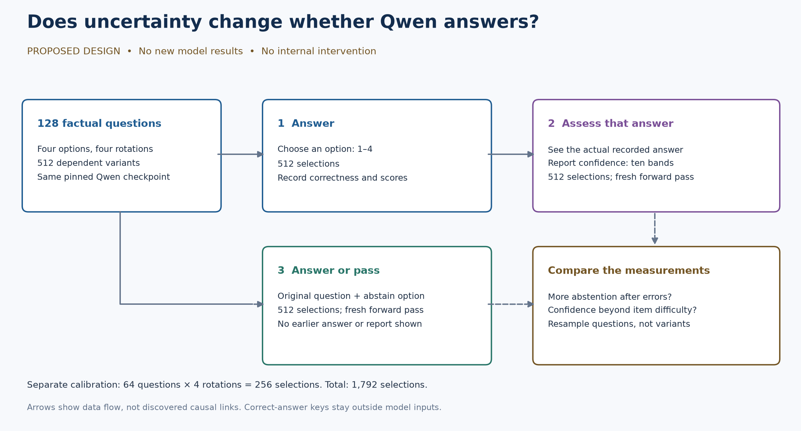

# Qwen confidence and abstention: bounded replication design

**Status, 2026-11-08: v2 completed; [verified negative baseline](QWEN_CONFIDENCE_RESULTS.md).**
All 1,792 selections are valid. Measurements are usable but the behavioral candidate rule
fails: S −1.37 pp [−10.62, +7.93], verbal AUROC 0.544 [0.485, 0.602]. The protocol stops here.
V1 subsequently stopped on an exact score tie during calibration, before any assessment
question. The explicit [v2 amendment](QWEN_CONFIDENCE_V2.md) replaces the unique-maximum
requirement with deterministic greedy tie-breaking and reports ties plus a sensitivity
analysis. The original v1 rules below remain historical; the amendment governs completed v2.
The original [machine-readable design](../designs/qwen-confidence-pilot.json) retains its
historical preparation status. The executable [configuration](../configs/qwen-confidence-pilot.json)
preserves its exact sample, prompts and scoring and adds the isolated `qwen-confidence`
engine. The dependent runner, grouped analysis, resume and evidence export are implemented.
The [execution record](QWEN_CONFIDENCE_RUN.md) distinguishes authorization, dispatch and results.

In plain language: give Qwen a factual question, record its answer, ask how likely that
answer is to be correct, and separately let it answer or pass. Does it pass more often on
questions it previously got wrong? Does its confidence tell us anything beyond a question's
general difficulty? These are distinct measurements of performance, self-evaluation and
behavior. No activation is changed in this pilot.



## Why this returns to the main question

The completed role experiments measured sensitivity to a supplied role description. Their
bounded diagnostic branch is closed: the Your/The primary comparison failed, and the prior
activation exchange failed its bidirectional rule. Those results remain part of the article;
they do not establish a functional self-monitoring mechanism.

Here the target is narrower and more directly tied to the model's own performance:
**evaluating the reliability of its answer and selectively withholding an answer**. This
is a candidate component of a functional self-model, not a definition of a complete one.
The first question is whether the measurements work on the pinned Qwen model. An internal
causal test would be a separate protocol after that baseline is understood.

The proposed study is a conceptual, partial replication of Kumaran et al.,
[Causal evidence that language models use confidence to drive behaviour](https://doi.org/10.1038/s42256-026-01293-x),
with [public author materials](https://osf.io/resw4/) and an
[accessible manuscript](https://arxiv.org/html/2603.22161). Their framework relates answers,
confidence and abstention and includes later causal experiments. We reuse the published
multiple-choice data and external covariates. Our smaller checkpoint, sample, prompts,
digit-coded confidence, reward framing and calibration objective are adaptations. We do
not reproduce their model-specific results, interventions or threshold sweep here.

Two objections shape the design. [Moran and Whiting](https://arxiv.org/abs/2605.24299v1)
argue that shared question difficulty can explain apparent metacognitive success.
[Singh, Linzen and Ravfogel](https://arxiv.org/abs/2605.26242v2) emphasize input-based
alternatives to privileged introspection. We therefore include external predictors and
describe a fresh confidence pass accurately: it can reconsider the visible question and
answer. It has no persistent access to the earlier forward pass's hidden state.

## Fixed scope and data

- `Qwen/Qwen2.5-7B-Instruct`, model and tokenizer revision
  `a09a35458c702b33eeacc393d103063234e8bc28`; BF16, no quantization, batch 1.
- Official chat template, including its actual default system message, recorded verbatim.
  No plaintext comparison, few-shot examples, free generation, SAE, training or model search.
- Context limit 2,048 tokens; reject oversized inputs, never truncate.
- Seed 1729. Select **64** questions from author `phase0_questions.csv` for calibration
  and **128** from `phase1_questions.csv` for assessment, by ascending SHA256 of the seed,
  split label and normalized question. Selection never uses difficulty or model outcomes.
- Each question receives a deterministic base permutation of its four answers, then all
  four cyclic rotations. The correct answer appears once at each position. Variants stay
  together throughout fitting, resampling and reporting.
- The remaining **872 phase-1 questions** are not sent to Qwen in this pilot. They are a
  potential reserve, not a claim of clean pretraining data or a frozen confirmation set.

The [source manifest](../review/confidence-sources.json) pins eight public author artifacts
by OSF file ID, version and SHA256. The CPU audit checks all 2,000 phase questions for
uniqueness and cross-split overlap, four distinct options, and all 3,000 covariate joins.
It checks keys against the separate master file: all 2,000 correct answers agree, but
**all 2,000 option sets differ**. Therefore the published phase tables are the task inputs;
the master is only a key provenance check. Do not silently regenerate their distractors.

This checks source consistency, not the factual truth or uniqueness of every answer.
Any identified ambiguous/stale question is logged without looking at condition effects;
the complete original-key result remains primary, with flagged-item sensitivity separate.
Public factual questions may occur in pretraining. No novelty or memorization claim follows.

## Three measurements, with explicit dependencies

| Stage | Inputs and output | Selections |
|---|---|---:|
| Calibration | 64 questions × 4 rotations; forced answer 1–4 | 256 |
| Assessment answer | 128 questions × 4 rotations; forced answer 1–4 | 512 |
| Confidence | Same question and options plus the **actual recorded answer**, even when wrong; category 0–9 | 512 |
| Optional answer | Original question/options, plus option 5 to abstain; no earlier answer or confidence supplied | 512 |
| **Total** | 192 distinct questions, 128 in the main analysis | **1,792** |

The confidence categories cover ten consecutive probability bands, represented by
midpoints 0.05, 0.15, …, 0.95. Their exact wording is in the design JSON. They measure an
elicited report. A number such as 0.85 is not an independently calibrated probability.

The optional-answer prompt gives a fixed payoff: +1 for correct, −1 for incorrect, 0 for
abstaining. It does not falsely assert that some questions lack a correct answer. No reward
is used to train the weights. This framing changes the policy being elicited and limits
generalization to other costs. The model may revise its answer rather than abstain; report
all answer transitions, including wrong→correct and correct→wrong. We do not force the
behavior by applying an external threshold to the confidence report.

Every stage is a separate forward pass. The confidence prompt sees a recorded answer;
the optional-answer prompt sees neither that answer nor the confidence report. Thus their
association cannot establish that the confidence **report causes** abstention. Shared
knowledge, input difficulty and reconsideration remain explanations.

## Scoring and calibration

For each permitted digit \(j\), record its complete continuation log-likelihood
\(\ell_j=\log P(j\mid x)\), using the existing pinned native harness backend. Every digit
must be a single token after the opened assistant turn. The preflight checks all four
possible recorded answers for every confidence prompt, not just the correct answer.
No extra whitespace or EOS, length normalization, sampling or chain-of-thought extraction.
Choose the unique maximum; ties/nonfinite scores are technical failures.

Distinguish two quantities:

\[
q_j(T)=\frac{\exp(\ell_j/T)}{\sum_{k\in\mathcal A}\exp(\ell_k/T)},
\qquad M=\sum_{k\in\mathcal A}\exp(\ell_k).
\]

The first is a probability **restricted to the menu**; the second is the model's original
probability mass on that menu. Record both, every candidate score, digit token and prompt.
High restricted confidence does not imply that unconstrained generation would obey the
format. The behavior here is constrained choice; it is not a free-form refusal rate.

Fit one temperature on the 64 calibration questions only, minimizing mean correct-option
negative log-likelihood over their four rotations. Search 401 equally spaced log-values
from 0.1 to 10; break exact ties by smaller temperature, record boundary optima. Freeze it
before assessment analysis. Do not refit on the 128 questions. Temperature preserves each
item's winning option, but need not preserve confidence ranks across different items.
All behavioral choices use the original unscaled scores. Calibration affects only reported
probabilities and their analytical covariate.

There are **10,752 candidate likelihoods** in the planned execution. The CPU tokenizer
audit checks **26,112 boundaries**, because it enumerates the four possible answer-dependent
confidence prompts. These are not additional model trials.

## Primary quantity and uncertainty

For question \(i\), rotation \(r\), let \(Y_{ir}\) indicate a correct forced answer and
\(Z_{ir}\) indicate choosing abstention in the optional-answer stage. The sole primary
behavioral quantity is

\[
S=P(Z=1\mid Y=0)-P(Z=1\mid Y=1).
\]

A positive value means the model more often withholds an answer on questions it previously
got wrong. It does not by itself identify why. Compute both conditional rates from all
512 assessment variants, weighted equally. Resample **128 whole questions**, retaining
their four rotations and all stages, 10,000 times with seed 1729; report the percentile
95% interval. A draw with an empty class is undefined: report its count and do not silently
drop it to manufacture an interval. If any such draws occur, the candidate rule below
cannot pass. Do not treat rotations or stages as independent samples. No primary p-value
or multiple primary contrasts are introduced.

Report, with the same question-level resampling:

- Forced and optional-answer accuracy; abstention/coverage; answered-only accuracy;
  payoff per question; all answer-transition counts. An empty answered set has undefined
  accuracy, not perfect accuracy. These measures expose gains due to answer revision.
- Verbal-confidence AUROC for forced correctness (ties contribute one half), Brier score,
  ten fixed probability-bin calibration plots, and the corresponding raw/calibrated
  forced-answer probabilities. Curves must display counts and not hide empty bins.
- Correct-position and rotation breakdowns, confidence-category occupancy, menu mass,
  errors, invalid outputs and the number of distinct questions behind each denominator.

Only S is primary. Other intervals are descriptive and unadjusted; their inclusion does
not authorize selecting whichever endpoint looks best.

## Does the report add anything beyond generic difficulty?

The published `difficulty_score` is the fraction correct in **20 GPT-4o runs**, so larger
means easier. It is an external comparator, not Qwen's own ability or objective difficulty.
Use the author's ten question embedding components as additional visible-content proxies.
These are precomputed author projections; only our standardization and regression are
fitted within training folds. They are not a new embedding model learned on our holdouts.
The supplied RAG covariates are integrity-audited but not used as another predictor search.

Prespecify five grouped folds: sort the 128 selected question IDs by
SHA256 of `[1729, "fold", item_id]`, assign round-robin to folds 0–4. All rotations of one
question stay in one fold. Fit three logistic predictors of forced correctness:

1. **E:** external difficulty, ten embedding components and **recorded forced-answer**
   position indicators (positions 2–4, reference 1). This is an observable answer feature;
   the hidden correct-answer position is never a predictor.
2. **E+Q:** E plus calibrated probability assigned to the forced answer.
3. **E+Q+V:** E+Q plus reported confidence midpoint.

Standardize continuous features on each training fold only; zero-variance scale is 1.
Use L2 logistic regression, C=1, intercept enabled, `lbfgs`, tolerance 1e−8,
max_iter=2,000, no class weighting or hyperparameter selection. Fit failure, one-class
training data or nonconvergence is reported, not repaired by trying other predictors.
Average held-out binary log loss across variants, weighting questions equally; clip
predictions to [1e−12, 1−1e−12] only for logarithms. Positive loss reductions indicate
incremental predictive value. Group-bootstrap the fixed out-of-fold losses and explicitly
label the intervals **conditional on these fitted models**, not full model-fitting uncertainty.

The last comparison asks whether a report adds information beyond visible-content proxies
and the model's answer-score confidence. It is a deliberately modest diagnostic, not an
exhaustive input-only adversary. Positive residual prediction still does not establish
privileged access; absent incremental information weakens a self-monitoring interpretation.

## Stop rules and the next decision

First require complete, valid dependent records and no source/token/journal mismatch.
An incomplete run is reported as incomplete; no positive candidate is assigned from the
completed subset. Preserve failures rather than replacing questions. Resume the same
identities and frozen inputs; retries of a failed stage are explicit attempts, not duplicate
scientific records. A failed forced answer blocks its dependent confidence stage.

The measurement is usable only if at least 20 distinct assessment questions contribute
to each of the forced-correct, forced-wrong, abstained and answered groups, and at least
three confidence categories occur. A question can contribute to more than one group across
rotations; report that overlap. These are feasibility requirements, not independent sample
sizes or a power calculation. The old **80% accuracy gate is inapplicable**: this task
requires both errors and successes to measure their discrimination.

A **behavioral candidate for review** requires S ≥ 0.10 with lower 95% bound above zero,
and confidence AUROC with lower bound above 0.5, alongside usable measurements. The ten-point
threshold is an explicit pilot choice, not a literature-derived universal boundary. The
conditional predictor comparison must be reviewed before proposing a confidence-specific
intervention; even a passing behavioral rule alone does not establish self-specificity.
Do not search prompts, models, confidence bins or easier item subsets to obtain a pass.

If unusable: document why and stop this protocol. If usable but negative: publish the
negative baseline. If a candidate: discuss one fixed internal intervention with random,
null and general-performance controls in a **new** protocol. No layer sweep follows.
Changes to an already generated answer cannot serve as a later accuracy control: if an
intervention is applied only after answering, unchanged earlier accuracy is guaranteed by
construction. A selective causal claim needs a separately justified intervention scope.

## Implementation handoff and reproduction

Reuse pinned Qwen loading, exact-boundary scoring and the established HF archive transport.
The isolated adapter reuses the transactional journal without changing the historical
experiment engines. The following requirements are implemented and tested before submission:

1. Parent-answer hashes on confidence jobs; atomically persisted stage outputs, resumable
   question blocks and explicit blocked/failed states. No confidence job may substitute
   the answer key for a missing model answer.
2. Tests against an independent tiny-model likelihood calculation; calibration isolation;
   grouped analysis, tied AUROC and degenerate groups; crash/restart without duplicates.
3. Full exports of config, source hashes, selected indices/permutations, prompts, tokens,
   all scores, temperature fit, dependent answers, judgments, failures and package versions.
   User-visible examples fixed as the first selected assessment question in each correct
   answer position, all stages; do not cherry-pick an impressive mistake after execution.
4. L4 dry-run plan with measured/estimated runtime clearly separated, fixed cooperative
   and provider limits, current price, tested upload/resume and a concrete cost request.
   The user subsequently authorized implementation and this bounded pilot. The launch uses
   a separate USD 5 cap for one job; previous receipts remain immutable.

CPU reproduction (no model weights, provider credentials or paid API):

```bash
# Explicitly download the pinned public author files into ignored local cache.
uv run --no-sync python scripts/review_confidence_design.py --fetch
# Eval extras and the pinned tokenizer must already be cached for this offline step.
uv run --no-sync python scripts/review_confidence_design.py --tokenizer-check \
  --out review/qwen-confidence-preflight.json
uv run --no-sync pytest -q tests/test_confidence_design.py
uv run --no-sync python scripts/render_confidence_design.py
uv run --no-sync self-study validate configs/qwen-confidence-pilot.json --tokenizer-check
```

The [CPU audit](../review/qwen-confidence-preflight.json) contains source joins, sample IDs,
input fingerprints, digit IDs, fixed example/fold IDs and maximum token length. The actual
audit passed **26,112 candidate boundaries**, with maximum total length **312 tokens**;
digits 0–9 each occupy one token. The original **11 preparation tests** are supplemented by
dependent-run, statistical, archive and tiny-Qwen likelihood tests; see the current
[verification record](VERIFICATION.md). The execution tokenizer audit preserves the same
input fingerprint. Author files remain in ignored
cache; their notebook is inspected, never executed. The output diagram is explicitly a
design. Actual result plots will come from archived records: calibration, confidence vs
correctness, abstention/error rates, answer transitions and external-predictor comparisons,
each in SVG/PDF/PNG. There are no fabricated pilot curves.

## Article and philosophical meaning

The accessible story is: **Can a machine tell when its answer is unreliable, and does that
change whether it answers?** The mathematical distinction is between an answer \(Y\),
a report \(V\) and a policy \(Z\). An internal intervention would later test causal links;
this pilot establishes only whether the observable measurements are informative.

For illusionism, the interest is in how a system constructs and uses judgments about itself.
Both a useful self-evaluation and a convincing but uninformative report would be relevant
to that engineering question. Neither outcome establishes human illusionism, an inner
observer, phenomenal experience or its absence. Replication and limits are the contribution
at this stage; a novel mechanism and a dramatic dissociation remain possibilities to test.
