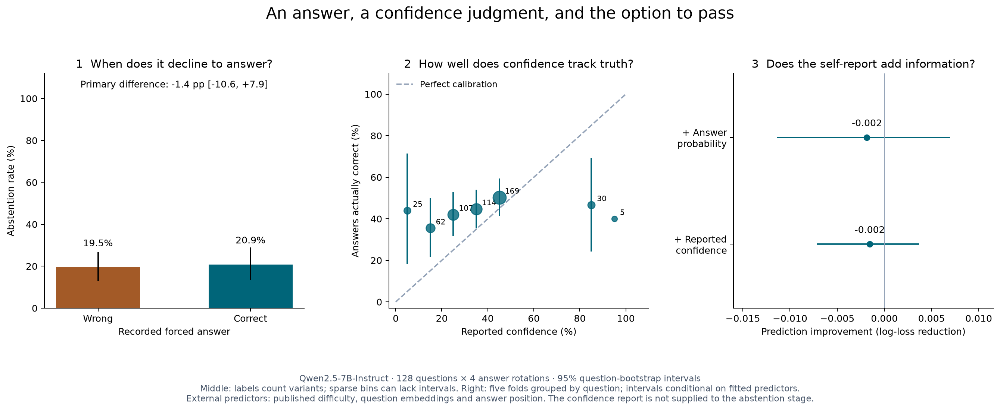

# Does Qwen know which answers to withhold?

**The completed pilot does not meet its prespecified behavioral criterion.** Qwen abstains
on 19.5% of questions it previously answered incorrectly and 20.9% of those it answered
correctly. Its confidence reports discriminate correct from incorrect answers only weakly,
with uncertainty including chance-level discrimination. All measurements are complete and
technically valid; this is a negative behavioral baseline, not another failed execution.

This result concerns **Qwen2.5-7B-Instruct, these prompts and this sample**. It does not
establish that language models cannot evaluate themselves, that Qwen lacks all functional
self-models, or that confidence has no causal role. No internal state was changed here.

Figure 1. Actual saved outputs; 128 independent assessment questions, four option rotations
each. Left: abstention conditional on the earlier answer. Middle: confidence bands against
accuracy; labels count variants, and sparse bins can have undefined intervals. Right:
incremental held-out prediction of correctness. Positive values would indicate improved
prediction. All intervals resample whole questions. The right panel's intervals condition
on the fitted predictors and exclude refitting uncertainty.

[SVG](../assets/qwen_confidence_results/article_confidence.svg) ·
[PDF](../assets/qwen_confidence_results/article_confidence.pdf) ·
[Frozen design](QWEN_CONFIDENCE_PILOT.md) · [Pre-assessment amendment](QWEN_CONFIDENCE_V2.md) ·
[Full report and fixed example](QWEN_CONFIDENCE_FULL_REPORT.md) ·
[Execution and reproduction](QWEN_CONFIDENCE_RUN.md)

## What we asked

First, Qwen chooses an answer to a factual four-option question. A separate prompt shows
its actual answer and asks for a confidence category. Another separate prompt offers the
original question with a fifth option: abstain. It awards +1 for a correct answer, −1 for
a wrong answer and zero for abstaining. The optional-answer stage sees neither the previous
answer nor the confidence report. It can change its answer as well as abstain.

For a calibrated probability of correctness p, answering has expected payoff

\[
\mathbb E[R\mid\text{answer}]=p-(1-p)=2p-1.
\]

This explains the decision problem: abstention is preferable below p = 0.5. We do not
impose that threshold on Qwen's reported number; the model chooses from the five options
itself. The reported category is not assumed to be a calibrated probability.

The pilot completed **1,792 selections and 10,752 candidate likelihoods**: 64 calibration
questions × four rotations, followed by 128 assessment questions × four rotations × three
stages. Every digit continuation is one token. The model, tokenizer, official chat format,
sample, rotations and all primary rules were fixed before assessment inference.

## The primary result and the decision

Let Y indicate a correct forced answer and Z indicate abstention in the separate optional
stage. The sole primary quantity is

\[
S=P(Z=1\mid Y=0)-P(Z=1\mid Y=1)
  =\frac{55}{282}-\frac{48}{230}
  =-0.01366.
\]

That is **−1.37 percentage points, 95% question-bootstrap interval [−10.62, +7.93]**.
There are 10,000 paired bootstrap draws with seed 1729, retaining every rotation of a
sampled question. None has an undefined primary denominator. Rotations are not extra
independent questions. No primary p-value is introduced.

The frozen candidate rule required S ≥ +10 points with an interval above zero, together
with verbal-confidence AUROC whose lower bound exceeds 0.5. The latter measures how often
a correct answer receives greater confidence than a wrong one, with ties counting one half:

\[
\operatorname{AUROC}
=P(V_{\rm correct}>V_{\rm wrong})
 +\tfrac12P(V_{\rm correct}=V_{\rm wrong}).
\]

Observed verbal AUROC is **0.544 [0.485, 0.602]**. Both behavioral requirements fail.
The result is `no_behavioral_candidate`. This does **not** establish equivalence to zero:
the primary interval still spans practically substantial effects in both directions.

The feasibility requirements pass: 92 distinct questions contribute a correct forced
answer, 101 a wrong answer, 43 an abstention and 117 a non-abstention. These groups overlap
across rotations. Seven confidence categories occur. The previous action task's 80%
accuracy gate does not apply: this measurement requires both mistakes and successes.

## Accuracy, revisions and calibration

| Quantity | Estimate | 95% question-bootstrap interval |
|---|---:|---:|
| Forced-answer accuracy | 44.92% (230/512) | 38.28–51.37% |
| Optional-answer coverage | 79.88% (409/512) | 74.02–85.35% |
| Accuracy among optional answers given | 44.25% (181/409) | 37.18–51.30% |
| Abstention after a wrong forced answer | 19.50% (55/282) | 12.88–26.67% |
| Abstention after a correct forced answer | 20.87% (48/230) | 13.45–28.99% |
| Optional-stage payoff per variant | −0.0918 | −0.2051–0.0215 |
| Verbal-confidence AUROC | 0.5444 | 0.4855–0.6021 |
| Raw answer-probability AUROC | 0.5501 | 0.4842–0.6158 |
| Calibrated answer-probability AUROC | 0.5572 | 0.4908–0.6238 |

Secondary intervals are descriptive and unadjusted. The original cloud figures provide
[calibration](../assets/qwen_confidence_results/confidence_calibration.png),
[answer transitions](../assets/qwen_confidence_results/confidence_behavior.png) and
[prediction controls](../assets/qwen_confidence_results/confidence_controls.png).
Each is also retained as SVG/PDF in the same asset directory.

Of the 230 initially correct variants, 158 remain correct, 24 become wrong and 48 abstain.
Of the 282 initially wrong variants, 23 become correct, 204 remain wrong and 55 abstain.
Thus the optional stage is not a filter applied to a fixed set of answers. These are
different prompts and forward passes, not evidence that the model consciously reconsidered.

The calibration-only temperature is T = 7.5858, inside the fixed search range. Assessment
Brier scores are 0.4984 for raw answer-menu probabilities, 0.2741 after temperature scaling,
and 0.2784 for confidence-category midpoints. Raw next-digit certainty and reported
confidence are different measurements; neither is automatically well calibrated.

Forced accuracy by correct-answer position is 46.09%, 49.22%, 42.19% and 42.19%; by rotation
it is 44.53%, 46.09%, 42.97% and 46.09%. All breakdowns, category counts and menu masses
remain in the full report and archived analysis. No position or category is removed.

## Does the report add information beyond the controls?

All three prespecified logistic predictors fit successfully in five folds grouped by
question. E contains published GPT-4o difficulty, ten author-supplied question embedding
components and the recorded answer position. Q adds the calibrated answer probability;
V then adds the verbal confidence midpoint. No hidden correct-answer position is a feature.

| Predictor | Held-out log loss | Reduction relative to preceding model [95% interval] |
|---|---:|---:|
| E | 0.72749 | — |
| E + Q | 0.72934 | −0.00185 [−0.01140, +0.00697] |
| E + Q + V | 0.73089 | −0.00155 [−0.00712, +0.00366] |

Lower loss is better. Neither addition improves the observed point estimate; both intervals
include zero. This provides no positive incremental-confidence finding. It does not prove
the proxies capture all question difficulty or rule out another valid introspection test.
The intervals are conditional on these fitted predictors, not full model-fitting uncertainty.

## Ties, failures and the fixed example

V1 stopped on its 32nd calibration selection because its unique-maximum rule rejected an
exact tie. No assessment questions had been presented. The versioned amendment chose the
smallest token ID among exact maxima before starting a fresh v2 run. The original failed
archive remains unchanged. V2 has **zero failed/invalid selections and 39 retained ties**:
three calibration answers, one assessment answer, 29 confidence reports and six abstention
choices. Near-equal values are not rounded into ties.

The prespecified amendment's descriptive sensitivity removes every assessment question with
any tie in any stage/rotation. It retains 96 questions and removes 32: S = **−2.27 pp
[−13.14, +8.43]**, verbal AUROC **0.532 [0.462, 0.599]**. This does not replace the primary.

The example fixed before inference, `assessment:0836`, asks which French journal published
Fairmaire's 1888 description of *Agrilus planipennis*. The published key is
“Revue d'Entomologie”. It was not selected for an impressive result.

| Rotation | Correct/forced digit | Confidence band | Optional digit | Optional outcome |
|---|---:|---|---:|---|
| 0 | 2 / 2 | 30–<40% | 2 | Correct |
| 1 | 1 / 1 | 40–<50% | 4 | Wrong |
| 2 | 4 / 4 | 30–<40% | 4 | Correct |
| 3 | 3 / 3 | 20–<30%, exact tie resolved | 3 | Correct |

The [full report](QWEN_CONFIDENCE_FULL_REPORT.md) contains all twelve actual prompts,
scores, token IDs and decisions, including the tie. Correctness follows the published keys;
we checked key provenance, not the factual truth of every source item.

## What follows for the study

We returned from role wording to a more direct candidate component of a functional
self-model: assessing the reliability of one's actual answers. This implementation did
not establish useful selectivity or reliable confidence discrimination. The frozen branch
therefore ends with a negative baseline. It does not justify a confidence-vector search,
layer sweep or activation intervention on this measurement.

The article gains a measured limit: fluent self-evaluation, confidence categories and
selective action are separate things to test. The human illusionism analogy remains an
explanatory question about constructed self-reports, not a conclusion from these data.
Before another paid experiment, a methodological review must justify a different
measurement or a closer reproduction of the source study; no automatic follow-up is launched.

## Evidence and reproducibility

The immutable [archive](../review/evidence/qwen-confidence-v2-4ea43316ce714c03.tar.gz)
has SHA256 `ba8b0d01d31da9004758abacd054fbdf664ed235834bc5e7889ab5e3d6cb97dd`.
All 61 payload hashes pass. A [second implementation](../scripts/review_confidence_evidence.py)
checks every choice, actual-answer dependency, primary statistic, AUROC interval and candidate
decision from raw records, without importing the study package. Its [audit](../review/qwen-confidence-audit.json)
agrees. This is software cross-checking by the same assistant, not independent peer review.

The [archived-source verifier](../scripts/verify_confidence_run.py) reproduces the complete
analysis exactly, checks all 1,792 rendered inputs and 10,752 candidate boundaries, confirms
SQLite/JSONL identity and regenerates **all nine original figure files byte-for-byte**.
See its [verification result](../review/qwen-confidence-verification.json). No model
likelihoods were recomputed in a second pretrained-model execution. The article overview is
a separate rendering of the same pinned results, not a new analysis.
