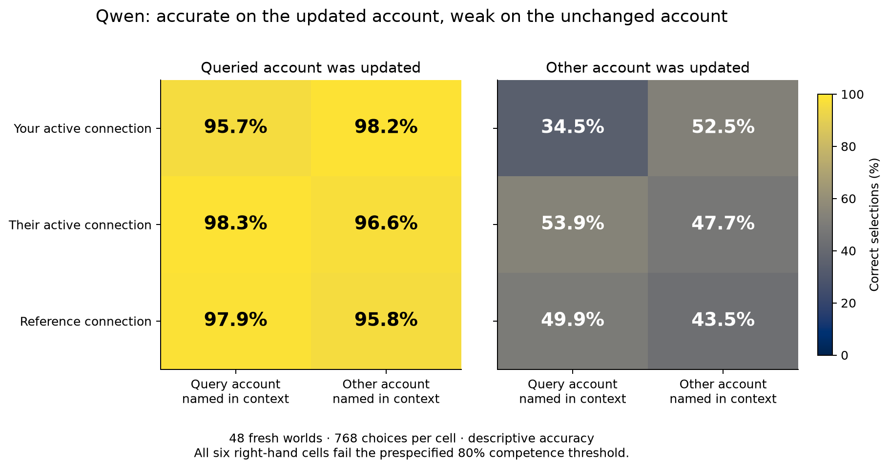

# Fresh-world ownership tranche: complete data, failed competence controls

The Qwen / permissions tranche completed all **18,432 selections across 48 fresh worlds**.
The predicted increase in other-account commands when the queried account is named did
not recur at the prespecified magnitude. Its world-averaged contrast is **−0.39 percentage
points**, with a nominal 95% paired-world bootstrap interval **[−1.43, +0.74] pp**.
All six competence cells after an irrelevant update fail the required 80% accuracy.
At the observed relevant-update accuracies, the categorical contrast can be at most
**+2.69 pp** if the total error counts are held fixed. The +10 pp rule therefore fails
in a regime with little error available to redistribute, alongside a separate failure
to resist irrelevant updates. This is a negative result under the frozen rule for this
model/template cell; it neither erases the historical effect nor establishes a functional
self-model. The bound is conditional on these observations, not a pre-run impossibility.

The [complete machine-generated report](../review/ownership-permissions-results/report.md),
[analysis](../review/ownership-permissions-results/analysis.json),
[offline audit](../review/ownership-permissions-results/audit.json) and
[archive provenance](../review/ownership-permissions-results/provenance.json) provide the evidence.
The publication draft remains unchanged at `article-v1`; this report is a separate addendum.
The subsequent [CPU design review](OWNERSHIP_DESIGN_REVIEW.md) and its
[reproducible audit](../review/ownership-design-audit/audit.json) examine the ceiling,
historical prompt parity, shortcuts and proposed controls without new model inference.

## What was tested

The frozen [replication design](OWNERSHIP_REPLICATION.md) asks whether naming the queried
account increases selection of the other account's currently permitted command. Each world
crosses Your / Their / Reference wording, whether the context names the queried or other
account, which account is updated, before/after timing, alternative grants and option order.
There are 384 variants per world. These variants are paired observations, not 18,432
independent experiments.

The model and tokenizer are Qwen2.5-7B-Instruct at revision
`a09a35458c702b33eeacc393d103063234e8bc28`, using BF16, official chat format and summed
full-command log-likelihood. No model, scoring rule, prompt or threshold was changed
after observing this tranche. This is an extension of the historical task: it uses fresh
labels/worlds and a shared introduction identifying observer Rowan as the antecedent of
“their.” It is not an exact rerun of the historical prompts. The result cannot isolate
which of these contextual changes accounts for the difference from earlier cohorts.

One historical distinction matters here. The original pilot's **self** view asked for
“your active connection,” but the later role and Your/The cohorts already put the frame
in a separate context line and named the target in the question. All 2,048 role-control
and 6,144 Your/The inputs reconstruct exactly with that historical named-query template.
The historical 186/256 comparison below comes from the latter cohort, not the pilot's
self view. Thus moving a possessive out of the queried noun phrase cannot explain
this particular cross-cohort comparison: it was already outside it. Shorter task
instructions, the Rowan introduction, event wording, answer presentation and fresh
worlds remain bundled differences. Their individual causal contributions are unknown.

## Primary result

For world \(w\), the frozen endpoint averages over the three frames:

\[
E_w=\frac13\sum_f\left[
P(\text{other-current command}\mid f,\text{target named},w)
-P(\text{other-current command}\mid f,\text{other named},w)
\right].
\]

Both probabilities use all scheduled selections **after the target account is updated**.
The estimate is the mean of the 48 world contrasts. The bootstrap resamples whole worlds
10,000 times with seed 1729. The separate paired-world t-test gives unadjusted
\(p=0.4893\), with 47 degrees of freedom. Nine worlds have a positive contrast, 19 a
negative contrast, and 20 exactly zero. The prerequired effect magnitude was at least
**+10 pp**; the observed −0.39 pp does not meet it.

| Frame | Other-current commands: target named | Other-current commands: other named | Target − other |
|---|---:|---:|---:|
| Your | 33/768 | 14/768 | +2.47 pp |
| Their | 13/768 | 26/768 | −1.69 pp |
| Reference | 16/768 | 31/768 | −1.95 pp |

The pooled counts are 62/2,304 versus 71/2,304. This table describes the components of
the single primary contrast; it does not introduce three new primary tests. There is
no Holm-adjusted four-cell decision and no wording-equivalence conclusion. Three planned
model/template cells remain unrun. The narrow interval pertains to this categorical
endpoint and context, not to all role or wording effects.

## Ceiling arithmetic: what this negative result can distinguish

Let \(q_{f,r}\) be the probability of selecting the other account's current command,
and \(e_{f,r}=1-A_{f,r}\) the total error probability, for frame \(f\) and mention
relation \(r\). Since \(0\leq q_{f,r}\leq e_{f,r}\), the primary contrast obeys

\[
-\frac13\sum_f e_{f,\mathrm{other}}
\;\leq E\leq\;
\frac13\sum_f e_{f,\mathrm{target}}.
\]

The target-named cells have **62 total errors in 2,304 selections**; the other-named
cells have **72**, of which **71** are other-current errors. Holding these observed
accuracies fixed bounds \(E\) to **[−3.125, +2.691] pp**. These are algebraic bounds,
not confidence limits. Relabeling every available target-named error as other-current
and none of the other-named errors that way still cannot yield +10 pp. The frozen
threshold remains unmet; changing the threshold after seeing the ceiling would not
make this a successful replication.

| Relevant-update Your cell | Historical Your/The cohort | This tranche |
|---|---:|---:|
| Target named: correct | 186/256 = 72.66% | 735/768 = 95.70% |
| Other named: correct | 256/256 = 100.00% | 754/768 = 98.18% |
| Target named: total error | 70/256 = 27.34% | 33/768 = 4.30% |

The target-named error rate fell by a factor of **6.36**, not 6.8. This is better
performance in this cell, not a general competence improvement: performance after an
irrelevant update is much worse. Nor does 98% accuracy in the other-named cell alone
exclude a large positive contrast; the upper bound depends on target-named errors.
The historical Your accuracy gap of +27.34 pp is unavailable at these *observed*
accuracies, but it was not prohibited by the new generator before the model answered.
The data do not determine why the error budget changed.

For comparison, the pooled accuracy gap \(D=A_{\mathrm{other}}-A_{\mathrm{target}}\)
is **−0.434 pp**, versus categorical \(E=-0.391\) pp. Their difference,
**−0.043 pp**, is the target-minus-other contrast in remaining errors: one other-named
selection chose a different valid command. Reporting both preserves the distinction
between overall performance and error direction. It does not remove the ceiling;
the accuracy gap is also constrained by total errors. Counts, historical prompts
and these calculations are reproduced by the CPU design-review script.

## The frozen competence gate and its recency confound



Each table entry below has 768 scheduled selections. “Other updated” means the queried
account retains its original permission; a successful response must resist selecting the
new command granted to the other account.

| Frame | Target updated, target named | Target updated, other named | Other updated, target named | Other updated, other named |
|---|---:|---:|---:|---:|
| Your | 95.70% | 98.18% | 34.51% | 52.47% |
| Their | 98.31% | 96.61% | 53.91% | 47.66% |
| Reference | 97.92% | 95.83% | 49.87% | 43.49% |

All six before-update cells pass the 80% rule. **All six after-irrelevant-update cells
fail**, leaving 6/12 competence cells passing. Relevant-update accuracy is not itself a
competence gate; errors there are the primary study outcome and cannot be screened away.

The error directions sharpen this distinction. After relevant updates, 133 of 134
incorrect selections choose the other account's current command; none choose the revoked
target command. After irrelevant updates, **2,442 of 2,443 errors** choose the other
account's current command, which in this stratum is precisely its newly granted command.
These conditional counts explain errors; they do not replace the all-choice denominators
of 4,608 selections per after-update stratum.

In the irrelevant-update stratum, the other account's current command and the newly
granted command are the same option by construction. Consequently, these errors cannot
distinguish “select the newest grant” from “select for the other account.” The gate
tests a demanding part of update/account tracking, with this unresolved mechanism
confound. It remains a failed gate under the frozen specification; its difficulty alone
does not invalidate requiring resistance to irrelevant changes.

The zero count for **revoked_target** has different meanings across strata. Following
a relevant update, that answer exists and its observed count is zero. Before an update
or after an irrelevant update, the target's original command remains correct, so the
category is structurally inapplicable. Its zero there supplies no evidence against
stale-state selection. The historical relevant-update zero must not be generalized
to these controls.

This pattern is compatible with the update or its new command dominating account
selection. It does not identify an attention mechanism or establish a causal explanation.
The descriptive 2×2 addresses the supplementary question about which account is named
and which is changed; it does not become a replacement primary endpoint after the fact.
The large context-mention difference within Your/other-updated remains visible in the
table, without being presented as a successful replication of the original prediction.

Changed-answer consistency is also uneven: both answers are correct in 5,904/9,216
target-identity pairs, 4,134/4,608 before/after pairs, and 2,176/2,304 alternative-grant
pairs. None are missing. The full position-, command- and world-level distributions are
retained in `analysis.json`.

## CPU shortcuts and frame differences

Scripted policies evaluated on all saved task states give the following accuracies.
They read structured state; they are diagnostic shortcuts, not measured language models.

| Policy | Before | Target updated | Other updated |
|---|---:|---:|---:|
| Newest grant, or first option before an update | 25% | 100% | 0% |
| Ignore update; use initial target permission | 100% | 0% | 100% |
| Use current permission of context-named account | 50% | 50% | 50% |
| Use own active account (Your only) | 50% | 50% | 50% |

The newest-grant policy agrees with Qwen on **4,474/4,608** relevant-update responses
and **2,442/4,608** irrelevant-update responses. Agreement is not a causal fraction:
in the first stratum, following the shortcut and correctly tracking the target give
identical answers. In the second, the shortcut and selecting the other account coincide.
All cell-level accuracies and agreements are retained in the
[CPU audit](../review/ownership-design-audit/audit.json).

The frozen endpoint measures a mention contrast within frames, not every frame effect.
A purely additive frame effect cancels in the within-frame target-minus-other
subtraction. Averaging across frames can additionally cancel oppositely directed
frame-by-mention effects. The following descriptive accuracies average the two mention
relations with equal weights:

| Stratum | Your | Their | Reference |
|---|---:|---:|---:|
| Before | 88.02% | 91.41% | 96.61% |
| Target updated | 96.94% | 97.46% | 96.88% |
| Other updated | 43.49% | 50.78% | 46.68% |

Before updates, Your is **8.59 pp** below Reference and Their **5.21 pp** below Reference.
The ranking changes after updates; there is no single frame penalty shared across strata.
These are post hoc contrasts, not additional successful primary tests. The separate
review reports nominal paired-world intervals for all six frame comparisons and their
limits. “Their” also assigns the connection to Rowan, whereas “Your” assigns it to the
addressee; it adds an antecedent-resolution requirement absent from historical “The.”
It cannot be treated as a parallel lexical substitution without checking those semantics.

## Data integrity and recovery

The original three jobs stopped on checkpoint-upload throttling after preserving 14,976
technically valid selections. The first continuation stopped before new inference on a
Python/JSON metadata comparison bug. The corrected continuation added exactly **3,456**
records: 1,152, 768 and 1,536 in the three blocks. All 14,976 earlier records remain
identical. Every block now contains 6,144 unique, technically valid selections, with zero
missing, invalid or error outcomes. Incorrect task answers remain in the dataset.

The [execution record](OWNERSHIP_RUN.md) and [incident history](OWNERSHIP_RECOVERY.md)
retain these failures. The final private HF snapshot is
`f114e53bb62b683c4d40277944985477567db498`. Unchanged copies of all three cloud exports
are included under `review/ownership-permissions-results/archives/`; credentials or GPU
access are unnecessary for offline review.

Local regeneration matches the cloud analysis, Markdown report and six original
SVG/PDF/PNG files byte-for-byte. A separate audit, importing no study-package code,
checks all 188 archive payload checksums, SQLite/JSONL equality, preserved records,
backend comparisons, frozen tokens, simulator execution, score maxima, categorical
counts, the bootstrap and the t statistic. It is a second software implementation,
not independent human peer review or an independent calculation of model likelihoods.
The supplementary accuracy figure is rendered from the saved aggregate counts and
exported in SVG, PDF and PNG as well.

```bash
uv run --no-sync python scripts/review_ownership_evidence.py
uv run --no-sync python scripts/plot_ownership_results.py
```

To regenerate the combined report, extract each tracked block archive into its own
directory, then run the existing analyzer against the three resulting `run/` directories:

```bash
uv run --no-sync python scripts/ownership_tranche.py analyze \
  --runs BLOCK_00/run BLOCK_01/run BLOCK_02/run --out NEW_REPORT_DIRECTORY
```

## Consequence for the study

This tranche supplies no qualifying role-error replication and no sound baseline for a
new internal intervention. Because the frozen full-replication rule requires every
model/template cell to pass, successful results in the other cells could not rescue
that rule with the present Qwen/permissions result retained. They could still characterize
limits of generalization, which would be a separate reason to run them.

The CPU review now supplies reconstructed historical templates, separate query-reference
probes, shortcut results, a proposed accuracy co-endpoint and proposed lookup controls.
These are [unrun design proposals](OWNERSHIP_DESIGN_REVIEW.md), not amendments to this
completed protocol. Before/lookup competence would not by itself demonstrate competence
at dynamic update tracking. Mistral, routing and another patch remain unrun. The historical findings
remain observations in their original contexts; the new result limits how broadly they
can be described. Neither a functional self-model nor its absence, phenomenal consciousness,
or human illusionism is established. No further GPU job was launched during this analysis.
