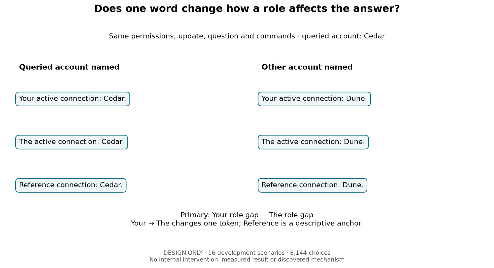

# Does “your” contribute to the role effect?

**Frozen pilot `qwen-possessive-v1`; implemented and CPU-verified, no model results yet.**
The [method review](reviews/2026-11-07-role-patch-method-review.md) motivated this single
follow-up. It changes an input word, with no activation patch, feature search, generation,
new model or layer sweep. The completed patch's failed bidirectional decision remains unchanged.



For a nontechnical reader: two accounts have different permissions. After an update, the model
must choose a command for a named account. Does calling an account **“your active connection”**
affect its answer differently from calling it **“the active connection”**? Only one token changes
in that comparison. This helps establish what our earlier role-sensitive result was measuring
before we invest in another internal intervention.

## Inputs fixed before inference

- Qwen/Qwen2.5-7B-Instruct, model and tokenizer revision
  `a09a35458c702b33eeacc393d103063234e8bc28`; BF16, no quantization.
- Native Hugging Face backend through `lm-eval==0.4.13`, eager attention, float32 softmax,
  TF32 disabled, batch 1; official chat template including its default system message.
- Unchanged `action-permissions-v2.1-draft`, seed 1729, **development scenarios 16–31**.
  Sixteen newly selected instances of the same template and vocabulary; no held-out-template
  or general-population claim. Indices were selected before inspecting model responses.
- Each scenario has 64 task variants: two changed accounts × two grant alternatives × two
  queried identities × before/after × four command rotations. Questions always name the target.
- Each variant receives three context lines, crossed with context naming target/other:
  `Your active connection: {actor}.`, `The active connection: {actor}.`,
  `Reference connection: {actor}.`. Thus **6,144 choices**, in 16 resumable blocks of 384.
- Six conditions stay adjacent; their execution order is deterministically shuffled and rotated.
  There are **3,840 distinct model inputs**, because some before-update variants repeat.
  Repeats are retained as matched design variants, never counted as independent scenarios.
- Every Your/The pair changes exactly token **7771 → 785 at zero-based position 57**.
  All lengths and other token positions are equal. The Reference line deliberately retains
  its old wording and shorter token length; it is not a token-matched primary comparison.
- Responses are exact command continuations in the open assistant turn, with no added space
  or EOS. Score the **sum** of conditional log-likelihoods over the entire command. Commands
  have three or four tokens; no length normalization or post hoc scoring switch is allowed.
  Maximum audited prompt plus command length is 156, below the 2,048 limit; no truncation.

The [preflight](../review/qwen-possessive-preflight.json) includes exact input/token checks and
hash-pinned comparisons against every prior archived Qwen action run. Scenario IDs, exact
inputs and inputs with context wording removed have **zero overlap**. This is instance
separation, not new language, new templates or demonstrated statistical power. Historical
Gemma tasks use a different task generator; rated Qwen exports repeat the original outputs.

Frozen plan SHA256: `ab455c85fb4a1c0e237dcbd317f1e0be4401d65dc2cc0a8d9bbe95994d0b511d`.
Frozen rendered token-input SHA256:
`44da35dd8ca75899c277f60ec3cbf7b34f4c4f6cceda646e461cb24089a90b4e`.
The [design archive](../review/evidence/qwen-possessive-v1-design.tar.gz) contains every task,
model-facing input, oracle, tokenizer audit and the SVG/PDF/PNG design. Its manifest says
`design_only`; the runner refuses to treat it as a completed or resumable model run.

## One primary question and decision

For each scenario and frame f, define the role gap after the queried account's permission changes:

$$D_f=A_{f,other}-A_{f,target},\qquad S=D_{Your}-D_{The}.$$

Accuracy is automatically scored by executing the selected command in the simulator. Ties,
invalid scores and execution errors count as incorrect. Missing outcomes remain missing and
prevent a successful decision; incomplete matched sextets receive no paired effect estimate.

**The only primary statistical comparison is S in the `after_relevant` stratum.** The point
estimate is the average of the 16 scenario contrasts (equal variant counts). A percentile
95% interval uses 10,000 paired scenario-bootstrap draws, seed 1729, keeping every variant
and condition of a scenario together. The exact two-sided sign-flip test enumerates all
65,536 scenario sign assignments, counting ties in the tail. It assumes independent,
symmetric scenario effects under the null; it is not a randomized treatment-assignment test.
Scenarios remain a small, designed set, not a representative sample of natural interactions.

A **possessive-wording candidate** requires all of:

1. Complete real-model data, matching source and token audits, and no measurement errors.
2. S ≥ **5 percentage points**, with bootstrap lower bound strictly above zero.
3. Exact two-sided sign-flip p ≤ 0.05 and strictly positive contrasts in ≥ **12 of 16** scenarios.
4. ≥80% accuracy in each of **48** control cells: every frame/relation combination ×
   (two queried identities, four answer positions, before-update checkpoint and irrelevant-update
   checkpoint). Identity/position cells pool checkpoints, as in the earlier role control.

These are newly prespecified **pilot quality rules**, not a power calculation or repairs to
the failed original capability gate. They permit a bounded interpretation and planning step,
not another automatic job or a claim of functional self-model competence. All failures,
negative/opposite effects and incomplete outcomes are reported. No alternative layer, model,
metric, threshold or favorable subset replaces S after results are known.

## Descriptive measurements and limits

The historical contrast $D_{Your}-D_{Reference}$ is a descriptive anchor on fresh instances,
not a second primary test or another route to success. All six cell accuracies and three
frame gaps are reported at all three checkpoints. The report also includes every identity,
answer position, command identity, and changed-answer counterfactual pair (query identity,
before/after, grant alternative). A counterfactual pair succeeds only when **both** answers
are correct. These pair rates remain visible even if the wording candidate rule passes;
they do not reopen the original capability screen.

Secondary margins use
$m=\log P(\text{correct command}\mid p)-\log P(\text{other account's allowed command}\mid p)$
in nats, with the same paired gap contrasts. They are not confidence percentages. Invalid
scores yield no margin; complete sextets are required for paired margin estimates. Secondary
intervals are nominal descriptions, without independent success claims or multiplicity-adjusted
confirmatory interpretation. No inference of equivalence follows from a nonsignificant S.

- If the old contrast recurs and S passes, the possessive token contributes under this template.
  Salience, semantics and instruction relevance remain plausible explanations.
- If S is inconclusive, report its interval and the anchor; a large anchor cannot rescue it.
- If the old contrast does not recur clearly, first reassess the earlier effect's stability.
  An isolated positive S would still require this qualification.
- After this bounded control, revisit the study's central question and article. Do not
  continue a sequence of ad hoc diagnostics automatically.

This experiment does not measure private-state introspection, a self-monitoring circuit,
phenomenal consciousness or human illusionism. The larger motivation remains how self-language
relates to functional behavior, and what constructed self-descriptions can and cannot tell us.

## Execution and reproducible handover

The configuration is [configs/qwen-possessive-control.json](../configs/qwen-possessive-control.json).
The existing `validate`, `run`, `analyze`, `export` CLI and HF launcher select it explicitly;
historical configurations keep their previous defaults and results. Only prompt, exact
commands and format reach the model backend. The dataset's answers remain in scoring metadata.
Actual rendered inputs and every continuation are checked against the frozen token inventory
before pretrained weights load, at execution, on resumption and during result audit.

Completed trials are journaled atomically; a private HF checkpoint is uploaded initially,
after each scenario block and on cooperative exit. A hard provider kill can lose work since
the last successful upload, but not previously uploaded blocks. Resumption requires the same
source, config, package environment and pinned artifact revision, a new receipt and separate
budget approval. It never silently retries a failed or unknown job dispatch.

CPU preparation (no pretrained inference):

```bash
uv run --no-sync pytest -q
uv run --no-sync python scripts/review_possessive_design.py --tokenizer-check
uv run --no-sync self-study validate configs/qwen-possessive-control.json --tokenizer-check
# Optional design-only export; choose a new/empty folder:
uv run --no-sync self-study validate configs/qwen-possessive-control.json --freeze runs/possessive-design
uv run --no-sync self-study export runs/possessive-design --out exports/possessive-design.tar.gz
```

Cloud quote only (reads hardware price, does not submit):

```bash
uv run --script scripts/hf_jobs.py plan --namespace zett13 --budget-usd 5 --config configs/qwen-possessive-control.json
```

**No paid launch is authorized by this document.** After explicit approval for this one job,
from a clean, pushed main branch:

```bash
uv run --script scripts/hf_jobs.py submit --namespace zett13 --budget-usd 5 --config configs/qwen-possessive-control.json
uv run --script scripts/hf_jobs.py status --receipt .hf-jobs/qwen-possessive-control.json
uv run --script scripts/hf_jobs.py fetch --receipt .hf-jobs/qwen-possessive-control.json
```

One L4, 90-minute cooperative experiment limit and two-hour provider limit, including setup.
The prior uncached patch averaged about 0.387 seconds per scientific selection: approximately
40 minutes for 6,144 choices, before token audits, setup, uploads and export. A working estimate
is **40–60 minutes**, not a completion guarantee; this run retains the original baseline
scorer's cache behavior. The launcher refreshes the live price and reserves one extra billable
minute in its compute bound; it requires that bound to be at most half the approved budget.
The read-only price check on 2026-11-07 quotes **USD 0.013333/minute**, hence
**USD 1.613293 maximum compute** for 121 billable minutes. The proposed total budget is
USD 5, pending approval; the price is checked again before submission.
No credit purchase, repeat job or model expansion is automatic.

Exports contain the source snapshot, provenance, all scores/tokens, simulator results, errors,
analysis JSON, full report and a short accessible article section. All plots are generated from
saved records in SVG/PDF/PNG. Six complete examples are fixed before inference: scenario 0016,
queried identity 0, relevant after-update, grant alternative 0, rotation 0, all conditions.
The design illustration describes an input comparison, not a neural mechanism.
