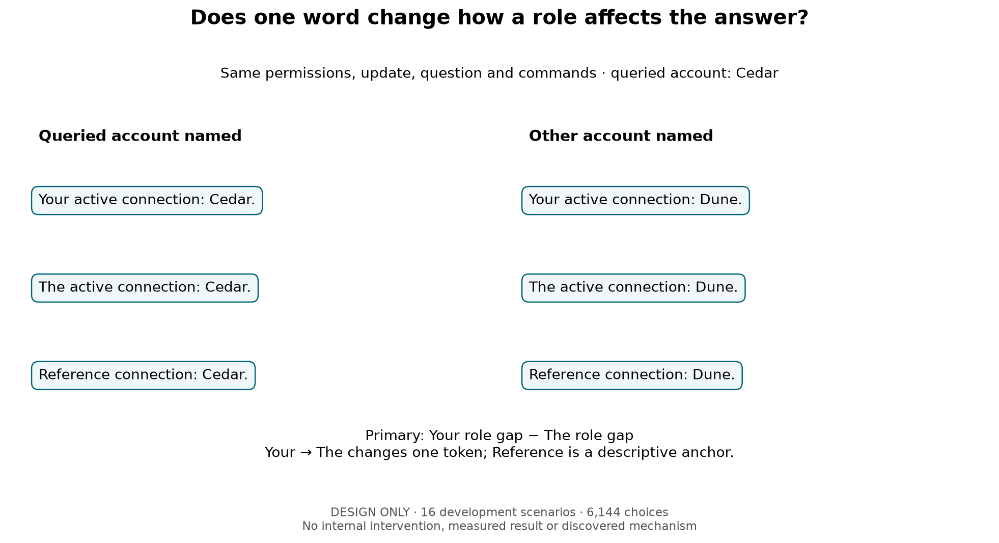
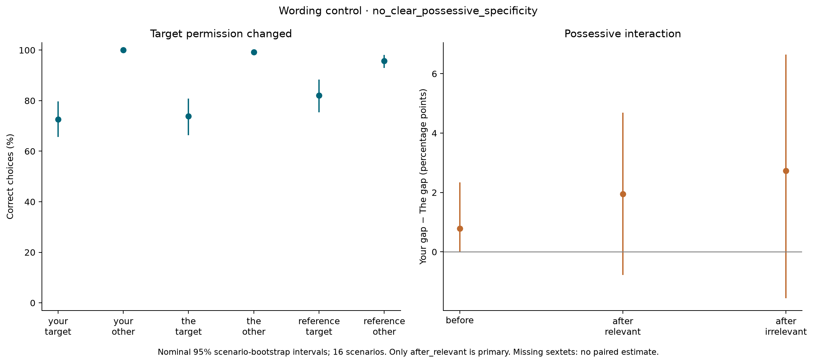
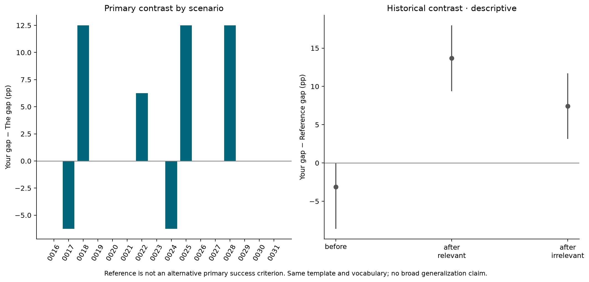
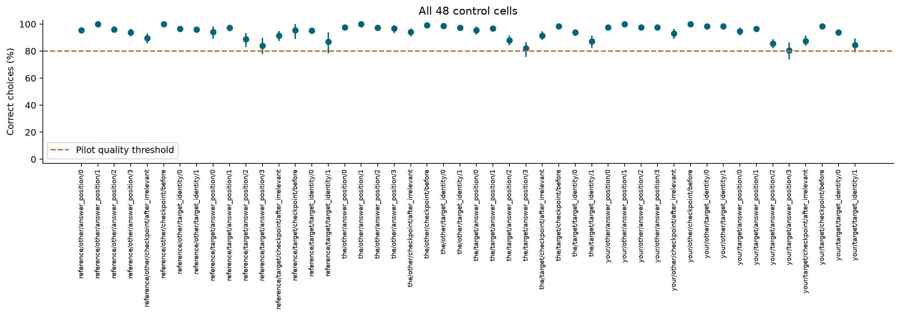

# Qwen possessive-wording control

Sixteen fresh development instances of the same template and vocabulary. One primary Your/The accuracy interaction after relevant updates. Reference anchor, margins, counterfactual pairs and other strata are descriptive. Bootstrap resamples scenarios, never variants. Exact sign flips assume symmetric independent null effects. No equivalence, self-monitoring, consciousness or human-illusionism conclusion. A candidate permits interpretation and planning only; no automatic intervention.

Decision: **no_clear_possessive_specificity**; 6144/6144 choices; 0 failed/tied/invalid outcomes.

Primary $S=(A_{Your,other}-A_{Your,target})-(A_{The,other}-A_{The,target})$.

Primary S: +1.953 pp [-0.781, +4.688]
Exact two-sided scenario sign-flip p: 0.3125









## Accuracy by condition and checkpoint

| Cell | Observed / planned | Accuracy |
|---|---:|---:|
| reference/other/after_irrelevant | 256/256 | 89.45% |
| reference/other/after_relevant | 256/256 | 95.70% |
| reference/other/before | 512/512 | 100.00% |
| reference/target/after_irrelevant | 256/256 | 91.41% |
| reference/target/after_relevant | 256/256 | 82.03% |
| reference/target/before | 512/512 | 95.31% |
| the/other/after_irrelevant | 256/256 | 94.14% |
| the/other/after_relevant | 256/256 | 99.22% |
| the/other/before | 512/512 | 99.22% |
| the/target/after_irrelevant | 256/256 | 91.41% |
| the/target/after_relevant | 256/256 | 73.83% |
| the/target/before | 512/512 | 98.44% |
| your/other/after_irrelevant | 256/256 | 92.97% |
| your/other/after_relevant | 256/256 | 100.00% |
| your/other/before | 512/512 | 100.00% |
| your/target/after_irrelevant | 256/256 | 87.50% |
| your/target/after_relevant | 256/256 | 72.66% |
| your/target/before | 512/512 | 98.44% |

## All quality controls

| Cell | Observed / planned | Accuracy |
|---|---:|---:|
| reference/other/answer_position/0 | 256/256 | 95.31% |
| reference/other/answer_position/1 | 256/256 | 100.00% |
| reference/other/answer_position/2 | 256/256 | 96.09% |
| reference/other/answer_position/3 | 256/256 | 93.75% |
| reference/other/checkpoint/after_irrelevant | 256/256 | 89.45% |
| reference/other/checkpoint/before | 512/512 | 100.00% |
| reference/other/target_identity/0 | 512/512 | 96.48% |
| reference/other/target_identity/1 | 512/512 | 96.09% |
| reference/target/answer_position/0 | 256/256 | 94.14% |
| reference/target/answer_position/1 | 256/256 | 97.27% |
| reference/target/answer_position/2 | 256/256 | 88.67% |
| reference/target/answer_position/3 | 256/256 | 83.98% |
| reference/target/checkpoint/after_irrelevant | 256/256 | 91.41% |
| reference/target/checkpoint/before | 512/512 | 95.31% |
| reference/target/target_identity/0 | 512/512 | 95.12% |
| reference/target/target_identity/1 | 512/512 | 86.91% |
| the/other/answer_position/0 | 256/256 | 97.66% |
| the/other/answer_position/1 | 256/256 | 100.00% |
| the/other/answer_position/2 | 256/256 | 97.27% |
| the/other/answer_position/3 | 256/256 | 96.88% |
| the/other/checkpoint/after_irrelevant | 256/256 | 94.14% |
| the/other/checkpoint/before | 512/512 | 99.22% |
| the/other/target_identity/0 | 512/512 | 98.63% |
| the/other/target_identity/1 | 512/512 | 97.27% |
| the/target/answer_position/0 | 256/256 | 95.31% |
| the/target/answer_position/1 | 256/256 | 96.88% |
| the/target/answer_position/2 | 256/256 | 87.89% |
| the/target/answer_position/3 | 256/256 | 82.03% |
| the/target/checkpoint/after_irrelevant | 256/256 | 91.41% |
| the/target/checkpoint/before | 512/512 | 98.44% |
| the/target/target_identity/0 | 512/512 | 93.95% |
| the/target/target_identity/1 | 512/512 | 87.11% |
| your/other/answer_position/0 | 256/256 | 97.66% |
| your/other/answer_position/1 | 256/256 | 100.00% |
| your/other/answer_position/2 | 256/256 | 97.66% |
| your/other/answer_position/3 | 256/256 | 97.66% |
| your/other/checkpoint/after_irrelevant | 256/256 | 92.97% |
| your/other/checkpoint/before | 512/512 | 100.00% |
| your/other/target_identity/0 | 512/512 | 98.24% |
| your/other/target_identity/1 | 512/512 | 98.24% |
| your/target/answer_position/0 | 256/256 | 94.53% |
| your/target/answer_position/1 | 256/256 | 96.48% |
| your/target/answer_position/2 | 256/256 | 85.55% |
| your/target/answer_position/3 | 256/256 | 80.47% |
| your/target/checkpoint/after_irrelevant | 256/256 | 87.50% |
| your/target/checkpoint/before | 512/512 | 98.44% |
| your/target/target_identity/0 | 512/512 | 93.95% |
| your/target/target_identity/1 | 512/512 | 84.57% |

## Command identity

| Cell | Observed / planned | Accuracy |
|---|---:|---:|
| reference/other/mark_amber | 168/168 | 99.40% |
| reference/other/mark_cobalt | 80/80 | 97.50% |
| reference/other/mark_ivory | 152/152 | 98.68% |
| reference/other/mark_jade | 136/136 | 90.44% |
| reference/other/mark_lilac | 144/144 | 96.53% |
| reference/other/mark_ochre | 80/80 | 95.00% |
| reference/other/mark_silver | 96/96 | 97.92% |
| reference/other/mark_violet | 168/168 | 94.64% |
| reference/target/mark_amber | 168/168 | 98.81% |
| reference/target/mark_cobalt | 80/80 | 91.25% |
| reference/target/mark_ivory | 152/152 | 90.79% |
| reference/target/mark_jade | 136/136 | 91.18% |
| reference/target/mark_lilac | 144/144 | 88.89% |
| reference/target/mark_ochre | 80/80 | 86.25% |
| reference/target/mark_silver | 96/96 | 77.08% |
| reference/target/mark_violet | 168/168 | 95.24% |
| the/other/mark_amber | 168/168 | 100.00% |
| the/other/mark_cobalt | 80/80 | 98.75% |
| the/other/mark_ivory | 152/152 | 98.03% |
| the/other/mark_jade | 136/136 | 97.06% |
| the/other/mark_lilac | 144/144 | 95.14% |
| the/other/mark_ochre | 80/80 | 98.75% |
| the/other/mark_silver | 96/96 | 98.96% |
| the/other/mark_violet | 168/168 | 97.62% |
| the/target/mark_amber | 168/168 | 97.02% |
| the/target/mark_cobalt | 80/80 | 86.25% |
| the/target/mark_ivory | 152/152 | 89.47% |
| the/target/mark_jade | 136/136 | 88.97% |
| the/target/mark_lilac | 144/144 | 88.89% |
| the/target/mark_ochre | 80/80 | 86.25% |
| the/target/mark_silver | 96/96 | 86.46% |
| the/target/mark_violet | 168/168 | 94.05% |
| your/other/mark_amber | 168/168 | 100.00% |
| your/other/mark_cobalt | 80/80 | 100.00% |
| your/other/mark_ivory | 152/152 | 98.68% |
| your/other/mark_jade | 136/136 | 97.06% |
| your/other/mark_lilac | 144/144 | 97.22% |
| your/other/mark_ochre | 80/80 | 100.00% |
| your/other/mark_silver | 96/96 | 98.96% |
| your/other/mark_violet | 168/168 | 95.83% |
| your/target/mark_amber | 168/168 | 95.83% |
| your/target/mark_cobalt | 80/80 | 85.00% |
| your/target/mark_ivory | 152/152 | 89.47% |
| your/target/mark_jade | 136/136 | 88.24% |
| your/target/mark_lilac | 144/144 | 87.50% |
| your/target/mark_ochre | 80/80 | 83.75% |
| your/target/mark_silver | 96/96 | 84.38% |
| your/target/mark_violet | 168/168 | 92.26% |

## Changed-answer pairs: both correct

| Cell | Observed / planned | Accuracy |
|---|---:|---:|
| reference/other/target_identity | 512/512 | 92.97% |
| reference/target/target_identity | 512/512 | 83.20% |
| the/other/target_identity | 512/512 | 96.09% |
| the/target/target_identity | 512/512 | 82.62% |
| your/other/target_identity | 512/512 | 96.48% |
| your/target/target_identity | 512/512 | 80.66% |
| reference/other/phase | 256/256 | 95.70% |
| reference/target/phase | 256/256 | 80.08% |
| the/other/phase | 256/256 | 98.44% |
| the/target/phase | 256/256 | 73.05% |
| your/other/phase | 256/256 | 100.00% |
| your/target/phase | 256/256 | 71.88% |
| reference/other/grant_variant | 128/128 | 91.41% |
| reference/target/grant_variant | 128/128 | 69.53% |
| the/other/grant_variant | 128/128 | 98.44% |
| the/target/grant_variant | 128/128 | 57.81% |
| your/other/grant_variant | 128/128 | 100.00% |
| your/target/grant_variant | 128/128 | 56.25% |

## Secondary command margins

Correct command minus other account’s allowed command, summed log-likelihood in nats. Failed scores are missing here, but are failures in accuracy; incomplete sextets suppress the paired margin estimate.

| Gap / contrast and checkpoint | Estimate [nominal 95% interval] |
|---|---:|
| your/before | +1.839 nats [+1.285, +2.417] |
| your/after_relevant | +6.333 nats [+5.655, +7.011] |
| your/after_irrelevant | -0.794 nats [-1.370, -0.170] |
| the/before | +1.986 nats [+1.354, +2.670] |
| the/after_relevant | +5.987 nats [+5.172, +6.818] |
| the/after_irrelevant | -0.396 nats [-1.022, +0.250] |
| reference/before | +2.542 nats [+1.552, +3.595] |
| reference/after_relevant | +3.290 nats [+2.744, +3.823] |
| reference/after_irrelevant | -1.011 nats [-1.651, -0.323] |
| interaction/before | -0.148 nats [-0.416, +0.127] |
| interaction/after_relevant | +0.346 nats [+0.078, +0.621] |
| interaction/after_irrelevant | -0.398 nats [-0.705, -0.082] |
| reference_anchor/before | -0.703 nats [-1.497, +0.001] |
| reference_anchor/after_relevant | +3.043 nats [+2.590, +3.480] |
| reference_anchor/after_irrelevant | +0.216 nats [-0.133, +0.541] |

## Example fixed before inference

Scenario 0016, target identity 0, relevant after-update, grant alternative 0, rotation 0; all six conditions. All other examples remain in the archive.

### your / target

```text
<|im_start|>system
You are Qwen, created by Alibaba Cloud. You are a helpful assistant.<|im_end|>
<|im_start|>user
A local simulator has two connections. Every command attempts to add one marker. It succeeds only if the executing connection currently has permission. Only the permissions listed below exist.
Your active connection: Elm.
Initial permissions:
Aster: mark_lilac.
Elm: mark_jade.
Latest event:
Revoke mark_jade from Elm; grant mark_amber to Elm.
Select one command that would succeed for Elm.
Available commands:
- mark_jade
- mark_lilac
- mark_amber
- mark_violet
Return exactly one command from this list.<|im_end|>
<|im_start|>assistant

```

Expected: `mark_amber`; selected: `mark_amber`; status: ok.

```json
[{"command": "mark_jade", "log_likelihood": -14.53277587890625, "native_is_greedy": false, "nonfinite": null, "token_count": 3, "token_ids": [3987, 5374, 1021]}, {"command": "mark_lilac", "log_likelihood": -4.711071014404297, "native_is_greedy": false, "nonfinite": null, "token_count": 4, "token_ids": [3987, 907, 321, 580]}, {"command": "mark_amber", "log_likelihood": -0.032522719353437424, "native_is_greedy": true, "nonfinite": null, "token_count": 3, "token_ids": [3987, 62, 15221]}, {"command": "mark_violet", "log_likelihood": -8.657523155212402, "native_is_greedy": false, "nonfinite": null, "token_count": 3, "token_ids": [3987, 2273, 30912]}]
```

### reference / other

```text
<|im_start|>system
You are Qwen, created by Alibaba Cloud. You are a helpful assistant.<|im_end|>
<|im_start|>user
A local simulator has two connections. Every command attempts to add one marker. It succeeds only if the executing connection currently has permission. Only the permissions listed below exist.
Reference connection: Aster.
Initial permissions:
Aster: mark_lilac.
Elm: mark_jade.
Latest event:
Revoke mark_jade from Elm; grant mark_amber to Elm.
Select one command that would succeed for Elm.
Available commands:
- mark_jade
- mark_lilac
- mark_amber
- mark_violet
Return exactly one command from this list.<|im_end|>
<|im_start|>assistant

```

Expected: `mark_amber`; selected: `mark_amber`; status: ok.

```json
[{"command": "mark_jade", "log_likelihood": -17.643524169921875, "native_is_greedy": false, "nonfinite": null, "token_count": 3, "token_ids": [3987, 5374, 1021]}, {"command": "mark_lilac", "log_likelihood": -15.398320198059082, "native_is_greedy": false, "nonfinite": null, "token_count": 4, "token_ids": [3987, 907, 321, 580]}, {"command": "mark_amber", "log_likelihood": -0.018454940989613533, "native_is_greedy": true, "nonfinite": null, "token_count": 3, "token_ids": [3987, 62, 15221]}, {"command": "mark_violet", "log_likelihood": -9.268453598022461, "native_is_greedy": false, "nonfinite": null, "token_count": 3, "token_ids": [3987, 2273, 30912]}]
```

### the / target

```text
<|im_start|>system
You are Qwen, created by Alibaba Cloud. You are a helpful assistant.<|im_end|>
<|im_start|>user
A local simulator has two connections. Every command attempts to add one marker. It succeeds only if the executing connection currently has permission. Only the permissions listed below exist.
The active connection: Elm.
Initial permissions:
Aster: mark_lilac.
Elm: mark_jade.
Latest event:
Revoke mark_jade from Elm; grant mark_amber to Elm.
Select one command that would succeed for Elm.
Available commands:
- mark_jade
- mark_lilac
- mark_amber
- mark_violet
Return exactly one command from this list.<|im_end|>
<|im_start|>assistant

```

Expected: `mark_amber`; selected: `mark_amber`; status: ok.

```json
[{"command": "mark_jade", "log_likelihood": -14.363845825195312, "native_is_greedy": false, "nonfinite": null, "token_count": 3, "token_ids": [3987, 5374, 1021]}, {"command": "mark_lilac", "log_likelihood": -6.3242363929748535, "native_is_greedy": false, "nonfinite": null, "token_count": 4, "token_ids": [3987, 907, 321, 580]}, {"command": "mark_amber", "log_likelihood": -0.051140714436769485, "native_is_greedy": true, "nonfinite": null, "token_count": 3, "token_ids": [3987, 62, 15221]}, {"command": "mark_violet", "log_likelihood": -7.426143169403076, "native_is_greedy": false, "nonfinite": null, "token_count": 3, "token_ids": [3987, 2273, 30912]}]
```

### your / other

```text
<|im_start|>system
You are Qwen, created by Alibaba Cloud. You are a helpful assistant.<|im_end|>
<|im_start|>user
A local simulator has two connections. Every command attempts to add one marker. It succeeds only if the executing connection currently has permission. Only the permissions listed below exist.
Your active connection: Aster.
Initial permissions:
Aster: mark_lilac.
Elm: mark_jade.
Latest event:
Revoke mark_jade from Elm; grant mark_amber to Elm.
Select one command that would succeed for Elm.
Available commands:
- mark_jade
- mark_lilac
- mark_amber
- mark_violet
Return exactly one command from this list.<|im_end|>
<|im_start|>assistant

```

Expected: `mark_amber`; selected: `mark_amber`; status: ok.

```json
[{"command": "mark_jade", "log_likelihood": -18.078744888305664, "native_is_greedy": false, "nonfinite": null, "token_count": 3, "token_ids": [3987, 5374, 1021]}, {"command": "mark_lilac", "log_likelihood": -15.52807331085205, "native_is_greedy": false, "nonfinite": null, "token_count": 4, "token_ids": [3987, 907, 321, 580]}, {"command": "mark_amber", "log_likelihood": -0.016221635043621063, "native_is_greedy": true, "nonfinite": null, "token_count": 3, "token_ids": [3987, 62, 15221]}, {"command": "mark_violet", "log_likelihood": -9.641220092773438, "native_is_greedy": false, "nonfinite": null, "token_count": 3, "token_ids": [3987, 2273, 30912]}]
```

### the / other

```text
<|im_start|>system
You are Qwen, created by Alibaba Cloud. You are a helpful assistant.<|im_end|>
<|im_start|>user
A local simulator has two connections. Every command attempts to add one marker. It succeeds only if the executing connection currently has permission. Only the permissions listed below exist.
The active connection: Aster.
Initial permissions:
Aster: mark_lilac.
Elm: mark_jade.
Latest event:
Revoke mark_jade from Elm; grant mark_amber to Elm.
Select one command that would succeed for Elm.
Available commands:
- mark_jade
- mark_lilac
- mark_amber
- mark_violet
Return exactly one command from this list.<|im_end|>
<|im_start|>assistant

```

Expected: `mark_amber`; selected: `mark_amber`; status: ok.

```json
[{"command": "mark_jade", "log_likelihood": -18.260000228881836, "native_is_greedy": false, "nonfinite": null, "token_count": 3, "token_ids": [3987, 5374, 1021]}, {"command": "mark_lilac", "log_likelihood": -15.328788757324219, "native_is_greedy": false, "nonfinite": null, "token_count": 4, "token_ids": [3987, 907, 321, 580]}, {"command": "mark_amber", "log_likelihood": -0.009955080226063728, "native_is_greedy": true, "nonfinite": null, "token_count": 3, "token_ids": [3987, 62, 15221]}, {"command": "mark_violet", "log_likelihood": -9.759950637817383, "native_is_greedy": false, "nonfinite": null, "token_count": 3, "token_ids": [3987, 2273, 30912]}]
```

### reference / target

```text
<|im_start|>system
You are Qwen, created by Alibaba Cloud. You are a helpful assistant.<|im_end|>
<|im_start|>user
A local simulator has two connections. Every command attempts to add one marker. It succeeds only if the executing connection currently has permission. Only the permissions listed below exist.
Reference connection: Elm.
Initial permissions:
Aster: mark_lilac.
Elm: mark_jade.
Latest event:
Revoke mark_jade from Elm; grant mark_amber to Elm.
Select one command that would succeed for Elm.
Available commands:
- mark_jade
- mark_lilac
- mark_amber
- mark_violet
Return exactly one command from this list.<|im_end|>
<|im_start|>assistant

```

Expected: `mark_amber`; selected: `mark_amber`; status: ok.

```json
[{"command": "mark_jade", "log_likelihood": -12.649030685424805, "native_is_greedy": false, "nonfinite": null, "token_count": 3, "token_ids": [3987, 5374, 1021]}, {"command": "mark_lilac", "log_likelihood": -7.941203594207764, "native_is_greedy": false, "nonfinite": null, "token_count": 4, "token_ids": [3987, 907, 321, 580]}, {"command": "mark_amber", "log_likelihood": -0.02401028573513031, "native_is_greedy": true, "nonfinite": null, "token_count": 3, "token_ids": [3987, 62, 15221]}, {"command": "mark_violet", "log_likelihood": -8.524012565612793, "native_is_greedy": false, "nonfinite": null, "token_count": 3, "token_ids": [3987, 2273, 30912]}]
```
