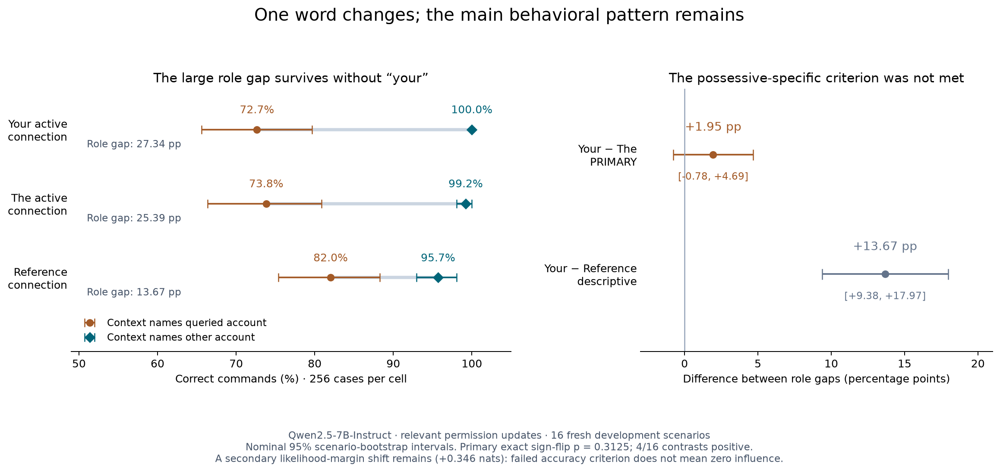
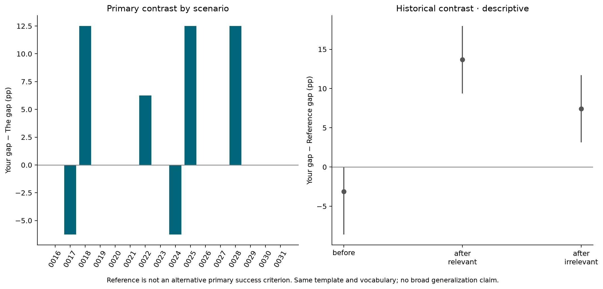

# One word changes; the large role effect remains

The frozen **Your/The control completed all 6,144 choices**, with zero failed, tied or invalid
outcomes. All 48 quality-control cells passed. The primary accuracy interaction was
**+1.95 percentage points**, with nominal 95% scenario-bootstrap interval **−0.78 to +4.69**,
exact two-sided sign-flip **p=0.3125**, and positive effects in **4/16 scenarios**.
The decision is **`no_clear_possessive_specificity`**: the prespecified candidate rule failed.

The large role gap also occurs with **“The active connection”**, which has no possessive
“your”. This weakens a specifically possessive explanation of the earlier result. It does
not show that the token has zero influence: a secondary likelihood-margin interaction
remains positive. No self-monitoring mechanism or functional dissociation is established.



**Reading the figure:** each row keeps the permissions and question fixed. Orange means the
context names the account we ask about; teal means it names the other account. Both “Your”
and “The” show a large accuracy gap. The right panel subtracts those gaps. Intervals resample
16 scenarios, not thousands of variants. The Reference comparison is descriptive.
[SVG](../assets/qwen_possessive_results/article_possessive.svg) ·
[PDF](../assets/qwen_possessive_results/article_possessive.pdf).

## The question in ordinary language

Two accounts have different permissions. After a permission changes, we ask which command
works for a named account. A separate context line says either **“Your active connection”**,
**“The active connection”**, or **“Reference connection”**, and names either account.
The permissions, update, question and commands remain identical within each six-way comparison.
Does personal wording make the context line affect the answer differently?

This is a behavioral control for our earlier role-framing result. It changes model input;
it contains **no internal activation edit**, learned vector, SAE feature or generated prose.
The [preceding activation exchange](QWEN_ROLE_PATCH_RESULTS.md) remains a separate experiment
whose bidirectional-transfer rule failed.

## What was fixed and what ran

The [frozen protocol](QWEN_POSSESSIVE_CONTROL.md) used Qwen2.5-7B-Instruct and its tokenizer at
revision `a09a35458c702b33eeacc393d103063234e8bc28`, unquantized BF16, official chat format,
and summed full-command conditional log-likelihood. The highest-scoring of four commands
was executed in the permission simulator. Scoring was not changed after seeing results.

Development scenarios 16–31 were new model inputs, checked against all earlier Qwen action
archives before launch. They are new instances of the **same template and vocabulary**,
not held-out task families. Sixteen scenarios × 64 task variants × six conditions give
6,144 recorded choices and 1,024 matched sextets. Some before-update inputs repeat: there
are 3,840 distinct inputs. Their repetition does not increase the independent sample size.

All 2,048 matched Your/The pairs change only token **7771 → 785 at position 57**; lengths
and all later positions match. All 24,576 candidate boundaries were checked against the
pinned tokenizer. Reference uses a different-length phrase and remains a bundled comparison.
The [execution record](QWEN_POSSESSIVE_RUN.md) pins source, configuration and original archive.

## Primary result and mathematics

For each scenario, let $A_{f,r}$ be accuracy with wording $f$ and the context naming relation
$r$. The primary stratum is after the **queried account's permission changes**. Define

$$D_f=A_{f,other}-A_{f,target},\qquad S=D_{Your}-D_{The}.$$

A positive $S$ means that calling the connection “Your” increases the role gap relative to
calling it “The”. With equal variant counts, the pooled contrast equals the mean of the
16 scenario contrasts.

| Context wording | Queried account named | Other account named | Role gap $D_f$ |
|---|---:|---:|---:|
| Your active connection | 186/256 = 72.66% | 256/256 = 100.00% | +27.34 pp |
| The active connection | 189/256 = 73.83% | 254/256 = 99.22% | +25.39 pp |
| Reference connection | 210/256 = 82.03% | 245/256 = 95.70% | +13.67 pp |

Thus $\widehat S=27.34375-25.390625=1.953125$ percentage points. The 10,000-draw paired
scenario bootstrap uses seed 1729 and keeps all conditions and variants together. The exact
two-sided sign-flip calculation enumerates all $2^{16}=65,536$ scenario sign assignments,
including ties. It assumes independent symmetric effects under the null; it is not a
randomized treatment-assignment test.

| Frozen candidate requirement | Observed | Result |
|---|---:|---|
| Complete real outputs, source/token integrity, no errors | 6,144/6,144, 0 errors | Pass |
| Primary $S$ ≥5 pp | +1.953125 pp | Fail |
| Bootstrap lower bound >0 | −0.78125 pp | Fail |
| Exact two-sided p ≤0.05 | 0.3125 | Fail |
| Positive effects in ≥12/16 scenarios | 4 positive, 2 negative, 10 zero | Fail |
| Each of 48 control cells ≥80% accuracy | 80.47%–100% | Pass |

The primary interval is relatively narrow and its upper endpoint is below the five-point
candidate threshold. Nevertheless, the protocol did not define an equivalence test: we do
not turn this into a claim of no effect or universal unchanged behavior.



## What persists, and the important secondary nuance

The historical Your/Reference interaction on these fresh instances is **+13.67 pp**
(nominal 95% interval **+9.38 to +17.97**), positive in 15/16 scenarios. The earlier eight-scenario
estimate was +16.41 pp. This is a same-direction recurrence under the same task construction.
Reference was explicitly a **descriptive anchor**, not an alternative primary success route.
Its differing length and semantics mean we cannot identify the word “active” as the cause.

Accuracy records which command wins. It can stay unchanged when relative command scores
move. The prespecified secondary margin is

$$m(p)=\log P(c_{correct}\mid p)-\log P(c_{other\ account}\mid p),$$

where each command probability is the product of its conditional token probabilities.
Applying the same Your/The gap contrast to $m$ gives **+0.346 nats**, with nominal 95%
interval **+0.078 to +0.621**. These are log-likelihood differences, not confidence percentages.
This secondary result prevents an assertion that the possessive token is inert. The secondary
interval is not multiplicity-adjusted, and it cannot replace the registered accuracy endpoint.

Other descriptive accuracy strata are retained: Your/The is +0.78 pp before updates
([0.00, +2.34]) and +2.73 pp after irrelevant updates ([−1.56, +6.64]). The
[full exported report](QWEN_POSSESSIVE_FULL_REPORT.md) and archived `analysis.json` include
all cells, command identities, margins, counterfactual pairs and intervals.

## Why passing the controls does not establish a reliable self-model

The 48 pilot quality controls include identity and answer-position cells pooled over
checkpoints, plus before-update and irrelevant-update cells. They do not require ≥80%
accuracy in each difficult relevant-update cell. The target-named Your and The cells are
below 80%, as the table shows.

When two grant alternatives require different answers, **both answers** are correct in only
56.25% of Your/target pairs, 57.81% of The/target pairs and 69.53% of Reference/target pairs
(128 pairs each, still clustered within 16 scenarios). These failures remain in the report.
The original functional capability gate remains failed. A controlled wording effect on an
unreliable task is not evidence of a robust functional self-model.

## The example selected before inference

In scenario 0016, Elm initially has `mark_jade`, Aster has `mark_lilac`, and Elm's updated
permission is **`mark_amber`**. The frozen example asks for Elm's command after that update,
grant alternative 0 and rotation 0. **All six context conditions select `mark_amber` correctly.**
We retain this ordinary example rather than substitute a striking failure selected afterwards.
All six complete rendered prompts and every candidate score are in the
[full report](QWEN_POSSESSIVE_FULL_REPORT.md#example-fixed-before-inference).

## Research checkpoint

This closes the bounded possessive-specific candidate test at its frozen threshold. The
role-framing pattern persists without personal wording; a smaller score-level sensitivity
also remains. The evidence supports a question about context interpretation and role binding,
with a weaker basis for calling the effect specifically self-related.

The central question—can internal interventions selectively change self-language and
functional self-model use?—remains unanswered. Before further GPU work, reassess that
operationalization and obtain external methodological review of this completed evidence.
No layer search, model comparison or additional diagnostic job follows automatically.

Consciousness and human illusionism remain the motivating philosophical questions. This
result does not find private-state introspection, an inner observer or a self-monitoring
circuit. A system's construction of self-description remains an explanatory analogy for
human theories, requiring additional arguments and evidence to bridge the domains.

## Verification

The original archive is unchanged. A second implementation, without study-package imports,
reconstructs all 6,144 simulator outcomes, 1,024 sextets, 114 accuracy groups, 18 counterfactual
groups and 30 paired statistics, including **162 bootstrap intervals** and the exact primary
test. This is an independent code path written by the same assistant, **not external peer review**
or an independent forward computation of model likelihoods.

The checksum-verified archived source independently reproduces the frozen analysis exactly;
the SQLite journal equals JSONL, all tokenizer boundaries match, and the 12 original figure
files reproduce byte for byte in the recorded local environment. No new model inference ran.

```bash
OMP_NUM_THREADS=1 OPENBLAS_NUM_THREADS=1 uv run --no-sync python scripts/review_possessive_evidence.py
# Requires eval extras and the pinned tokenizer in the local cache:
uv run --no-sync python scripts/verify_possessive_run.py
uv run --no-sync python scripts/plot_qwen_possessive.py
```

[Audit record](../review/qwen-possessive-audit.json) ·
[Frozen-analysis verification](../review/qwen-possessive-verification.json) ·
[Reviewer handover](REVIEW_GUIDE.md).
