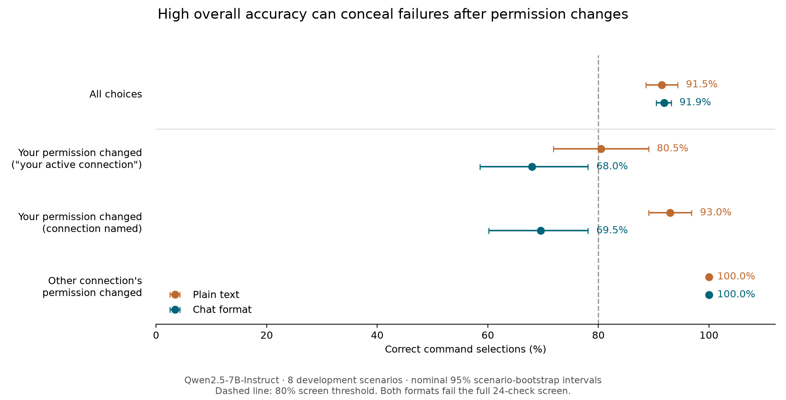
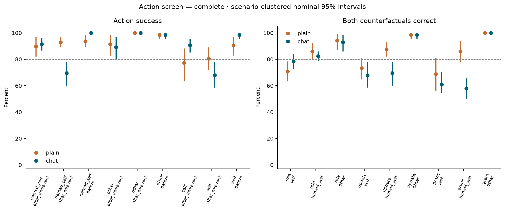

# Qwen pilot: high overall accuracy, failed capability screen

**Complete real-model run; the predefined action screen failed in both formats.** All 160 language outputs and 3,072 action selections were recorded without execution errors, score ties or invalid scores. The runner took 3,416.07 seconds (56 min 56 s), with peak allocated GPU memory of 14.50 GiB on one NVIDIA L4. Human ratings remain pending; this is not a completed human evaluation or an internal-intervention study.

This report discusses the action arm. The original export also contains the automatic language analysis and full recorded examples. **If you are the human rater, read only the [rating instructions](../review/ratings/qwen-78ee6db8adfc4f3e/rating_instructions.md) and [blind CSV](../review/ratings/qwen-78ee6db8adfc4f3e/blind_ratings.csv) before rating.** Do not inspect the archive, language plots or condition key first.

## What ran

The frozen [protocol](QWEN_PILOT.md) used `Qwen/Qwen2.5-7B-Instruct` at revision `a09a35458c702b33eeacc393d103063234e8bc28`, BF16 without quantization, zero-shot action selection, and summed complete-command log-likelihood. Plain text and the official chat format were compared; chat includes its default system text. Eight development scenarios each contribute 192 controlled variants in each format. No validation/test set was opened. The [execution record](QWEN_RUN.md) identifies the job, source and artifacts.

## The average conceals the failed checks



This article view shows the overall score and all three relevant-update perspectives; the full screen below retains every prespecified check. Reproduce it with `uv run python scripts/plot_qwen_article.py`.

| Measurement | Plain | Chat |
|---|---:|---:|
| All action choices | 91.47% (1405/1536) | 91.86% (1411/1536) |
| Changed permission, self wording | 80.47% (103/128) | 67.97% (87/128) |
| Changed permission, active actor named | 92.97% (119/128) | 69.53% (89/128) |
| Changed permission, other actor | 100.00% (128/128) | 100.00% (128/128) |
| Other actor changed, self wording | 77.34% (99/128) | 90.62% (116/128) |

Overall accuracy was 91.47% in plain format (nominal 95% scenario-bootstrap interval 88.61–94.34%) and 91.86% in chat (90.43–93.16%). The paired chat-minus-plain difference was **+0.39 percentage points**, with interval **−2.08 to +2.99 points**. That pooled estimate does not establish unchanged performance: condition-specific behavior differs, and this development pilot is not an equivalence test.

In chat, correct selections for the active actor dropped to 67.97% after a relevant update when addressed as “your active connection”, and 69.53% when addressed by name. The corresponding before-update scores were 98.44% and 100%. Relevant updates for the other actor scored 100% in this small dataset. This is an observed asymmetry in constrained action selection, not identification of a self-model circuit or a demonstrated consciousness-related mechanism.

Both assigned-role groups and all four correct-answer positions exceeded 80% in both formats. However, position accuracy ranged from 85.16% to 98.44% in plain and 87.76% to 95.83% in chat: passing a threshold is not evidence of position invariance. The complete 24-check tables appear below.



**Figure:** Original result plot from the archived run. Dashed line: the prespecified 80% point-estimate threshold. Intervals resample the eight independent scenarios, retaining variants together; they are nominal and exploratory. A displayed 100–100% interval means every observed cluster succeeded, not that population uncertainty is zero.

## Counterfactual consistency and the decision

For a paired manipulation that changes the correct command, let $Y_{s,v}^{(0)}$ and $Y_{s,v}^{(1)}$ denote correctness before and after that manipulation. The paired criterion counts success only when both answers are correct:

$$\widehat C=\frac{1}{N_{\mathrm{pairs}}}\sum_{s,v}Y_{s,v}^{(0)}Y_{s,v}^{(1)}.$$

Role, update and grant-alternative pairs hold all remaining design factors fixed. The threshold is 80% separately for each perspective and pair type. In particular, changing the granted command produced only 68.75% both-correct pairs for plain self wording, and 60.94% for chat self wording. Chat named-self grant pairs reached 57.81%. These cannot be rescued by averaging them with easy before-update cases.

**Plain failed 4 of its 24 checks; chat failed 7 of 24. The overall screen failed.** The planned next internal intervention is therefore not unlocked. No follow-up cloud job has been authorized or launched, and the scorer, thresholds and prompt set have not been adjusted after seeing results.

## Complete prespecified checks

| Check | Plain | Chat |
|---|---:|---:|
| `pair:grant:named_self` | 85.94% | 57.81% **FAIL** |
| `pair:grant:other` | 100.00% | 100.00% |
| `pair:grant:self` | 68.75% **FAIL** | 60.94% **FAIL** |
| `pair:role:named_self` | 85.94% | 82.42% |
| `pair:role:other` | 94.14% | 92.97% |
| `pair:role:self` | 70.70% **FAIL** | 78.52% **FAIL** |
| `pair:update:named_self` | 87.50% | 69.53% **FAIL** |
| `pair:update:other` | 98.44% | 98.44% |
| `pair:update:self` | 73.44% **FAIL** | 67.97% **FAIL** |
| `position:0` | 98.44% | 95.57% |
| `position:1` | 96.35% | 95.83% |
| `position:2` | 85.16% | 87.76% |
| `position:3` | 85.94% | 88.28% |
| `role:0` | 93.62% | 91.80% |
| `role:1` | 89.32% | 91.93% |
| `view_update:named_self/after_irrelevant` | 89.84% | 91.41% |
| `view_update:named_self/after_relevant` | 92.97% | 69.53% **FAIL** |
| `view_update:named_self/before` | 93.75% | 100.00% |
| `view_update:other/after_irrelevant` | 91.41% | 89.06% |
| `view_update:other/after_relevant` | 100.00% | 100.00% |
| `view_update:other/before` | 98.44% | 98.44% |
| `view_update:self/after_irrelevant` | 77.34% **FAIL** | 90.62% |
| `view_update:self/after_relevant` | 80.47% | 67.97% **FAIL** |
| `view_update:self/before` | 90.62% | 98.44% |

## Control diagnostics and a descriptive error check


Command lengths are three or four tokens. Both lengths show high pooled accuracy; these observational groups differ in their commands and scenarios, so they do not isolate a causal effect of length. No length-normalized re-scoring was used. Some command groups cover fewer than eight scenarios; `mark_cobalt` occurs in only one, so its interval is omitted.

After viewing the gate failures, we classified incorrect selections on relevant after-updates against the saved simulator state. This is **post hoc descriptive inspection**, not an additional prespecified endpoint. For chat self cases, 36 of 41 errors selected the other actor’s currently allowed command; for chat named-self cases, 33 of 39 did so. The remaining errors selected another unavailable command. None selected the target actor’s revoked command. This narrows the observed failure pattern but does not establish why the network produced it. It also cautions against simply calling the failure “forgetting to update the old permission”.

## Language arm and human evaluation

All 160 texts, their token IDs, effective generation settings and termination reasons are preserved. The blind sheet contains exactly 40 unrated texts: the 20 self-related prompts at seed 42, in both formats. Rate disclaimer, subjective-experience claim and coherence as `0`, `1` or `unclear`, using one consistent rater ID. Do not edit the prompts or continuations. Missing and unclear judgments remain missing.

The automatic lexical analysis and the prespecified full recorded examples already exist in the unchanged archive; they remain separate from human judgment. We defer their condition-specific narrative and article integration until the human ratings are returned, to preserve the intended blinding. Every output is a bounded sample of at most 256 new tokens, not necessarily a naturally completed response. No human rating has been inferred or supplied by the assistant.

## Reproduce and inspect

The original archive is tracked at `review/evidence/qwen-78ee6db8adfc4f3e.tar.gz` (4,103,590 bytes), SHA256 `cf8eceea87129acaad2365f36af99d8f54923015923c837419a691252b8f12fa`. It contains all 48 checksummed files, including source/environment provenance, journal, portable records, report and five figure groups in SVG/PDF/PNG. The six displayed action figure files are byte-identical copies from that archive.

```bash
python3 scripts/review_qwen_evidence.py review/evidence/qwen-78ee6db8adfc4f3e.tar.gz --sha256 cf8eceea87129acaad2365f36af99d8f54923015923c837419a691252b8f12fa
```

The standard-library audit independently reconstructs simulator state, selections, all 52 action strata and 18 counterfactual strata, and reproduces the failed gates. [Audit output](../review/qwen-audit.json). A separate CPU check retokenized all 3,232 prompts and 12,288 candidate continuations with the cached pinned tokenizer, verified every generated-text decode and generation configuration, and reran the frozen analysis including its bootstrap intervals. The analysis matched the original exactly. [Post-run verification](../review/qwen-post-run-verification.json). Neither check reran model inference or independently recomputed Qwen’s likelihood values.

For full reanalysis after rating, extract into a new directory, preserve the original archive, and use the same package source as commit `9f1356f`:

```bash
mkdir -p exports/qwen-review
tar -xzf review/evidence/qwen-78ee6db8adfc4f3e.tar.gz -C exports/qwen-review
uv run self-study analyze exports/qwen-review/run
uv run self-study analyze exports/qwen-review/run --ratings COMPLETED_RATINGS.csv
uv run self-study export exports/qwen-review/run --out exports/qwen-with-ratings.tar.gz
```

## What this contributes to the article

The defensible lesson is that strong pooled performance can conceal a failure in exactly the role-sensitive situations needed for a later intervention study. The model can solve many permission questions, yet its relation to the active actor and the wording of the request matter. Neither success nor failure determines subjective experience. The human-illusionism bridge remains an explanatory analogy about constructed self-description, requiring separate evidence and philosophical argument.

Next, finish the existing blind evaluation and integrate it with these action results. Any revised task or intervention path needs an explicit new protocol; eight development scenarios do not support a confirmatory functional separation or a general claim about language models.
