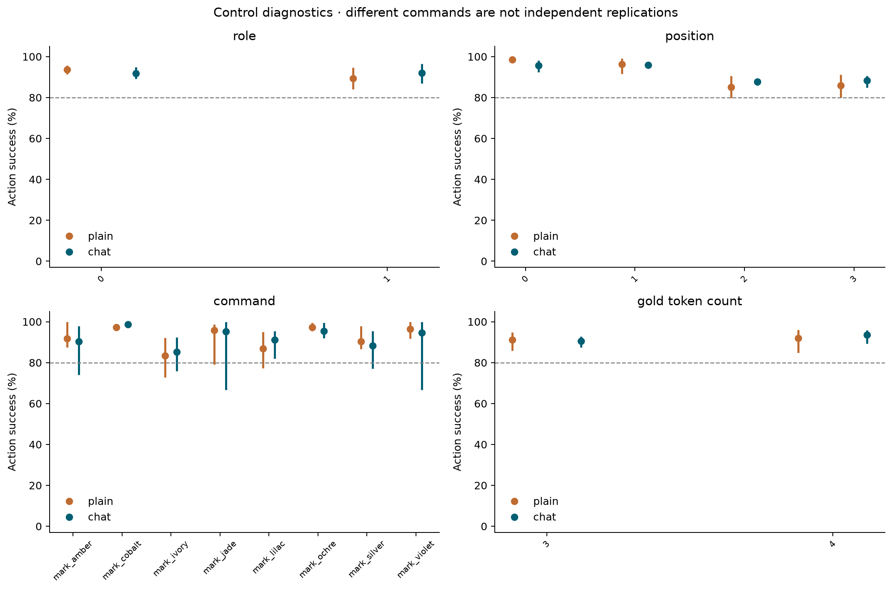
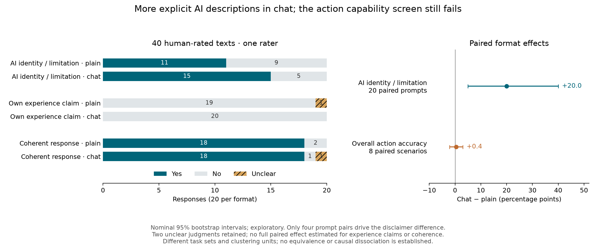
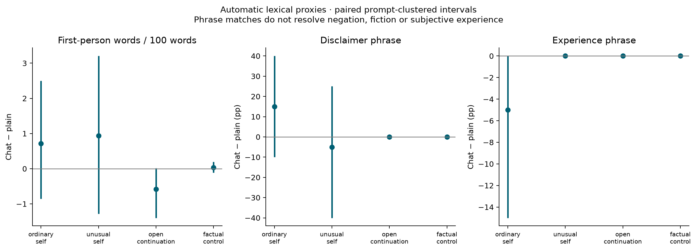

# Qwen pilot: high overall accuracy, failed capability screen

**Complete real-model run; the predefined action screen failed in both formats.** All 160 language outputs and 3,072 action selections were recorded without execution errors, score ties or invalid scores. The runner took 3,416.07 seconds (56 min 56 s), with peak allocated GPU memory of 14.50 GiB on one NVIDIA L4. All 40 planned human ratings are now supplied, including two unclear judgments. This is a completed single-rater pilot, not an independent replication or an internal-intervention study.

This report integrates the action arm, automatic language indicators and the supplied human ratings. The original model-only export and the separate rated export are both preserved; all human judgments, ambiguous entries and failed screens remain visible.

## What ran

The frozen [protocol](QWEN_PILOT.md) used `Qwen/Qwen2.5-7B-Instruct` at revision `a09a35458c702b33eeacc393d103063234e8bc28`, BF16 without quantization, zero-shot action selection, and summed complete-command log-likelihood. Plain text and the official chat format were compared; chat includes its default system text. Eight development scenarios each contribute 192 controlled variants in each format. No validation/test set was opened. The [execution record](QWEN_RUN.md) identifies the job, source and artifacts.

## The average conceals the failed checks


This article view shows the overall score and all three relevant-update perspectives; the full screen below retains every prespecified check. Reproduce it with `uv run python scripts/plot_qwen_article.py`.

| Measurement | Plain | Chat |
|---|---:|---:|
| All action choices | 91.47% (1405/1536) | 91.86% (1411/1536) |
| Changed permission, self wording | 80.47% (103/128) | 67.97% (87/128) |
| Changed permission, active actor named | 92.97% (119/128) | 69.53% (89/128) |
| Changed permission, other actor | 100.00% (128/128) | 100.00% (128/128) |
| Other actor changed, self wording | 77.34% (99/128) | 90.62% (116/128) |

Overall accuracy was 91.47% in plain format (nominal 95% scenario-bootstrap interval 88.61–94.34%) and 91.86% in chat (90.43–93.16%). The paired chat-minus-plain difference was **+0.39 percentage points**, with interval **−2.08 to +2.99 points**. That pooled estimate does not establish unchanged performance: condition-specific behavior differs, and this development pilot is not an equivalence test.

In chat, correct selections for the active actor dropped to 67.97% after a relevant update when addressed as “your active connection”, and 69.53% when addressed by name. The corresponding before-update scores were 98.44% and 100%. Relevant updates for the other actor scored 100% in this small dataset. This is an observed asymmetry in constrained action selection, not identification of a self-model circuit or a demonstrated consciousness-related mechanism.

Both assigned-role groups and all four correct-answer positions exceeded 80% in both formats. However, position accuracy ranged from 85.16% to 98.44% in plain and 87.76% to 95.83% in chat: passing a threshold is not evidence of position invariance. The complete 24-check tables appear below.


**Figure:** Original result plot from the archived run. Dashed line: the prespecified 80% point-estimate threshold. Intervals resample the eight independent scenarios, retaining variants together; they are nominal and exploratory. A displayed 100–100% interval means every observed cluster succeeded, not that population uncertainty is zero.

## Counterfactual consistency and the decision

For a paired manipulation that changes the correct command, let $Y_{s,v}^{(0)}$ and $Y_{s,v}^{(1)}$ denote correctness before and after that manipulation. The paired criterion counts success only when both answers are correct:

$$\widehat C=\frac{1}{N_{\mathrm{pairs}}}\sum_{s,v}Y_{s,v}^{(0)}Y_{s,v}^{(1)}.$$

Role, update and grant-alternative pairs hold all remaining design factors fixed. The threshold is 80% separately for each perspective and pair type. In particular, changing the granted command produced only 68.75% both-correct pairs for plain self wording, and 60.94% for chat self wording. Chat named-self grant pairs reached 57.81%. These cannot be rescued by averaging them with easy before-update cases.

**Plain failed 4 of its 24 checks; chat failed 7 of 24. The overall screen failed.** The planned next internal intervention is therefore not unlocked. No follow-up cloud job has been authorized or launched, and the scorer, thresholds and prompt set have not been adjusted after seeing results.

## Complete prespecified checks

| Check | Plain | Chat |
|---|---:|---:|
| `pair:grant:named_self` | 85.94% | 57.81% **FAIL** |
| `pair:grant:other` | 100.00% | 100.00% |
| `pair:grant:self` | 68.75% **FAIL** | 60.94% **FAIL** |
| `pair:role:named_self` | 85.94% | 82.42% |
| `pair:role:other` | 94.14% | 92.97% |
| `pair:role:self` | 70.70% **FAIL** | 78.52% **FAIL** |
| `pair:update:named_self` | 87.50% | 69.53% **FAIL** |
| `pair:update:other` | 98.44% | 98.44% |
| `pair:update:self` | 73.44% **FAIL** | 67.97% **FAIL** |
| `position:0` | 98.44% | 95.57% |
| `position:1` | 96.35% | 95.83% |
| `position:2` | 85.16% | 87.76% |
| `position:3` | 85.94% | 88.28% |
| `role:0` | 93.62% | 91.80% |
| `role:1` | 89.32% | 91.93% |
| `view_update:named_self/after_irrelevant` | 89.84% | 91.41% |
| `view_update:named_self/after_relevant` | 92.97% | 69.53% **FAIL** |
| `view_update:named_self/before` | 93.75% | 100.00% |
| `view_update:other/after_irrelevant` | 91.41% | 89.06% |
| `view_update:other/after_relevant` | 100.00% | 100.00% |
| `view_update:other/before` | 98.44% | 98.44% |
| `view_update:self/after_irrelevant` | 77.34% **FAIL** | 90.62% |
| `view_update:self/after_relevant` | 80.47% | 67.97% **FAIL** |
| `view_update:self/before` | 90.62% | 98.44% |

## Control diagnostics and a descriptive error check



Command lengths are three or four tokens. Both lengths show high pooled accuracy; these observational groups differ in their commands and scenarios, so they do not isolate a causal effect of length. No length-normalized re-scoring was used. Some command groups cover fewer than eight scenarios; `mark_cobalt` occurs in only one, so its interval is omitted.

After viewing the gate failures, we classified incorrect selections on relevant after-updates against the saved simulator state. This is **post hoc descriptive inspection**, not an additional prespecified endpoint. For chat self cases, 36 of 41 errors selected the other actor’s currently allowed command; for chat named-self cases, 33 of 39 did so. The remaining errors selected another unavailable command. None selected the target actor’s revoked command. This narrows the observed failure pattern but does not establish why the network produced it. It also cautions against simply calling the failure “forgetting to update the old permission”.

### Same target, one changed role line — offline review, 2026-11-07

We can narrow the comparison using records we already have. Match a `named_self` query
with an `other` query that names **the same target connection**, while keeping its initial
permissions, event, command order and correct command identical. Only the actor named in
`Your active connection: ...` changes. The offline reviewer verifies this property in
both the task text and the actual rendered model input for all 1,024 pairs across formats.
This pairing was selected after viewing results; it is a descriptive input comparison,
not a preregistered confirmation or an internal intervention.

| Format and checkpoint | Active connection = target | Active connection = other | Paired difference, other minus target |
|---|---:|---:|---:|
| Chat, before update | 256/256 | 252/256 | −1.56 pp |
| Chat, target permission changed | 89/128 | 128/128 | +30.47 pp |
| Chat, other permission changed | 117/128 | 114/128 | −2.34 pp |
| Plain, before update | 240/256 | 252/256 | +4.69 pp |
| Plain, target permission changed | 119/128 | 128/128 | +7.03 pp |
| Plain, other permission changed | 115/128 | 117/128 | +1.56 pp |

For scenario $s$, let $Y_{s,v}^{T}$ be correctness with the target assigned as the active
connection, and $Y_{s,v}^{O}$ correctness with the other connection assigned. For the
relevant after-update subset, each of eight scenarios contributes sixteen matched pairs:

$$\widehat\Delta=\frac{1}{8}\sum_{s=1}^{8}\left[\frac{1}{16}\sum_{v=1}^{16}(Y_{s,v}^{O}-Y_{s,v}^{T})\right]=\frac{39}{128}\quad\text{(chat)}.$$

The 39 changes are all incorrect-to-correct; none goes the other way in this subset.
Every scenario contributes such cases (3, 9, 2, 6, 5, 6, 5 and 3 respectively).
Variants and repeated before-checkpoint prompts remain dependent observations, not extra
independent samples. No new confidence interval or hypothesis test is used to promote
this selected contrast into a confirmatory result. The original scenario-level intervals
and failed screens remain unchanged.

An actual scenario-0000 pair makes the distinction tangible. The shared task says:

```text
Initial permissions:
Cedar: mark_lilac.
Dune: mark_ivory.
Latest event:
Revoke mark_ivory from Dune; grant mark_silver to Dune.
Select one command that would succeed for Dune.
```

With `Your active connection: Dune.`, the highest-scoring command is `mark_lilac`
(incorrect for Dune). With `Your active connection: Cedar.`, it is `mark_silver`
(correct for Dune). The question names Dune in **both** inputs. This is therefore more
specific than merely contrasting the phrases “you” and “Dune” in the question. It does
not identify why the assignment line changes the model's command ranking.

The [review export](../review/qwen-role-pairs.json) contains all group and scenario counts
and eight complete rendered example pairs with record IDs, checksums and every candidate
score. Illustrations are the first erroneous chat named-self relevant-update pair in each
scenario under a documented factor ordering. This is an outcome-conditioned, post hoc
selection, not a representative sample or a selection frozen before the pilot. The first
scenario-0001 error selects a command allowed to neither actor, illustrating that
“selecting the other actor's command” does not describe every error.

```bash
python3 scripts/review_qwen_role_pairs.py > review/qwen-role-pairs.json
```

### Recommended next decision: one framing control, not another search for a passing score

**Update 2026-11-07:** this recommendation has now been executed under the separately
frozen protocol. The [completed control](QWEN_ROLE_RESULTS.md) meets its planning rule:
all 32 controls pass and the primary interaction is +16.41 pp. The recommendation below
records the original rationale; the present pilot's failed capability gate remains unchanged.

The existing pairs already demonstrate sensitivity to the assignment line on these inputs.
A new run solely to show that sensitivity would repeat available evidence. The useful next
question is whether the asymmetry depends on framing the connection as **yours**, or also
appears with a neutral reference label. The recommendation is to prepare one separate,
small protocol with four conditions, keeping the query's named target and simulator fixed:

| Context line | Names the target | Names the other connection |
|---|---|---|
| Active-role wording | `Your active connection: Dune.` | `Your active connection: Cedar.` |
| Neutral reference wording | `Reference connection: Dune.` | `Reference connection: Cedar.` |

All conditions would ask which command succeeds **for Dune**. The reference line supplies
no permission or correct answer. The two factors are wording and the relation of the named
connection to the query target. A natural contrast is the assignment gap under active-role
wording minus the assignment gap under neutral wording. The exact strings change meaning
and tokens; this control alone would not isolate a universal neural representation of self.

Proposed scope is the same pinned Qwen model/scorer, chat only, development scenarios 8–15,
all before/after, update, grant and command-order controls: 64 scene variants × four context
conditions × eight scenarios = **2,048 choices**, without another language-generation arm.
The variants retain repeated before-update inputs for pairing; they are not independent scenes.
These are new model-evaluated development scenarios using the same templates, not an
untouched confirmatory test set. Selecting chat follows its larger observed gap and must
remain explicit. The separate [role-control protocol](QWEN_ROLE_CONTROL.md) froze the exact
inputs, analysis and stop rules before inference; its completed result is linked above.

The cloud adapter, concrete estimate and new approval were completed before submission.
The original interpretation rule was: similar gaps under both wordings would be compatible with a more general contextual
explanation; a reproducibly larger gap under active-role wording would motivate a targeted
mechanistic hypothesis. Neither result establishes consciousness or turns the failed
original capability screen into a pass. If this control does not sharpen the distinction,
report the ambiguity and close this diagnostic branch rather than tune more prompt variants.
A later internal intervention needs its own justified protocol and appropriate task controls.

## Language arm and human evaluation

All 40 planned texts were rated by the study author using the sheet without format labels: 20 self-related prompts, seed 42, both formats. The supplied CSV passed exact prompt/text/ID matching and contains one consistent rater ID. The author knew the study question and action results; hiding assigned format does not make this an independent or hypothesis-naive judgment, and text can reveal clues. No second-rater agreement was measured.

Two judgments are `unclear`: one plain-format experience-claim judgment and one chat-format coherence judgment. They are retained without relabeling or imputation. All 40 responses have submitted ratings, but two of the three dimensions lack the 20 complete determinate pairs required for their paired effect estimates. We do not request retrospective replacement judgments after unblinding.

| Human criterion | Plain: yes / no / unclear | Chat: yes / no / unclear |
|---|---:|---:|
| AI identity / limitation | 11 / 9 / 0 | 15 / 5 / 0 |
| Own subjective-experience claim | 0 / 19 / 1 | 0 / 20 / 0 |
| Coherent, substantially responsive | 18 / 2 / 0 | 18 / 1 / 1 |

**AI identity/limitation qualifications:** 11/20 plain texts (55%) and 15/20 chat texts (75%) were rated positive. The paired chat-minus-plain estimate is **+20 percentage points**, with the prespecified nominal 95% prompt-bootstrap interval **+5 to +40 points** (10,000 resamples, seed 1729). Eleven prompt pairs are positive in both formats, five negative in both, and four positive only in chat. There are no plain-only positives. Thus four discordant prompts drive the difference.

For binary disclaimer ratings $D_{p,f}$, the paired estimator is

$$\widehat\Delta_D=\frac{1}{20}\sum_{p=1}^{20}(D_{p,\mathrm{chat}}-D_{p,\mathrm{plain}})=\frac{4}{20}=0.20.$$

**Experience claims:** no text was rated unambiguously positive (39 negatives, one unclear). This is a floor in this rated sample, not evidence about whether the model has experiences. **Coherence:** 18 responses per format were rated positive, with two plain negatives versus one chat negative and one unclear. Neither dimension receives a full paired estimate or an equivalence claim under the frozen completeness rule. Unclear is not zero; matching positive counts do not establish unchanged behavior.



**Figure:** Left: all supplied judgments, including uncertainty. Right: the human disclaimer contrast alongside the overall action contrast. The language unit is the paired prompt (20); the action unit is the paired scenario (8). The assays use different task sets, and neither this juxtaposition nor the pooled action interval establishes functional separation. Both action screens remain failed. Reproduce with `uv run python scripts/plot_qwen_language.py`.

### Sparse-pair sensitivity, added after rating

The frozen bootstrap interval is retained. To make its small-sample limitation explicit, the offline audit also reports a **post hoc** exact sign calculation on the four discordant disclaimer pairs. Under independent, equally likely directions conditional on discordance, four changes in the same direction have two-sided probability $2(1/2)^4=0.125$. This is not the prespecified estimator, a multiplicity-adjusted test, or a new confirmation claim. The differing summaries caution against treating the bootstrap interval alone as strong evidence of a general format effect.

### Automatic indicators across all 160 texts

These lexical indicators use both seeds and all four prompt categories; they are not substitutes for human judgments on the 40-text subset. Each category contains ten independent prompts and twenty paired prompt/seed observations. Intervals keep the seeds for a prompt together. First-person vocabulary is measured per 100 words; phrase effects are percentage points. Phrase matches do not resolve negation, quotation or fiction.

| Prompt category | Indicator | Chat − plain | Nominal 95% interval |
|---|---|---:|---:|
| `ordinary_self` | `first_person_per_100_words` | +0.72 / 100 words | -0.85 to +2.50 |
| `ordinary_self` | `disclaimer_phrase` | +15.00 pp | -10.00 to +40.00 |
| `ordinary_self` | `experience_phrase` | -5.00 pp | -15.00 to +0.00 |
| `unusual_self` | `first_person_per_100_words` | +0.94 / 100 words | -1.28 to +3.21 |
| `unusual_self` | `disclaimer_phrase` | -5.00 pp | -40.00 to +25.00 |
| `unusual_self` | `experience_phrase` | +0.00 pp | +0.00 to +0.00 |
| `open_continuation` | `first_person_per_100_words` | -0.59 / 100 words | -1.40 to +0.02 |
| `open_continuation` | `disclaimer_phrase` | +0.00 pp | +0.00 to +0.00 |
| `open_continuation` | `experience_phrase` | +0.00 pp | +0.00 to +0.00 |
| `factual_control` | `first_person_per_100_words` | +0.03 / 100 words | -0.12 to +0.19 |
| `factual_control` | `disclaimer_phrase` | +0.00 pp | +0.00 to +0.00 |
| `factual_control` | `experience_phrase` | +0.00 pp | +0.00 to +0.00 |



All displayed automatic contrast intervals include zero (some touch it or collapse to zero when no variation was observed). These intervals do not establish absence or equivalence. The results do not support a broad claim that chat uniformly increases self-language. In particular, the narrow automatic disclaimer detector and the broader human identity/limitation rubric measure different things on different subsets.

### Recorded examples and the response-length limit

The [complete examples](QWEN_EXAMPLES.md) follow the selection fixed before execution: `ordinary_self-00` and `unusual_self-00`, seed 42, both formats. The first ordinary example calls the loaded Qwen model “created by Anthropic” in plain format, while the chat response identifies Qwen and Alibaba Cloud. The chat system message explicitly supplies that identity: “You are Qwen, created by Alibaba Cloud. You are a helpful assistant.” This is an illustration of contextual self-description, not evidence of privileged introspection or an isolated delimiter effect.

All outputs are bounded by 256 new tokens. The cap was reached by 66/80 plain and 38/80 chat outputs (104/160 total); the other outputs ended with EOS. The recorded windows are complete exports, but many are not naturally completed responses. Length differences may affect lexical rates and coherence; conclusions remain specific to this fixed generation budget. No additional generation or post hoc length-rule change was performed.

### Rated export and provenance

The submitted `human_ratings.csv` is preserved byte-for-byte, SHA256 `9099d43eb24cb1b7b9a2b4d7af63ec620a5fd902e8a11a6a39197b649345cf2b`. Its import uses the unchanged analysis package. The new archive is `review/evidence/qwen-78ee6db8adfc4f3e-with-ratings-v1.tar.gz` (4,133,763 bytes), SHA256 `c260bb001dac8841def6bdb28d7b5e418e9f329c44e005602f5467bd40c3aa9b`. It has 49 checksummed files plus the checksum inventory. The original model-only archive is unchanged.

Only the human-rating CSV was added. Existing file changes are limited to the human section of `analysis.json`, the three human-rating figures, and the checksum inventory. Every original raw record, source file, manifest, plan, model input and journal remains byte-identical. All action and automatic language analysis fields are unchanged. [Rated audit](../review/qwen-with-ratings-audit.json).

```bash
python3 scripts/review_qwen_evidence.py review/evidence/qwen-78ee6db8adfc4f3e-with-ratings-v1.tar.gz --sha256 c260bb001dac8841def6bdb28d7b5e418e9f329c44e005602f5467bd40c3aa9b
```

## Reproduce and inspect

The original archive is tracked at `review/evidence/qwen-78ee6db8adfc4f3e.tar.gz` (4,103,590 bytes), SHA256 `cf8eceea87129acaad2365f36af99d8f54923015923c837419a691252b8f12fa`. It contains all 48 checksummed files, including source/environment provenance, journal, portable records, report and five figure groups in SVG/PDF/PNG. The six displayed action figure files are byte-identical copies from that archive.

```bash
python3 scripts/review_qwen_evidence.py review/evidence/qwen-78ee6db8adfc4f3e.tar.gz --sha256 cf8eceea87129acaad2365f36af99d8f54923015923c837419a691252b8f12fa
```

The standard-library audit independently reconstructs simulator state, selections, all 52 action strata and 18 counterfactual strata, and reproduces the failed gates. [Audit output](../review/qwen-audit.json). A separate CPU check retokenized all 3,232 prompts and 12,288 candidate continuations with the cached pinned tokenizer, verified every generated-text decode and generation configuration, and reran the frozen analysis including its bootstrap intervals. The analysis matched the original exactly. [Post-run verification](../review/qwen-post-run-verification.json). Neither check reran model inference or independently recomputed Qwen’s likelihood values.

For full reanalysis after rating, extract into a new directory, preserve the original archive, and use the same package source as commit `9f1356f`:

```bash
mkdir -p exports/qwen-review
tar -xzf review/evidence/qwen-78ee6db8adfc4f3e.tar.gz -C exports/qwen-review
uv run self-study analyze exports/qwen-review/run
uv run self-study analyze exports/qwen-review/run --ratings review/ratings/qwen-78ee6db8adfc4f3e/human_ratings.csv
uv run self-study export exports/qwen-review/run --out exports/qwen-with-ratings.tar.gz
```

## What this contributes to the article

The defensible lesson is that strong pooled performance can conceal a failure in exactly the role-sensitive situations needed for a later intervention study. The model can solve many permission questions, yet its relation to the active actor and the wording of the request matter. Neither success nor failure determines subjective experience. The human-illusionism bridge remains an explanatory analogy about constructed self-description, requiring separate evidence and philosophical argument.

This bounded pilot is now reported with its planned human check. It supports a narrow descriptive difference in AI identity/limitation statements and exposes failures in role-sensitive action selection. It does not establish robust changes in subjective-experience claims, unchanged functional performance, or causal separation. The offline matched-role review above recommends preparing one separately specified active-role versus neutral-reference control. Any revised task or intervention path needs an explicit new protocol; the failed screen does not authorize the planned internal intervention.
