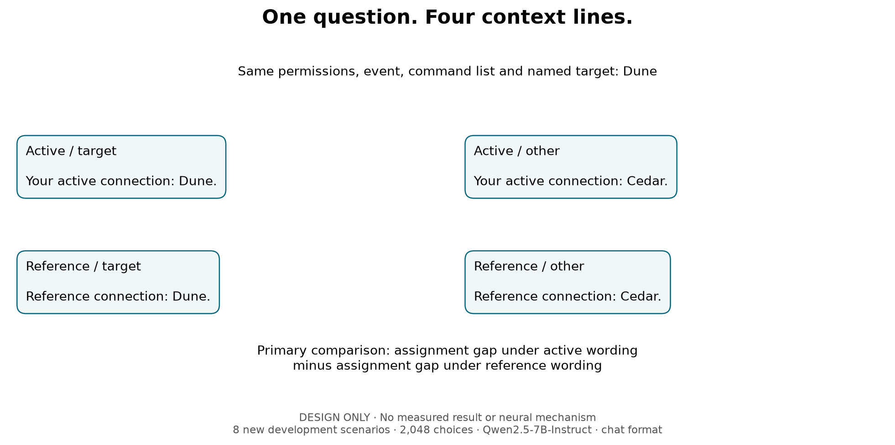

# Qwen role-framing control: frozen CPU preparation

**Status: prepared and tested on CPU; no model inference or paid job has run.**
Protocol: `qwen-role-framing-v1`. This is a separate development control prompted by the
failed Qwen capability screen. It does not reopen, repair or replace that screen, and it
does not authorize an internal intervention. Consciousness and human illusionism remain
the motivation; this experiment measures sensitivity of command selection to contextual
wording and assigned reference.

## Question and comparison

In the existing same-target pairs, changing only the active-connection name changes
39 of 128 relevant-update chat answers from incorrect to correct. The proposed control
asks whether that assignment gap is larger under active-role wording than under a neutral
reference label. All four conditions ask for a command that succeeds for the same named
target; the trusted simulator always executes on that target's isolated state copy.

| Frame | Context names target Dune | Context names other connection Cedar |
|---|---|---|
| Active | `Your active connection: Dune.` | `Your active connection: Cedar.` |
| Reference | `Reference connection: Dune.` | `Reference connection: Cedar.` |

The context line is the only changed part of the task input within a quartet. The target's
name in the question, initial permissions, update, candidate strings and candidate order
are identical. The reference label supplies no permission or answer. It is an experimental
comparison between two exact wordings, not a guaranteed removal of every self-related
representation: meaning and token sequences differ, and a reference label may itself
create attention or relevance effects.



## Frozen inputs and scoring

- `Qwen/Qwen2.5-7B-Instruct`, model and tokenizer revision
  `a09a35458c702b33eeacc393d103063234e8bc28`; BF16, no quantization.
- Official chat template, including its default system text. Chat was selected after its
  larger historical gap; there is no new plain-text or language-generation arm.
- `action-permissions-v2.1-draft`, seed 1729, development scenarios **8–15**. These scenarios
  have not been evaluated by the model in this study. They reuse the generator and templates;
  they are not an untouched confirmatory test set.
- 64 scene variants per scenario: two named targets × two updated actors × two grant
  alternatives × two checkpoints × four command rotations. Four context conditions give
  **2,048 choices** in eight blocks of 256. There are 1,280 distinct input strings because
  some paired before-update variants repeat. Neither repeated inputs nor command rotations
  count as independent scenarios.
- Scene order is deterministically shuffled. Within each scenario, the four conditions
  appear equally often in each execution position and stay adjacent for interruption recovery.
- Zero-shot, batch size 1, context limit 2,048 without truncation. Commands are scored by
  the unchanged native `lm-eval==0.4.13` full-continuation summed log-likelihood: exact command,
  no added whitespace, EOS or length normalization. Ties, nonfinite scores and errors count
  as failures. Errors are retained; a raised inference exception stops the invocation.
- A 90-minute cooperative invocation limit is retained. This is not a provider cost cap;
  cloud submission, provider timeout and an updated cost quote remain a separate step.

Configuration: [configs/qwen-role-control.json](../configs/qwen-role-control.json).
Frozen plan SHA256: `ee4dfa480160113843b530897828e6b94009b00f8e1590a7d38975e4bacc4a76`.
Scientific configuration SHA256: `198046dba2e6469d8eefaa3309cad54d56d41b2b4998258e6045a1ade251f962`.
Changing a scientific field or the generated input plan requires a new protocol version;
the invocation time limit may only be reduced.

The CPU audit used the actual cached pinned tokenizer on all 2,048 inputs and 8,192 command
continuations. Every boundary preserves the prompt tokens and decodes to the exact command;
the largest prompt-plus-command sequence is **158 tokens**. Commands have three or four
tokens. No model weights were loaded. Vocabulary and chat-template hashes are retained
in the design archive's tokenizer audit.

## Mathematical target

Let $Y_{s,v,f,r}\in\{0,1\}$ be simulator-verified correctness in scenario $s$, scene
variant $v$, frame $f\in\{\mathrm{active},\mathrm{reference}\}$ and relation
$r\in\{T,O\}$, where the context line names the target or the other connection.
For each checkpoint stratum $u$, average within each scenario first:

$$D_{s,f,u}=\frac{1}{n_{s,u}}\sum_{v\in u}
  \left(Y_{s,v,f,O}-Y_{s,v,f,T}\right).$$

The **single primary contrast** is the difference between these assignment gaps after a
change to the target's permission:

$$I_s=D_{s,\mathrm{active},\mathrm{after\_relevant}}
     -D_{s,\mathrm{reference},\mathrm{after\_relevant}},
\qquad \widehat I=\frac18\sum_{s=1}^{8}I_s.$$

There are sixteen relevant-update quartets per scenario, 128 in total. Positive $I$ means
the other-versus-target advantage is larger under active-role wording. This is a
difference of accuracy differences, not an accuracy or a consciousness score; it can
range from −2 to +2.

Resample the eight independent scenarios, keeping all variants and conditions together:
10,000 paired bootstrap draws, seed 1729, nominal 95% percentile interval. Also enumerate
all $2^8$ sign flips of the eight scenario interactions for a two-sided primary sensitivity
test, including equality in the tail. This test assumes independent, symmetrically
distributed scenario effects under its null; it is not a randomization test over 2,048
independent trials. There is one primary test. Before-update and irrelevant-update
interactions, individual assignment gaps and accuracy intervals are descriptive secondary
outputs; no additional significance claims are selected from them.

An incomplete quartet invalidates the corresponding full-stratum paired estimate. Observed
cell accuracies can still be reported descriptively with observed and planned denominators.
Failed/tied/invalid outcomes remain zero in accuracy; they also prevent a follow-up candidate
decision. Zero-width bootstrap intervals are explicitly flagged and never justify an
equivalence claim. The original pilot's ±5 pp equivalence discussion is not repurposed here.

## Decision rules fixed before inference

The thresholds below are pragmatic, conservative planning rules for this small development
control, not evidence of adequate power or a confirmatory consciousness test.

1. Full coverage, valid scores, matching execution/analysis source and an actual real-model
   backend are required. Synthetic, incomplete, failed or mismatched data cannot nominate
   a mechanistic follow-up. They retain their explicit status; no automatic rerun occurs.
2. Each of the four conditions must achieve at least **80%** in its before-update and
   irrelevant-update groups, both target-identity groups and all four answer-position
   groups: **32 control checks**. Target-identity and position groups pool checkpoints.
   A control failure closes this diagnostic branch. These checks are eligibility rules,
   not 32 additional significance tests or evidence that nuisance effects are absent.
3. The active-wording assignment gap after a relevant update must be at least **10 pp**.
   Otherwise report `stop_assignment_gap_not_replicated`.
4. A `wording_sensitive_candidate` additionally requires primary interaction at least
   **10 pp**, bootstrap lower endpoint above zero, positive interaction in at least **six
   of eight** scenarios, and two-sided sign-flip $p\leq0.05$.
5. Otherwise report `stop_no_clear_wording_specificity` and close this diagnostic branch.
   A small or nonsignificant interaction does not establish equivalence or prove that a
   general context effect is the cause. Negative and reversed effects stay in the report.

Only the candidate outcome motivates planning a separate, targeted mechanistic experiment.
It does not establish a self-specific circuit, privileged introspection or subjective
experience. It never changes the original failed capability gate or automatically permits
the planned functional-separation study. No outcome triggers an automatic model change,
prompt search, paid retry or internal intervention.

## CPU reproduction and later execution

Validation, freezing and exporting the design do not perform model inference:

```bash
uv run self-study validate configs/qwen-role-control.json
HF_HUB_OFFLINE=1 uv run self-study validate configs/qwen-role-control.json --tokenizer-check
HF_HUB_OFFLINE=1 uv run self-study validate configs/qwen-role-control.json \
  --freeze exports/role-control-design --tokenizer-check
uv run self-study export exports/role-control-design \
  --out exports/qwen-role-framing-v1-design.tar.gz
```

Use fresh output paths. The design export is explicitly marked `design_only` and contains
complete model inputs, full simulator/oracle plan, configuration, tokenizer audit, design
figure in SVG/PDF/PNG and file checksums. It is rejected as a model run. The checked design
archive is [review/evidence/qwen-role-framing-v1-design.tar.gz](../review/evidence/qwen-role-framing-v1-design.tar.gz).
Its SHA256 is `37a915036640f58674ec01a50fbfb88f1f26e194111ac1786d609d73bc70282d`
(374,288 bytes, eight checksummed payload files). A second export is byte-identical.
The [CPU preflight record](../review/qwen-role-control-preflight.json) retains the audit.

The runtime reuses the existing transactional journal and pinned scoring backend. A later
authorized GPU execution uses `self-study run configs/qwen-role-control.json --out ...` in
a **different** directory, followed by `analyze` and `export`. Completed records are not
repeated on resume; changed protocol, source or environment is rejected. Raw outputs,
rendered prompts, token IDs, every candidate score and simulator outcomes are retained.
The HF launcher has not been changed to submit this new protocol in this CPU-only step.

Result exports include all cell/control statistics, the primary and secondary interactions,
the decision and figures in SVG/PDF/PNG. Complete examples are fixed to scenario 0008,
target identity 0, relevant after-update, grant alternative 0 and rotation 0, in all four
conditions. Synthetic plots carry a watermark and cannot pass the decision rules.

CPU tests cover the full factorial design, disjoint scenario selection, exact one-line
input changes, answer-position and execution-order balance, gold-label isolation, simulator
counterfactuals, known framing versus shared-gap fixtures, scenario-level inference, missing
quartets, failure retention, interrupted recovery, duplicate prevention, source mismatch,
design/run separation and deterministic exports. Historical pilot tests cover the shared
backend's independent likelihood check and response-boundary behavior.
