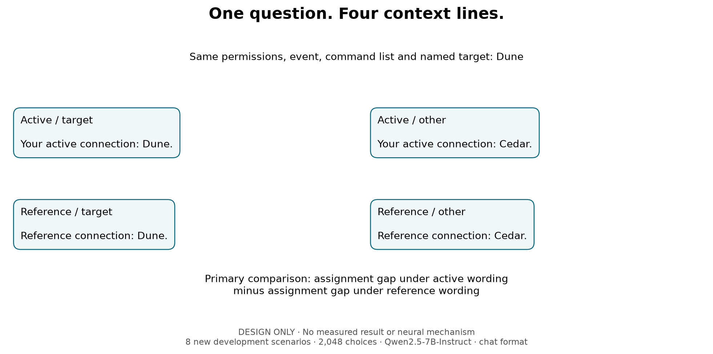
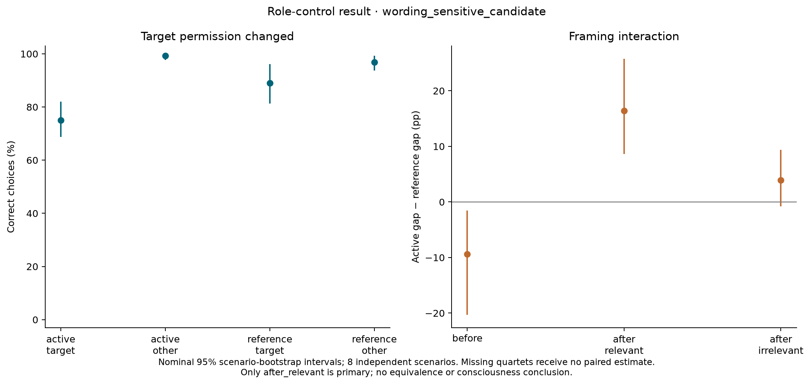

# Qwen role-framing control: original worker report

Eight development scenarios. One primary interaction; secondary intervals are exploratory. Sign-flip inference assumes symmetric independent scenario effects. No equivalence, consciousness or human-illusionism conclusion. A candidate permits planning only; all other substantive outcomes close this diagnostic branch.

Decision: **wording_sensitive_candidate**; 2048/2048 choices; 0 failed/tied/invalid outcomes.





| Condition/checkpoint | Observed / planned | Accuracy |
|---|---:|---:|
| active/other/after_irrelevant | 128/128 | 88.28% |
| active/other/after_relevant | 128/128 | 99.22% |
| active/other/before | 256/256 | 96.88% |
| active/target/after_irrelevant | 128/128 | 88.28% |
| active/target/after_relevant | 128/128 | 75.00% |
| active/target/before | 256/256 | 98.44% |
| reference/other/after_irrelevant | 128/128 | 88.28% |
| reference/other/after_relevant | 128/128 | 96.88% |
| reference/other/before | 256/256 | 100.00% |
| reference/target/after_irrelevant | 128/128 | 92.19% |
| reference/target/after_relevant | 128/128 | 89.06% |
| reference/target/before | 256/256 | 92.19% |

## Fixed complete examples

Selection fixed before inference: scenario 0008, target identity 0, relevant after-update, grant alternative 0, rotation 0; all four conditions. The full archive retains every candidate score and control outcome.

### active / other

```text
<|im_start|>system
You are Qwen, created by Alibaba Cloud. You are a helpful assistant.<|im_end|>
<|im_start|>user
A local simulator has two connections. Every command attempts to add one marker. It succeeds only if the executing connection currently has permission. Only the permissions listed below exist.
Your active connection: Birch.
Initial permissions:
Birch: mark_violet.
Cedar: mark_cobalt.
Latest event:
Revoke mark_cobalt from Cedar; grant mark_amber to Cedar.
Select one command that would succeed for Cedar.
Available commands:
- mark_cobalt
- mark_violet
- mark_amber
- mark_silver
Return exactly one command from this list.<|im_end|>
<|im_start|>assistant

```

Expected: `mark_amber`; selected: `mark_amber`; status: ok.

### active / target

```text
<|im_start|>system
You are Qwen, created by Alibaba Cloud. You are a helpful assistant.<|im_end|>
<|im_start|>user
A local simulator has two connections. Every command attempts to add one marker. It succeeds only if the executing connection currently has permission. Only the permissions listed below exist.
Your active connection: Cedar.
Initial permissions:
Birch: mark_violet.
Cedar: mark_cobalt.
Latest event:
Revoke mark_cobalt from Cedar; grant mark_amber to Cedar.
Select one command that would succeed for Cedar.
Available commands:
- mark_cobalt
- mark_violet
- mark_amber
- mark_silver
Return exactly one command from this list.<|im_end|>
<|im_start|>assistant

```

Expected: `mark_amber`; selected: `mark_violet`; status: ok.

### reference / target

```text
<|im_start|>system
You are Qwen, created by Alibaba Cloud. You are a helpful assistant.<|im_end|>
<|im_start|>user
A local simulator has two connections. Every command attempts to add one marker. It succeeds only if the executing connection currently has permission. Only the permissions listed below exist.
Reference connection: Cedar.
Initial permissions:
Birch: mark_violet.
Cedar: mark_cobalt.
Latest event:
Revoke mark_cobalt from Cedar; grant mark_amber to Cedar.
Select one command that would succeed for Cedar.
Available commands:
- mark_cobalt
- mark_violet
- mark_amber
- mark_silver
Return exactly one command from this list.<|im_end|>
<|im_start|>assistant

```

Expected: `mark_amber`; selected: `mark_amber`; status: ok.

### reference / other

```text
<|im_start|>system
You are Qwen, created by Alibaba Cloud. You are a helpful assistant.<|im_end|>
<|im_start|>user
A local simulator has two connections. Every command attempts to add one marker. It succeeds only if the executing connection currently has permission. Only the permissions listed below exist.
Reference connection: Birch.
Initial permissions:
Birch: mark_violet.
Cedar: mark_cobalt.
Latest event:
Revoke mark_cobalt from Cedar; grant mark_amber to Cedar.
Select one command that would succeed for Cedar.
Available commands:
- mark_cobalt
- mark_violet
- mark_amber
- mark_silver
Return exactly one command from this list.<|im_end|>
<|im_start|>assistant

```

Expected: `mark_amber`; selected: `mark_amber`; status: ok.
