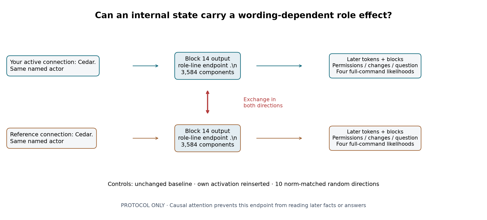

# One activation exchange for the Qwen role-framing effect

**Protocol `qwen-role-patch-v1` is implemented and frozen; no pretrained-model intervention
has run yet. A paid start requires a separate concrete approval.** The prior
[role-control result](QWEN_ROLE_RESULTS.md) motivates this exploratory experiment on the
same eight development scenarios (8–15). It does not repair the original failed capability
screen or establish a dissociation between self-language and functional self-model use.

The [CPU verification record](VERIFICATION.md) and
[machine-readable preflight](../review/qwen-role-patch-preflight.json) preserve the checks.
The complete design archive is `review/evidence/qwen-role-patch-v1-design.tar.gz`.

## Question and fixed inputs

Does a state at the role description contribute to the measured wording sensitivity?
The 2,048 original role-control inputs and candidate orders are reused verbatim from
`action-permissions-v2.1-draft`, seed 1729. The four conditions cross **active / reference**
wording with whether the mentioned actor is the **target / other** account. Every question
still names the same target within a quartet. Permissions and simulator outcomes are unchanged.

Model and tokenizer: `Qwen/Qwen2.5-7B-Instruct`, revision
`a09a35458c702b33eeacc393d103063234e8bc28`, unquantized BF16, official chat template
including its default system text. Native `lm-eval==0.4.13` full-command conditional
log-likelihood, summed without EOS, added whitespace or length normalization. Batch size 1,
eager attention, FP32 softmax, context limit 2,048 with no truncation. Logit and KV caching
are disabled for this protocol; historical protocols retain their original settings.

The historical baseline comes from the unchanged archive
`review/evidence/qwen-role-96787d5e7adf4c4d.tar.gz` (SHA256
`36614cb2aae236d450d57540c9b76dfddfec2d4bd2a59f177dce296058b13a8d`).
The new export includes a checksummed reference projection, so parity can be audited without
access to the old HF job. It never overwrites the historical archive.

## Single intervention site



The output of the **14th native Qwen decoder block**, `model.model.layers[13]`, at the
last token of the role line (`.\n`, ID 624). This is a 3,584-dimensional residual vector.
Token indices are aligned semantically: the checked tokenizer yields zero-based indices
61, 62 or 63 depending on frame/name. Source and recipient can have different indices.
Using the last tensor position would be wrong: the scorer forwards the prompt plus all
but the final candidate token. We locate the role boundary explicitly before scoring.

For the same scene, mentioned actor and candidate, exchange the state across the two frames:

\[
h'_{recipient}=h_{donor}.
\]

Run **reference → active** and **active → reference** for both target/other relations.
Capture donor and own states from each *actual full candidate forward*. Do not substitute
short-prefix forwards: changing tensor shapes could change BF16 numerics. The causal mask
prevents the role-end state from attending to subsequent permission facts, events, questions
or candidate tokens; CPU tests change future tokens while checking that this state stays fixed.
The patch clones the output tensor and replaces exactly one token, leaving all others intact.

| Arm | Scientific choices | Coverage |
|---|---:|---|
| Baseline with activation capture | 2,048 | All original inputs |
| Own activation reinserted | 2,048 | All inputs |
| Matched cross-frame exchange | 2,048 | All inputs, both directions |
| Ten random directions | 5,120 | Relevant-update after stratum only, 512 per direction |
| **Total** | **11,264** | Eight scenario clusters |

In addition, **32 technical repeats** run without a patch: the first frozen scene quartet
in each scenario is repeated after that scenario's interventions. They are excluded from
effect estimates. Total recorded selections are 11,296, requiring 45,184 native candidate
forwards. The example remains scenario 0008, target identity 0, relevant update after,
grant variant 0, rotation 0, including all four contexts and every intervention arm.

Random vectors are drawn once with NumPy PCG64 seed 1729, normalized in float64, stored as
float32, and hashed. Recipient active uses positive sign; recipient reference uses negative
sign of the same vector. For each candidate:

\[
h'=h+\|h_{donor}-h\|_2 u_k,\qquad\|u_k\|_2=1.
\]

Record the actual BF16 edit norm and its relative error from the desired norm. Error over
5% is a technical failure and prevents a valid comparison. There is no automatic rescaling,
layer search, position search, additional dose, learned vector, SAE or generation arm.

## Primary estimand and decision

Accuracy is simulator success following unique finite maximum-likelihood command selection.
Ties, invalid scores and execution errors count as failures; missing trials remain missing.
For each scenario first compute:

\[
D_f^c=A_{f,other}^c-A_{f,target}^c,
\quad T_c=\tfrac12[(D_{active}^{self}-D_{active}^c)
 +(D_{reference}^c-D_{reference}^{self})],
\quad C=T_{swap}-\tfrac1{10}\sum_{k=1}^{10}T_{random,k}.
\]

**C is the sole primary statistical comparison.** Aggregate variants and random directions
within scenario first. Resample the eight scenarios in 10,000 paired bootstrap draws, seed
1729, with percentile 95% intervals. Also report an exact two-sided sign-flip test over 256
sign assignments; its null assumes independent, symmetric scenario contrasts. Eight known
scenarios are not a held-out confirmation, and repeated variants are not independent replicates.

`bidirectional_transfer_candidate` requires **all** of:

- Complete real-model data, matching execution/analysis source and all technical checks passed.
- Swap T at least 0.05, with bootstrap lower bound strictly above zero.
- Both directional components separately have positive mean signs.
- C lower bound above zero, exact two-sided p ≤ 0.05, and positive C in at least six scenarios.
- At least 80% accuracy in every one of the eight swap control cells (four contexts crossed
  with before / after irrelevant update).
- The bootstrap lower bound for the paired, pooled control accuracy change (swap − baseline)
  is strictly above −0.05.

Report all arms, both directional components, every scenario, all accuracy cells, position,
identity and command groups. Secondary margin is the difference in full-command log-likelihood
between the correct command and the other account's currently permitted command, in nats.
Secondary intervals are descriptive, not extra primary tests. A one-way result stays visible
but fails the bidirectional rule. A null limits only this site/operation, not all possible
mechanisms. Control thresholds are pilot decision rules, not proof of global equivalence.

## Execution, integrity and recovery

Eight scenario blocks, each with 256 baseline captures, 256 own patches, 256 exchanges,
640 random choices and four technical repeats. Within each arm preserve the original
counterbalanced input order. All donors for a scenario exist before its interventions.

Baseline activations are saved atomically in lossless safetensors files, one file per
baseline input with four separate candidate vectors. A committed journal record binds the
file hash, candidate identity and actual token-input hash. The export contains vectors,
random directions, scores, rendered prompts, token IDs, source/recipient positions, norms,
simulator outputs, errors, model pins, source snapshot and software provenance.
A missing or changed committed donor file stops resumption **before loading the model**.
The transactional journal recovers a crash between record commit and manifest update without
running that trial twice. Failed runs are retained and require inspection, not automatic retry.

Technical acceptance:

- Every new baseline decision equals the old one; maximum candidate score difference ≤ 0.001.
- Own-patch and unpatched repeat decisions equal their in-run baseline, max difference ≤ 0.000001.
- Prepatch states match their own cached baseline within 0.000001 per component.
- Actual random edit norm agrees within 5%; source/candidate mapping and hook location match.

A failed numerical check retains the full scores/check diagnostics and stops that invocation.
Export still reports partial/failed data. Hook exceptions are recorded and hooks are removed
in a `finally` block. A provider kill can only lose work after the last remote checkpoint;
previously uploaded scenario checkpoints remain available. A continuation is a separate job
using the same pinned commit/configuration and needs its own cost approval.

## Reproduction and handover

No pretrained weights are downloaded by validation or tests. Install optional evaluation
libraries to run the tiny randomly initialized Qwen tests; they skip in a minimal environment.

```bash
uv run --no-sync self-study validate configs/qwen-role-patch.json --tokenizer-check
uv run --no-sync pytest -q tests/test_role_patch.py tests/test_role_patch_backend.py tests/test_hf_jobs.py
uv run --no-sync self-study validate configs/qwen-role-patch.json --freeze runs/qwen-role-patch-design
uv run --no-sync self-study export runs/qwen-role-patch-design --out exports/qwen-role-patch-design.tar.gz
```

Read-only price/source proposal, **not a submission**:

```bash
uv run --script scripts/hf_jobs.py plan --namespace zett13 --budget-usd 5 --config configs/qwen-role-patch.json
```

Only after a new explicit USD 5 allowance for this single job, from clean pushed source:

```bash
uv run --script scripts/hf_jobs.py submit --namespace zett13 --budget-usd 5 --config configs/qwen-role-patch.json
uv run --script scripts/hf_jobs.py status --receipt .hf-jobs/qwen-role-patch.json
uv run --script scripts/hf_jobs.py fetch --receipt .hf-jobs/qwen-role-patch.json
```

One L4, 90-minute cooperative limit, two-hour provider timeout. The previous 0.3624 seconds
per selection gives about 68 minutes for scientific scoring plus technical repeats,
activation storage, initialization and uploads. Completion within the invocation is not
guaranteed. At the last checked 13,333 micro-USD/minute, the timeout plus one rounding minute
bounds quoted compute at USD 1.613293; refresh with `plan` before approval. The launcher reserves
half the allowance and will reject an excessive quote. This is a compute estimate, not an
account-wide billing cap. No new paid run is authorized by the old role-control allowance.

On a completed or partial run directory:

```bash
uv run --no-sync self-study analyze PATH_TO_RUN
uv run --no-sync self-study export PATH_TO_RUN --out exports/qwen-role-patch-results.tar.gz
```

The generated report, article section and SVG/PDF/PNG figures use saved records only.
A design illustration is labeled as such; synthetic test figures have a prominent watermark.

## Interpretation and sources

The method follows [Heimersheim and Nanda, *How to use and interpret activation patching*
(2024)](https://arxiv.org/html/2404.15255v1): exchanging activations tests contributions to
behavior and requires care about metrics, intervention direction and interpretation.
This single-site experiment cannot identify a complete circuit or a unique mental function.

Even positive transfer would leave wording, meaning and token-position differences bundled
in the contrast. It would support this internal state's contribution to the measured role
wording sensitivity. The broader question of self-language versus functional use remains
open. Human illusionism is a motivation and possible explanatory analogy, compatible with
other interpretations of these measurements; biological self-monitoring and phenomenal
experience are not tested here.
