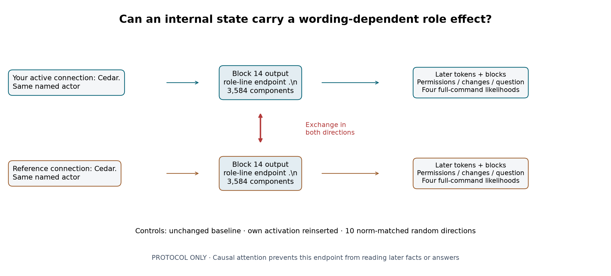
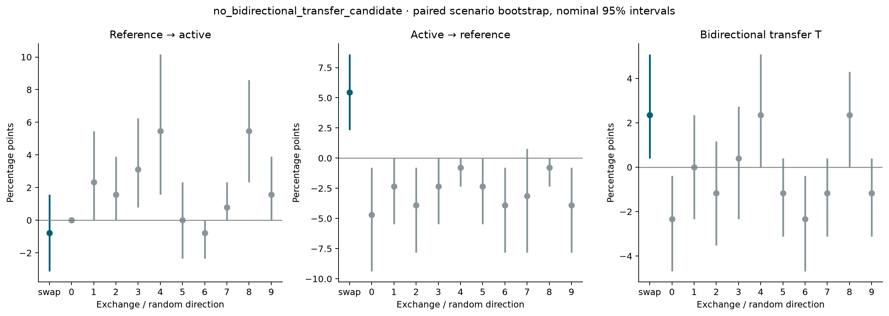
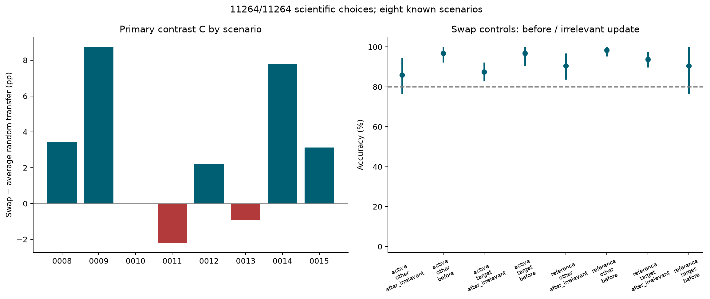

# Qwen role activation exchange

Exploratory intervention on eight known scenarios; no held-out confirmation. Intervals resample scenarios, not variants or random directions. The historical capability-screen failure is unchanged.

Decision: **no_bidirectional_transfer_candidate**. Status: complete. Scientific coverage: 11264/11264; technical repeats: 32/32. Scoring/execution errors: 0; failed technical checks: 0.



## Fixed estimands

$D_f^c=A_{f,other}^c-A_{f,target}^c$; $T_c=\frac12[D_{active}^{self}-D_{active}^c+D_{reference}^c-D_{reference}^{self}]$; $C=T_{swap}-\frac1{10}\sum_kT_{random,k}$.

10,000 paired scenario bootstrap draws, seed 1729; exact two-sided sign flip over eight scenario contrasts (256 signs). C is the sole primary statistical comparison. Symmetry of null scenario effects is an assumption of the sign-flip test. All intervals are nominal; secondary views are descriptive. Errors count as failures; missing outputs are shown explicitly and cannot pass the decision.

| Statistic | Estimate (pp) | 95% interval (pp) |
|---|---:|---|
| Swap T | 2.344 | 0.391 to 5.078 |
| Primary C | 2.773 | 0.312 to 5.391 |
| Control change | -0.716 | -1.888 to 0.195 |

Primary sign-flip p: 0.109375; positive scenarios: 5/8.





## Every recorded accuracy and secondary command margin

Margin = log P(correct command) − log P(other actor's currently permitted command), in nats. No EOS, added whitespace or length normalization.

| Arm | Group | Observed / planned | Accuracy (%) | Margin (nats) |
|---|---|---:|---:|---:|
| baseline | cell/active/other/after_irrelevant | 128/128 | 88.281 | 8.931 |
| baseline | cell/active/other/after_relevant | 128/128 | 99.219 | 11.112 |
| baseline | cell/active/other/before | 256/256 | 96.875 | 12.605 |
| baseline | cell/active/target/after_irrelevant | 128/128 | 88.281 | 9.452 |
| baseline | cell/active/target/after_relevant | 128/128 | 75.000 | 5.458 |
| baseline | cell/active/target/before | 256/256 | 98.438 | 11.963 |
| baseline | cell/reference/other/after_irrelevant | 128/128 | 88.281 | 8.621 |
| baseline | cell/reference/other/after_relevant | 128/128 | 96.875 | 8.954 |
| baseline | cell/reference/other/before | 256/256 | 100.000 | 13.290 |
| baseline | cell/reference/target/after_irrelevant | 128/128 | 92.188 | 9.492 |
| baseline | cell/reference/target/after_relevant | 128/128 | 89.062 | 6.232 |
| baseline | cell/reference/target/before | 256/256 | 92.188 | 10.793 |
| baseline | command/mark_amber | 256/256 | 94.531 | 9.122 |
| baseline | command/mark_cobalt | 384/384 | 94.271 | 11.480 |
| baseline | command/mark_ivory | 160/160 | 93.125 | 9.784 |
| baseline | command/mark_jade | 96/96 | 93.750 | 8.414 |
| baseline | command/mark_lilac | 544/544 | 88.787 | 10.262 |
| baseline | command/mark_ochre | 160/160 | 90.625 | 10.309 |
| baseline | command/mark_silver | 32/32 | 96.875 | 9.223 |
| baseline | command/mark_violet | 416/416 | 98.077 | 10.931 |
| baseline | identity/0 | 1024/1024 | 93.652 | 11.171 |
| baseline | identity/1 | 1024/1024 | 92.871 | 9.524 |
| baseline | position/0 | 512/512 | 97.461 | 10.631 |
| baseline | position/1 | 512/512 | 98.242 | 12.156 |
| baseline | position/2 | 512/512 | 89.453 | 10.488 |
| baseline | position/3 | 512/512 | 87.891 | 8.113 |
| random_00 | cell/active/other/after_relevant | 128/128 | 99.219 | 11.195 |
| random_00 | cell/active/target/after_relevant | 128/128 | 75.000 | 5.585 |
| random_00 | cell/reference/other/after_relevant | 128/128 | 96.875 | 8.960 |
| random_00 | cell/reference/target/after_relevant | 128/128 | 93.750 | 6.914 |
| random_00 | command/mark_amber | 64/64 | 95.312 | 8.710 |
| random_00 | command/mark_cobalt | 96/96 | 90.625 | 8.966 |
| random_00 | command/mark_ivory | 64/64 | 87.500 | 6.855 |
| random_00 | command/mark_jade | 96/96 | 94.792 | 8.714 |
| random_00 | command/mark_lilac | 64/64 | 85.938 | 6.271 |
| random_00 | command/mark_ochre | 64/64 | 85.938 | 7.809 |
| random_00 | command/mark_silver | 32/32 | 96.875 | 9.512 |
| random_00 | command/mark_violet | 32/32 | 96.875 | 8.774 |
| random_00 | identity/0 | 256/256 | 88.672 | 7.313 |
| random_00 | identity/1 | 256/256 | 93.750 | 9.014 |
| random_00 | position/0 | 128/128 | 96.094 | 6.842 |
| random_00 | position/1 | 128/128 | 96.094 | 10.239 |
| random_00 | position/2 | 128/128 | 88.281 | 8.656 |
| random_00 | position/3 | 128/128 | 84.375 | 6.918 |
| random_01 | cell/active/other/after_relevant | 128/128 | 99.219 | 10.934 |
| random_01 | cell/active/target/after_relevant | 128/128 | 77.344 | 5.899 |
| random_01 | cell/reference/other/after_relevant | 128/128 | 96.875 | 9.007 |
| random_01 | cell/reference/target/after_relevant | 128/128 | 91.406 | 6.544 |
| random_01 | command/mark_amber | 64/64 | 96.875 | 8.666 |
| random_01 | command/mark_cobalt | 96/96 | 89.583 | 8.694 |
| random_01 | command/mark_ivory | 64/64 | 87.500 | 6.798 |
| random_01 | command/mark_jade | 96/96 | 94.792 | 8.658 |
| random_01 | command/mark_lilac | 64/64 | 82.812 | 6.287 |
| random_01 | command/mark_ochre | 64/64 | 87.500 | 7.821 |
| random_01 | command/mark_silver | 32/32 | 100.000 | 9.585 |
| random_01 | command/mark_violet | 32/32 | 96.875 | 8.751 |
| random_01 | identity/0 | 256/256 | 89.453 | 7.310 |
| random_01 | identity/1 | 256/256 | 92.969 | 8.882 |
| random_01 | position/0 | 128/128 | 96.094 | 6.825 |
| random_01 | position/1 | 128/128 | 96.094 | 10.159 |
| random_01 | position/2 | 128/128 | 88.281 | 8.555 |
| random_01 | position/3 | 128/128 | 84.375 | 6.845 |
| random_02 | cell/active/other/after_relevant | 128/128 | 99.219 | 11.160 |
| random_02 | cell/active/target/after_relevant | 128/128 | 76.562 | 5.709 |
| random_02 | cell/reference/other/after_relevant | 128/128 | 96.875 | 9.021 |
| random_02 | cell/reference/target/after_relevant | 128/128 | 92.969 | 6.898 |
| random_02 | command/mark_amber | 64/64 | 95.312 | 8.716 |
| random_02 | command/mark_cobalt | 96/96 | 89.583 | 8.879 |
| random_02 | command/mark_ivory | 64/64 | 89.062 | 6.922 |
| random_02 | command/mark_jade | 96/96 | 94.792 | 8.713 |
| random_02 | command/mark_lilac | 64/64 | 85.938 | 6.426 |
| random_02 | command/mark_ochre | 64/64 | 87.500 | 7.923 |
| random_02 | command/mark_silver | 32/32 | 96.875 | 9.514 |
| random_02 | command/mark_violet | 32/32 | 96.875 | 8.887 |
| random_02 | identity/0 | 256/256 | 89.062 | 7.360 |
| random_02 | identity/1 | 256/256 | 93.750 | 9.034 |
| random_02 | position/0 | 128/128 | 96.875 | 6.917 |
| random_02 | position/1 | 128/128 | 96.094 | 10.246 |
| random_02 | position/2 | 128/128 | 89.062 | 8.645 |
| random_02 | position/3 | 128/128 | 83.594 | 6.981 |
| random_03 | cell/active/other/after_relevant | 128/128 | 99.219 | 11.141 |
| random_03 | cell/active/target/after_relevant | 128/128 | 78.125 | 6.001 |
| random_03 | cell/reference/other/after_relevant | 128/128 | 96.875 | 9.189 |
| random_03 | cell/reference/target/after_relevant | 128/128 | 91.406 | 6.573 |
| random_03 | command/mark_amber | 64/64 | 96.875 | 8.858 |
| random_03 | command/mark_cobalt | 96/96 | 89.583 | 8.938 |
| random_03 | command/mark_ivory | 64/64 | 89.062 | 6.857 |
| random_03 | command/mark_jade | 96/96 | 94.792 | 8.776 |
| random_03 | command/mark_lilac | 64/64 | 82.812 | 6.289 |
| random_03 | command/mark_ochre | 64/64 | 87.500 | 7.875 |
| random_03 | command/mark_silver | 32/32 | 100.000 | 9.843 |
| random_03 | command/mark_violet | 32/32 | 96.875 | 8.877 |
| random_03 | identity/0 | 256/256 | 89.844 | 7.419 |
| random_03 | identity/1 | 256/256 | 92.969 | 9.033 |
| random_03 | position/0 | 128/128 | 96.094 | 6.878 |
| random_03 | position/1 | 128/128 | 96.875 | 10.301 |
| random_03 | position/2 | 128/128 | 88.281 | 8.713 |
| random_03 | position/3 | 128/128 | 84.375 | 7.012 |
| random_04 | cell/active/other/after_relevant | 128/128 | 99.219 | 10.989 |
| random_04 | cell/active/target/after_relevant | 128/128 | 80.469 | 6.143 |
| random_04 | cell/reference/other/after_relevant | 128/128 | 96.875 | 8.897 |
| random_04 | cell/reference/target/after_relevant | 128/128 | 89.844 | 6.409 |
| random_04 | command/mark_amber | 64/64 | 96.875 | 8.633 |
| random_04 | command/mark_cobalt | 96/96 | 90.625 | 8.891 |
| random_04 | command/mark_ivory | 64/64 | 90.625 | 6.748 |
| random_04 | command/mark_jade | 96/96 | 93.750 | 8.664 |
| random_04 | command/mark_lilac | 64/64 | 84.375 | 6.255 |
| random_04 | command/mark_ochre | 64/64 | 85.938 | 7.821 |
| random_04 | command/mark_silver | 32/32 | 100.000 | 9.497 |
| random_04 | command/mark_violet | 32/32 | 96.875 | 8.679 |
| random_04 | identity/0 | 256/256 | 90.625 | 7.328 |
| random_04 | identity/1 | 256/256 | 92.578 | 8.891 |
| random_04 | position/0 | 128/128 | 95.312 | 6.804 |
| random_04 | position/1 | 128/128 | 97.656 | 10.213 |
| random_04 | position/2 | 128/128 | 89.844 | 8.576 |
| random_04 | position/3 | 128/128 | 83.594 | 6.846 |
| random_05 | cell/active/other/after_relevant | 128/128 | 99.219 | 10.977 |
| random_05 | cell/active/target/after_relevant | 128/128 | 75.000 | 5.540 |
| random_05 | cell/reference/other/after_relevant | 128/128 | 96.875 | 9.009 |
| random_05 | cell/reference/target/after_relevant | 128/128 | 91.406 | 6.889 |
| random_05 | command/mark_amber | 64/64 | 95.312 | 8.601 |
| random_05 | command/mark_cobalt | 96/96 | 89.583 | 8.863 |
| random_05 | command/mark_ivory | 64/64 | 89.062 | 6.836 |
| random_05 | command/mark_jade | 96/96 | 94.792 | 8.733 |
| random_05 | command/mark_lilac | 64/64 | 81.250 | 6.151 |
| random_05 | command/mark_ochre | 64/64 | 85.938 | 7.821 |
| random_05 | command/mark_silver | 32/32 | 96.875 | 9.360 |
| random_05 | command/mark_violet | 32/32 | 96.875 | 8.691 |
| random_05 | identity/0 | 256/256 | 88.672 | 7.271 |
| random_05 | identity/1 | 256/256 | 92.578 | 8.936 |
| random_05 | position/0 | 128/128 | 95.312 | 6.701 |
| random_05 | position/1 | 128/128 | 96.875 | 10.156 |
| random_05 | position/2 | 128/128 | 87.500 | 8.650 |
| random_05 | position/3 | 128/128 | 82.812 | 6.906 |
| random_06 | cell/active/other/after_relevant | 128/128 | 99.219 | 11.143 |
| random_06 | cell/active/target/after_relevant | 128/128 | 74.219 | 5.636 |
| random_06 | cell/reference/other/after_relevant | 128/128 | 96.094 | 8.642 |
| random_06 | cell/reference/target/after_relevant | 128/128 | 92.188 | 6.583 |
| random_06 | command/mark_amber | 64/64 | 95.312 | 8.528 |
| random_06 | command/mark_cobalt | 96/96 | 89.583 | 8.736 |
| random_06 | command/mark_ivory | 64/64 | 85.938 | 6.727 |
| random_06 | command/mark_jade | 96/96 | 93.750 | 8.511 |
| random_06 | command/mark_lilac | 64/64 | 84.375 | 6.123 |
| random_06 | command/mark_ochre | 64/64 | 85.938 | 7.786 |
| random_06 | command/mark_silver | 32/32 | 96.875 | 9.295 |
| random_06 | command/mark_violet | 32/32 | 96.875 | 8.646 |
| random_06 | identity/0 | 256/256 | 87.891 | 7.208 |
| random_06 | identity/1 | 256/256 | 92.969 | 8.793 |
| random_06 | position/0 | 128/128 | 95.312 | 6.725 |
| random_06 | position/1 | 128/128 | 96.094 | 10.121 |
| random_06 | position/2 | 128/128 | 88.281 | 8.489 |
| random_06 | position/3 | 128/128 | 82.031 | 6.667 |
| random_07 | cell/active/other/after_relevant | 128/128 | 99.219 | 10.863 |
| random_07 | cell/active/target/after_relevant | 128/128 | 75.781 | 5.636 |
| random_07 | cell/reference/other/after_relevant | 128/128 | 97.656 | 9.073 |
| random_07 | cell/reference/target/after_relevant | 128/128 | 92.969 | 6.834 |
| random_07 | command/mark_amber | 64/64 | 95.312 | 8.648 |
| random_07 | command/mark_cobalt | 96/96 | 90.625 | 8.924 |
| random_07 | command/mark_ivory | 64/64 | 87.500 | 6.791 |
| random_07 | command/mark_jade | 96/96 | 94.792 | 8.658 |
| random_07 | command/mark_lilac | 64/64 | 87.500 | 6.045 |
| random_07 | command/mark_ochre | 64/64 | 85.938 | 7.751 |
| random_07 | command/mark_silver | 32/32 | 96.875 | 9.523 |
| random_07 | command/mark_violet | 32/32 | 96.875 | 8.884 |
| random_07 | identity/0 | 256/256 | 88.672 | 7.272 |
| random_07 | identity/1 | 256/256 | 94.141 | 8.931 |
| random_07 | position/0 | 128/128 | 96.875 | 6.743 |
| random_07 | position/1 | 128/128 | 96.094 | 10.161 |
| random_07 | position/2 | 128/128 | 88.281 | 8.611 |
| random_07 | position/3 | 128/128 | 84.375 | 6.890 |
| random_08 | cell/active/other/after_relevant | 128/128 | 99.219 | 11.087 |
| random_08 | cell/active/target/after_relevant | 128/128 | 80.469 | 6.094 |
| random_08 | cell/reference/other/after_relevant | 128/128 | 96.875 | 9.093 |
| random_08 | cell/reference/target/after_relevant | 128/128 | 89.844 | 6.503 |
| random_08 | command/mark_amber | 64/64 | 96.875 | 8.723 |
| random_08 | command/mark_cobalt | 96/96 | 90.625 | 8.895 |
| random_08 | command/mark_ivory | 64/64 | 90.625 | 6.885 |
| random_08 | command/mark_jade | 96/96 | 93.750 | 8.709 |
| random_08 | command/mark_lilac | 64/64 | 84.375 | 6.377 |
| random_08 | command/mark_ochre | 64/64 | 85.938 | 7.856 |
| random_08 | command/mark_silver | 32/32 | 100.000 | 9.623 |
| random_08 | command/mark_violet | 32/32 | 96.875 | 8.991 |
| random_08 | identity/0 | 256/256 | 90.625 | 7.392 |
| random_08 | identity/1 | 256/256 | 92.578 | 8.996 |
| random_08 | position/0 | 128/128 | 95.312 | 6.884 |
| random_08 | position/1 | 128/128 | 97.656 | 10.304 |
| random_08 | position/2 | 128/128 | 89.062 | 8.669 |
| random_08 | position/3 | 128/128 | 84.375 | 6.920 |
| random_09 | cell/active/other/after_relevant | 128/128 | 99.219 | 11.330 |
| random_09 | cell/active/target/after_relevant | 128/128 | 76.562 | 5.666 |
| random_09 | cell/reference/other/after_relevant | 128/128 | 96.875 | 8.855 |
| random_09 | cell/reference/target/after_relevant | 128/128 | 92.969 | 6.938 |
| random_09 | command/mark_amber | 64/64 | 96.875 | 8.768 |
| random_09 | command/mark_cobalt | 96/96 | 90.625 | 8.878 |
| random_09 | command/mark_ivory | 64/64 | 87.500 | 6.899 |
| random_09 | command/mark_jade | 96/96 | 94.792 | 8.702 |
| random_09 | command/mark_lilac | 64/64 | 85.938 | 6.364 |
| random_09 | command/mark_ochre | 64/64 | 85.938 | 7.813 |
| random_09 | command/mark_silver | 32/32 | 96.875 | 9.667 |
| random_09 | command/mark_violet | 32/32 | 96.875 | 9.062 |
| random_09 | identity/0 | 256/256 | 89.062 | 7.324 |
| random_09 | identity/1 | 256/256 | 93.750 | 9.071 |
| random_09 | position/0 | 128/128 | 96.094 | 7.023 |
| random_09 | position/1 | 128/128 | 96.094 | 10.231 |
| random_09 | position/2 | 128/128 | 88.281 | 8.644 |
| random_09 | position/3 | 128/128 | 85.156 | 6.891 |
| self | cell/active/other/after_irrelevant | 128/128 | 88.281 | 8.931 |
| self | cell/active/other/after_relevant | 128/128 | 99.219 | 11.112 |
| self | cell/active/other/before | 256/256 | 96.875 | 12.605 |
| self | cell/active/target/after_irrelevant | 128/128 | 88.281 | 9.452 |
| self | cell/active/target/after_relevant | 128/128 | 75.000 | 5.458 |
| self | cell/active/target/before | 256/256 | 98.438 | 11.963 |
| self | cell/reference/other/after_irrelevant | 128/128 | 88.281 | 8.621 |
| self | cell/reference/other/after_relevant | 128/128 | 96.875 | 8.954 |
| self | cell/reference/other/before | 256/256 | 100.000 | 13.290 |
| self | cell/reference/target/after_irrelevant | 128/128 | 92.188 | 9.492 |
| self | cell/reference/target/after_relevant | 128/128 | 89.062 | 6.232 |
| self | cell/reference/target/before | 256/256 | 92.188 | 10.793 |
| self | command/mark_amber | 256/256 | 94.531 | 9.122 |
| self | command/mark_cobalt | 384/384 | 94.271 | 11.480 |
| self | command/mark_ivory | 160/160 | 93.125 | 9.784 |
| self | command/mark_jade | 96/96 | 93.750 | 8.414 |
| self | command/mark_lilac | 544/544 | 88.787 | 10.262 |
| self | command/mark_ochre | 160/160 | 90.625 | 10.309 |
| self | command/mark_silver | 32/32 | 96.875 | 9.223 |
| self | command/mark_violet | 416/416 | 98.077 | 10.931 |
| self | identity/0 | 1024/1024 | 93.652 | 11.171 |
| self | identity/1 | 1024/1024 | 92.871 | 9.524 |
| self | position/0 | 512/512 | 97.461 | 10.631 |
| self | position/1 | 512/512 | 98.242 | 12.156 |
| self | position/2 | 512/512 | 89.453 | 10.488 |
| self | position/3 | 512/512 | 87.891 | 8.113 |
| swap | cell/active/other/after_irrelevant | 128/128 | 85.938 | 8.399 |
| swap | cell/active/other/after_relevant | 128/128 | 100.000 | 11.207 |
| swap | cell/active/other/before | 256/256 | 96.875 | 12.971 |
| swap | cell/active/target/after_irrelevant | 128/128 | 87.500 | 10.316 |
| swap | cell/active/target/after_relevant | 128/128 | 75.000 | 5.475 |
| swap | cell/active/target/before | 256/256 | 96.875 | 12.194 |
| swap | cell/reference/other/after_irrelevant | 128/128 | 90.625 | 8.701 |
| swap | cell/reference/other/after_relevant | 128/128 | 98.438 | 10.439 |
| swap | cell/reference/other/before | 256/256 | 98.438 | 13.270 |
| swap | cell/reference/target/after_irrelevant | 128/128 | 93.750 | 8.895 |
| swap | cell/reference/target/after_relevant | 128/128 | 85.156 | 5.655 |
| swap | cell/reference/target/before | 256/256 | 90.625 | 10.109 |
| swap | command/mark_amber | 256/256 | 92.188 | 9.060 |
| swap | command/mark_cobalt | 384/384 | 94.531 | 11.596 |
| swap | command/mark_ivory | 160/160 | 93.125 | 9.827 |
| swap | command/mark_jade | 96/96 | 92.708 | 8.670 |
| swap | command/mark_lilac | 544/544 | 86.949 | 10.228 |
| swap | command/mark_ochre | 160/160 | 91.250 | 10.445 |
| swap | command/mark_silver | 32/32 | 96.875 | 9.510 |
| swap | command/mark_violet | 416/416 | 98.558 | 10.947 |
| swap | identity/0 | 1024/1024 | 93.457 | 11.239 |
| swap | identity/1 | 1024/1024 | 91.797 | 9.533 |
| swap | position/0 | 512/512 | 97.070 | 10.563 |
| swap | position/1 | 512/512 | 97.266 | 12.222 |
| swap | position/2 | 512/512 | 89.062 | 10.514 |
| swap | position/3 | 512/512 | 87.109 | 8.245 |

## Prespecified complete example

Scenario 0008, target identity 0, relevant update after, grant variant 0, rotation 0. All four recipient prompts and all intervention outcomes are shown, including missing work.

### Recipient active/other

```text
A local simulator has two connections. Every command attempts to add one marker. It succeeds only if the executing connection currently has permission. Only the permissions listed below exist.
Your active connection: Birch.
Initial permissions:
Birch: mark_violet.
Cedar: mark_cobalt.
Latest event:
Revoke mark_cobalt from Cedar; grant mark_amber to Cedar.
Select one command that would succeed for Cedar.
Available commands:
- mark_cobalt
- mark_violet
- mark_amber
- mark_silver
Return exactly one command from this list.
```

**baseline · active/other**

Selected: mark_amber; correct: True; expected: mark_amber.

```json
[{"command": "mark_cobalt", "forward_input_hash": "b6c82591e25fe68c64024d3d07a9185816978054ac941993ac4673a15b963887", "log_likelihood": -15.687972068786621, "native_is_greedy": false, "nonfinite": null, "patch": {"layer": 13, "mode": "baseline", "position": 62, "residual_norm": 65.32633972167969, "width": 3584}, "token_count": 4, "token_ids": [3987, 666, 674, 3145]}, {"command": "mark_violet", "forward_input_hash": "c1a7f21bf9fb70d4c1097e5c3d790078df9a654c9e5fa4abf6de377f3eae75f7", "log_likelihood": -11.62557601928711, "native_is_greedy": false, "nonfinite": null, "patch": {"layer": 13, "mode": "baseline", "position": 62, "residual_norm": 65.26612854003906, "width": 3584}, "token_count": 3, "token_ids": [3987, 2273, 30912]}, {"command": "mark_amber", "forward_input_hash": "918b760f9e43ca0678093234ac511ff337531bbee8eda0f4b14918ac3cf6e342", "log_likelihood": -0.0005650499952025712, "native_is_greedy": true, "nonfinite": null, "patch": {"layer": 13, "mode": "baseline", "position": 62, "residual_norm": 65.26612854003906, "width": 3584}, "token_count": 3, "token_ids": [3987, 62, 15221]}, {"command": "mark_silver", "forward_input_hash": "17f2fa24c26121d735844c8d9e6461941c62c1ff006b38db90fc05bff76d6e67", "log_likelihood": -10.000558853149414, "native_is_greedy": false, "nonfinite": null, "patch": {"layer": 13, "mode": "baseline", "position": 62, "residual_norm": 65.26612854003906, "width": 3584}, "token_count": 3, "token_ids": [3987, 643, 47030]}]
```

### Recipient active/target

```text
A local simulator has two connections. Every command attempts to add one marker. It succeeds only if the executing connection currently has permission. Only the permissions listed below exist.
Your active connection: Cedar.
Initial permissions:
Birch: mark_violet.
Cedar: mark_cobalt.
Latest event:
Revoke mark_cobalt from Cedar; grant mark_amber to Cedar.
Select one command that would succeed for Cedar.
Available commands:
- mark_cobalt
- mark_violet
- mark_amber
- mark_silver
Return exactly one command from this list.
```

**baseline · active/target**

Selected: mark_violet; correct: False; expected: mark_amber.

```json
[{"command": "mark_cobalt", "forward_input_hash": "efc22e5b474bd3af8fc6595a70d2aa9bec4b049a59d41c6ff4fdd833861e3ae5", "log_likelihood": -15.83178424835205, "native_is_greedy": false, "nonfinite": null, "patch": {"layer": 13, "mode": "baseline", "position": 62, "residual_norm": 64.49052429199219, "width": 3584}, "token_count": 4, "token_ids": [3987, 666, 674, 3145]}, {"command": "mark_violet", "forward_input_hash": "bf06b9c86c2d30b901a5c69d3fb9936bcff65d75944bbc384d6a263a0a579a38", "log_likelihood": -0.18135201930999756, "native_is_greedy": true, "nonfinite": null, "patch": {"layer": 13, "mode": "baseline", "position": 62, "residual_norm": 64.09723663330078, "width": 3584}, "token_count": 3, "token_ids": [3987, 2273, 30912]}, {"command": "mark_amber", "forward_input_hash": "4163575e230bee6bf512d7bb55dc3e4ef514ba84fb5f650aa94dea5d73a07b85", "log_likelihood": -1.8064370155334473, "native_is_greedy": false, "nonfinite": null, "patch": {"layer": 13, "mode": "baseline", "position": 62, "residual_norm": 64.09723663330078, "width": 3584}, "token_count": 3, "token_ids": [3987, 62, 15221]}, {"command": "mark_silver", "forward_input_hash": "57667b6e0bb734f9ffec84c2bb4082f860cdc807c2057b94ae864151673565c3", "log_likelihood": -13.306364059448242, "native_is_greedy": false, "nonfinite": null, "patch": {"layer": 13, "mode": "baseline", "position": 62, "residual_norm": 64.09723663330078, "width": 3584}, "token_count": 3, "token_ids": [3987, 643, 47030]}]
```

### Recipient reference/target

```text
A local simulator has two connections. Every command attempts to add one marker. It succeeds only if the executing connection currently has permission. Only the permissions listed below exist.
Reference connection: Cedar.
Initial permissions:
Birch: mark_violet.
Cedar: mark_cobalt.
Latest event:
Revoke mark_cobalt from Cedar; grant mark_amber to Cedar.
Select one command that would succeed for Cedar.
Available commands:
- mark_cobalt
- mark_violet
- mark_amber
- mark_silver
Return exactly one command from this list.
```

**baseline · reference/target**

Selected: mark_amber; correct: True; expected: mark_amber.

```json
[{"command": "mark_cobalt", "forward_input_hash": "5bb616bf90ed9c9fe014f72afc58636609cbe2e4fb019a009ec5f7702f8353c9", "log_likelihood": -14.939447402954102, "native_is_greedy": false, "nonfinite": null, "patch": {"layer": 13, "mode": "baseline", "position": 61, "residual_norm": 59.735084533691406, "width": 3584}, "token_count": 4, "token_ids": [3987, 666, 674, 3145]}, {"command": "mark_violet", "forward_input_hash": "1d01312feda27621c54f3b10cf61e0e65ebe0eaf57994e6cbc8582d0610dd936", "log_likelihood": -1.5029544830322266, "native_is_greedy": false, "nonfinite": null, "patch": {"layer": 13, "mode": "baseline", "position": 61, "residual_norm": 59.820438385009766, "width": 3584}, "token_count": 3, "token_ids": [3987, 2273, 30912]}, {"command": "mark_amber", "forward_input_hash": "5b2286ac23849272774330a8bc83445aaf604209e7ee8e83391c5236cdbb594e", "log_likelihood": -0.2529943883419037, "native_is_greedy": true, "nonfinite": null, "patch": {"layer": 13, "mode": "baseline", "position": 61, "residual_norm": 59.820438385009766, "width": 3584}, "token_count": 3, "token_ids": [3987, 62, 15221]}, {"command": "mark_silver", "forward_input_hash": "5f9e679f897e07c6d0d2c50cc1f98ad59429b05403b6541619ce6ede36f0b656", "log_likelihood": -11.627964973449707, "native_is_greedy": false, "nonfinite": null, "patch": {"layer": 13, "mode": "baseline", "position": 61, "residual_norm": 59.820438385009766, "width": 3584}, "token_count": 3, "token_ids": [3987, 643, 47030]}]
```

### Recipient reference/other

```text
A local simulator has two connections. Every command attempts to add one marker. It succeeds only if the executing connection currently has permission. Only the permissions listed below exist.
Reference connection: Birch.
Initial permissions:
Birch: mark_violet.
Cedar: mark_cobalt.
Latest event:
Revoke mark_cobalt from Cedar; grant mark_amber to Cedar.
Select one command that would succeed for Cedar.
Available commands:
- mark_cobalt
- mark_violet
- mark_amber
- mark_silver
Return exactly one command from this list.
```

**baseline · reference/other**

Selected: mark_amber; correct: True; expected: mark_amber.

```json
[{"command": "mark_cobalt", "forward_input_hash": "1fa76a5ad223728624403905338723409b4bc18cc9baedb52cfe90bff7ad14c1", "log_likelihood": -15.938854217529297, "native_is_greedy": false, "nonfinite": null, "patch": {"layer": 13, "mode": "baseline", "position": 61, "residual_norm": 61.2449951171875, "width": 3584}, "token_count": 4, "token_ids": [3987, 666, 674, 3145]}, {"command": "mark_violet", "forward_input_hash": "defda5c24956c0bfdd3ba5a4fa042d4eefe85bc2dc0e07d81fbe337e7879548a", "log_likelihood": -9.251462936401367, "native_is_greedy": false, "nonfinite": null, "patch": {"layer": 13, "mode": "baseline", "position": 61, "residual_norm": 61.180076599121094, "width": 3584}, "token_count": 3, "token_ids": [3987, 2273, 30912]}, {"command": "mark_amber", "forward_input_hash": "c165616a3594e5ee51eebafb588ff4989f226c5d62e7bd1824168e2a9f38540b", "log_likelihood": -0.0014823186211287975, "native_is_greedy": true, "nonfinite": null, "patch": {"layer": 13, "mode": "baseline", "position": 61, "residual_norm": 61.180076599121094, "width": 3584}, "token_count": 3, "token_ids": [3987, 62, 15221]}, {"command": "mark_silver", "forward_input_hash": "cf6e47f3bf379103892d17674b35e4f900cd2fd651c7ceb888b40ffa248f2847", "log_likelihood": -10.126465797424316, "native_is_greedy": false, "nonfinite": null, "patch": {"layer": 13, "mode": "baseline", "position": 61, "residual_norm": 61.180076599121094, "width": 3584}, "token_count": 3, "token_ids": [3987, 643, 47030]}]
```

**self · active/other**

Selected: mark_amber; correct: True; expected: mark_amber.

```json
[{"command": "mark_cobalt", "forward_input_hash": "b6c82591e25fe68c64024d3d07a9185816978054ac941993ac4673a15b963887", "log_likelihood": -15.687972068786621, "native_is_greedy": false, "nonfinite": null, "patch": {"actual_norm": 0.0, "desired_norm": 0.0, "donor": {"key": "candidate_0", "path": "activations/f2f7b0045481728f62853a3709ad560fe60329804f8c08e167ff1003c619f6b6.safetensors", "sha256": "9376ec73ad75d1136b14390e3309dbf5c260cac9d021ea0a7e1e605a0191e350"}, "donor_position": 62, "layer": 13, "mode": "self", "position": 62, "prepatch_max_abs_difference": 0.0, "random_index": null, "random_sign": null, "recipient": {"key": "candidate_0", "path": "activations/f2f7b0045481728f62853a3709ad560fe60329804f8c08e167ff1003c619f6b6.safetensors", "sha256": "9376ec73ad75d1136b14390e3309dbf5c260cac9d021ea0a7e1e605a0191e350"}, "relative_norm_error": 0.0, "residual_norm": 65.32633972167969, "width": 3584}, "token_count": 4, "token_ids": [3987, 666, 674, 3145]}, {"command": "mark_violet", "forward_input_hash": "c1a7f21bf9fb70d4c1097e5c3d790078df9a654c9e5fa4abf6de377f3eae75f7", "log_likelihood": -11.62557601928711, "native_is_greedy": false, "nonfinite": null, "patch": {"actual_norm": 0.0, "desired_norm": 0.0, "donor": {"key": "candidate_1", "path": "activations/f2f7b0045481728f62853a3709ad560fe60329804f8c08e167ff1003c619f6b6.safetensors", "sha256": "9376ec73ad75d1136b14390e3309dbf5c260cac9d021ea0a7e1e605a0191e350"}, "donor_position": 62, "layer": 13, "mode": "self", "position": 62, "prepatch_max_abs_difference": 0.0, "random_index": null, "random_sign": null, "recipient": {"key": "candidate_1", "path": "activations/f2f7b0045481728f62853a3709ad560fe60329804f8c08e167ff1003c619f6b6.safetensors", "sha256": "9376ec73ad75d1136b14390e3309dbf5c260cac9d021ea0a7e1e605a0191e350"}, "relative_norm_error": 0.0, "residual_norm": 65.26612854003906, "width": 3584}, "token_count": 3, "token_ids": [3987, 2273, 30912]}, {"command": "mark_amber", "forward_input_hash": "918b760f9e43ca0678093234ac511ff337531bbee8eda0f4b14918ac3cf6e342", "log_likelihood": -0.0005650499952025712, "native_is_greedy": true, "nonfinite": null, "patch": {"actual_norm": 0.0, "desired_norm": 0.0, "donor": {"key": "candidate_2", "path": "activations/f2f7b0045481728f62853a3709ad560fe60329804f8c08e167ff1003c619f6b6.safetensors", "sha256": "9376ec73ad75d1136b14390e3309dbf5c260cac9d021ea0a7e1e605a0191e350"}, "donor_position": 62, "layer": 13, "mode": "self", "position": 62, "prepatch_max_abs_difference": 0.0, "random_index": null, "random_sign": null, "recipient": {"key": "candidate_2", "path": "activations/f2f7b0045481728f62853a3709ad560fe60329804f8c08e167ff1003c619f6b6.safetensors", "sha256": "9376ec73ad75d1136b14390e3309dbf5c260cac9d021ea0a7e1e605a0191e350"}, "relative_norm_error": 0.0, "residual_norm": 65.26612854003906, "width": 3584}, "token_count": 3, "token_ids": [3987, 62, 15221]}, {"command": "mark_silver", "forward_input_hash": "17f2fa24c26121d735844c8d9e6461941c62c1ff006b38db90fc05bff76d6e67", "log_likelihood": -10.000558853149414, "native_is_greedy": false, "nonfinite": null, "patch": {"actual_norm": 0.0, "desired_norm": 0.0, "donor": {"key": "candidate_3", "path": "activations/f2f7b0045481728f62853a3709ad560fe60329804f8c08e167ff1003c619f6b6.safetensors", "sha256": "9376ec73ad75d1136b14390e3309dbf5c260cac9d021ea0a7e1e605a0191e350"}, "donor_position": 62, "layer": 13, "mode": "self", "position": 62, "prepatch_max_abs_difference": 0.0, "random_index": null, "random_sign": null, "recipient": {"key": "candidate_3", "path": "activations/f2f7b0045481728f62853a3709ad560fe60329804f8c08e167ff1003c619f6b6.safetensors", "sha256": "9376ec73ad75d1136b14390e3309dbf5c260cac9d021ea0a7e1e605a0191e350"}, "relative_norm_error": 0.0, "residual_norm": 65.26612854003906, "width": 3584}, "token_count": 3, "token_ids": [3987, 643, 47030]}]
```

**self · active/target**

Selected: mark_violet; correct: False; expected: mark_amber.

```json
[{"command": "mark_cobalt", "forward_input_hash": "efc22e5b474bd3af8fc6595a70d2aa9bec4b049a59d41c6ff4fdd833861e3ae5", "log_likelihood": -15.83178424835205, "native_is_greedy": false, "nonfinite": null, "patch": {"actual_norm": 0.0, "desired_norm": 0.0, "donor": {"key": "candidate_0", "path": "activations/ec7ee2612a4f1e2bb77ef5dfd6bbdee0ac683c05c2c1e15052077faf2fdcd199.safetensors", "sha256": "be6df791360f4e31ead36add05bead1a80b8c6afe84141273c9022619902e5ce"}, "donor_position": 62, "layer": 13, "mode": "self", "position": 62, "prepatch_max_abs_difference": 0.0, "random_index": null, "random_sign": null, "recipient": {"key": "candidate_0", "path": "activations/ec7ee2612a4f1e2bb77ef5dfd6bbdee0ac683c05c2c1e15052077faf2fdcd199.safetensors", "sha256": "be6df791360f4e31ead36add05bead1a80b8c6afe84141273c9022619902e5ce"}, "relative_norm_error": 0.0, "residual_norm": 64.49052429199219, "width": 3584}, "token_count": 4, "token_ids": [3987, 666, 674, 3145]}, {"command": "mark_violet", "forward_input_hash": "bf06b9c86c2d30b901a5c69d3fb9936bcff65d75944bbc384d6a263a0a579a38", "log_likelihood": -0.18135201930999756, "native_is_greedy": true, "nonfinite": null, "patch": {"actual_norm": 0.0, "desired_norm": 0.0, "donor": {"key": "candidate_1", "path": "activations/ec7ee2612a4f1e2bb77ef5dfd6bbdee0ac683c05c2c1e15052077faf2fdcd199.safetensors", "sha256": "be6df791360f4e31ead36add05bead1a80b8c6afe84141273c9022619902e5ce"}, "donor_position": 62, "layer": 13, "mode": "self", "position": 62, "prepatch_max_abs_difference": 0.0, "random_index": null, "random_sign": null, "recipient": {"key": "candidate_1", "path": "activations/ec7ee2612a4f1e2bb77ef5dfd6bbdee0ac683c05c2c1e15052077faf2fdcd199.safetensors", "sha256": "be6df791360f4e31ead36add05bead1a80b8c6afe84141273c9022619902e5ce"}, "relative_norm_error": 0.0, "residual_norm": 64.09723663330078, "width": 3584}, "token_count": 3, "token_ids": [3987, 2273, 30912]}, {"command": "mark_amber", "forward_input_hash": "4163575e230bee6bf512d7bb55dc3e4ef514ba84fb5f650aa94dea5d73a07b85", "log_likelihood": -1.8064370155334473, "native_is_greedy": false, "nonfinite": null, "patch": {"actual_norm": 0.0, "desired_norm": 0.0, "donor": {"key": "candidate_2", "path": "activations/ec7ee2612a4f1e2bb77ef5dfd6bbdee0ac683c05c2c1e15052077faf2fdcd199.safetensors", "sha256": "be6df791360f4e31ead36add05bead1a80b8c6afe84141273c9022619902e5ce"}, "donor_position": 62, "layer": 13, "mode": "self", "position": 62, "prepatch_max_abs_difference": 0.0, "random_index": null, "random_sign": null, "recipient": {"key": "candidate_2", "path": "activations/ec7ee2612a4f1e2bb77ef5dfd6bbdee0ac683c05c2c1e15052077faf2fdcd199.safetensors", "sha256": "be6df791360f4e31ead36add05bead1a80b8c6afe84141273c9022619902e5ce"}, "relative_norm_error": 0.0, "residual_norm": 64.09723663330078, "width": 3584}, "token_count": 3, "token_ids": [3987, 62, 15221]}, {"command": "mark_silver", "forward_input_hash": "57667b6e0bb734f9ffec84c2bb4082f860cdc807c2057b94ae864151673565c3", "log_likelihood": -13.306364059448242, "native_is_greedy": false, "nonfinite": null, "patch": {"actual_norm": 0.0, "desired_norm": 0.0, "donor": {"key": "candidate_3", "path": "activations/ec7ee2612a4f1e2bb77ef5dfd6bbdee0ac683c05c2c1e15052077faf2fdcd199.safetensors", "sha256": "be6df791360f4e31ead36add05bead1a80b8c6afe84141273c9022619902e5ce"}, "donor_position": 62, "layer": 13, "mode": "self", "position": 62, "prepatch_max_abs_difference": 0.0, "random_index": null, "random_sign": null, "recipient": {"key": "candidate_3", "path": "activations/ec7ee2612a4f1e2bb77ef5dfd6bbdee0ac683c05c2c1e15052077faf2fdcd199.safetensors", "sha256": "be6df791360f4e31ead36add05bead1a80b8c6afe84141273c9022619902e5ce"}, "relative_norm_error": 0.0, "residual_norm": 64.09723663330078, "width": 3584}, "token_count": 3, "token_ids": [3987, 643, 47030]}]
```

**self · reference/target**

Selected: mark_amber; correct: True; expected: mark_amber.

```json
[{"command": "mark_cobalt", "forward_input_hash": "5bb616bf90ed9c9fe014f72afc58636609cbe2e4fb019a009ec5f7702f8353c9", "log_likelihood": -14.939447402954102, "native_is_greedy": false, "nonfinite": null, "patch": {"actual_norm": 0.0, "desired_norm": 0.0, "donor": {"key": "candidate_0", "path": "activations/a30c42fcf77113e7838f680a07810fc9adb796f87ea37a511ffa1cd6478ccfbb.safetensors", "sha256": "da38781130cbaeba8a941cc3c707dda51e282655763c0378f43e9d65f97ec2f1"}, "donor_position": 61, "layer": 13, "mode": "self", "position": 61, "prepatch_max_abs_difference": 0.0, "random_index": null, "random_sign": null, "recipient": {"key": "candidate_0", "path": "activations/a30c42fcf77113e7838f680a07810fc9adb796f87ea37a511ffa1cd6478ccfbb.safetensors", "sha256": "da38781130cbaeba8a941cc3c707dda51e282655763c0378f43e9d65f97ec2f1"}, "relative_norm_error": 0.0, "residual_norm": 59.735084533691406, "width": 3584}, "token_count": 4, "token_ids": [3987, 666, 674, 3145]}, {"command": "mark_violet", "forward_input_hash": "1d01312feda27621c54f3b10cf61e0e65ebe0eaf57994e6cbc8582d0610dd936", "log_likelihood": -1.5029544830322266, "native_is_greedy": false, "nonfinite": null, "patch": {"actual_norm": 0.0, "desired_norm": 0.0, "donor": {"key": "candidate_1", "path": "activations/a30c42fcf77113e7838f680a07810fc9adb796f87ea37a511ffa1cd6478ccfbb.safetensors", "sha256": "da38781130cbaeba8a941cc3c707dda51e282655763c0378f43e9d65f97ec2f1"}, "donor_position": 61, "layer": 13, "mode": "self", "position": 61, "prepatch_max_abs_difference": 0.0, "random_index": null, "random_sign": null, "recipient": {"key": "candidate_1", "path": "activations/a30c42fcf77113e7838f680a07810fc9adb796f87ea37a511ffa1cd6478ccfbb.safetensors", "sha256": "da38781130cbaeba8a941cc3c707dda51e282655763c0378f43e9d65f97ec2f1"}, "relative_norm_error": 0.0, "residual_norm": 59.820438385009766, "width": 3584}, "token_count": 3, "token_ids": [3987, 2273, 30912]}, {"command": "mark_amber", "forward_input_hash": "5b2286ac23849272774330a8bc83445aaf604209e7ee8e83391c5236cdbb594e", "log_likelihood": -0.2529943883419037, "native_is_greedy": true, "nonfinite": null, "patch": {"actual_norm": 0.0, "desired_norm": 0.0, "donor": {"key": "candidate_2", "path": "activations/a30c42fcf77113e7838f680a07810fc9adb796f87ea37a511ffa1cd6478ccfbb.safetensors", "sha256": "da38781130cbaeba8a941cc3c707dda51e282655763c0378f43e9d65f97ec2f1"}, "donor_position": 61, "layer": 13, "mode": "self", "position": 61, "prepatch_max_abs_difference": 0.0, "random_index": null, "random_sign": null, "recipient": {"key": "candidate_2", "path": "activations/a30c42fcf77113e7838f680a07810fc9adb796f87ea37a511ffa1cd6478ccfbb.safetensors", "sha256": "da38781130cbaeba8a941cc3c707dda51e282655763c0378f43e9d65f97ec2f1"}, "relative_norm_error": 0.0, "residual_norm": 59.820438385009766, "width": 3584}, "token_count": 3, "token_ids": [3987, 62, 15221]}, {"command": "mark_silver", "forward_input_hash": "5f9e679f897e07c6d0d2c50cc1f98ad59429b05403b6541619ce6ede36f0b656", "log_likelihood": -11.627964973449707, "native_is_greedy": false, "nonfinite": null, "patch": {"actual_norm": 0.0, "desired_norm": 0.0, "donor": {"key": "candidate_3", "path": "activations/a30c42fcf77113e7838f680a07810fc9adb796f87ea37a511ffa1cd6478ccfbb.safetensors", "sha256": "da38781130cbaeba8a941cc3c707dda51e282655763c0378f43e9d65f97ec2f1"}, "donor_position": 61, "layer": 13, "mode": "self", "position": 61, "prepatch_max_abs_difference": 0.0, "random_index": null, "random_sign": null, "recipient": {"key": "candidate_3", "path": "activations/a30c42fcf77113e7838f680a07810fc9adb796f87ea37a511ffa1cd6478ccfbb.safetensors", "sha256": "da38781130cbaeba8a941cc3c707dda51e282655763c0378f43e9d65f97ec2f1"}, "relative_norm_error": 0.0, "residual_norm": 59.820438385009766, "width": 3584}, "token_count": 3, "token_ids": [3987, 643, 47030]}]
```

**self · reference/other**

Selected: mark_amber; correct: True; expected: mark_amber.

```json
[{"command": "mark_cobalt", "forward_input_hash": "1fa76a5ad223728624403905338723409b4bc18cc9baedb52cfe90bff7ad14c1", "log_likelihood": -15.938854217529297, "native_is_greedy": false, "nonfinite": null, "patch": {"actual_norm": 0.0, "desired_norm": 0.0, "donor": {"key": "candidate_0", "path": "activations/6026de458511195e41be6e45595993716f7005af512bb465781c419dffba9460.safetensors", "sha256": "8a5be9543d70b2930f5049937b7cb9b3c3c99750e2900956e57c5d53539a6c07"}, "donor_position": 61, "layer": 13, "mode": "self", "position": 61, "prepatch_max_abs_difference": 0.0, "random_index": null, "random_sign": null, "recipient": {"key": "candidate_0", "path": "activations/6026de458511195e41be6e45595993716f7005af512bb465781c419dffba9460.safetensors", "sha256": "8a5be9543d70b2930f5049937b7cb9b3c3c99750e2900956e57c5d53539a6c07"}, "relative_norm_error": 0.0, "residual_norm": 61.2449951171875, "width": 3584}, "token_count": 4, "token_ids": [3987, 666, 674, 3145]}, {"command": "mark_violet", "forward_input_hash": "defda5c24956c0bfdd3ba5a4fa042d4eefe85bc2dc0e07d81fbe337e7879548a", "log_likelihood": -9.251462936401367, "native_is_greedy": false, "nonfinite": null, "patch": {"actual_norm": 0.0, "desired_norm": 0.0, "donor": {"key": "candidate_1", "path": "activations/6026de458511195e41be6e45595993716f7005af512bb465781c419dffba9460.safetensors", "sha256": "8a5be9543d70b2930f5049937b7cb9b3c3c99750e2900956e57c5d53539a6c07"}, "donor_position": 61, "layer": 13, "mode": "self", "position": 61, "prepatch_max_abs_difference": 0.0, "random_index": null, "random_sign": null, "recipient": {"key": "candidate_1", "path": "activations/6026de458511195e41be6e45595993716f7005af512bb465781c419dffba9460.safetensors", "sha256": "8a5be9543d70b2930f5049937b7cb9b3c3c99750e2900956e57c5d53539a6c07"}, "relative_norm_error": 0.0, "residual_norm": 61.180076599121094, "width": 3584}, "token_count": 3, "token_ids": [3987, 2273, 30912]}, {"command": "mark_amber", "forward_input_hash": "c165616a3594e5ee51eebafb588ff4989f226c5d62e7bd1824168e2a9f38540b", "log_likelihood": -0.0014823186211287975, "native_is_greedy": true, "nonfinite": null, "patch": {"actual_norm": 0.0, "desired_norm": 0.0, "donor": {"key": "candidate_2", "path": "activations/6026de458511195e41be6e45595993716f7005af512bb465781c419dffba9460.safetensors", "sha256": "8a5be9543d70b2930f5049937b7cb9b3c3c99750e2900956e57c5d53539a6c07"}, "donor_position": 61, "layer": 13, "mode": "self", "position": 61, "prepatch_max_abs_difference": 0.0, "random_index": null, "random_sign": null, "recipient": {"key": "candidate_2", "path": "activations/6026de458511195e41be6e45595993716f7005af512bb465781c419dffba9460.safetensors", "sha256": "8a5be9543d70b2930f5049937b7cb9b3c3c99750e2900956e57c5d53539a6c07"}, "relative_norm_error": 0.0, "residual_norm": 61.180076599121094, "width": 3584}, "token_count": 3, "token_ids": [3987, 62, 15221]}, {"command": "mark_silver", "forward_input_hash": "cf6e47f3bf379103892d17674b35e4f900cd2fd651c7ceb888b40ffa248f2847", "log_likelihood": -10.126465797424316, "native_is_greedy": false, "nonfinite": null, "patch": {"actual_norm": 0.0, "desired_norm": 0.0, "donor": {"key": "candidate_3", "path": "activations/6026de458511195e41be6e45595993716f7005af512bb465781c419dffba9460.safetensors", "sha256": "8a5be9543d70b2930f5049937b7cb9b3c3c99750e2900956e57c5d53539a6c07"}, "donor_position": 61, "layer": 13, "mode": "self", "position": 61, "prepatch_max_abs_difference": 0.0, "random_index": null, "random_sign": null, "recipient": {"key": "candidate_3", "path": "activations/6026de458511195e41be6e45595993716f7005af512bb465781c419dffba9460.safetensors", "sha256": "8a5be9543d70b2930f5049937b7cb9b3c3c99750e2900956e57c5d53539a6c07"}, "relative_norm_error": 0.0, "residual_norm": 61.180076599121094, "width": 3584}, "token_count": 3, "token_ids": [3987, 643, 47030]}]
```

**swap · active/other**

Selected: mark_amber; correct: True; expected: mark_amber.

```json
[{"command": "mark_cobalt", "forward_input_hash": "b6c82591e25fe68c64024d3d07a9185816978054ac941993ac4673a15b963887", "log_likelihood": -15.75051498413086, "native_is_greedy": false, "nonfinite": null, "patch": {"actual_norm": 29.392728805541992, "desired_norm": 29.392728805541992, "donor": {"key": "candidate_0", "path": "activations/6026de458511195e41be6e45595993716f7005af512bb465781c419dffba9460.safetensors", "sha256": "8a5be9543d70b2930f5049937b7cb9b3c3c99750e2900956e57c5d53539a6c07"}, "donor_position": 61, "layer": 13, "mode": "swap", "position": 62, "prepatch_max_abs_difference": 0.0, "random_index": null, "random_sign": null, "recipient": {"key": "candidate_0", "path": "activations/f2f7b0045481728f62853a3709ad560fe60329804f8c08e167ff1003c619f6b6.safetensors", "sha256": "9376ec73ad75d1136b14390e3309dbf5c260cac9d021ea0a7e1e605a0191e350"}, "relative_norm_error": 0.0, "residual_norm": 65.32633972167969, "width": 3584}, "token_count": 4, "token_ids": [3987, 666, 674, 3145]}, {"command": "mark_violet", "forward_input_hash": "c1a7f21bf9fb70d4c1097e5c3d790078df9a654c9e5fa4abf6de377f3eae75f7", "log_likelihood": -11.125438690185547, "native_is_greedy": false, "nonfinite": null, "patch": {"actual_norm": 29.377111434936523, "desired_norm": 29.377111434936523, "donor": {"key": "candidate_1", "path": "activations/6026de458511195e41be6e45595993716f7005af512bb465781c419dffba9460.safetensors", "sha256": "8a5be9543d70b2930f5049937b7cb9b3c3c99750e2900956e57c5d53539a6c07"}, "donor_position": 61, "layer": 13, "mode": "swap", "position": 62, "prepatch_max_abs_difference": 0.0, "random_index": null, "random_sign": null, "recipient": {"key": "candidate_1", "path": "activations/f2f7b0045481728f62853a3709ad560fe60329804f8c08e167ff1003c619f6b6.safetensors", "sha256": "9376ec73ad75d1136b14390e3309dbf5c260cac9d021ea0a7e1e605a0191e350"}, "relative_norm_error": 0.0, "residual_norm": 65.26612854003906, "width": 3584}, "token_count": 3, "token_ids": [3987, 2273, 30912]}, {"command": "mark_amber", "forward_input_hash": "918b760f9e43ca0678093234ac511ff337531bbee8eda0f4b14918ac3cf6e342", "log_likelihood": -0.00044302744208835065, "native_is_greedy": true, "nonfinite": null, "patch": {"actual_norm": 29.377111434936523, "desired_norm": 29.377111434936523, "donor": {"key": "candidate_2", "path": "activations/6026de458511195e41be6e45595993716f7005af512bb465781c419dffba9460.safetensors", "sha256": "8a5be9543d70b2930f5049937b7cb9b3c3c99750e2900956e57c5d53539a6c07"}, "donor_position": 61, "layer": 13, "mode": "swap", "position": 62, "prepatch_max_abs_difference": 0.0, "random_index": null, "random_sign": null, "recipient": {"key": "candidate_2", "path": "activations/f2f7b0045481728f62853a3709ad560fe60329804f8c08e167ff1003c619f6b6.safetensors", "sha256": "9376ec73ad75d1136b14390e3309dbf5c260cac9d021ea0a7e1e605a0191e350"}, "relative_norm_error": 0.0, "residual_norm": 65.26612854003906, "width": 3584}, "token_count": 3, "token_ids": [3987, 62, 15221]}, {"command": "mark_silver", "forward_input_hash": "17f2fa24c26121d735844c8d9e6461941c62c1ff006b38db90fc05bff76d6e67", "log_likelihood": -10.375434875488281, "native_is_greedy": false, "nonfinite": null, "patch": {"actual_norm": 29.377111434936523, "desired_norm": 29.377111434936523, "donor": {"key": "candidate_3", "path": "activations/6026de458511195e41be6e45595993716f7005af512bb465781c419dffba9460.safetensors", "sha256": "8a5be9543d70b2930f5049937b7cb9b3c3c99750e2900956e57c5d53539a6c07"}, "donor_position": 61, "layer": 13, "mode": "swap", "position": 62, "prepatch_max_abs_difference": 0.0, "random_index": null, "random_sign": null, "recipient": {"key": "candidate_3", "path": "activations/f2f7b0045481728f62853a3709ad560fe60329804f8c08e167ff1003c619f6b6.safetensors", "sha256": "9376ec73ad75d1136b14390e3309dbf5c260cac9d021ea0a7e1e605a0191e350"}, "relative_norm_error": 0.0, "residual_norm": 65.26612854003906, "width": 3584}, "token_count": 3, "token_ids": [3987, 643, 47030]}]
```

**swap · active/target**

Selected: mark_violet; correct: False; expected: mark_amber.

```json
[{"command": "mark_cobalt", "forward_input_hash": "efc22e5b474bd3af8fc6595a70d2aa9bec4b049a59d41c6ff4fdd833861e3ae5", "log_likelihood": -16.044292449951172, "native_is_greedy": false, "nonfinite": null, "patch": {"actual_norm": 32.373905181884766, "desired_norm": 32.373905181884766, "donor": {"key": "candidate_0", "path": "activations/a30c42fcf77113e7838f680a07810fc9adb796f87ea37a511ffa1cd6478ccfbb.safetensors", "sha256": "da38781130cbaeba8a941cc3c707dda51e282655763c0378f43e9d65f97ec2f1"}, "donor_position": 61, "layer": 13, "mode": "swap", "position": 62, "prepatch_max_abs_difference": 0.0, "random_index": null, "random_sign": null, "recipient": {"key": "candidate_0", "path": "activations/ec7ee2612a4f1e2bb77ef5dfd6bbdee0ac683c05c2c1e15052077faf2fdcd199.safetensors", "sha256": "be6df791360f4e31ead36add05bead1a80b8c6afe84141273c9022619902e5ce"}, "relative_norm_error": 0.0, "residual_norm": 64.49052429199219, "width": 3584}, "token_count": 4, "token_ids": [3987, 666, 674, 3145]}, {"command": "mark_violet", "forward_input_hash": "bf06b9c86c2d30b901a5c69d3fb9936bcff65d75944bbc384d6a263a0a579a38", "log_likelihood": -0.05021171271800995, "native_is_greedy": true, "nonfinite": null, "patch": {"actual_norm": 32.276885986328125, "desired_norm": 32.276885986328125, "donor": {"key": "candidate_1", "path": "activations/a30c42fcf77113e7838f680a07810fc9adb796f87ea37a511ffa1cd6478ccfbb.safetensors", "sha256": "da38781130cbaeba8a941cc3c707dda51e282655763c0378f43e9d65f97ec2f1"}, "donor_position": 61, "layer": 13, "mode": "swap", "position": 62, "prepatch_max_abs_difference": 0.0, "random_index": null, "random_sign": null, "recipient": {"key": "candidate_1", "path": "activations/ec7ee2612a4f1e2bb77ef5dfd6bbdee0ac683c05c2c1e15052077faf2fdcd199.safetensors", "sha256": "be6df791360f4e31ead36add05bead1a80b8c6afe84141273c9022619902e5ce"}, "relative_norm_error": 0.0, "residual_norm": 64.09723663330078, "width": 3584}, "token_count": 3, "token_ids": [3987, 2273, 30912]}, {"command": "mark_amber", "forward_input_hash": "4163575e230bee6bf512d7bb55dc3e4ef514ba84fb5f650aa94dea5d73a07b85", "log_likelihood": -3.0503058433532715, "native_is_greedy": false, "nonfinite": null, "patch": {"actual_norm": 32.276885986328125, "desired_norm": 32.276885986328125, "donor": {"key": "candidate_2", "path": "activations/a30c42fcf77113e7838f680a07810fc9adb796f87ea37a511ffa1cd6478ccfbb.safetensors", "sha256": "da38781130cbaeba8a941cc3c707dda51e282655763c0378f43e9d65f97ec2f1"}, "donor_position": 61, "layer": 13, "mode": "swap", "position": 62, "prepatch_max_abs_difference": 0.0, "random_index": null, "random_sign": null, "recipient": {"key": "candidate_2", "path": "activations/ec7ee2612a4f1e2bb77ef5dfd6bbdee0ac683c05c2c1e15052077faf2fdcd199.safetensors", "sha256": "be6df791360f4e31ead36add05bead1a80b8c6afe84141273c9022619902e5ce"}, "relative_norm_error": 0.0, "residual_norm": 64.09723663330078, "width": 3584}, "token_count": 3, "token_ids": [3987, 62, 15221]}, {"command": "mark_silver", "forward_input_hash": "57667b6e0bb734f9ffec84c2bb4082f860cdc807c2057b94ae864151673565c3", "log_likelihood": -13.550225257873535, "native_is_greedy": false, "nonfinite": null, "patch": {"actual_norm": 32.276885986328125, "desired_norm": 32.276885986328125, "donor": {"key": "candidate_3", "path": "activations/a30c42fcf77113e7838f680a07810fc9adb796f87ea37a511ffa1cd6478ccfbb.safetensors", "sha256": "da38781130cbaeba8a941cc3c707dda51e282655763c0378f43e9d65f97ec2f1"}, "donor_position": 61, "layer": 13, "mode": "swap", "position": 62, "prepatch_max_abs_difference": 0.0, "random_index": null, "random_sign": null, "recipient": {"key": "candidate_3", "path": "activations/ec7ee2612a4f1e2bb77ef5dfd6bbdee0ac683c05c2c1e15052077faf2fdcd199.safetensors", "sha256": "be6df791360f4e31ead36add05bead1a80b8c6afe84141273c9022619902e5ce"}, "relative_norm_error": 0.0, "residual_norm": 64.09723663330078, "width": 3584}, "token_count": 3, "token_ids": [3987, 643, 47030]}]
```

**swap · reference/target**

Selected: mark_violet; correct: False; expected: mark_amber.

```json
[{"command": "mark_cobalt", "forward_input_hash": "5bb616bf90ed9c9fe014f72afc58636609cbe2e4fb019a009ec5f7702f8353c9", "log_likelihood": -15.263372421264648, "native_is_greedy": false, "nonfinite": null, "patch": {"actual_norm": 32.373905181884766, "desired_norm": 32.373905181884766, "donor": {"key": "candidate_0", "path": "activations/ec7ee2612a4f1e2bb77ef5dfd6bbdee0ac683c05c2c1e15052077faf2fdcd199.safetensors", "sha256": "be6df791360f4e31ead36add05bead1a80b8c6afe84141273c9022619902e5ce"}, "donor_position": 62, "layer": 13, "mode": "swap", "position": 61, "prepatch_max_abs_difference": 0.0, "random_index": null, "random_sign": null, "recipient": {"key": "candidate_0", "path": "activations/a30c42fcf77113e7838f680a07810fc9adb796f87ea37a511ffa1cd6478ccfbb.safetensors", "sha256": "da38781130cbaeba8a941cc3c707dda51e282655763c0378f43e9d65f97ec2f1"}, "relative_norm_error": 0.0, "residual_norm": 59.735084533691406, "width": 3584}, "token_count": 4, "token_ids": [3987, 666, 674, 3145]}, {"command": "mark_violet", "forward_input_hash": "1d01312feda27621c54f3b10cf61e0e65ebe0eaf57994e6cbc8582d0610dd936", "log_likelihood": -0.6947840452194214, "native_is_greedy": false, "nonfinite": null, "patch": {"actual_norm": 32.276885986328125, "desired_norm": 32.276885986328125, "donor": {"key": "candidate_1", "path": "activations/ec7ee2612a4f1e2bb77ef5dfd6bbdee0ac683c05c2c1e15052077faf2fdcd199.safetensors", "sha256": "be6df791360f4e31ead36add05bead1a80b8c6afe84141273c9022619902e5ce"}, "donor_position": 62, "layer": 13, "mode": "swap", "position": 61, "prepatch_max_abs_difference": 0.0, "random_index": null, "random_sign": null, "recipient": {"key": "candidate_1", "path": "activations/a30c42fcf77113e7838f680a07810fc9adb796f87ea37a511ffa1cd6478ccfbb.safetensors", "sha256": "da38781130cbaeba8a941cc3c707dda51e282655763c0378f43e9d65f97ec2f1"}, "relative_norm_error": 0.0, "residual_norm": 59.820438385009766, "width": 3584}, "token_count": 3, "token_ids": [3987, 2273, 30912]}, {"command": "mark_amber", "forward_input_hash": "5b2286ac23849272774330a8bc83445aaf604209e7ee8e83391c5236cdbb594e", "log_likelihood": -0.694837212562561, "native_is_greedy": true, "nonfinite": null, "patch": {"actual_norm": 32.276885986328125, "desired_norm": 32.276885986328125, "donor": {"key": "candidate_2", "path": "activations/ec7ee2612a4f1e2bb77ef5dfd6bbdee0ac683c05c2c1e15052077faf2fdcd199.safetensors", "sha256": "be6df791360f4e31ead36add05bead1a80b8c6afe84141273c9022619902e5ce"}, "donor_position": 62, "layer": 13, "mode": "swap", "position": 61, "prepatch_max_abs_difference": 0.0, "random_index": null, "random_sign": null, "recipient": {"key": "candidate_2", "path": "activations/a30c42fcf77113e7838f680a07810fc9adb796f87ea37a511ffa1cd6478ccfbb.safetensors", "sha256": "da38781130cbaeba8a941cc3c707dda51e282655763c0378f43e9d65f97ec2f1"}, "relative_norm_error": 0.0, "residual_norm": 59.820438385009766, "width": 3584}, "token_count": 3, "token_ids": [3987, 62, 15221]}, {"command": "mark_silver", "forward_input_hash": "5f9e679f897e07c6d0d2c50cc1f98ad59429b05403b6541619ce6ede36f0b656", "log_likelihood": -12.194790840148926, "native_is_greedy": false, "nonfinite": null, "patch": {"actual_norm": 32.276885986328125, "desired_norm": 32.276885986328125, "donor": {"key": "candidate_3", "path": "activations/ec7ee2612a4f1e2bb77ef5dfd6bbdee0ac683c05c2c1e15052077faf2fdcd199.safetensors", "sha256": "be6df791360f4e31ead36add05bead1a80b8c6afe84141273c9022619902e5ce"}, "donor_position": 62, "layer": 13, "mode": "swap", "position": 61, "prepatch_max_abs_difference": 0.0, "random_index": null, "random_sign": null, "recipient": {"key": "candidate_3", "path": "activations/a30c42fcf77113e7838f680a07810fc9adb796f87ea37a511ffa1cd6478ccfbb.safetensors", "sha256": "da38781130cbaeba8a941cc3c707dda51e282655763c0378f43e9d65f97ec2f1"}, "relative_norm_error": 0.0, "residual_norm": 59.820438385009766, "width": 3584}, "token_count": 3, "token_ids": [3987, 643, 47030]}]
```

**swap · reference/other**

Selected: mark_amber; correct: True; expected: mark_amber.

```json
[{"command": "mark_cobalt", "forward_input_hash": "1fa76a5ad223728624403905338723409b4bc18cc9baedb52cfe90bff7ad14c1", "log_likelihood": -16.376178741455078, "native_is_greedy": false, "nonfinite": null, "patch": {"actual_norm": 29.392728805541992, "desired_norm": 29.392728805541992, "donor": {"key": "candidate_0", "path": "activations/f2f7b0045481728f62853a3709ad560fe60329804f8c08e167ff1003c619f6b6.safetensors", "sha256": "9376ec73ad75d1136b14390e3309dbf5c260cac9d021ea0a7e1e605a0191e350"}, "donor_position": 62, "layer": 13, "mode": "swap", "position": 61, "prepatch_max_abs_difference": 0.0, "random_index": null, "random_sign": null, "recipient": {"key": "candidate_0", "path": "activations/6026de458511195e41be6e45595993716f7005af512bb465781c419dffba9460.safetensors", "sha256": "8a5be9543d70b2930f5049937b7cb9b3c3c99750e2900956e57c5d53539a6c07"}, "relative_norm_error": 0.0, "residual_norm": 61.2449951171875, "width": 3584}, "token_count": 4, "token_ids": [3987, 666, 674, 3145]}, {"command": "mark_violet", "forward_input_hash": "defda5c24956c0bfdd3ba5a4fa042d4eefe85bc2dc0e07d81fbe337e7879548a", "log_likelihood": -10.501716613769531, "native_is_greedy": false, "nonfinite": null, "patch": {"actual_norm": 29.377111434936523, "desired_norm": 29.377111434936523, "donor": {"key": "candidate_1", "path": "activations/f2f7b0045481728f62853a3709ad560fe60329804f8c08e167ff1003c619f6b6.safetensors", "sha256": "9376ec73ad75d1136b14390e3309dbf5c260cac9d021ea0a7e1e605a0191e350"}, "donor_position": 62, "layer": 13, "mode": "swap", "position": 61, "prepatch_max_abs_difference": 0.0, "random_index": null, "random_sign": null, "recipient": {"key": "candidate_1", "path": "activations/6026de458511195e41be6e45595993716f7005af512bb465781c419dffba9460.safetensors", "sha256": "8a5be9543d70b2930f5049937b7cb9b3c3c99750e2900956e57c5d53539a6c07"}, "relative_norm_error": 0.0, "residual_norm": 61.180076599121094, "width": 3584}, "token_count": 3, "token_ids": [3987, 2273, 30912]}, {"command": "mark_amber", "forward_input_hash": "c165616a3594e5ee51eebafb588ff4989f226c5d62e7bd1824168e2a9f38540b", "log_likelihood": -0.0017317032907158136, "native_is_greedy": true, "nonfinite": null, "patch": {"actual_norm": 29.377111434936523, "desired_norm": 29.377111434936523, "donor": {"key": "candidate_2", "path": "activations/f2f7b0045481728f62853a3709ad560fe60329804f8c08e167ff1003c619f6b6.safetensors", "sha256": "9376ec73ad75d1136b14390e3309dbf5c260cac9d021ea0a7e1e605a0191e350"}, "donor_position": 62, "layer": 13, "mode": "swap", "position": 61, "prepatch_max_abs_difference": 0.0, "random_index": null, "random_sign": null, "recipient": {"key": "candidate_2", "path": "activations/6026de458511195e41be6e45595993716f7005af512bb465781c419dffba9460.safetensors", "sha256": "8a5be9543d70b2930f5049937b7cb9b3c3c99750e2900956e57c5d53539a6c07"}, "relative_norm_error": 0.0, "residual_norm": 61.180076599121094, "width": 3584}, "token_count": 3, "token_ids": [3987, 62, 15221]}, {"command": "mark_silver", "forward_input_hash": "cf6e47f3bf379103892d17674b35e4f900cd2fd651c7ceb888b40ffa248f2847", "log_likelihood": -10.376717567443848, "native_is_greedy": false, "nonfinite": null, "patch": {"actual_norm": 29.377111434936523, "desired_norm": 29.377111434936523, "donor": {"key": "candidate_3", "path": "activations/f2f7b0045481728f62853a3709ad560fe60329804f8c08e167ff1003c619f6b6.safetensors", "sha256": "9376ec73ad75d1136b14390e3309dbf5c260cac9d021ea0a7e1e605a0191e350"}, "donor_position": 62, "layer": 13, "mode": "swap", "position": 61, "prepatch_max_abs_difference": 0.0, "random_index": null, "random_sign": null, "recipient": {"key": "candidate_3", "path": "activations/6026de458511195e41be6e45595993716f7005af512bb465781c419dffba9460.safetensors", "sha256": "8a5be9543d70b2930f5049937b7cb9b3c3c99750e2900956e57c5d53539a6c07"}, "relative_norm_error": 0.0, "residual_norm": 61.180076599121094, "width": 3584}, "token_count": 3, "token_ids": [3987, 643, 47030]}]
```

**random_00 · active/other**

Selected: mark_amber; correct: True; expected: mark_amber.

```json
[{"command": "mark_cobalt", "forward_input_hash": "b6c82591e25fe68c64024d3d07a9185816978054ac941993ac4673a15b963887", "log_likelihood": -15.562917709350586, "native_is_greedy": false, "nonfinite": null, "patch": {"actual_norm": 29.394392013549805, "desired_norm": 29.392728805541992, "donor": {"key": "candidate_0", "path": "activations/6026de458511195e41be6e45595993716f7005af512bb465781c419dffba9460.safetensors", "sha256": "8a5be9543d70b2930f5049937b7cb9b3c3c99750e2900956e57c5d53539a6c07"}, "donor_position": 61, "layer": 13, "mode": "random_00", "position": 62, "prepatch_max_abs_difference": 0.0, "random_index": 0, "random_sign": 1, "recipient": {"key": "candidate_0", "path": "activations/f2f7b0045481728f62853a3709ad560fe60329804f8c08e167ff1003c619f6b6.safetensors", "sha256": "9376ec73ad75d1136b14390e3309dbf5c260cac9d021ea0a7e1e605a0191e350"}, "relative_norm_error": 5.6585695694198445e-05, "residual_norm": 65.32633972167969, "width": 3584}, "token_count": 4, "token_ids": [3987, 666, 674, 3145]}, {"command": "mark_violet", "forward_input_hash": "c1a7f21bf9fb70d4c1097e5c3d790078df9a654c9e5fa4abf6de377f3eae75f7", "log_likelihood": -11.000310897827148, "native_is_greedy": false, "nonfinite": null, "patch": {"actual_norm": 29.375751495361328, "desired_norm": 29.377111434936523, "donor": {"key": "candidate_1", "path": "activations/6026de458511195e41be6e45595993716f7005af512bb465781c419dffba9460.safetensors", "sha256": "8a5be9543d70b2930f5049937b7cb9b3c3c99750e2900956e57c5d53539a6c07"}, "donor_position": 61, "layer": 13, "mode": "random_00", "position": 62, "prepatch_max_abs_difference": 0.0, "random_index": 0, "random_sign": 1, "recipient": {"key": "candidate_1", "path": "activations/f2f7b0045481728f62853a3709ad560fe60329804f8c08e167ff1003c619f6b6.safetensors", "sha256": "9376ec73ad75d1136b14390e3309dbf5c260cac9d021ea0a7e1e605a0191e350"}, "relative_norm_error": 4.629248788490532e-05, "residual_norm": 65.26612854003906, "width": 3584}, "token_count": 3, "token_ids": [3987, 2273, 30912]}, {"command": "mark_amber", "forward_input_hash": "918b760f9e43ca0678093234ac511ff337531bbee8eda0f4b14918ac3cf6e342", "log_likelihood": -0.00032063809339888394, "native_is_greedy": true, "nonfinite": null, "patch": {"actual_norm": 29.375751495361328, "desired_norm": 29.377111434936523, "donor": {"key": "candidate_2", "path": "activations/6026de458511195e41be6e45595993716f7005af512bb465781c419dffba9460.safetensors", "sha256": "8a5be9543d70b2930f5049937b7cb9b3c3c99750e2900956e57c5d53539a6c07"}, "donor_position": 61, "layer": 13, "mode": "random_00", "position": 62, "prepatch_max_abs_difference": 0.0, "random_index": 0, "random_sign": 1, "recipient": {"key": "candidate_2", "path": "activations/f2f7b0045481728f62853a3709ad560fe60329804f8c08e167ff1003c619f6b6.safetensors", "sha256": "9376ec73ad75d1136b14390e3309dbf5c260cac9d021ea0a7e1e605a0191e350"}, "relative_norm_error": 4.629248788490532e-05, "residual_norm": 65.26612854003906, "width": 3584}, "token_count": 3, "token_ids": [3987, 62, 15221]}, {"command": "mark_silver", "forward_input_hash": "17f2fa24c26121d735844c8d9e6461941c62c1ff006b38db90fc05bff76d6e67", "log_likelihood": -10.625317573547363, "native_is_greedy": false, "nonfinite": null, "patch": {"actual_norm": 29.375751495361328, "desired_norm": 29.377111434936523, "donor": {"key": "candidate_3", "path": "activations/6026de458511195e41be6e45595993716f7005af512bb465781c419dffba9460.safetensors", "sha256": "8a5be9543d70b2930f5049937b7cb9b3c3c99750e2900956e57c5d53539a6c07"}, "donor_position": 61, "layer": 13, "mode": "random_00", "position": 62, "prepatch_max_abs_difference": 0.0, "random_index": 0, "random_sign": 1, "recipient": {"key": "candidate_3", "path": "activations/f2f7b0045481728f62853a3709ad560fe60329804f8c08e167ff1003c619f6b6.safetensors", "sha256": "9376ec73ad75d1136b14390e3309dbf5c260cac9d021ea0a7e1e605a0191e350"}, "relative_norm_error": 4.629248788490532e-05, "residual_norm": 65.26612854003906, "width": 3584}, "token_count": 3, "token_ids": [3987, 643, 47030]}]
```

**random_00 · active/target**

Selected: mark_violet; correct: False; expected: mark_amber.

```json
[{"command": "mark_cobalt", "forward_input_hash": "efc22e5b474bd3af8fc6595a70d2aa9bec4b049a59d41c6ff4fdd833861e3ae5", "log_likelihood": -16.1280517578125, "native_is_greedy": false, "nonfinite": null, "patch": {"actual_norm": 32.37203598022461, "desired_norm": 32.373905181884766, "donor": {"key": "candidate_0", "path": "activations/a30c42fcf77113e7838f680a07810fc9adb796f87ea37a511ffa1cd6478ccfbb.safetensors", "sha256": "da38781130cbaeba8a941cc3c707dda51e282655763c0378f43e9d65f97ec2f1"}, "donor_position": 61, "layer": 13, "mode": "random_00", "position": 62, "prepatch_max_abs_difference": 0.0, "random_index": 0, "random_sign": 1, "recipient": {"key": "candidate_0", "path": "activations/ec7ee2612a4f1e2bb77ef5dfd6bbdee0ac683c05c2c1e15052077faf2fdcd199.safetensors", "sha256": "be6df791360f4e31ead36add05bead1a80b8c6afe84141273c9022619902e5ce"}, "relative_norm_error": 5.773791112485823e-05, "residual_norm": 64.49052429199219, "width": 3584}, "token_count": 4, "token_ids": [3987, 666, 674, 3145]}, {"command": "mark_violet", "forward_input_hash": "bf06b9c86c2d30b901a5c69d3fb9936bcff65d75944bbc384d6a263a0a579a38", "log_likelihood": -0.14449182152748108, "native_is_greedy": true, "nonfinite": null, "patch": {"actual_norm": 32.27558898925781, "desired_norm": 32.276885986328125, "donor": {"key": "candidate_1", "path": "activations/a30c42fcf77113e7838f680a07810fc9adb796f87ea37a511ffa1cd6478ccfbb.safetensors", "sha256": "da38781130cbaeba8a941cc3c707dda51e282655763c0378f43e9d65f97ec2f1"}, "donor_position": 61, "layer": 13, "mode": "random_00", "position": 62, "prepatch_max_abs_difference": 0.0, "random_index": 0, "random_sign": 1, "recipient": {"key": "candidate_1", "path": "activations/ec7ee2612a4f1e2bb77ef5dfd6bbdee0ac683c05c2c1e15052077faf2fdcd199.safetensors", "sha256": "be6df791360f4e31ead36add05bead1a80b8c6afe84141273c9022619902e5ce"}, "relative_norm_error": 4.018346351199689e-05, "residual_norm": 64.09723663330078, "width": 3584}, "token_count": 3, "token_ids": [3987, 2273, 30912]}, {"command": "mark_amber", "forward_input_hash": "4163575e230bee6bf512d7bb55dc3e4ef514ba84fb5f650aa94dea5d73a07b85", "log_likelihood": -2.019571542739868, "native_is_greedy": false, "nonfinite": null, "patch": {"actual_norm": 32.27558898925781, "desired_norm": 32.276885986328125, "donor": {"key": "candidate_2", "path": "activations/a30c42fcf77113e7838f680a07810fc9adb796f87ea37a511ffa1cd6478ccfbb.safetensors", "sha256": "da38781130cbaeba8a941cc3c707dda51e282655763c0378f43e9d65f97ec2f1"}, "donor_position": 61, "layer": 13, "mode": "random_00", "position": 62, "prepatch_max_abs_difference": 0.0, "random_index": 0, "random_sign": 1, "recipient": {"key": "candidate_2", "path": "activations/ec7ee2612a4f1e2bb77ef5dfd6bbdee0ac683c05c2c1e15052077faf2fdcd199.safetensors", "sha256": "be6df791360f4e31ead36add05bead1a80b8c6afe84141273c9022619902e5ce"}, "relative_norm_error": 4.018346351199689e-05, "residual_norm": 64.09723663330078, "width": 3584}, "token_count": 3, "token_ids": [3987, 62, 15221]}, {"command": "mark_silver", "forward_input_hash": "57667b6e0bb734f9ffec84c2bb4082f860cdc807c2057b94ae864151673565c3", "log_likelihood": -13.51950740814209, "native_is_greedy": false, "nonfinite": null, "patch": {"actual_norm": 32.27558898925781, "desired_norm": 32.276885986328125, "donor": {"key": "candidate_3", "path": "activations/a30c42fcf77113e7838f680a07810fc9adb796f87ea37a511ffa1cd6478ccfbb.safetensors", "sha256": "da38781130cbaeba8a941cc3c707dda51e282655763c0378f43e9d65f97ec2f1"}, "donor_position": 61, "layer": 13, "mode": "random_00", "position": 62, "prepatch_max_abs_difference": 0.0, "random_index": 0, "random_sign": 1, "recipient": {"key": "candidate_3", "path": "activations/ec7ee2612a4f1e2bb77ef5dfd6bbdee0ac683c05c2c1e15052077faf2fdcd199.safetensors", "sha256": "be6df791360f4e31ead36add05bead1a80b8c6afe84141273c9022619902e5ce"}, "relative_norm_error": 4.018346351199689e-05, "residual_norm": 64.09723663330078, "width": 3584}, "token_count": 3, "token_ids": [3987, 643, 47030]}]
```

**random_00 · reference/target**

Selected: mark_amber; correct: True; expected: mark_amber.

```json
[{"command": "mark_cobalt", "forward_input_hash": "5bb616bf90ed9c9fe014f72afc58636609cbe2e4fb019a009ec5f7702f8353c9", "log_likelihood": -15.343731880187988, "native_is_greedy": false, "nonfinite": null, "patch": {"actual_norm": 32.372779846191406, "desired_norm": 32.373905181884766, "donor": {"key": "candidate_0", "path": "activations/ec7ee2612a4f1e2bb77ef5dfd6bbdee0ac683c05c2c1e15052077faf2fdcd199.safetensors", "sha256": "be6df791360f4e31ead36add05bead1a80b8c6afe84141273c9022619902e5ce"}, "donor_position": 62, "layer": 13, "mode": "random_00", "position": 61, "prepatch_max_abs_difference": 0.0, "random_index": 0, "random_sign": -1, "recipient": {"key": "candidate_0", "path": "activations/a30c42fcf77113e7838f680a07810fc9adb796f87ea37a511ffa1cd6478ccfbb.safetensors", "sha256": "da38781130cbaeba8a941cc3c707dda51e282655763c0378f43e9d65f97ec2f1"}, "relative_norm_error": 3.4760579146598326e-05, "residual_norm": 59.735084533691406, "width": 3584}, "token_count": 4, "token_ids": [3987, 666, 674, 3145]}, {"command": "mark_violet", "forward_input_hash": "1d01312feda27621c54f3b10cf61e0e65ebe0eaf57994e6cbc8582d0610dd936", "log_likelihood": -3.4099674224853516, "native_is_greedy": false, "nonfinite": null, "patch": {"actual_norm": 32.27681350708008, "desired_norm": 32.276885986328125, "donor": {"key": "candidate_1", "path": "activations/ec7ee2612a4f1e2bb77ef5dfd6bbdee0ac683c05c2c1e15052077faf2fdcd199.safetensors", "sha256": "be6df791360f4e31ead36add05bead1a80b8c6afe84141273c9022619902e5ce"}, "donor_position": 62, "layer": 13, "mode": "random_00", "position": 61, "prepatch_max_abs_difference": 0.0, "random_index": 0, "random_sign": -1, "recipient": {"key": "candidate_1", "path": "activations/a30c42fcf77113e7838f680a07810fc9adb796f87ea37a511ffa1cd6478ccfbb.safetensors", "sha256": "da38781130cbaeba8a941cc3c707dda51e282655763c0378f43e9d65f97ec2f1"}, "relative_norm_error": 2.2455464903762967e-06, "residual_norm": 59.820438385009766, "width": 3584}, "token_count": 3, "token_ids": [3987, 2273, 30912]}, {"command": "mark_amber", "forward_input_hash": "5b2286ac23849272774330a8bc83445aaf604209e7ee8e83391c5236cdbb594e", "log_likelihood": -0.03499579802155495, "native_is_greedy": true, "nonfinite": null, "patch": {"actual_norm": 32.27681350708008, "desired_norm": 32.276885986328125, "donor": {"key": "candidate_2", "path": "activations/ec7ee2612a4f1e2bb77ef5dfd6bbdee0ac683c05c2c1e15052077faf2fdcd199.safetensors", "sha256": "be6df791360f4e31ead36add05bead1a80b8c6afe84141273c9022619902e5ce"}, "donor_position": 62, "layer": 13, "mode": "random_00", "position": 61, "prepatch_max_abs_difference": 0.0, "random_index": 0, "random_sign": -1, "recipient": {"key": "candidate_2", "path": "activations/a30c42fcf77113e7838f680a07810fc9adb796f87ea37a511ffa1cd6478ccfbb.safetensors", "sha256": "da38781130cbaeba8a941cc3c707dda51e282655763c0378f43e9d65f97ec2f1"}, "relative_norm_error": 2.2455464903762967e-06, "residual_norm": 59.820438385009766, "width": 3584}, "token_count": 3, "token_ids": [3987, 62, 15221]}, {"command": "mark_silver", "forward_input_hash": "5f9e679f897e07c6d0d2c50cc1f98ad59429b05403b6541619ce6ede36f0b656", "log_likelihood": -11.284978866577148, "native_is_greedy": false, "nonfinite": null, "patch": {"actual_norm": 32.27681350708008, "desired_norm": 32.276885986328125, "donor": {"key": "candidate_3", "path": "activations/ec7ee2612a4f1e2bb77ef5dfd6bbdee0ac683c05c2c1e15052077faf2fdcd199.safetensors", "sha256": "be6df791360f4e31ead36add05bead1a80b8c6afe84141273c9022619902e5ce"}, "donor_position": 62, "layer": 13, "mode": "random_00", "position": 61, "prepatch_max_abs_difference": 0.0, "random_index": 0, "random_sign": -1, "recipient": {"key": "candidate_3", "path": "activations/a30c42fcf77113e7838f680a07810fc9adb796f87ea37a511ffa1cd6478ccfbb.safetensors", "sha256": "da38781130cbaeba8a941cc3c707dda51e282655763c0378f43e9d65f97ec2f1"}, "relative_norm_error": 2.2455464903762967e-06, "residual_norm": 59.820438385009766, "width": 3584}, "token_count": 3, "token_ids": [3987, 643, 47030]}]
```

**random_00 · reference/other**

Selected: mark_amber; correct: True; expected: mark_amber.

```json
[{"command": "mark_cobalt", "forward_input_hash": "1fa76a5ad223728624403905338723409b4bc18cc9baedb52cfe90bff7ad14c1", "log_likelihood": -16.251176834106445, "native_is_greedy": false, "nonfinite": null, "patch": {"actual_norm": 29.39275550842285, "desired_norm": 29.392728805541992, "donor": {"key": "candidate_0", "path": "activations/f2f7b0045481728f62853a3709ad560fe60329804f8c08e167ff1003c619f6b6.safetensors", "sha256": "9376ec73ad75d1136b14390e3309dbf5c260cac9d021ea0a7e1e605a0191e350"}, "donor_position": 62, "layer": 13, "mode": "random_00", "position": 61, "prepatch_max_abs_difference": 0.0, "random_index": 0, "random_sign": -1, "recipient": {"key": "candidate_0", "path": "activations/6026de458511195e41be6e45595993716f7005af512bb465781c419dffba9460.safetensors", "sha256": "8a5be9543d70b2930f5049937b7cb9b3c3c99750e2900956e57c5d53539a6c07"}, "relative_norm_error": 9.084859400444704e-07, "residual_norm": 61.2449951171875, "width": 3584}, "token_count": 4, "token_ids": [3987, 666, 674, 3145]}, {"command": "mark_violet", "forward_input_hash": "defda5c24956c0bfdd3ba5a4fa042d4eefe85bc2dc0e07d81fbe337e7879548a", "log_likelihood": -9.25117301940918, "native_is_greedy": false, "nonfinite": null, "patch": {"actual_norm": 29.378467559814453, "desired_norm": 29.377111434936523, "donor": {"key": "candidate_1", "path": "activations/f2f7b0045481728f62853a3709ad560fe60329804f8c08e167ff1003c619f6b6.safetensors", "sha256": "9376ec73ad75d1136b14390e3309dbf5c260cac9d021ea0a7e1e605a0191e350"}, "donor_position": 62, "layer": 13, "mode": "random_00", "position": 61, "prepatch_max_abs_difference": 0.0, "random_index": 0, "random_sign": -1, "recipient": {"key": "candidate_1", "path": "activations/6026de458511195e41be6e45595993716f7005af512bb465781c419dffba9460.safetensors", "sha256": "8a5be9543d70b2930f5049937b7cb9b3c3c99750e2900956e57c5d53539a6c07"}, "relative_norm_error": 4.616263518396589e-05, "residual_norm": 61.180076599121094, "width": 3584}, "token_count": 3, "token_ids": [3987, 2273, 30912]}, {"command": "mark_amber", "forward_input_hash": "c165616a3594e5ee51eebafb588ff4989f226c5d62e7bd1824168e2a9f38540b", "log_likelihood": -0.0011902417754754424, "native_is_greedy": true, "nonfinite": null, "patch": {"actual_norm": 29.378467559814453, "desired_norm": 29.377111434936523, "donor": {"key": "candidate_2", "path": "activations/f2f7b0045481728f62853a3709ad560fe60329804f8c08e167ff1003c619f6b6.safetensors", "sha256": "9376ec73ad75d1136b14390e3309dbf5c260cac9d021ea0a7e1e605a0191e350"}, "donor_position": 62, "layer": 13, "mode": "random_00", "position": 61, "prepatch_max_abs_difference": 0.0, "random_index": 0, "random_sign": -1, "recipient": {"key": "candidate_2", "path": "activations/6026de458511195e41be6e45595993716f7005af512bb465781c419dffba9460.safetensors", "sha256": "8a5be9543d70b2930f5049937b7cb9b3c3c99750e2900956e57c5d53539a6c07"}, "relative_norm_error": 4.616263518396589e-05, "residual_norm": 61.180076599121094, "width": 3584}, "token_count": 3, "token_ids": [3987, 62, 15221]}, {"command": "mark_silver", "forward_input_hash": "cf6e47f3bf379103892d17674b35e4f900cd2fd651c7ceb888b40ffa248f2847", "log_likelihood": -10.126177787780762, "native_is_greedy": false, "nonfinite": null, "patch": {"actual_norm": 29.378467559814453, "desired_norm": 29.377111434936523, "donor": {"key": "candidate_3", "path": "activations/f2f7b0045481728f62853a3709ad560fe60329804f8c08e167ff1003c619f6b6.safetensors", "sha256": "9376ec73ad75d1136b14390e3309dbf5c260cac9d021ea0a7e1e605a0191e350"}, "donor_position": 62, "layer": 13, "mode": "random_00", "position": 61, "prepatch_max_abs_difference": 0.0, "random_index": 0, "random_sign": -1, "recipient": {"key": "candidate_3", "path": "activations/6026de458511195e41be6e45595993716f7005af512bb465781c419dffba9460.safetensors", "sha256": "8a5be9543d70b2930f5049937b7cb9b3c3c99750e2900956e57c5d53539a6c07"}, "relative_norm_error": 4.616263518396589e-05, "residual_norm": 61.180076599121094, "width": 3584}, "token_count": 3, "token_ids": [3987, 643, 47030]}]
```

**random_01 · active/other**

Selected: mark_amber; correct: True; expected: mark_amber.

```json
[{"command": "mark_cobalt", "forward_input_hash": "b6c82591e25fe68c64024d3d07a9185816978054ac941993ac4673a15b963887", "log_likelihood": -15.56312084197998, "native_is_greedy": false, "nonfinite": null, "patch": {"actual_norm": 29.391281127929688, "desired_norm": 29.392728805541992, "donor": {"key": "candidate_0", "path": "activations/6026de458511195e41be6e45595993716f7005af512bb465781c419dffba9460.safetensors", "sha256": "8a5be9543d70b2930f5049937b7cb9b3c3c99750e2900956e57c5d53539a6c07"}, "donor_position": 61, "layer": 13, "mode": "random_01", "position": 62, "prepatch_max_abs_difference": 0.0, "random_index": 1, "random_sign": 1, "recipient": {"key": "candidate_0", "path": "activations/f2f7b0045481728f62853a3709ad560fe60329804f8c08e167ff1003c619f6b6.safetensors", "sha256": "9376ec73ad75d1136b14390e3309dbf5c260cac9d021ea0a7e1e605a0191e350"}, "relative_norm_error": 4.925291632098236e-05, "residual_norm": 65.32633972167969, "width": 3584}, "token_count": 4, "token_ids": [3987, 666, 674, 3145]}, {"command": "mark_violet", "forward_input_hash": "c1a7f21bf9fb70d4c1097e5c3d790078df9a654c9e5fa4abf6de377f3eae75f7", "log_likelihood": -11.625276565551758, "native_is_greedy": false, "nonfinite": null, "patch": {"actual_norm": 29.37059211730957, "desired_norm": 29.377111434936523, "donor": {"key": "candidate_1", "path": "activations/6026de458511195e41be6e45595993716f7005af512bb465781c419dffba9460.safetensors", "sha256": "8a5be9543d70b2930f5049937b7cb9b3c3c99750e2900956e57c5d53539a6c07"}, "donor_position": 61, "layer": 13, "mode": "random_01", "position": 62, "prepatch_max_abs_difference": 0.0, "random_index": 1, "random_sign": 1, "recipient": {"key": "candidate_1", "path": "activations/f2f7b0045481728f62853a3709ad560fe60329804f8c08e167ff1003c619f6b6.safetensors", "sha256": "9376ec73ad75d1136b14390e3309dbf5c260cac9d021ea0a7e1e605a0191e350"}, "relative_norm_error": 0.0002219182659054788, "residual_norm": 65.26612854003906, "width": 3584}, "token_count": 3, "token_ids": [3987, 2273, 30912]}, {"command": "mark_amber", "forward_input_hash": "918b760f9e43ca0678093234ac511ff337531bbee8eda0f4b14918ac3cf6e342", "log_likelihood": -0.000285481073660776, "native_is_greedy": true, "nonfinite": null, "patch": {"actual_norm": 29.37059211730957, "desired_norm": 29.377111434936523, "donor": {"key": "candidate_2", "path": "activations/6026de458511195e41be6e45595993716f7005af512bb465781c419dffba9460.safetensors", "sha256": "8a5be9543d70b2930f5049937b7cb9b3c3c99750e2900956e57c5d53539a6c07"}, "donor_position": 61, "layer": 13, "mode": "random_01", "position": 62, "prepatch_max_abs_difference": 0.0, "random_index": 1, "random_sign": 1, "recipient": {"key": "candidate_2", "path": "activations/f2f7b0045481728f62853a3709ad560fe60329804f8c08e167ff1003c619f6b6.safetensors", "sha256": "9376ec73ad75d1136b14390e3309dbf5c260cac9d021ea0a7e1e605a0191e350"}, "relative_norm_error": 0.0002219182659054788, "residual_norm": 65.26612854003906, "width": 3584}, "token_count": 3, "token_ids": [3987, 62, 15221]}, {"command": "mark_silver", "forward_input_hash": "17f2fa24c26121d735844c8d9e6461941c62c1ff006b38db90fc05bff76d6e67", "log_likelihood": -10.125277519226074, "native_is_greedy": false, "nonfinite": null, "patch": {"actual_norm": 29.37059211730957, "desired_norm": 29.377111434936523, "donor": {"key": "candidate_3", "path": "activations/6026de458511195e41be6e45595993716f7005af512bb465781c419dffba9460.safetensors", "sha256": "8a5be9543d70b2930f5049937b7cb9b3c3c99750e2900956e57c5d53539a6c07"}, "donor_position": 61, "layer": 13, "mode": "random_01", "position": 62, "prepatch_max_abs_difference": 0.0, "random_index": 1, "random_sign": 1, "recipient": {"key": "candidate_3", "path": "activations/f2f7b0045481728f62853a3709ad560fe60329804f8c08e167ff1003c619f6b6.safetensors", "sha256": "9376ec73ad75d1136b14390e3309dbf5c260cac9d021ea0a7e1e605a0191e350"}, "relative_norm_error": 0.0002219182659054788, "residual_norm": 65.26612854003906, "width": 3584}, "token_count": 3, "token_ids": [3987, 643, 47030]}]
```

**random_01 · active/target**

Selected: mark_violet; correct: False; expected: mark_amber.

```json
[{"command": "mark_cobalt", "forward_input_hash": "efc22e5b474bd3af8fc6595a70d2aa9bec4b049a59d41c6ff4fdd833861e3ae5", "log_likelihood": -16.039337158203125, "native_is_greedy": false, "nonfinite": null, "patch": {"actual_norm": 32.37553787231445, "desired_norm": 32.373905181884766, "donor": {"key": "candidate_0", "path": "activations/a30c42fcf77113e7838f680a07810fc9adb796f87ea37a511ffa1cd6478ccfbb.safetensors", "sha256": "da38781130cbaeba8a941cc3c707dda51e282655763c0378f43e9d65f97ec2f1"}, "donor_position": 61, "layer": 13, "mode": "random_01", "position": 62, "prepatch_max_abs_difference": 0.0, "random_index": 1, "random_sign": 1, "recipient": {"key": "candidate_0", "path": "activations/ec7ee2612a4f1e2bb77ef5dfd6bbdee0ac683c05c2c1e15052077faf2fdcd199.safetensors", "sha256": "be6df791360f4e31ead36add05bead1a80b8c6afe84141273c9022619902e5ce"}, "relative_norm_error": 5.043229788048842e-05, "residual_norm": 64.49052429199219, "width": 3584}, "token_count": 4, "token_ids": [3987, 666, 674, 3145]}, {"command": "mark_violet", "forward_input_hash": "bf06b9c86c2d30b901a5c69d3fb9936bcff65d75944bbc384d6a263a0a579a38", "log_likelihood": -0.31469103693962097, "native_is_greedy": true, "nonfinite": null, "patch": {"actual_norm": 32.27708053588867, "desired_norm": 32.276885986328125, "donor": {"key": "candidate_1", "path": "activations/a30c42fcf77113e7838f680a07810fc9adb796f87ea37a511ffa1cd6478ccfbb.safetensors", "sha256": "da38781130cbaeba8a941cc3c707dda51e282655763c0378f43e9d65f97ec2f1"}, "donor_position": 61, "layer": 13, "mode": "random_01", "position": 62, "prepatch_max_abs_difference": 0.0, "random_index": 1, "random_sign": 1, "recipient": {"key": "candidate_1", "path": "activations/ec7ee2612a4f1e2bb77ef5dfd6bbdee0ac683c05c2c1e15052077faf2fdcd199.safetensors", "sha256": "be6df791360f4e31ead36add05bead1a80b8c6afe84141273c9022619902e5ce"}, "relative_norm_error": 6.027519526799534e-06, "residual_norm": 64.09723663330078, "width": 3584}, "token_count": 3, "token_ids": [3987, 2273, 30912]}, {"command": "mark_amber", "forward_input_hash": "4163575e230bee6bf512d7bb55dc3e4ef514ba84fb5f650aa94dea5d73a07b85", "log_likelihood": -1.3147695064544678, "native_is_greedy": false, "nonfinite": null, "patch": {"actual_norm": 32.27708053588867, "desired_norm": 32.276885986328125, "donor": {"key": "candidate_2", "path": "activations/a30c42fcf77113e7838f680a07810fc9adb796f87ea37a511ffa1cd6478ccfbb.safetensors", "sha256": "da38781130cbaeba8a941cc3c707dda51e282655763c0378f43e9d65f97ec2f1"}, "donor_position": 61, "layer": 13, "mode": "random_01", "position": 62, "prepatch_max_abs_difference": 0.0, "random_index": 1, "random_sign": 1, "recipient": {"key": "candidate_2", "path": "activations/ec7ee2612a4f1e2bb77ef5dfd6bbdee0ac683c05c2c1e15052077faf2fdcd199.safetensors", "sha256": "be6df791360f4e31ead36add05bead1a80b8c6afe84141273c9022619902e5ce"}, "relative_norm_error": 6.027519526799534e-06, "residual_norm": 64.09723663330078, "width": 3584}, "token_count": 3, "token_ids": [3987, 62, 15221]}, {"command": "mark_silver", "forward_input_hash": "57667b6e0bb734f9ffec84c2bb4082f860cdc807c2057b94ae864151673565c3", "log_likelihood": -12.939705848693848, "native_is_greedy": false, "nonfinite": null, "patch": {"actual_norm": 32.27708053588867, "desired_norm": 32.276885986328125, "donor": {"key": "candidate_3", "path": "activations/a30c42fcf77113e7838f680a07810fc9adb796f87ea37a511ffa1cd6478ccfbb.safetensors", "sha256": "da38781130cbaeba8a941cc3c707dda51e282655763c0378f43e9d65f97ec2f1"}, "donor_position": 61, "layer": 13, "mode": "random_01", "position": 62, "prepatch_max_abs_difference": 0.0, "random_index": 1, "random_sign": 1, "recipient": {"key": "candidate_3", "path": "activations/ec7ee2612a4f1e2bb77ef5dfd6bbdee0ac683c05c2c1e15052077faf2fdcd199.safetensors", "sha256": "be6df791360f4e31ead36add05bead1a80b8c6afe84141273c9022619902e5ce"}, "relative_norm_error": 6.027519526799534e-06, "residual_norm": 64.09723663330078, "width": 3584}, "token_count": 3, "token_ids": [3987, 643, 47030]}]
```

**random_01 · reference/target**

Selected: mark_amber; correct: True; expected: mark_amber.

```json
[{"command": "mark_cobalt", "forward_input_hash": "5bb616bf90ed9c9fe014f72afc58636609cbe2e4fb019a009ec5f7702f8353c9", "log_likelihood": -15.019317626953125, "native_is_greedy": false, "nonfinite": null, "patch": {"actual_norm": 32.37590026855469, "desired_norm": 32.373905181884766, "donor": {"key": "candidate_0", "path": "activations/ec7ee2612a4f1e2bb77ef5dfd6bbdee0ac683c05c2c1e15052077faf2fdcd199.safetensors", "sha256": "be6df791360f4e31ead36add05bead1a80b8c6afe84141273c9022619902e5ce"}, "donor_position": 62, "layer": 13, "mode": "random_01", "position": 61, "prepatch_max_abs_difference": 0.0, "random_index": 1, "random_sign": -1, "recipient": {"key": "candidate_0", "path": "activations/a30c42fcf77113e7838f680a07810fc9adb796f87ea37a511ffa1cd6478ccfbb.safetensors", "sha256": "da38781130cbaeba8a941cc3c707dda51e282655763c0378f43e9d65f97ec2f1"}, "relative_norm_error": 6.162638269040992e-05, "residual_norm": 59.735084533691406, "width": 3584}, "token_count": 4, "token_ids": [3987, 666, 674, 3145]}, {"command": "mark_violet", "forward_input_hash": "1d01312feda27621c54f3b10cf61e0e65ebe0eaf57994e6cbc8582d0610dd936", "log_likelihood": -1.9120975732803345, "native_is_greedy": false, "nonfinite": null, "patch": {"actual_norm": 32.28092956542969, "desired_norm": 32.276885986328125, "donor": {"key": "candidate_1", "path": "activations/ec7ee2612a4f1e2bb77ef5dfd6bbdee0ac683c05c2c1e15052077faf2fdcd199.safetensors", "sha256": "be6df791360f4e31ead36add05bead1a80b8c6afe84141273c9022619902e5ce"}, "donor_position": 62, "layer": 13, "mode": "random_01", "position": 61, "prepatch_max_abs_difference": 0.0, "random_index": 1, "random_sign": -1, "recipient": {"key": "candidate_1", "path": "activations/a30c42fcf77113e7838f680a07810fc9adb796f87ea37a511ffa1cd6478ccfbb.safetensors", "sha256": "da38781130cbaeba8a941cc3c707dda51e282655763c0378f43e9d65f97ec2f1"}, "relative_norm_error": 0.00012527785683151972, "residual_norm": 59.820438385009766, "width": 3584}, "token_count": 3, "token_ids": [3987, 2273, 30912]}, {"command": "mark_amber", "forward_input_hash": "5b2286ac23849272774330a8bc83445aaf604209e7ee8e83391c5236cdbb594e", "log_likelihood": -0.16213341057300568, "native_is_greedy": true, "nonfinite": null, "patch": {"actual_norm": 32.28092956542969, "desired_norm": 32.276885986328125, "donor": {"key": "candidate_2", "path": "activations/ec7ee2612a4f1e2bb77ef5dfd6bbdee0ac683c05c2c1e15052077faf2fdcd199.safetensors", "sha256": "be6df791360f4e31ead36add05bead1a80b8c6afe84141273c9022619902e5ce"}, "donor_position": 62, "layer": 13, "mode": "random_01", "position": 61, "prepatch_max_abs_difference": 0.0, "random_index": 1, "random_sign": -1, "recipient": {"key": "candidate_2", "path": "activations/a30c42fcf77113e7838f680a07810fc9adb796f87ea37a511ffa1cd6478ccfbb.safetensors", "sha256": "da38781130cbaeba8a941cc3c707dda51e282655763c0378f43e9d65f97ec2f1"}, "relative_norm_error": 0.00012527785683151972, "residual_norm": 59.820438385009766, "width": 3584}, "token_count": 3, "token_ids": [3987, 62, 15221]}, {"command": "mark_silver", "forward_input_hash": "5f9e679f897e07c6d0d2c50cc1f98ad59429b05403b6541619ce6ede36f0b656", "log_likelihood": -10.787108421325684, "native_is_greedy": false, "nonfinite": null, "patch": {"actual_norm": 32.28092956542969, "desired_norm": 32.276885986328125, "donor": {"key": "candidate_3", "path": "activations/ec7ee2612a4f1e2bb77ef5dfd6bbdee0ac683c05c2c1e15052077faf2fdcd199.safetensors", "sha256": "be6df791360f4e31ead36add05bead1a80b8c6afe84141273c9022619902e5ce"}, "donor_position": 62, "layer": 13, "mode": "random_01", "position": 61, "prepatch_max_abs_difference": 0.0, "random_index": 1, "random_sign": -1, "recipient": {"key": "candidate_3", "path": "activations/a30c42fcf77113e7838f680a07810fc9adb796f87ea37a511ffa1cd6478ccfbb.safetensors", "sha256": "da38781130cbaeba8a941cc3c707dda51e282655763c0378f43e9d65f97ec2f1"}, "relative_norm_error": 0.00012527785683151972, "residual_norm": 59.820438385009766, "width": 3584}, "token_count": 3, "token_ids": [3987, 643, 47030]}]
```

**random_01 · reference/other**

Selected: mark_amber; correct: True; expected: mark_amber.

```json
[{"command": "mark_cobalt", "forward_input_hash": "1fa76a5ad223728624403905338723409b4bc18cc9baedb52cfe90bff7ad14c1", "log_likelihood": -16.314289093017578, "native_is_greedy": false, "nonfinite": null, "patch": {"actual_norm": 29.390583038330078, "desired_norm": 29.392728805541992, "donor": {"key": "candidate_0", "path": "activations/f2f7b0045481728f62853a3709ad560fe60329804f8c08e167ff1003c619f6b6.safetensors", "sha256": "9376ec73ad75d1136b14390e3309dbf5c260cac9d021ea0a7e1e605a0191e350"}, "donor_position": 62, "layer": 13, "mode": "random_01", "position": 61, "prepatch_max_abs_difference": 0.0, "random_index": 1, "random_sign": -1, "recipient": {"key": "candidate_0", "path": "activations/6026de458511195e41be6e45595993716f7005af512bb465781c419dffba9460.safetensors", "sha256": "8a5be9543d70b2930f5049937b7cb9b3c3c99750e2900956e57c5d53539a6c07"}, "relative_norm_error": 7.300333446785923e-05, "residual_norm": 61.2449951171875, "width": 3584}, "token_count": 4, "token_ids": [3987, 666, 674, 3145]}, {"command": "mark_violet", "forward_input_hash": "defda5c24956c0bfdd3ba5a4fa042d4eefe85bc2dc0e07d81fbe337e7879548a", "log_likelihood": -9.001214027404785, "native_is_greedy": false, "nonfinite": null, "patch": {"actual_norm": 29.37860870361328, "desired_norm": 29.377111434936523, "donor": {"key": "candidate_1", "path": "activations/f2f7b0045481728f62853a3709ad560fe60329804f8c08e167ff1003c619f6b6.safetensors", "sha256": "9376ec73ad75d1136b14390e3309dbf5c260cac9d021ea0a7e1e605a0191e350"}, "donor_position": 62, "layer": 13, "mode": "random_01", "position": 61, "prepatch_max_abs_difference": 0.0, "random_index": 1, "random_sign": -1, "recipient": {"key": "candidate_1", "path": "activations/6026de458511195e41be6e45595993716f7005af512bb465781c419dffba9460.safetensors", "sha256": "8a5be9543d70b2930f5049937b7cb9b3c3c99750e2900956e57c5d53539a6c07"}, "relative_norm_error": 5.096718511872465e-05, "residual_norm": 61.180076599121094, "width": 3584}, "token_count": 3, "token_ids": [3987, 2273, 30912]}, {"command": "mark_amber", "forward_input_hash": "c165616a3594e5ee51eebafb588ff4989f226c5d62e7bd1824168e2a9f38540b", "log_likelihood": -0.0012321950634941459, "native_is_greedy": true, "nonfinite": null, "patch": {"actual_norm": 29.37860870361328, "desired_norm": 29.377111434936523, "donor": {"key": "candidate_2", "path": "activations/f2f7b0045481728f62853a3709ad560fe60329804f8c08e167ff1003c619f6b6.safetensors", "sha256": "9376ec73ad75d1136b14390e3309dbf5c260cac9d021ea0a7e1e605a0191e350"}, "donor_position": 62, "layer": 13, "mode": "random_01", "position": 61, "prepatch_max_abs_difference": 0.0, "random_index": 1, "random_sign": -1, "recipient": {"key": "candidate_2", "path": "activations/6026de458511195e41be6e45595993716f7005af512bb465781c419dffba9460.safetensors", "sha256": "8a5be9543d70b2930f5049937b7cb9b3c3c99750e2900956e57c5d53539a6c07"}, "relative_norm_error": 5.096718511872465e-05, "residual_norm": 61.180076599121094, "width": 3584}, "token_count": 3, "token_ids": [3987, 62, 15221]}, {"command": "mark_silver", "forward_input_hash": "cf6e47f3bf379103892d17674b35e4f900cd2fd651c7ceb888b40ffa248f2847", "log_likelihood": -9.876216888427734, "native_is_greedy": false, "nonfinite": null, "patch": {"actual_norm": 29.37860870361328, "desired_norm": 29.377111434936523, "donor": {"key": "candidate_3", "path": "activations/f2f7b0045481728f62853a3709ad560fe60329804f8c08e167ff1003c619f6b6.safetensors", "sha256": "9376ec73ad75d1136b14390e3309dbf5c260cac9d021ea0a7e1e605a0191e350"}, "donor_position": 62, "layer": 13, "mode": "random_01", "position": 61, "prepatch_max_abs_difference": 0.0, "random_index": 1, "random_sign": -1, "recipient": {"key": "candidate_3", "path": "activations/6026de458511195e41be6e45595993716f7005af512bb465781c419dffba9460.safetensors", "sha256": "8a5be9543d70b2930f5049937b7cb9b3c3c99750e2900956e57c5d53539a6c07"}, "relative_norm_error": 5.096718511872465e-05, "residual_norm": 61.180076599121094, "width": 3584}, "token_count": 3, "token_ids": [3987, 643, 47030]}]
```

**random_02 · active/other**

Selected: mark_amber; correct: True; expected: mark_amber.

```json
[{"command": "mark_cobalt", "forward_input_hash": "b6c82591e25fe68c64024d3d07a9185816978054ac941993ac4673a15b963887", "log_likelihood": -15.875480651855469, "native_is_greedy": false, "nonfinite": null, "patch": {"actual_norm": 29.398256301879883, "desired_norm": 29.392728805541992, "donor": {"key": "candidate_0", "path": "activations/6026de458511195e41be6e45595993716f7005af512bb465781c419dffba9460.safetensors", "sha256": "8a5be9543d70b2930f5049937b7cb9b3c3c99750e2900956e57c5d53539a6c07"}, "donor_position": 61, "layer": 13, "mode": "random_02", "position": 62, "prepatch_max_abs_difference": 0.0, "random_index": 2, "random_sign": 1, "recipient": {"key": "candidate_0", "path": "activations/f2f7b0045481728f62853a3709ad560fe60329804f8c08e167ff1003c619f6b6.safetensors", "sha256": "9376ec73ad75d1136b14390e3309dbf5c260cac9d021ea0a7e1e605a0191e350"}, "relative_norm_error": 0.00018805658958920537, "residual_norm": 65.32633972167969, "width": 3584}, "token_count": 4, "token_ids": [3987, 666, 674, 3145]}, {"command": "mark_violet", "forward_input_hash": "c1a7f21bf9fb70d4c1097e5c3d790078df9a654c9e5fa4abf6de377f3eae75f7", "log_likelihood": -11.375387191772461, "native_is_greedy": false, "nonfinite": null, "patch": {"actual_norm": 29.37652015686035, "desired_norm": 29.377111434936523, "donor": {"key": "candidate_1", "path": "activations/6026de458511195e41be6e45595993716f7005af512bb465781c419dffba9460.safetensors", "sha256": "8a5be9543d70b2930f5049937b7cb9b3c3c99750e2900956e57c5d53539a6c07"}, "donor_position": 61, "layer": 13, "mode": "random_02", "position": 62, "prepatch_max_abs_difference": 0.0, "random_index": 2, "random_sign": 1, "recipient": {"key": "candidate_1", "path": "activations/f2f7b0045481728f62853a3709ad560fe60329804f8c08e167ff1003c619f6b6.safetensors", "sha256": "9376ec73ad75d1136b14390e3309dbf5c260cac9d021ea0a7e1e605a0191e350"}, "relative_norm_error": 2.0127168645611008e-05, "residual_norm": 65.26612854003906, "width": 3584}, "token_count": 3, "token_ids": [3987, 2273, 30912]}, {"command": "mark_amber", "forward_input_hash": "918b760f9e43ca0678093234ac511ff337531bbee8eda0f4b14918ac3cf6e342", "log_likelihood": -0.0003981038462370634, "native_is_greedy": true, "nonfinite": null, "patch": {"actual_norm": 29.37652015686035, "desired_norm": 29.377111434936523, "donor": {"key": "candidate_2", "path": "activations/6026de458511195e41be6e45595993716f7005af512bb465781c419dffba9460.safetensors", "sha256": "8a5be9543d70b2930f5049937b7cb9b3c3c99750e2900956e57c5d53539a6c07"}, "donor_position": 61, "layer": 13, "mode": "random_02", "position": 62, "prepatch_max_abs_difference": 0.0, "random_index": 2, "random_sign": 1, "recipient": {"key": "candidate_2", "path": "activations/f2f7b0045481728f62853a3709ad560fe60329804f8c08e167ff1003c619f6b6.safetensors", "sha256": "9376ec73ad75d1136b14390e3309dbf5c260cac9d021ea0a7e1e605a0191e350"}, "relative_norm_error": 2.0127168645611008e-05, "residual_norm": 65.26612854003906, "width": 3584}, "token_count": 3, "token_ids": [3987, 62, 15221]}, {"command": "mark_silver", "forward_input_hash": "17f2fa24c26121d735844c8d9e6461941c62c1ff006b38db90fc05bff76d6e67", "log_likelihood": -10.12539291381836, "native_is_greedy": false, "nonfinite": null, "patch": {"actual_norm": 29.37652015686035, "desired_norm": 29.377111434936523, "donor": {"key": "candidate_3", "path": "activations/6026de458511195e41be6e45595993716f7005af512bb465781c419dffba9460.safetensors", "sha256": "8a5be9543d70b2930f5049937b7cb9b3c3c99750e2900956e57c5d53539a6c07"}, "donor_position": 61, "layer": 13, "mode": "random_02", "position": 62, "prepatch_max_abs_difference": 0.0, "random_index": 2, "random_sign": 1, "recipient": {"key": "candidate_3", "path": "activations/f2f7b0045481728f62853a3709ad560fe60329804f8c08e167ff1003c619f6b6.safetensors", "sha256": "9376ec73ad75d1136b14390e3309dbf5c260cac9d021ea0a7e1e605a0191e350"}, "relative_norm_error": 2.0127168645611008e-05, "residual_norm": 65.26612854003906, "width": 3584}, "token_count": 3, "token_ids": [3987, 643, 47030]}]
```

**random_02 · active/target**

Selected: mark_violet; correct: False; expected: mark_amber.

```json
[{"command": "mark_cobalt", "forward_input_hash": "efc22e5b474bd3af8fc6595a70d2aa9bec4b049a59d41c6ff4fdd833861e3ae5", "log_likelihood": -15.724141120910645, "native_is_greedy": false, "nonfinite": null, "patch": {"actual_norm": 32.37284851074219, "desired_norm": 32.373905181884766, "donor": {"key": "candidate_0", "path": "activations/a30c42fcf77113e7838f680a07810fc9adb796f87ea37a511ffa1cd6478ccfbb.safetensors", "sha256": "da38781130cbaeba8a941cc3c707dda51e282655763c0378f43e9d65f97ec2f1"}, "donor_position": 61, "layer": 13, "mode": "random_02", "position": 62, "prepatch_max_abs_difference": 0.0, "random_index": 2, "random_sign": 1, "recipient": {"key": "candidate_0", "path": "activations/ec7ee2612a4f1e2bb77ef5dfd6bbdee0ac683c05c2c1e15052077faf2fdcd199.safetensors", "sha256": "be6df791360f4e31ead36add05bead1a80b8c6afe84141273c9022619902e5ce"}, "relative_norm_error": 3.2639594656297406e-05, "residual_norm": 64.49052429199219, "width": 3584}, "token_count": 4, "token_ids": [3987, 666, 674, 3145]}, {"command": "mark_violet", "forward_input_hash": "bf06b9c86c2d30b901a5c69d3fb9936bcff65d75944bbc384d6a263a0a579a38", "log_likelihood": -0.20323047041893005, "native_is_greedy": true, "nonfinite": null, "patch": {"actual_norm": 32.277713775634766, "desired_norm": 32.276885986328125, "donor": {"key": "candidate_1", "path": "activations/a30c42fcf77113e7838f680a07810fc9adb796f87ea37a511ffa1cd6478ccfbb.safetensors", "sha256": "da38781130cbaeba8a941cc3c707dda51e282655763c0378f43e9d65f97ec2f1"}, "donor_position": 61, "layer": 13, "mode": "random_02", "position": 62, "prepatch_max_abs_difference": 0.0, "random_index": 2, "random_sign": 1, "recipient": {"key": "candidate_1", "path": "activations/ec7ee2612a4f1e2bb77ef5dfd6bbdee0ac683c05c2c1e15052077faf2fdcd199.safetensors", "sha256": "be6df791360f4e31ead36add05bead1a80b8c6afe84141273c9022619902e5ce"}, "relative_norm_error": 2.5646504653245074e-05, "residual_norm": 64.09723663330078, "width": 3584}, "token_count": 3, "token_ids": [3987, 2273, 30912]}, {"command": "mark_amber", "forward_input_hash": "4163575e230bee6bf512d7bb55dc3e4ef514ba84fb5f650aa94dea5d73a07b85", "log_likelihood": -1.7033095359802246, "native_is_greedy": false, "nonfinite": null, "patch": {"actual_norm": 32.277713775634766, "desired_norm": 32.276885986328125, "donor": {"key": "candidate_2", "path": "activations/a30c42fcf77113e7838f680a07810fc9adb796f87ea37a511ffa1cd6478ccfbb.safetensors", "sha256": "da38781130cbaeba8a941cc3c707dda51e282655763c0378f43e9d65f97ec2f1"}, "donor_position": 61, "layer": 13, "mode": "random_02", "position": 62, "prepatch_max_abs_difference": 0.0, "random_index": 2, "random_sign": 1, "recipient": {"key": "candidate_2", "path": "activations/ec7ee2612a4f1e2bb77ef5dfd6bbdee0ac683c05c2c1e15052077faf2fdcd199.safetensors", "sha256": "be6df791360f4e31ead36add05bead1a80b8c6afe84141273c9022619902e5ce"}, "relative_norm_error": 2.5646504653245074e-05, "residual_norm": 64.09723663330078, "width": 3584}, "token_count": 3, "token_ids": [3987, 62, 15221]}, {"command": "mark_silver", "forward_input_hash": "57667b6e0bb734f9ffec84c2bb4082f860cdc807c2057b94ae864151673565c3", "log_likelihood": -12.95324420928955, "native_is_greedy": false, "nonfinite": null, "patch": {"actual_norm": 32.277713775634766, "desired_norm": 32.276885986328125, "donor": {"key": "candidate_3", "path": "activations/a30c42fcf77113e7838f680a07810fc9adb796f87ea37a511ffa1cd6478ccfbb.safetensors", "sha256": "da38781130cbaeba8a941cc3c707dda51e282655763c0378f43e9d65f97ec2f1"}, "donor_position": 61, "layer": 13, "mode": "random_02", "position": 62, "prepatch_max_abs_difference": 0.0, "random_index": 2, "random_sign": 1, "recipient": {"key": "candidate_3", "path": "activations/ec7ee2612a4f1e2bb77ef5dfd6bbdee0ac683c05c2c1e15052077faf2fdcd199.safetensors", "sha256": "be6df791360f4e31ead36add05bead1a80b8c6afe84141273c9022619902e5ce"}, "relative_norm_error": 2.5646504653245074e-05, "residual_norm": 64.09723663330078, "width": 3584}, "token_count": 3, "token_ids": [3987, 643, 47030]}]
```

**random_02 · reference/target**

Selected: mark_amber; correct: True; expected: mark_amber.

```json
[{"command": "mark_cobalt", "forward_input_hash": "5bb616bf90ed9c9fe014f72afc58636609cbe2e4fb019a009ec5f7702f8353c9", "log_likelihood": -15.44681167602539, "native_is_greedy": false, "nonfinite": null, "patch": {"actual_norm": 32.371795654296875, "desired_norm": 32.373905181884766, "donor": {"key": "candidate_0", "path": "activations/ec7ee2612a4f1e2bb77ef5dfd6bbdee0ac683c05c2c1e15052077faf2fdcd199.safetensors", "sha256": "be6df791360f4e31ead36add05bead1a80b8c6afe84141273c9022619902e5ce"}, "donor_position": 62, "layer": 13, "mode": "random_02", "position": 61, "prepatch_max_abs_difference": 0.0, "random_index": 2, "random_sign": -1, "recipient": {"key": "candidate_0", "path": "activations/a30c42fcf77113e7838f680a07810fc9adb796f87ea37a511ffa1cd6478ccfbb.safetensors", "sha256": "da38781130cbaeba8a941cc3c707dda51e282655763c0378f43e9d65f97ec2f1"}, "relative_norm_error": 6.516135684091143e-05, "residual_norm": 59.735084533691406, "width": 3584}, "token_count": 4, "token_ids": [3987, 666, 674, 3145]}, {"command": "mark_violet", "forward_input_hash": "1d01312feda27621c54f3b10cf61e0e65ebe0eaf57994e6cbc8582d0610dd936", "log_likelihood": -2.9319756031036377, "native_is_greedy": false, "nonfinite": null, "patch": {"actual_norm": 32.27817916870117, "desired_norm": 32.276885986328125, "donor": {"key": "candidate_1", "path": "activations/ec7ee2612a4f1e2bb77ef5dfd6bbdee0ac683c05c2c1e15052077faf2fdcd199.safetensors", "sha256": "be6df791360f4e31ead36add05bead1a80b8c6afe84141273c9022619902e5ce"}, "donor_position": 62, "layer": 13, "mode": "random_02", "position": 61, "prepatch_max_abs_difference": 0.0, "random_index": 2, "random_sign": -1, "recipient": {"key": "candidate_1", "path": "activations/a30c42fcf77113e7838f680a07810fc9adb796f87ea37a511ffa1cd6478ccfbb.safetensors", "sha256": "da38781130cbaeba8a941cc3c707dda51e282655763c0378f43e9d65f97ec2f1"}, "relative_norm_error": 4.0065276854608666e-05, "residual_norm": 59.820438385009766, "width": 3584}, "token_count": 3, "token_ids": [3987, 2273, 30912]}, {"command": "mark_amber", "forward_input_hash": "5b2286ac23849272774330a8bc83445aaf604209e7ee8e83391c5236cdbb594e", "log_likelihood": -0.05700388178229332, "native_is_greedy": true, "nonfinite": null, "patch": {"actual_norm": 32.27817916870117, "desired_norm": 32.276885986328125, "donor": {"key": "candidate_2", "path": "activations/ec7ee2612a4f1e2bb77ef5dfd6bbdee0ac683c05c2c1e15052077faf2fdcd199.safetensors", "sha256": "be6df791360f4e31ead36add05bead1a80b8c6afe84141273c9022619902e5ce"}, "donor_position": 62, "layer": 13, "mode": "random_02", "position": 61, "prepatch_max_abs_difference": 0.0, "random_index": 2, "random_sign": -1, "recipient": {"key": "candidate_2", "path": "activations/a30c42fcf77113e7838f680a07810fc9adb796f87ea37a511ffa1cd6478ccfbb.safetensors", "sha256": "da38781130cbaeba8a941cc3c707dda51e282655763c0378f43e9d65f97ec2f1"}, "relative_norm_error": 4.0065276854608666e-05, "residual_norm": 59.820438385009766, "width": 3584}, "token_count": 3, "token_ids": [3987, 62, 15221]}, {"command": "mark_silver", "forward_input_hash": "5f9e679f897e07c6d0d2c50cc1f98ad59429b05403b6541619ce6ede36f0b656", "log_likelihood": -11.056985855102539, "native_is_greedy": false, "nonfinite": null, "patch": {"actual_norm": 32.27817916870117, "desired_norm": 32.276885986328125, "donor": {"key": "candidate_3", "path": "activations/ec7ee2612a4f1e2bb77ef5dfd6bbdee0ac683c05c2c1e15052077faf2fdcd199.safetensors", "sha256": "be6df791360f4e31ead36add05bead1a80b8c6afe84141273c9022619902e5ce"}, "donor_position": 62, "layer": 13, "mode": "random_02", "position": 61, "prepatch_max_abs_difference": 0.0, "random_index": 2, "random_sign": -1, "recipient": {"key": "candidate_3", "path": "activations/a30c42fcf77113e7838f680a07810fc9adb796f87ea37a511ffa1cd6478ccfbb.safetensors", "sha256": "da38781130cbaeba8a941cc3c707dda51e282655763c0378f43e9d65f97ec2f1"}, "relative_norm_error": 4.0065276854608666e-05, "residual_norm": 59.820438385009766, "width": 3584}, "token_count": 3, "token_ids": [3987, 643, 47030]}]
```

**random_02 · reference/other**

Selected: mark_amber; correct: True; expected: mark_amber.

```json
[{"command": "mark_cobalt", "forward_input_hash": "1fa76a5ad223728624403905338723409b4bc18cc9baedb52cfe90bff7ad14c1", "log_likelihood": -16.251293182373047, "native_is_greedy": false, "nonfinite": null, "patch": {"actual_norm": 29.39065170288086, "desired_norm": 29.392728805541992, "donor": {"key": "candidate_0", "path": "activations/f2f7b0045481728f62853a3709ad560fe60329804f8c08e167ff1003c619f6b6.safetensors", "sha256": "9376ec73ad75d1136b14390e3309dbf5c260cac9d021ea0a7e1e605a0191e350"}, "donor_position": 62, "layer": 13, "mode": "random_02", "position": 61, "prepatch_max_abs_difference": 0.0, "random_index": 2, "random_sign": -1, "recipient": {"key": "candidate_0", "path": "activations/6026de458511195e41be6e45595993716f7005af512bb465781c419dffba9460.safetensors", "sha256": "8a5be9543d70b2930f5049937b7cb9b3c3c99750e2900956e57c5d53539a6c07"}, "relative_norm_error": 7.066722776488773e-05, "residual_norm": 61.2449951171875, "width": 3584}, "token_count": 4, "token_ids": [3987, 666, 674, 3145]}, {"command": "mark_violet", "forward_input_hash": "defda5c24956c0bfdd3ba5a4fa042d4eefe85bc2dc0e07d81fbe337e7879548a", "log_likelihood": -9.376148223876953, "native_is_greedy": false, "nonfinite": null, "patch": {"actual_norm": 29.376916885375977, "desired_norm": 29.377111434936523, "donor": {"key": "candidate_1", "path": "activations/f2f7b0045481728f62853a3709ad560fe60329804f8c08e167ff1003c619f6b6.safetensors", "sha256": "9376ec73ad75d1136b14390e3309dbf5c260cac9d021ea0a7e1e605a0191e350"}, "donor_position": 62, "layer": 13, "mode": "random_02", "position": 61, "prepatch_max_abs_difference": 0.0, "random_index": 2, "random_sign": -1, "recipient": {"key": "candidate_1", "path": "activations/6026de458511195e41be6e45595993716f7005af512bb465781c419dffba9460.safetensors", "sha256": "8a5be9543d70b2930f5049937b7cb9b3c3c99750e2900956e57c5d53539a6c07"}, "relative_norm_error": 6.622487747910719e-06, "residual_norm": 61.180076599121094, "width": 3584}, "token_count": 3, "token_ids": [3987, 2273, 30912]}, {"command": "mark_amber", "forward_input_hash": "c165616a3594e5ee51eebafb588ff4989f226c5d62e7bd1824168e2a9f38540b", "log_likelihood": -0.0011583005543798208, "native_is_greedy": true, "nonfinite": null, "patch": {"actual_norm": 29.376916885375977, "desired_norm": 29.377111434936523, "donor": {"key": "candidate_2", "path": "activations/f2f7b0045481728f62853a3709ad560fe60329804f8c08e167ff1003c619f6b6.safetensors", "sha256": "9376ec73ad75d1136b14390e3309dbf5c260cac9d021ea0a7e1e605a0191e350"}, "donor_position": 62, "layer": 13, "mode": "random_02", "position": 61, "prepatch_max_abs_difference": 0.0, "random_index": 2, "random_sign": -1, "recipient": {"key": "candidate_2", "path": "activations/6026de458511195e41be6e45595993716f7005af512bb465781c419dffba9460.safetensors", "sha256": "8a5be9543d70b2930f5049937b7cb9b3c3c99750e2900956e57c5d53539a6c07"}, "relative_norm_error": 6.622487747910719e-06, "residual_norm": 61.180076599121094, "width": 3584}, "token_count": 3, "token_ids": [3987, 62, 15221]}, {"command": "mark_silver", "forward_input_hash": "cf6e47f3bf379103892d17674b35e4f900cd2fd651c7ceb888b40ffa248f2847", "log_likelihood": -10.376152992248535, "native_is_greedy": false, "nonfinite": null, "patch": {"actual_norm": 29.376916885375977, "desired_norm": 29.377111434936523, "donor": {"key": "candidate_3", "path": "activations/f2f7b0045481728f62853a3709ad560fe60329804f8c08e167ff1003c619f6b6.safetensors", "sha256": "9376ec73ad75d1136b14390e3309dbf5c260cac9d021ea0a7e1e605a0191e350"}, "donor_position": 62, "layer": 13, "mode": "random_02", "position": 61, "prepatch_max_abs_difference": 0.0, "random_index": 2, "random_sign": -1, "recipient": {"key": "candidate_3", "path": "activations/6026de458511195e41be6e45595993716f7005af512bb465781c419dffba9460.safetensors", "sha256": "8a5be9543d70b2930f5049937b7cb9b3c3c99750e2900956e57c5d53539a6c07"}, "relative_norm_error": 6.622487747910719e-06, "residual_norm": 61.180076599121094, "width": 3584}, "token_count": 3, "token_ids": [3987, 643, 47030]}]
```

**random_03 · active/other**

Selected: mark_amber; correct: True; expected: mark_amber.

```json
[{"command": "mark_cobalt", "forward_input_hash": "b6c82591e25fe68c64024d3d07a9185816978054ac941993ac4673a15b963887", "log_likelihood": -16.06290054321289, "native_is_greedy": false, "nonfinite": null, "patch": {"actual_norm": 29.390819549560547, "desired_norm": 29.392728805541992, "donor": {"key": "candidate_0", "path": "activations/6026de458511195e41be6e45595993716f7005af512bb465781c419dffba9460.safetensors", "sha256": "8a5be9543d70b2930f5049937b7cb9b3c3c99750e2900956e57c5d53539a6c07"}, "donor_position": 61, "layer": 13, "mode": "random_03", "position": 62, "prepatch_max_abs_difference": 0.0, "random_index": 3, "random_sign": 1, "recipient": {"key": "candidate_0", "path": "activations/f2f7b0045481728f62853a3709ad560fe60329804f8c08e167ff1003c619f6b6.safetensors", "sha256": "9376ec73ad75d1136b14390e3309dbf5c260cac9d021ea0a7e1e605a0191e350"}, "relative_norm_error": 6.495674471317964e-05, "residual_norm": 65.32633972167969, "width": 3584}, "token_count": 4, "token_ids": [3987, 666, 674, 3145]}, {"command": "mark_violet", "forward_input_hash": "c1a7f21bf9fb70d4c1097e5c3d790078df9a654c9e5fa4abf6de377f3eae75f7", "log_likelihood": -11.750408172607422, "native_is_greedy": false, "nonfinite": null, "patch": {"actual_norm": 29.37661361694336, "desired_norm": 29.377111434936523, "donor": {"key": "candidate_1", "path": "activations/6026de458511195e41be6e45595993716f7005af512bb465781c419dffba9460.safetensors", "sha256": "8a5be9543d70b2930f5049937b7cb9b3c3c99750e2900956e57c5d53539a6c07"}, "donor_position": 61, "layer": 13, "mode": "random_03", "position": 62, "prepatch_max_abs_difference": 0.0, "random_index": 3, "random_sign": 1, "recipient": {"key": "candidate_1", "path": "activations/f2f7b0045481728f62853a3709ad560fe60329804f8c08e167ff1003c619f6b6.safetensors", "sha256": "9376ec73ad75d1136b14390e3309dbf5c260cac9d021ea0a7e1e605a0191e350"}, "relative_norm_error": 1.6945777472595074e-05, "residual_norm": 65.26612854003906, "width": 3584}, "token_count": 3, "token_ids": [3987, 2273, 30912]}, {"command": "mark_amber", "forward_input_hash": "918b760f9e43ca0678093234ac511ff337531bbee8eda0f4b14918ac3cf6e342", "log_likelihood": -0.0004174051864538342, "native_is_greedy": true, "nonfinite": null, "patch": {"actual_norm": 29.37661361694336, "desired_norm": 29.377111434936523, "donor": {"key": "candidate_2", "path": "activations/6026de458511195e41be6e45595993716f7005af512bb465781c419dffba9460.safetensors", "sha256": "8a5be9543d70b2930f5049937b7cb9b3c3c99750e2900956e57c5d53539a6c07"}, "donor_position": 61, "layer": 13, "mode": "random_03", "position": 62, "prepatch_max_abs_difference": 0.0, "random_index": 3, "random_sign": 1, "recipient": {"key": "candidate_2", "path": "activations/f2f7b0045481728f62853a3709ad560fe60329804f8c08e167ff1003c619f6b6.safetensors", "sha256": "9376ec73ad75d1136b14390e3309dbf5c260cac9d021ea0a7e1e605a0191e350"}, "relative_norm_error": 1.6945777472595074e-05, "residual_norm": 65.26612854003906, "width": 3584}, "token_count": 3, "token_ids": [3987, 62, 15221]}, {"command": "mark_silver", "forward_input_hash": "17f2fa24c26121d735844c8d9e6461941c62c1ff006b38db90fc05bff76d6e67", "log_likelihood": -10.375405311584473, "native_is_greedy": false, "nonfinite": null, "patch": {"actual_norm": 29.37661361694336, "desired_norm": 29.377111434936523, "donor": {"key": "candidate_3", "path": "activations/6026de458511195e41be6e45595993716f7005af512bb465781c419dffba9460.safetensors", "sha256": "8a5be9543d70b2930f5049937b7cb9b3c3c99750e2900956e57c5d53539a6c07"}, "donor_position": 61, "layer": 13, "mode": "random_03", "position": 62, "prepatch_max_abs_difference": 0.0, "random_index": 3, "random_sign": 1, "recipient": {"key": "candidate_3", "path": "activations/f2f7b0045481728f62853a3709ad560fe60329804f8c08e167ff1003c619f6b6.safetensors", "sha256": "9376ec73ad75d1136b14390e3309dbf5c260cac9d021ea0a7e1e605a0191e350"}, "relative_norm_error": 1.6945777472595074e-05, "residual_norm": 65.26612854003906, "width": 3584}, "token_count": 3, "token_ids": [3987, 643, 47030]}]
```

**random_03 · active/target**

Selected: mark_violet; correct: False; expected: mark_amber.

```json
[{"command": "mark_cobalt", "forward_input_hash": "efc22e5b474bd3af8fc6595a70d2aa9bec4b049a59d41c6ff4fdd833861e3ae5", "log_likelihood": -15.993510246276855, "native_is_greedy": false, "nonfinite": null, "patch": {"actual_norm": 32.37275695800781, "desired_norm": 32.373905181884766, "donor": {"key": "candidate_0", "path": "activations/a30c42fcf77113e7838f680a07810fc9adb796f87ea37a511ffa1cd6478ccfbb.safetensors", "sha256": "da38781130cbaeba8a941cc3c707dda51e282655763c0378f43e9d65f97ec2f1"}, "donor_position": 61, "layer": 13, "mode": "random_03", "position": 62, "prepatch_max_abs_difference": 0.0, "random_index": 3, "random_sign": 1, "recipient": {"key": "candidate_0", "path": "activations/ec7ee2612a4f1e2bb77ef5dfd6bbdee0ac683c05c2c1e15052077faf2fdcd199.safetensors", "sha256": "be6df791360f4e31ead36add05bead1a80b8c6afe84141273c9022619902e5ce"}, "relative_norm_error": 3.5467573976698626e-05, "residual_norm": 64.49052429199219, "width": 3584}, "token_count": 4, "token_ids": [3987, 666, 674, 3145]}, {"command": "mark_violet", "forward_input_hash": "bf06b9c86c2d30b901a5c69d3fb9936bcff65d75944bbc384d6a263a0a579a38", "log_likelihood": -0.5777451395988464, "native_is_greedy": true, "nonfinite": null, "patch": {"actual_norm": 32.27649688720703, "desired_norm": 32.276885986328125, "donor": {"key": "candidate_1", "path": "activations/a30c42fcf77113e7838f680a07810fc9adb796f87ea37a511ffa1cd6478ccfbb.safetensors", "sha256": "da38781130cbaeba8a941cc3c707dda51e282655763c0378f43e9d65f97ec2f1"}, "donor_position": 61, "layer": 13, "mode": "random_03", "position": 62, "prepatch_max_abs_difference": 0.0, "random_index": 3, "random_sign": 1, "recipient": {"key": "candidate_1", "path": "activations/ec7ee2612a4f1e2bb77ef5dfd6bbdee0ac683c05c2c1e15052077faf2fdcd199.safetensors", "sha256": "be6df791360f4e31ead36add05bead1a80b8c6afe84141273c9022619902e5ce"}, "relative_norm_error": 1.2055039053599068e-05, "residual_norm": 64.09723663330078, "width": 3584}, "token_count": 3, "token_ids": [3987, 2273, 30912]}, {"command": "mark_amber", "forward_input_hash": "4163575e230bee6bf512d7bb55dc3e4ef514ba84fb5f650aa94dea5d73a07b85", "log_likelihood": -0.8278035521507263, "native_is_greedy": false, "nonfinite": null, "patch": {"actual_norm": 32.27649688720703, "desired_norm": 32.276885986328125, "donor": {"key": "candidate_2", "path": "activations/a30c42fcf77113e7838f680a07810fc9adb796f87ea37a511ffa1cd6478ccfbb.safetensors", "sha256": "da38781130cbaeba8a941cc3c707dda51e282655763c0378f43e9d65f97ec2f1"}, "donor_position": 61, "layer": 13, "mode": "random_03", "position": 62, "prepatch_max_abs_difference": 0.0, "random_index": 3, "random_sign": 1, "recipient": {"key": "candidate_2", "path": "activations/ec7ee2612a4f1e2bb77ef5dfd6bbdee0ac683c05c2c1e15052077faf2fdcd199.safetensors", "sha256": "be6df791360f4e31ead36add05bead1a80b8c6afe84141273c9022619902e5ce"}, "relative_norm_error": 1.2055039053599068e-05, "residual_norm": 64.09723663330078, "width": 3584}, "token_count": 3, "token_ids": [3987, 62, 15221]}, {"command": "mark_silver", "forward_input_hash": "57667b6e0bb734f9ffec84c2bb4082f860cdc807c2057b94ae864151673565c3", "log_likelihood": -13.077752113342285, "native_is_greedy": false, "nonfinite": null, "patch": {"actual_norm": 32.27649688720703, "desired_norm": 32.276885986328125, "donor": {"key": "candidate_3", "path": "activations/a30c42fcf77113e7838f680a07810fc9adb796f87ea37a511ffa1cd6478ccfbb.safetensors", "sha256": "da38781130cbaeba8a941cc3c707dda51e282655763c0378f43e9d65f97ec2f1"}, "donor_position": 61, "layer": 13, "mode": "random_03", "position": 62, "prepatch_max_abs_difference": 0.0, "random_index": 3, "random_sign": 1, "recipient": {"key": "candidate_3", "path": "activations/ec7ee2612a4f1e2bb77ef5dfd6bbdee0ac683c05c2c1e15052077faf2fdcd199.safetensors", "sha256": "be6df791360f4e31ead36add05bead1a80b8c6afe84141273c9022619902e5ce"}, "relative_norm_error": 1.2055039053599068e-05, "residual_norm": 64.09723663330078, "width": 3584}, "token_count": 3, "token_ids": [3987, 643, 47030]}]
```

**random_03 · reference/target**

Selected: mark_amber; correct: True; expected: mark_amber.

```json
[{"command": "mark_cobalt", "forward_input_hash": "5bb616bf90ed9c9fe014f72afc58636609cbe2e4fb019a009ec5f7702f8353c9", "log_likelihood": -15.204948425292969, "native_is_greedy": false, "nonfinite": null, "patch": {"actual_norm": 32.373287200927734, "desired_norm": 32.373905181884766, "donor": {"key": "candidate_0", "path": "activations/ec7ee2612a4f1e2bb77ef5dfd6bbdee0ac683c05c2c1e15052077faf2fdcd199.safetensors", "sha256": "be6df791360f4e31ead36add05bead1a80b8c6afe84141273c9022619902e5ce"}, "donor_position": 62, "layer": 13, "mode": "random_03", "position": 61, "prepatch_max_abs_difference": 0.0, "random_index": 3, "random_sign": -1, "recipient": {"key": "candidate_0", "path": "activations/a30c42fcf77113e7838f680a07810fc9adb796f87ea37a511ffa1cd6478ccfbb.safetensors", "sha256": "da38781130cbaeba8a941cc3c707dda51e282655763c0378f43e9d65f97ec2f1"}, "relative_norm_error": 1.908886041270823e-05, "residual_norm": 59.735084533691406, "width": 3584}, "token_count": 4, "token_ids": [3987, 666, 674, 3145]}, {"command": "mark_violet", "forward_input_hash": "1d01312feda27621c54f3b10cf61e0e65ebe0eaf57994e6cbc8582d0610dd936", "log_likelihood": -2.2389774322509766, "native_is_greedy": false, "nonfinite": null, "patch": {"actual_norm": 32.27869415283203, "desired_norm": 32.276885986328125, "donor": {"key": "candidate_1", "path": "activations/ec7ee2612a4f1e2bb77ef5dfd6bbdee0ac683c05c2c1e15052077faf2fdcd199.safetensors", "sha256": "be6df791360f4e31ead36add05bead1a80b8c6afe84141273c9022619902e5ce"}, "donor_position": 62, "layer": 13, "mode": "random_03", "position": 61, "prepatch_max_abs_difference": 0.0, "random_index": 3, "random_sign": -1, "recipient": {"key": "candidate_1", "path": "activations/a30c42fcf77113e7838f680a07810fc9adb796f87ea37a511ffa1cd6478ccfbb.safetensors", "sha256": "da38781130cbaeba8a941cc3c707dda51e282655763c0378f43e9d65f97ec2f1"}, "relative_norm_error": 5.6020475602019196e-05, "residual_norm": 59.820438385009766, "width": 3584}, "token_count": 3, "token_ids": [3987, 2273, 30912]}, {"command": "mark_amber", "forward_input_hash": "5b2286ac23849272774330a8bc83445aaf604209e7ee8e83391c5236cdbb594e", "log_likelihood": -0.11401158571243286, "native_is_greedy": true, "nonfinite": null, "patch": {"actual_norm": 32.27869415283203, "desired_norm": 32.276885986328125, "donor": {"key": "candidate_2", "path": "activations/ec7ee2612a4f1e2bb77ef5dfd6bbdee0ac683c05c2c1e15052077faf2fdcd199.safetensors", "sha256": "be6df791360f4e31ead36add05bead1a80b8c6afe84141273c9022619902e5ce"}, "donor_position": 62, "layer": 13, "mode": "random_03", "position": 61, "prepatch_max_abs_difference": 0.0, "random_index": 3, "random_sign": -1, "recipient": {"key": "candidate_2", "path": "activations/a30c42fcf77113e7838f680a07810fc9adb796f87ea37a511ffa1cd6478ccfbb.safetensors", "sha256": "da38781130cbaeba8a941cc3c707dda51e282655763c0378f43e9d65f97ec2f1"}, "relative_norm_error": 5.6020475602019196e-05, "residual_norm": 59.820438385009766, "width": 3584}, "token_count": 3, "token_ids": [3987, 62, 15221]}, {"command": "mark_silver", "forward_input_hash": "5f9e679f897e07c6d0d2c50cc1f98ad59429b05403b6541619ce6ede36f0b656", "log_likelihood": -11.61398696899414, "native_is_greedy": false, "nonfinite": null, "patch": {"actual_norm": 32.27869415283203, "desired_norm": 32.276885986328125, "donor": {"key": "candidate_3", "path": "activations/ec7ee2612a4f1e2bb77ef5dfd6bbdee0ac683c05c2c1e15052077faf2fdcd199.safetensors", "sha256": "be6df791360f4e31ead36add05bead1a80b8c6afe84141273c9022619902e5ce"}, "donor_position": 62, "layer": 13, "mode": "random_03", "position": 61, "prepatch_max_abs_difference": 0.0, "random_index": 3, "random_sign": -1, "recipient": {"key": "candidate_3", "path": "activations/a30c42fcf77113e7838f680a07810fc9adb796f87ea37a511ffa1cd6478ccfbb.safetensors", "sha256": "da38781130cbaeba8a941cc3c707dda51e282655763c0378f43e9d65f97ec2f1"}, "relative_norm_error": 5.6020475602019196e-05, "residual_norm": 59.820438385009766, "width": 3584}, "token_count": 3, "token_ids": [3987, 643, 47030]}]
```

**random_03 · reference/other**

Selected: mark_amber; correct: True; expected: mark_amber.

```json
[{"command": "mark_cobalt", "forward_input_hash": "1fa76a5ad223728624403905338723409b4bc18cc9baedb52cfe90bff7ad14c1", "log_likelihood": -16.126676559448242, "native_is_greedy": false, "nonfinite": null, "patch": {"actual_norm": 29.390972137451172, "desired_norm": 29.392728805541992, "donor": {"key": "candidate_0", "path": "activations/f2f7b0045481728f62853a3709ad560fe60329804f8c08e167ff1003c619f6b6.safetensors", "sha256": "9376ec73ad75d1136b14390e3309dbf5c260cac9d021ea0a7e1e605a0191e350"}, "donor_position": 62, "layer": 13, "mode": "random_03", "position": 61, "prepatch_max_abs_difference": 0.0, "random_index": 3, "random_sign": -1, "recipient": {"key": "candidate_0", "path": "activations/6026de458511195e41be6e45595993716f7005af512bb465781c419dffba9460.safetensors", "sha256": "8a5be9543d70b2930f5049937b7cb9b3c3c99750e2900956e57c5d53539a6c07"}, "relative_norm_error": 5.9765396484354084e-05, "residual_norm": 61.2449951171875, "width": 3584}, "token_count": 4, "token_ids": [3987, 666, 674, 3145]}, {"command": "mark_violet", "forward_input_hash": "defda5c24956c0bfdd3ba5a4fa042d4eefe85bc2dc0e07d81fbe337e7879548a", "log_likelihood": -10.001571655273438, "native_is_greedy": false, "nonfinite": null, "patch": {"actual_norm": 29.377063751220703, "desired_norm": 29.377111434936523, "donor": {"key": "candidate_1", "path": "activations/f2f7b0045481728f62853a3709ad560fe60329804f8c08e167ff1003c619f6b6.safetensors", "sha256": "9376ec73ad75d1136b14390e3309dbf5c260cac9d021ea0a7e1e605a0191e350"}, "donor_position": 62, "layer": 13, "mode": "random_03", "position": 61, "prepatch_max_abs_difference": 0.0, "random_index": 3, "random_sign": -1, "recipient": {"key": "candidate_1", "path": "activations/6026de458511195e41be6e45595993716f7005af512bb465781c419dffba9460.safetensors", "sha256": "8a5be9543d70b2930f5049937b7cb9b3c3c99750e2900956e57c5d53539a6c07"}, "relative_norm_error": 1.6231587617428233e-06, "residual_norm": 61.180076599121094, "width": 3584}, "token_count": 3, "token_ids": [3987, 2273, 30912]}, {"command": "mark_amber", "forward_input_hash": "c165616a3594e5ee51eebafb588ff4989f226c5d62e7bd1824168e2a9f38540b", "log_likelihood": -0.001581640332005918, "native_is_greedy": true, "nonfinite": null, "patch": {"actual_norm": 29.377063751220703, "desired_norm": 29.377111434936523, "donor": {"key": "candidate_2", "path": "activations/f2f7b0045481728f62853a3709ad560fe60329804f8c08e167ff1003c619f6b6.safetensors", "sha256": "9376ec73ad75d1136b14390e3309dbf5c260cac9d021ea0a7e1e605a0191e350"}, "donor_position": 62, "layer": 13, "mode": "random_03", "position": 61, "prepatch_max_abs_difference": 0.0, "random_index": 3, "random_sign": -1, "recipient": {"key": "candidate_2", "path": "activations/6026de458511195e41be6e45595993716f7005af512bb465781c419dffba9460.safetensors", "sha256": "8a5be9543d70b2930f5049937b7cb9b3c3c99750e2900956e57c5d53539a6c07"}, "relative_norm_error": 1.6231587617428233e-06, "residual_norm": 61.180076599121094, "width": 3584}, "token_count": 3, "token_ids": [3987, 62, 15221]}, {"command": "mark_silver", "forward_input_hash": "cf6e47f3bf379103892d17674b35e4f900cd2fd651c7ceb888b40ffa248f2847", "log_likelihood": -10.251570701599121, "native_is_greedy": false, "nonfinite": null, "patch": {"actual_norm": 29.377063751220703, "desired_norm": 29.377111434936523, "donor": {"key": "candidate_3", "path": "activations/f2f7b0045481728f62853a3709ad560fe60329804f8c08e167ff1003c619f6b6.safetensors", "sha256": "9376ec73ad75d1136b14390e3309dbf5c260cac9d021ea0a7e1e605a0191e350"}, "donor_position": 62, "layer": 13, "mode": "random_03", "position": 61, "prepatch_max_abs_difference": 0.0, "random_index": 3, "random_sign": -1, "recipient": {"key": "candidate_3", "path": "activations/6026de458511195e41be6e45595993716f7005af512bb465781c419dffba9460.safetensors", "sha256": "8a5be9543d70b2930f5049937b7cb9b3c3c99750e2900956e57c5d53539a6c07"}, "relative_norm_error": 1.6231587617428233e-06, "residual_norm": 61.180076599121094, "width": 3584}, "token_count": 3, "token_ids": [3987, 643, 47030]}]
```

**random_04 · active/other**

Selected: mark_amber; correct: True; expected: mark_amber.

```json
[{"command": "mark_cobalt", "forward_input_hash": "b6c82591e25fe68c64024d3d07a9185816978054ac941993ac4673a15b963887", "log_likelihood": -15.813014030456543, "native_is_greedy": false, "nonfinite": null, "patch": {"actual_norm": 29.39375877380371, "desired_norm": 29.392728805541992, "donor": {"key": "candidate_0", "path": "activations/6026de458511195e41be6e45595993716f7005af512bb465781c419dffba9460.safetensors", "sha256": "8a5be9543d70b2930f5049937b7cb9b3c3c99750e2900956e57c5d53539a6c07"}, "donor_position": 61, "layer": 13, "mode": "random_04", "position": 62, "prepatch_max_abs_difference": 0.0, "random_index": 4, "random_sign": 1, "recipient": {"key": "candidate_0", "path": "activations/f2f7b0045481728f62853a3709ad560fe60329804f8c08e167ff1003c619f6b6.safetensors", "sha256": "9376ec73ad75d1136b14390e3309dbf5c260cac9d021ea0a7e1e605a0191e350"}, "relative_norm_error": 3.504160054457243e-05, "residual_norm": 65.32633972167969, "width": 3584}, "token_count": 4, "token_ids": [3987, 666, 674, 3145]}, {"command": "mark_violet", "forward_input_hash": "c1a7f21bf9fb70d4c1097e5c3d790078df9a654c9e5fa4abf6de377f3eae75f7", "log_likelihood": -11.12541389465332, "native_is_greedy": false, "nonfinite": null, "patch": {"actual_norm": 29.377004623413086, "desired_norm": 29.377111434936523, "donor": {"key": "candidate_1", "path": "activations/6026de458511195e41be6e45595993716f7005af512bb465781c419dffba9460.safetensors", "sha256": "8a5be9543d70b2930f5049937b7cb9b3c3c99750e2900956e57c5d53539a6c07"}, "donor_position": 61, "layer": 13, "mode": "random_04", "position": 62, "prepatch_max_abs_difference": 0.0, "random_index": 4, "random_sign": 1, "recipient": {"key": "candidate_1", "path": "activations/f2f7b0045481728f62853a3709ad560fe60329804f8c08e167ff1003c619f6b6.safetensors", "sha256": "9376ec73ad75d1136b14390e3309dbf5c260cac9d021ea0a7e1e605a0191e350"}, "relative_norm_error": 3.635875626303924e-06, "residual_norm": 65.26612854003906, "width": 3584}, "token_count": 3, "token_ids": [3987, 2273, 30912]}, {"command": "mark_amber", "forward_input_hash": "918b760f9e43ca0678093234ac511ff337531bbee8eda0f4b14918ac3cf6e342", "log_likelihood": -0.0004244407173246145, "native_is_greedy": true, "nonfinite": null, "patch": {"actual_norm": 29.377004623413086, "desired_norm": 29.377111434936523, "donor": {"key": "candidate_2", "path": "activations/6026de458511195e41be6e45595993716f7005af512bb465781c419dffba9460.safetensors", "sha256": "8a5be9543d70b2930f5049937b7cb9b3c3c99750e2900956e57c5d53539a6c07"}, "donor_position": 61, "layer": 13, "mode": "random_04", "position": 62, "prepatch_max_abs_difference": 0.0, "random_index": 4, "random_sign": 1, "recipient": {"key": "candidate_2", "path": "activations/f2f7b0045481728f62853a3709ad560fe60329804f8c08e167ff1003c619f6b6.safetensors", "sha256": "9376ec73ad75d1136b14390e3309dbf5c260cac9d021ea0a7e1e605a0191e350"}, "relative_norm_error": 3.635875626303924e-06, "residual_norm": 65.26612854003906, "width": 3584}, "token_count": 3, "token_ids": [3987, 62, 15221]}, {"command": "mark_silver", "forward_input_hash": "17f2fa24c26121d735844c8d9e6461941c62c1ff006b38db90fc05bff76d6e67", "log_likelihood": -10.12541675567627, "native_is_greedy": false, "nonfinite": null, "patch": {"actual_norm": 29.377004623413086, "desired_norm": 29.377111434936523, "donor": {"key": "candidate_3", "path": "activations/6026de458511195e41be6e45595993716f7005af512bb465781c419dffba9460.safetensors", "sha256": "8a5be9543d70b2930f5049937b7cb9b3c3c99750e2900956e57c5d53539a6c07"}, "donor_position": 61, "layer": 13, "mode": "random_04", "position": 62, "prepatch_max_abs_difference": 0.0, "random_index": 4, "random_sign": 1, "recipient": {"key": "candidate_3", "path": "activations/f2f7b0045481728f62853a3709ad560fe60329804f8c08e167ff1003c619f6b6.safetensors", "sha256": "9376ec73ad75d1136b14390e3309dbf5c260cac9d021ea0a7e1e605a0191e350"}, "relative_norm_error": 3.635875626303924e-06, "residual_norm": 65.26612854003906, "width": 3584}, "token_count": 3, "token_ids": [3987, 643, 47030]}]
```

**random_04 · active/target**

Selected: mark_violet; correct: False; expected: mark_amber.

```json
[{"command": "mark_cobalt", "forward_input_hash": "efc22e5b474bd3af8fc6595a70d2aa9bec4b049a59d41c6ff4fdd833861e3ae5", "log_likelihood": -15.691041946411133, "native_is_greedy": false, "nonfinite": null, "patch": {"actual_norm": 32.36972427368164, "desired_norm": 32.373905181884766, "donor": {"key": "candidate_0", "path": "activations/a30c42fcf77113e7838f680a07810fc9adb796f87ea37a511ffa1cd6478ccfbb.safetensors", "sha256": "da38781130cbaeba8a941cc3c707dda51e282655763c0378f43e9d65f97ec2f1"}, "donor_position": 61, "layer": 13, "mode": "random_04", "position": 62, "prepatch_max_abs_difference": 0.0, "random_index": 4, "random_sign": 1, "recipient": {"key": "candidate_0", "path": "activations/ec7ee2612a4f1e2bb77ef5dfd6bbdee0ac683c05c2c1e15052077faf2fdcd199.safetensors", "sha256": "be6df791360f4e31ead36add05bead1a80b8c6afe84141273c9022619902e5ce"}, "relative_norm_error": 0.00012914438896498902, "residual_norm": 64.49052429199219, "width": 3584}, "token_count": 4, "token_ids": [3987, 666, 674, 3145]}, {"command": "mark_violet", "forward_input_hash": "bf06b9c86c2d30b901a5c69d3fb9936bcff65d75944bbc384d6a263a0a579a38", "log_likelihood": -0.388151615858078, "native_is_greedy": true, "nonfinite": null, "patch": {"actual_norm": 32.27907943725586, "desired_norm": 32.276885986328125, "donor": {"key": "candidate_1", "path": "activations/a30c42fcf77113e7838f680a07810fc9adb796f87ea37a511ffa1cd6478ccfbb.safetensors", "sha256": "da38781130cbaeba8a941cc3c707dda51e282655763c0378f43e9d65f97ec2f1"}, "donor_position": 61, "layer": 13, "mode": "random_04", "position": 62, "prepatch_max_abs_difference": 0.0, "random_index": 4, "random_sign": 1, "recipient": {"key": "candidate_1", "path": "activations/ec7ee2612a4f1e2bb77ef5dfd6bbdee0ac683c05c2c1e15052077faf2fdcd199.safetensors", "sha256": "be6df791360f4e31ead36add05bead1a80b8c6afe84141273c9022619902e5ce"}, "relative_norm_error": 6.795732799823003e-05, "residual_norm": 64.09723663330078, "width": 3584}, "token_count": 3, "token_ids": [3987, 2273, 30912]}, {"command": "mark_amber", "forward_input_hash": "4163575e230bee6bf512d7bb55dc3e4ef514ba84fb5f650aa94dea5d73a07b85", "log_likelihood": -1.1382429599761963, "native_is_greedy": false, "nonfinite": null, "patch": {"actual_norm": 32.27907943725586, "desired_norm": 32.276885986328125, "donor": {"key": "candidate_2", "path": "activations/a30c42fcf77113e7838f680a07810fc9adb796f87ea37a511ffa1cd6478ccfbb.safetensors", "sha256": "da38781130cbaeba8a941cc3c707dda51e282655763c0378f43e9d65f97ec2f1"}, "donor_position": 61, "layer": 13, "mode": "random_04", "position": 62, "prepatch_max_abs_difference": 0.0, "random_index": 4, "random_sign": 1, "recipient": {"key": "candidate_2", "path": "activations/ec7ee2612a4f1e2bb77ef5dfd6bbdee0ac683c05c2c1e15052077faf2fdcd199.safetensors", "sha256": "be6df791360f4e31ead36add05bead1a80b8c6afe84141273c9022619902e5ce"}, "relative_norm_error": 6.795732799823003e-05, "residual_norm": 64.09723663330078, "width": 3584}, "token_count": 3, "token_ids": [3987, 62, 15221]}, {"command": "mark_silver", "forward_input_hash": "57667b6e0bb734f9ffec84c2bb4082f860cdc807c2057b94ae864151673565c3", "log_likelihood": -13.138161659240723, "native_is_greedy": false, "nonfinite": null, "patch": {"actual_norm": 32.27907943725586, "desired_norm": 32.276885986328125, "donor": {"key": "candidate_3", "path": "activations/a30c42fcf77113e7838f680a07810fc9adb796f87ea37a511ffa1cd6478ccfbb.safetensors", "sha256": "da38781130cbaeba8a941cc3c707dda51e282655763c0378f43e9d65f97ec2f1"}, "donor_position": 61, "layer": 13, "mode": "random_04", "position": 62, "prepatch_max_abs_difference": 0.0, "random_index": 4, "random_sign": 1, "recipient": {"key": "candidate_3", "path": "activations/ec7ee2612a4f1e2bb77ef5dfd6bbdee0ac683c05c2c1e15052077faf2fdcd199.safetensors", "sha256": "be6df791360f4e31ead36add05bead1a80b8c6afe84141273c9022619902e5ce"}, "relative_norm_error": 6.795732799823003e-05, "residual_norm": 64.09723663330078, "width": 3584}, "token_count": 3, "token_ids": [3987, 643, 47030]}]
```

**random_04 · reference/target**

Selected: mark_amber; correct: True; expected: mark_amber.

```json
[{"command": "mark_cobalt", "forward_input_hash": "5bb616bf90ed9c9fe014f72afc58636609cbe2e4fb019a009ec5f7702f8353c9", "log_likelihood": -15.383282661437988, "native_is_greedy": false, "nonfinite": null, "patch": {"actual_norm": 32.373069763183594, "desired_norm": 32.373905181884766, "donor": {"key": "candidate_0", "path": "activations/ec7ee2612a4f1e2bb77ef5dfd6bbdee0ac683c05c2c1e15052077faf2fdcd199.safetensors", "sha256": "be6df791360f4e31ead36add05bead1a80b8c6afe84141273c9022619902e5ce"}, "donor_position": 62, "layer": 13, "mode": "random_04", "position": 61, "prepatch_max_abs_difference": 0.0, "random_index": 4, "random_sign": -1, "recipient": {"key": "candidate_0", "path": "activations/a30c42fcf77113e7838f680a07810fc9adb796f87ea37a511ffa1cd6478ccfbb.safetensors", "sha256": "da38781130cbaeba8a941cc3c707dda51e282655763c0378f43e9d65f97ec2f1"}, "relative_norm_error": 2.580531129866113e-05, "residual_norm": 59.735084533691406, "width": 3584}, "token_count": 4, "token_ids": [3987, 666, 674, 3145]}, {"command": "mark_violet", "forward_input_hash": "1d01312feda27621c54f3b10cf61e0e65ebe0eaf57994e6cbc8582d0610dd936", "log_likelihood": -2.3523223400115967, "native_is_greedy": false, "nonfinite": null, "patch": {"actual_norm": 32.271202087402344, "desired_norm": 32.276885986328125, "donor": {"key": "candidate_1", "path": "activations/ec7ee2612a4f1e2bb77ef5dfd6bbdee0ac683c05c2c1e15052077faf2fdcd199.safetensors", "sha256": "be6df791360f4e31ead36add05bead1a80b8c6afe84141273c9022619902e5ce"}, "donor_position": 62, "layer": 13, "mode": "random_04", "position": 61, "prepatch_max_abs_difference": 0.0, "random_index": 4, "random_sign": -1, "recipient": {"key": "candidate_1", "path": "activations/a30c42fcf77113e7838f680a07810fc9adb796f87ea37a511ffa1cd6478ccfbb.safetensors", "sha256": "da38781130cbaeba8a941cc3c707dda51e282655763c0378f43e9d65f97ec2f1"}, "relative_norm_error": 0.00017609811950845697, "residual_norm": 59.820438385009766, "width": 3584}, "token_count": 3, "token_ids": [3987, 2273, 30912]}, {"command": "mark_amber", "forward_input_hash": "5b2286ac23849272774330a8bc83445aaf604209e7ee8e83391c5236cdbb594e", "log_likelihood": -0.10235177725553513, "native_is_greedy": true, "nonfinite": null, "patch": {"actual_norm": 32.271202087402344, "desired_norm": 32.276885986328125, "donor": {"key": "candidate_2", "path": "activations/ec7ee2612a4f1e2bb77ef5dfd6bbdee0ac683c05c2c1e15052077faf2fdcd199.safetensors", "sha256": "be6df791360f4e31ead36add05bead1a80b8c6afe84141273c9022619902e5ce"}, "donor_position": 62, "layer": 13, "mode": "random_04", "position": 61, "prepatch_max_abs_difference": 0.0, "random_index": 4, "random_sign": -1, "recipient": {"key": "candidate_2", "path": "activations/a30c42fcf77113e7838f680a07810fc9adb796f87ea37a511ffa1cd6478ccfbb.safetensors", "sha256": "da38781130cbaeba8a941cc3c707dda51e282655763c0378f43e9d65f97ec2f1"}, "relative_norm_error": 0.00017609811950845697, "residual_norm": 59.820438385009766, "width": 3584}, "token_count": 3, "token_ids": [3987, 62, 15221]}, {"command": "mark_silver", "forward_input_hash": "5f9e679f897e07c6d0d2c50cc1f98ad59429b05403b6541619ce6ede36f0b656", "log_likelihood": -11.10233211517334, "native_is_greedy": false, "nonfinite": null, "patch": {"actual_norm": 32.271202087402344, "desired_norm": 32.276885986328125, "donor": {"key": "candidate_3", "path": "activations/ec7ee2612a4f1e2bb77ef5dfd6bbdee0ac683c05c2c1e15052077faf2fdcd199.safetensors", "sha256": "be6df791360f4e31ead36add05bead1a80b8c6afe84141273c9022619902e5ce"}, "donor_position": 62, "layer": 13, "mode": "random_04", "position": 61, "prepatch_max_abs_difference": 0.0, "random_index": 4, "random_sign": -1, "recipient": {"key": "candidate_3", "path": "activations/a30c42fcf77113e7838f680a07810fc9adb796f87ea37a511ffa1cd6478ccfbb.safetensors", "sha256": "da38781130cbaeba8a941cc3c707dda51e282655763c0378f43e9d65f97ec2f1"}, "relative_norm_error": 0.00017609811950845697, "residual_norm": 59.820438385009766, "width": 3584}, "token_count": 3, "token_ids": [3987, 643, 47030]}]
```

**random_04 · reference/other**

Selected: mark_amber; correct: True; expected: mark_amber.

```json
[{"command": "mark_cobalt", "forward_input_hash": "1fa76a5ad223728624403905338723409b4bc18cc9baedb52cfe90bff7ad14c1", "log_likelihood": -16.00122833251953, "native_is_greedy": false, "nonfinite": null, "patch": {"actual_norm": 29.396310806274414, "desired_norm": 29.392728805541992, "donor": {"key": "candidate_0", "path": "activations/f2f7b0045481728f62853a3709ad560fe60329804f8c08e167ff1003c619f6b6.safetensors", "sha256": "9376ec73ad75d1136b14390e3309dbf5c260cac9d021ea0a7e1e605a0191e350"}, "donor_position": 62, "layer": 13, "mode": "random_04", "position": 61, "prepatch_max_abs_difference": 0.0, "random_index": 4, "random_sign": -1, "recipient": {"key": "candidate_0", "path": "activations/6026de458511195e41be6e45595993716f7005af512bb465781c419dffba9460.safetensors", "sha256": "8a5be9543d70b2930f5049937b7cb9b3c3c99750e2900956e57c5d53539a6c07"}, "relative_norm_error": 0.00012186689967167967, "residual_norm": 61.2449951171875, "width": 3584}, "token_count": 4, "token_ids": [3987, 666, 674, 3145]}, {"command": "mark_violet", "forward_input_hash": "defda5c24956c0bfdd3ba5a4fa042d4eefe85bc2dc0e07d81fbe337e7879548a", "log_likelihood": -9.001508712768555, "native_is_greedy": false, "nonfinite": null, "patch": {"actual_norm": 29.378454208374023, "desired_norm": 29.377111434936523, "donor": {"key": "candidate_1", "path": "activations/f2f7b0045481728f62853a3709ad560fe60329804f8c08e167ff1003c619f6b6.safetensors", "sha256": "9376ec73ad75d1136b14390e3309dbf5c260cac9d021ea0a7e1e605a0191e350"}, "donor_position": 62, "layer": 13, "mode": "random_04", "position": 61, "prepatch_max_abs_difference": 0.0, "random_index": 4, "random_sign": -1, "recipient": {"key": "candidate_1", "path": "activations/6026de458511195e41be6e45595993716f7005af512bb465781c419dffba9460.safetensors", "sha256": "8a5be9543d70b2930f5049937b7cb9b3c3c99750e2900956e57c5d53539a6c07"}, "relative_norm_error": 4.57081507306779e-05, "residual_norm": 61.180076599121094, "width": 3584}, "token_count": 3, "token_ids": [3987, 2273, 30912]}, {"command": "mark_amber", "forward_input_hash": "c165616a3594e5ee51eebafb588ff4989f226c5d62e7bd1824168e2a9f38540b", "log_likelihood": -0.001528321416117251, "native_is_greedy": true, "nonfinite": null, "patch": {"actual_norm": 29.378454208374023, "desired_norm": 29.377111434936523, "donor": {"key": "candidate_2", "path": "activations/f2f7b0045481728f62853a3709ad560fe60329804f8c08e167ff1003c619f6b6.safetensors", "sha256": "9376ec73ad75d1136b14390e3309dbf5c260cac9d021ea0a7e1e605a0191e350"}, "donor_position": 62, "layer": 13, "mode": "random_04", "position": 61, "prepatch_max_abs_difference": 0.0, "random_index": 4, "random_sign": -1, "recipient": {"key": "candidate_2", "path": "activations/6026de458511195e41be6e45595993716f7005af512bb465781c419dffba9460.safetensors", "sha256": "8a5be9543d70b2930f5049937b7cb9b3c3c99750e2900956e57c5d53539a6c07"}, "relative_norm_error": 4.57081507306779e-05, "residual_norm": 61.180076599121094, "width": 3584}, "token_count": 3, "token_ids": [3987, 62, 15221]}, {"command": "mark_silver", "forward_input_hash": "cf6e47f3bf379103892d17674b35e4f900cd2fd651c7ceb888b40ffa248f2847", "log_likelihood": -9.87651252746582, "native_is_greedy": false, "nonfinite": null, "patch": {"actual_norm": 29.378454208374023, "desired_norm": 29.377111434936523, "donor": {"key": "candidate_3", "path": "activations/f2f7b0045481728f62853a3709ad560fe60329804f8c08e167ff1003c619f6b6.safetensors", "sha256": "9376ec73ad75d1136b14390e3309dbf5c260cac9d021ea0a7e1e605a0191e350"}, "donor_position": 62, "layer": 13, "mode": "random_04", "position": 61, "prepatch_max_abs_difference": 0.0, "random_index": 4, "random_sign": -1, "recipient": {"key": "candidate_3", "path": "activations/6026de458511195e41be6e45595993716f7005af512bb465781c419dffba9460.safetensors", "sha256": "8a5be9543d70b2930f5049937b7cb9b3c3c99750e2900956e57c5d53539a6c07"}, "relative_norm_error": 4.57081507306779e-05, "residual_norm": 61.180076599121094, "width": 3584}, "token_count": 3, "token_ids": [3987, 643, 47030]}]
```

**random_05 · active/other**

Selected: mark_amber; correct: True; expected: mark_amber.

```json
[{"command": "mark_cobalt", "forward_input_hash": "b6c82591e25fe68c64024d3d07a9185816978054ac941993ac4673a15b963887", "log_likelihood": -15.12552547454834, "native_is_greedy": false, "nonfinite": null, "patch": {"actual_norm": 29.39301300048828, "desired_norm": 29.392728805541992, "donor": {"key": "candidate_0", "path": "activations/6026de458511195e41be6e45595993716f7005af512bb465781c419dffba9460.safetensors", "sha256": "8a5be9543d70b2930f5049937b7cb9b3c3c99750e2900956e57c5d53539a6c07"}, "donor_position": 61, "layer": 13, "mode": "random_05", "position": 62, "prepatch_max_abs_difference": 0.0, "random_index": 5, "random_sign": 1, "recipient": {"key": "candidate_0", "path": "activations/f2f7b0045481728f62853a3709ad560fe60329804f8c08e167ff1003c619f6b6.safetensors", "sha256": "9376ec73ad75d1136b14390e3309dbf5c260cac9d021ea0a7e1e605a0191e350"}, "relative_norm_error": 9.668886076187578e-06, "residual_norm": 65.32633972167969, "width": 3584}, "token_count": 4, "token_ids": [3987, 666, 674, 3145]}, {"command": "mark_violet", "forward_input_hash": "c1a7f21bf9fb70d4c1097e5c3d790078df9a654c9e5fa4abf6de377f3eae75f7", "log_likelihood": -10.500675201416016, "native_is_greedy": false, "nonfinite": null, "patch": {"actual_norm": 29.376691818237305, "desired_norm": 29.377111434936523, "donor": {"key": "candidate_1", "path": "activations/6026de458511195e41be6e45595993716f7005af512bb465781c419dffba9460.safetensors", "sha256": "8a5be9543d70b2930f5049937b7cb9b3c3c99750e2900956e57c5d53539a6c07"}, "donor_position": 61, "layer": 13, "mode": "random_05", "position": 62, "prepatch_max_abs_difference": 0.0, "random_index": 5, "random_sign": 1, "recipient": {"key": "candidate_1", "path": "activations/f2f7b0045481728f62853a3709ad560fe60329804f8c08e167ff1003c619f6b6.safetensors", "sha256": "9376ec73ad75d1136b14390e3309dbf5c260cac9d021ea0a7e1e605a0191e350"}, "relative_norm_error": 1.4283797103336844e-05, "residual_norm": 65.26612854003906, "width": 3584}, "token_count": 3, "token_ids": [3987, 2273, 30912]}, {"command": "mark_amber", "forward_input_hash": "918b760f9e43ca0678093234ac511ff337531bbee8eda0f4b14918ac3cf6e342", "log_likelihood": -0.0006843351875431836, "native_is_greedy": true, "nonfinite": null, "patch": {"actual_norm": 29.376691818237305, "desired_norm": 29.377111434936523, "donor": {"key": "candidate_2", "path": "activations/6026de458511195e41be6e45595993716f7005af512bb465781c419dffba9460.safetensors", "sha256": "8a5be9543d70b2930f5049937b7cb9b3c3c99750e2900956e57c5d53539a6c07"}, "donor_position": 61, "layer": 13, "mode": "random_05", "position": 62, "prepatch_max_abs_difference": 0.0, "random_index": 5, "random_sign": 1, "recipient": {"key": "candidate_2", "path": "activations/f2f7b0045481728f62853a3709ad560fe60329804f8c08e167ff1003c619f6b6.safetensors", "sha256": "9376ec73ad75d1136b14390e3309dbf5c260cac9d021ea0a7e1e605a0191e350"}, "relative_norm_error": 1.4283797103336844e-05, "residual_norm": 65.26612854003906, "width": 3584}, "token_count": 3, "token_ids": [3987, 62, 15221]}, {"command": "mark_silver", "forward_input_hash": "17f2fa24c26121d735844c8d9e6461941c62c1ff006b38db90fc05bff76d6e67", "log_likelihood": -9.500679016113281, "native_is_greedy": false, "nonfinite": null, "patch": {"actual_norm": 29.376691818237305, "desired_norm": 29.377111434936523, "donor": {"key": "candidate_3", "path": "activations/6026de458511195e41be6e45595993716f7005af512bb465781c419dffba9460.safetensors", "sha256": "8a5be9543d70b2930f5049937b7cb9b3c3c99750e2900956e57c5d53539a6c07"}, "donor_position": 61, "layer": 13, "mode": "random_05", "position": 62, "prepatch_max_abs_difference": 0.0, "random_index": 5, "random_sign": 1, "recipient": {"key": "candidate_3", "path": "activations/f2f7b0045481728f62853a3709ad560fe60329804f8c08e167ff1003c619f6b6.safetensors", "sha256": "9376ec73ad75d1136b14390e3309dbf5c260cac9d021ea0a7e1e605a0191e350"}, "relative_norm_error": 1.4283797103336844e-05, "residual_norm": 65.26612854003906, "width": 3584}, "token_count": 3, "token_ids": [3987, 643, 47030]}]
```

**random_05 · active/target**

Selected: mark_violet; correct: False; expected: mark_amber.

```json
[{"command": "mark_cobalt", "forward_input_hash": "efc22e5b474bd3af8fc6595a70d2aa9bec4b049a59d41c6ff4fdd833861e3ae5", "log_likelihood": -16.414306640625, "native_is_greedy": false, "nonfinite": null, "patch": {"actual_norm": 32.3731575012207, "desired_norm": 32.373905181884766, "donor": {"key": "candidate_0", "path": "activations/a30c42fcf77113e7838f680a07810fc9adb796f87ea37a511ffa1cd6478ccfbb.safetensors", "sha256": "da38781130cbaeba8a941cc3c707dda51e282655763c0378f43e9d65f97ec2f1"}, "donor_position": 61, "layer": 13, "mode": "random_05", "position": 62, "prepatch_max_abs_difference": 0.0, "random_index": 5, "random_sign": 1, "recipient": {"key": "candidate_0", "path": "activations/ec7ee2612a4f1e2bb77ef5dfd6bbdee0ac683c05c2c1e15052077faf2fdcd199.safetensors", "sha256": "be6df791360f4e31ead36add05bead1a80b8c6afe84141273c9022619902e5ce"}, "relative_norm_error": 2.3095164449943292e-05, "residual_norm": 64.49052429199219, "width": 3584}, "token_count": 4, "token_ids": [3987, 666, 674, 3145]}, {"command": "mark_violet", "forward_input_hash": "bf06b9c86c2d30b901a5c69d3fb9936bcff65d75944bbc384d6a263a0a579a38", "log_likelihood": -0.28277891874313354, "native_is_greedy": true, "nonfinite": null, "patch": {"actual_norm": 32.274749755859375, "desired_norm": 32.276885986328125, "donor": {"key": "candidate_1", "path": "activations/a30c42fcf77113e7838f680a07810fc9adb796f87ea37a511ffa1cd6478ccfbb.safetensors", "sha256": "da38781130cbaeba8a941cc3c707dda51e282655763c0378f43e9d65f97ec2f1"}, "donor_position": 61, "layer": 13, "mode": "random_05", "position": 62, "prepatch_max_abs_difference": 0.0, "random_index": 5, "random_sign": 1, "recipient": {"key": "candidate_1", "path": "activations/ec7ee2612a4f1e2bb77ef5dfd6bbdee0ac683c05c2c1e15052077faf2fdcd199.safetensors", "sha256": "be6df791360f4e31ead36add05bead1a80b8c6afe84141273c9022619902e5ce"}, "relative_norm_error": 6.618452813740664e-05, "residual_norm": 64.09723663330078, "width": 3584}, "token_count": 3, "token_ids": [3987, 2273, 30912]}, {"command": "mark_amber", "forward_input_hash": "4163575e230bee6bf512d7bb55dc3e4ef514ba84fb5f650aa94dea5d73a07b85", "log_likelihood": -1.4078553915023804, "native_is_greedy": false, "nonfinite": null, "patch": {"actual_norm": 32.274749755859375, "desired_norm": 32.276885986328125, "donor": {"key": "candidate_2", "path": "activations/a30c42fcf77113e7838f680a07810fc9adb796f87ea37a511ffa1cd6478ccfbb.safetensors", "sha256": "da38781130cbaeba8a941cc3c707dda51e282655763c0378f43e9d65f97ec2f1"}, "donor_position": 61, "layer": 13, "mode": "random_05", "position": 62, "prepatch_max_abs_difference": 0.0, "random_index": 5, "random_sign": 1, "recipient": {"key": "candidate_2", "path": "activations/ec7ee2612a4f1e2bb77ef5dfd6bbdee0ac683c05c2c1e15052077faf2fdcd199.safetensors", "sha256": "be6df791360f4e31ead36add05bead1a80b8c6afe84141273c9022619902e5ce"}, "relative_norm_error": 6.618452813740664e-05, "residual_norm": 64.09723663330078, "width": 3584}, "token_count": 3, "token_ids": [3987, 62, 15221]}, {"command": "mark_silver", "forward_input_hash": "57667b6e0bb734f9ffec84c2bb4082f860cdc807c2057b94ae864151673565c3", "log_likelihood": -13.65778636932373, "native_is_greedy": false, "nonfinite": null, "patch": {"actual_norm": 32.274749755859375, "desired_norm": 32.276885986328125, "donor": {"key": "candidate_3", "path": "activations/a30c42fcf77113e7838f680a07810fc9adb796f87ea37a511ffa1cd6478ccfbb.safetensors", "sha256": "da38781130cbaeba8a941cc3c707dda51e282655763c0378f43e9d65f97ec2f1"}, "donor_position": 61, "layer": 13, "mode": "random_05", "position": 62, "prepatch_max_abs_difference": 0.0, "random_index": 5, "random_sign": 1, "recipient": {"key": "candidate_3", "path": "activations/ec7ee2612a4f1e2bb77ef5dfd6bbdee0ac683c05c2c1e15052077faf2fdcd199.safetensors", "sha256": "be6df791360f4e31ead36add05bead1a80b8c6afe84141273c9022619902e5ce"}, "relative_norm_error": 6.618452813740664e-05, "residual_norm": 64.09723663330078, "width": 3584}, "token_count": 3, "token_ids": [3987, 643, 47030]}]
```

**random_05 · reference/target**

Selected: mark_amber; correct: True; expected: mark_amber.

```json
[{"command": "mark_cobalt", "forward_input_hash": "5bb616bf90ed9c9fe014f72afc58636609cbe2e4fb019a009ec5f7702f8353c9", "log_likelihood": -15.46145248413086, "native_is_greedy": false, "nonfinite": null, "patch": {"actual_norm": 32.373836517333984, "desired_norm": 32.373905181884766, "donor": {"key": "candidate_0", "path": "activations/ec7ee2612a4f1e2bb77ef5dfd6bbdee0ac683c05c2c1e15052077faf2fdcd199.safetensors", "sha256": "be6df791360f4e31ead36add05bead1a80b8c6afe84141273c9022619902e5ce"}, "donor_position": 62, "layer": 13, "mode": "random_05", "position": 61, "prepatch_max_abs_difference": 0.0, "random_index": 5, "random_sign": -1, "recipient": {"key": "candidate_0", "path": "activations/a30c42fcf77113e7838f680a07810fc9adb796f87ea37a511ffa1cd6478ccfbb.safetensors", "sha256": "da38781130cbaeba8a941cc3c707dda51e282655763c0378f43e9d65f97ec2f1"}, "relative_norm_error": 2.1209844903009148e-06, "residual_norm": 59.735084533691406, "width": 3584}, "token_count": 4, "token_ids": [3987, 666, 674, 3145]}, {"command": "mark_violet", "forward_input_hash": "1d01312feda27621c54f3b10cf61e0e65ebe0eaf57994e6cbc8582d0610dd936", "log_likelihood": -3.2895162105560303, "native_is_greedy": false, "nonfinite": null, "patch": {"actual_norm": 32.275386810302734, "desired_norm": 32.276885986328125, "donor": {"key": "candidate_1", "path": "activations/ec7ee2612a4f1e2bb77ef5dfd6bbdee0ac683c05c2c1e15052077faf2fdcd199.safetensors", "sha256": "be6df791360f4e31ead36add05bead1a80b8c6afe84141273c9022619902e5ce"}, "donor_position": 62, "layer": 13, "mode": "random_05", "position": 61, "prepatch_max_abs_difference": 0.0, "random_index": 5, "random_sign": -1, "recipient": {"key": "candidate_1", "path": "activations/a30c42fcf77113e7838f680a07810fc9adb796f87ea37a511ffa1cd6478ccfbb.safetensors", "sha256": "da38781130cbaeba8a941cc3c707dda51e282655763c0378f43e9d65f97ec2f1"}, "relative_norm_error": 4.6447356353572875e-05, "residual_norm": 59.820438385009766, "width": 3584}, "token_count": 3, "token_ids": [3987, 2273, 30912]}, {"command": "mark_amber", "forward_input_hash": "5b2286ac23849272774330a8bc83445aaf604209e7ee8e83391c5236cdbb594e", "log_likelihood": -0.03953925147652626, "native_is_greedy": true, "nonfinite": null, "patch": {"actual_norm": 32.275386810302734, "desired_norm": 32.276885986328125, "donor": {"key": "candidate_2", "path": "activations/ec7ee2612a4f1e2bb77ef5dfd6bbdee0ac683c05c2c1e15052077faf2fdcd199.safetensors", "sha256": "be6df791360f4e31ead36add05bead1a80b8c6afe84141273c9022619902e5ce"}, "donor_position": 62, "layer": 13, "mode": "random_05", "position": 61, "prepatch_max_abs_difference": 0.0, "random_index": 5, "random_sign": -1, "recipient": {"key": "candidate_2", "path": "activations/a30c42fcf77113e7838f680a07810fc9adb796f87ea37a511ffa1cd6478ccfbb.safetensors", "sha256": "da38781130cbaeba8a941cc3c707dda51e282655763c0378f43e9d65f97ec2f1"}, "relative_norm_error": 4.6447356353572875e-05, "residual_norm": 59.820438385009766, "width": 3584}, "token_count": 3, "token_ids": [3987, 62, 15221]}, {"command": "mark_silver", "forward_input_hash": "5f9e679f897e07c6d0d2c50cc1f98ad59429b05403b6541619ce6ede36f0b656", "log_likelihood": -11.539525985717773, "native_is_greedy": false, "nonfinite": null, "patch": {"actual_norm": 32.275386810302734, "desired_norm": 32.276885986328125, "donor": {"key": "candidate_3", "path": "activations/ec7ee2612a4f1e2bb77ef5dfd6bbdee0ac683c05c2c1e15052077faf2fdcd199.safetensors", "sha256": "be6df791360f4e31ead36add05bead1a80b8c6afe84141273c9022619902e5ce"}, "donor_position": 62, "layer": 13, "mode": "random_05", "position": 61, "prepatch_max_abs_difference": 0.0, "random_index": 5, "random_sign": -1, "recipient": {"key": "candidate_3", "path": "activations/a30c42fcf77113e7838f680a07810fc9adb796f87ea37a511ffa1cd6478ccfbb.safetensors", "sha256": "da38781130cbaeba8a941cc3c707dda51e282655763c0378f43e9d65f97ec2f1"}, "relative_norm_error": 4.6447356353572875e-05, "residual_norm": 59.820438385009766, "width": 3584}, "token_count": 3, "token_ids": [3987, 643, 47030]}]
```

**random_05 · reference/other**

Selected: mark_amber; correct: True; expected: mark_amber.

```json
[{"command": "mark_cobalt", "forward_input_hash": "1fa76a5ad223728624403905338723409b4bc18cc9baedb52cfe90bff7ad14c1", "log_likelihood": -16.31395721435547, "native_is_greedy": false, "nonfinite": null, "patch": {"actual_norm": 29.3918399810791, "desired_norm": 29.392728805541992, "donor": {"key": "candidate_0", "path": "activations/f2f7b0045481728f62853a3709ad560fe60329804f8c08e167ff1003c619f6b6.safetensors", "sha256": "9376ec73ad75d1136b14390e3309dbf5c260cac9d021ea0a7e1e605a0191e350"}, "donor_position": 62, "layer": 13, "mode": "random_05", "position": 61, "prepatch_max_abs_difference": 0.0, "random_index": 5, "random_sign": -1, "recipient": {"key": "candidate_0", "path": "activations/6026de458511195e41be6e45595993716f7005af512bb465781c419dffba9460.safetensors", "sha256": "8a5be9543d70b2930f5049937b7cb9b3c3c99750e2900956e57c5d53539a6c07"}, "relative_norm_error": 3.02396034329088e-05, "residual_norm": 61.2449951171875, "width": 3584}, "token_count": 4, "token_ids": [3987, 666, 674, 3145]}, {"command": "mark_violet", "forward_input_hash": "defda5c24956c0bfdd3ba5a4fa042d4eefe85bc2dc0e07d81fbe337e7879548a", "log_likelihood": -9.376306533813477, "native_is_greedy": false, "nonfinite": null, "patch": {"actual_norm": 29.378719329833984, "desired_norm": 29.377111434936523, "donor": {"key": "candidate_1", "path": "activations/f2f7b0045481728f62853a3709ad560fe60329804f8c08e167ff1003c619f6b6.safetensors", "sha256": "9376ec73ad75d1136b14390e3309dbf5c260cac9d021ea0a7e1e605a0191e350"}, "donor_position": 62, "layer": 13, "mode": "random_05", "position": 61, "prepatch_max_abs_difference": 0.0, "random_index": 5, "random_sign": -1, "recipient": {"key": "candidate_1", "path": "activations/6026de458511195e41be6e45595993716f7005af512bb465781c419dffba9460.safetensors", "sha256": "8a5be9543d70b2930f5049937b7cb9b3c3c99750e2900956e57c5d53539a6c07"}, "relative_norm_error": 5.4732913445968e-05, "residual_norm": 61.180076599121094, "width": 3584}, "token_count": 3, "token_ids": [3987, 2273, 30912]}, {"command": "mark_amber", "forward_input_hash": "c165616a3594e5ee51eebafb588ff4989f226c5d62e7bd1824168e2a9f38540b", "log_likelihood": -0.0013231062330305576, "native_is_greedy": true, "nonfinite": null, "patch": {"actual_norm": 29.378719329833984, "desired_norm": 29.377111434936523, "donor": {"key": "candidate_2", "path": "activations/f2f7b0045481728f62853a3709ad560fe60329804f8c08e167ff1003c619f6b6.safetensors", "sha256": "9376ec73ad75d1136b14390e3309dbf5c260cac9d021ea0a7e1e605a0191e350"}, "donor_position": 62, "layer": 13, "mode": "random_05", "position": 61, "prepatch_max_abs_difference": 0.0, "random_index": 5, "random_sign": -1, "recipient": {"key": "candidate_2", "path": "activations/6026de458511195e41be6e45595993716f7005af512bb465781c419dffba9460.safetensors", "sha256": "8a5be9543d70b2930f5049937b7cb9b3c3c99750e2900956e57c5d53539a6c07"}, "relative_norm_error": 5.4732913445968e-05, "residual_norm": 61.180076599121094, "width": 3584}, "token_count": 3, "token_ids": [3987, 62, 15221]}, {"command": "mark_silver", "forward_input_hash": "cf6e47f3bf379103892d17674b35e4f900cd2fd651c7ceb888b40ffa248f2847", "log_likelihood": -10.501309394836426, "native_is_greedy": false, "nonfinite": null, "patch": {"actual_norm": 29.378719329833984, "desired_norm": 29.377111434936523, "donor": {"key": "candidate_3", "path": "activations/f2f7b0045481728f62853a3709ad560fe60329804f8c08e167ff1003c619f6b6.safetensors", "sha256": "9376ec73ad75d1136b14390e3309dbf5c260cac9d021ea0a7e1e605a0191e350"}, "donor_position": 62, "layer": 13, "mode": "random_05", "position": 61, "prepatch_max_abs_difference": 0.0, "random_index": 5, "random_sign": -1, "recipient": {"key": "candidate_3", "path": "activations/6026de458511195e41be6e45595993716f7005af512bb465781c419dffba9460.safetensors", "sha256": "8a5be9543d70b2930f5049937b7cb9b3c3c99750e2900956e57c5d53539a6c07"}, "relative_norm_error": 5.4732913445968e-05, "residual_norm": 61.180076599121094, "width": 3584}, "token_count": 3, "token_ids": [3987, 643, 47030]}]
```

**random_06 · active/other**

Selected: mark_amber; correct: True; expected: mark_amber.

```json
[{"command": "mark_cobalt", "forward_input_hash": "b6c82591e25fe68c64024d3d07a9185816978054ac941993ac4673a15b963887", "log_likelihood": -15.56296157836914, "native_is_greedy": false, "nonfinite": null, "patch": {"actual_norm": 29.393203735351562, "desired_norm": 29.392728805541992, "donor": {"key": "candidate_0", "path": "activations/6026de458511195e41be6e45595993716f7005af512bb465781c419dffba9460.safetensors", "sha256": "8a5be9543d70b2930f5049937b7cb9b3c3c99750e2900956e57c5d53539a6c07"}, "donor_position": 61, "layer": 13, "mode": "random_06", "position": 62, "prepatch_max_abs_difference": 0.0, "random_index": 6, "random_sign": 1, "recipient": {"key": "candidate_0", "path": "activations/f2f7b0045481728f62853a3709ad560fe60329804f8c08e167ff1003c619f6b6.safetensors", "sha256": "9376ec73ad75d1136b14390e3309dbf5c260cac9d021ea0a7e1e605a0191e350"}, "relative_norm_error": 1.615807136221951e-05, "residual_norm": 65.32633972167969, "width": 3584}, "token_count": 4, "token_ids": [3987, 666, 674, 3145]}, {"command": "mark_violet", "forward_input_hash": "c1a7f21bf9fb70d4c1097e5c3d790078df9a654c9e5fa4abf6de377f3eae75f7", "log_likelihood": -11.125272750854492, "native_is_greedy": false, "nonfinite": null, "patch": {"actual_norm": 29.380313873291016, "desired_norm": 29.377111434936523, "donor": {"key": "candidate_1", "path": "activations/6026de458511195e41be6e45595993716f7005af512bb465781c419dffba9460.safetensors", "sha256": "8a5be9543d70b2930f5049937b7cb9b3c3c99750e2900956e57c5d53539a6c07"}, "donor_position": 61, "layer": 13, "mode": "random_06", "position": 62, "prepatch_max_abs_difference": 0.0, "random_index": 6, "random_sign": 1, "recipient": {"key": "candidate_1", "path": "activations/f2f7b0045481728f62853a3709ad560fe60329804f8c08e167ff1003c619f6b6.safetensors", "sha256": "9376ec73ad75d1136b14390e3309dbf5c260cac9d021ea0a7e1e605a0191e350"}, "relative_norm_error": 0.00010901134243864801, "residual_norm": 65.26612854003906, "width": 3584}, "token_count": 3, "token_ids": [3987, 2273, 30912]}, {"command": "mark_amber", "forward_input_hash": "918b760f9e43ca0678093234ac511ff337531bbee8eda0f4b14918ac3cf6e342", "log_likelihood": -0.0002822641981765628, "native_is_greedy": true, "nonfinite": null, "patch": {"actual_norm": 29.380313873291016, "desired_norm": 29.377111434936523, "donor": {"key": "candidate_2", "path": "activations/6026de458511195e41be6e45595993716f7005af512bb465781c419dffba9460.safetensors", "sha256": "8a5be9543d70b2930f5049937b7cb9b3c3c99750e2900956e57c5d53539a6c07"}, "donor_position": 61, "layer": 13, "mode": "random_06", "position": 62, "prepatch_max_abs_difference": 0.0, "random_index": 6, "random_sign": 1, "recipient": {"key": "candidate_2", "path": "activations/f2f7b0045481728f62853a3709ad560fe60329804f8c08e167ff1003c619f6b6.safetensors", "sha256": "9376ec73ad75d1136b14390e3309dbf5c260cac9d021ea0a7e1e605a0191e350"}, "relative_norm_error": 0.00010901134243864801, "residual_norm": 65.26612854003906, "width": 3584}, "token_count": 3, "token_ids": [3987, 62, 15221]}, {"command": "mark_silver", "forward_input_hash": "17f2fa24c26121d735844c8d9e6461941c62c1ff006b38db90fc05bff76d6e67", "log_likelihood": -10.12527847290039, "native_is_greedy": false, "nonfinite": null, "patch": {"actual_norm": 29.380313873291016, "desired_norm": 29.377111434936523, "donor": {"key": "candidate_3", "path": "activations/6026de458511195e41be6e45595993716f7005af512bb465781c419dffba9460.safetensors", "sha256": "8a5be9543d70b2930f5049937b7cb9b3c3c99750e2900956e57c5d53539a6c07"}, "donor_position": 61, "layer": 13, "mode": "random_06", "position": 62, "prepatch_max_abs_difference": 0.0, "random_index": 6, "random_sign": 1, "recipient": {"key": "candidate_3", "path": "activations/f2f7b0045481728f62853a3709ad560fe60329804f8c08e167ff1003c619f6b6.safetensors", "sha256": "9376ec73ad75d1136b14390e3309dbf5c260cac9d021ea0a7e1e605a0191e350"}, "relative_norm_error": 0.00010901134243864801, "residual_norm": 65.26612854003906, "width": 3584}, "token_count": 3, "token_ids": [3987, 643, 47030]}]
```

**random_06 · active/target**

Selected: mark_violet; correct: False; expected: mark_amber.

```json
[{"command": "mark_cobalt", "forward_input_hash": "efc22e5b474bd3af8fc6595a70d2aa9bec4b049a59d41c6ff4fdd833861e3ae5", "log_likelihood": -15.753744125366211, "native_is_greedy": false, "nonfinite": null, "patch": {"actual_norm": 32.37458419799805, "desired_norm": 32.373905181884766, "donor": {"key": "candidate_0", "path": "activations/a30c42fcf77113e7838f680a07810fc9adb796f87ea37a511ffa1cd6478ccfbb.safetensors", "sha256": "da38781130cbaeba8a941cc3c707dda51e282655763c0378f43e9d65f97ec2f1"}, "donor_position": 61, "layer": 13, "mode": "random_06", "position": 62, "prepatch_max_abs_difference": 0.0, "random_index": 6, "random_sign": 1, "recipient": {"key": "candidate_0", "path": "activations/ec7ee2612a4f1e2bb77ef5dfd6bbdee0ac683c05c2c1e15052077faf2fdcd199.safetensors", "sha256": "be6df791360f4e31ead36add05bead1a80b8c6afe84141273c9022619902e5ce"}, "relative_norm_error": 2.097417995964238e-05, "residual_norm": 64.49052429199219, "width": 3584}, "token_count": 4, "token_ids": [3987, 666, 674, 3145]}, {"command": "mark_violet", "forward_input_hash": "bf06b9c86c2d30b901a5c69d3fb9936bcff65d75944bbc384d6a263a0a579a38", "log_likelihood": -0.3148699700832367, "native_is_greedy": true, "nonfinite": null, "patch": {"actual_norm": 32.27643585205078, "desired_norm": 32.276885986328125, "donor": {"key": "candidate_1", "path": "activations/a30c42fcf77113e7838f680a07810fc9adb796f87ea37a511ffa1cd6478ccfbb.safetensors", "sha256": "da38781130cbaeba8a941cc3c707dda51e282655763c0378f43e9d65f97ec2f1"}, "donor_position": 61, "layer": 13, "mode": "random_06", "position": 62, "prepatch_max_abs_difference": 0.0, "random_index": 6, "random_sign": 1, "recipient": {"key": "candidate_1", "path": "activations/ec7ee2612a4f1e2bb77ef5dfd6bbdee0ac683c05c2c1e15052077faf2fdcd199.safetensors", "sha256": "be6df791360f4e31ead36add05bead1a80b8c6afe84141273c9022619902e5ce"}, "relative_norm_error": 1.3946025571810686e-05, "residual_norm": 64.09723663330078, "width": 3584}, "token_count": 3, "token_ids": [3987, 2273, 30912]}, {"command": "mark_amber", "forward_input_hash": "4163575e230bee6bf512d7bb55dc3e4ef514ba84fb5f650aa94dea5d73a07b85", "log_likelihood": -1.3149375915527344, "native_is_greedy": false, "nonfinite": null, "patch": {"actual_norm": 32.27643585205078, "desired_norm": 32.276885986328125, "donor": {"key": "candidate_2", "path": "activations/a30c42fcf77113e7838f680a07810fc9adb796f87ea37a511ffa1cd6478ccfbb.safetensors", "sha256": "da38781130cbaeba8a941cc3c707dda51e282655763c0378f43e9d65f97ec2f1"}, "donor_position": 61, "layer": 13, "mode": "random_06", "position": 62, "prepatch_max_abs_difference": 0.0, "random_index": 6, "random_sign": 1, "recipient": {"key": "candidate_2", "path": "activations/ec7ee2612a4f1e2bb77ef5dfd6bbdee0ac683c05c2c1e15052077faf2fdcd199.safetensors", "sha256": "be6df791360f4e31ead36add05bead1a80b8c6afe84141273c9022619902e5ce"}, "relative_norm_error": 1.3946025571810686e-05, "residual_norm": 64.09723663330078, "width": 3584}, "token_count": 3, "token_ids": [3987, 62, 15221]}, {"command": "mark_silver", "forward_input_hash": "57667b6e0bb734f9ffec84c2bb4082f860cdc807c2057b94ae864151673565c3", "log_likelihood": -12.939879417419434, "native_is_greedy": false, "nonfinite": null, "patch": {"actual_norm": 32.27643585205078, "desired_norm": 32.276885986328125, "donor": {"key": "candidate_3", "path": "activations/a30c42fcf77113e7838f680a07810fc9adb796f87ea37a511ffa1cd6478ccfbb.safetensors", "sha256": "da38781130cbaeba8a941cc3c707dda51e282655763c0378f43e9d65f97ec2f1"}, "donor_position": 61, "layer": 13, "mode": "random_06", "position": 62, "prepatch_max_abs_difference": 0.0, "random_index": 6, "random_sign": 1, "recipient": {"key": "candidate_3", "path": "activations/ec7ee2612a4f1e2bb77ef5dfd6bbdee0ac683c05c2c1e15052077faf2fdcd199.safetensors", "sha256": "be6df791360f4e31ead36add05bead1a80b8c6afe84141273c9022619902e5ce"}, "relative_norm_error": 1.3946025571810686e-05, "residual_norm": 64.09723663330078, "width": 3584}, "token_count": 3, "token_ids": [3987, 643, 47030]}]
```

**random_06 · reference/target**

Selected: mark_amber; correct: True; expected: mark_amber.

```json
[{"command": "mark_cobalt", "forward_input_hash": "5bb616bf90ed9c9fe014f72afc58636609cbe2e4fb019a009ec5f7702f8353c9", "log_likelihood": -15.326933860778809, "native_is_greedy": false, "nonfinite": null, "patch": {"actual_norm": 32.37563705444336, "desired_norm": 32.373905181884766, "donor": {"key": "candidate_0", "path": "activations/ec7ee2612a4f1e2bb77ef5dfd6bbdee0ac683c05c2c1e15052077faf2fdcd199.safetensors", "sha256": "be6df791360f4e31ead36add05bead1a80b8c6afe84141273c9022619902e5ce"}, "donor_position": 62, "layer": 13, "mode": "random_06", "position": 61, "prepatch_max_abs_difference": 0.0, "random_index": 6, "random_sign": -1, "recipient": {"key": "candidate_0", "path": "activations/a30c42fcf77113e7838f680a07810fc9adb796f87ea37a511ffa1cd6478ccfbb.safetensors", "sha256": "da38781130cbaeba8a941cc3c707dda51e282655763c0378f43e9d65f97ec2f1"}, "relative_norm_error": 5.3495942144256405e-05, "residual_norm": 59.735084533691406, "width": 3584}, "token_count": 4, "token_ids": [3987, 666, 674, 3145]}, {"command": "mark_violet", "forward_input_hash": "1d01312feda27621c54f3b10cf61e0e65ebe0eaf57994e6cbc8582d0610dd936", "log_likelihood": -3.1694819927215576, "native_is_greedy": false, "nonfinite": null, "patch": {"actual_norm": 32.278236389160156, "desired_norm": 32.276885986328125, "donor": {"key": "candidate_1", "path": "activations/ec7ee2612a4f1e2bb77ef5dfd6bbdee0ac683c05c2c1e15052077faf2fdcd199.safetensors", "sha256": "be6df791360f4e31ead36add05bead1a80b8c6afe84141273c9022619902e5ce"}, "donor_position": 62, "layer": 13, "mode": "random_06", "position": 61, "prepatch_max_abs_difference": 0.0, "random_index": 6, "random_sign": -1, "recipient": {"key": "candidate_1", "path": "activations/a30c42fcf77113e7838f680a07810fc9adb796f87ea37a511ffa1cd6478ccfbb.safetensors", "sha256": "da38781130cbaeba8a941cc3c707dda51e282655763c0378f43e9d65f97ec2f1"}, "relative_norm_error": 4.183807671543206e-05, "residual_norm": 59.820438385009766, "width": 3584}, "token_count": 3, "token_ids": [3987, 2273, 30912]}, {"command": "mark_amber", "forward_input_hash": "5b2286ac23849272774330a8bc83445aaf604209e7ee8e83391c5236cdbb594e", "log_likelihood": -0.04451215639710426, "native_is_greedy": true, "nonfinite": null, "patch": {"actual_norm": 32.278236389160156, "desired_norm": 32.276885986328125, "donor": {"key": "candidate_2", "path": "activations/ec7ee2612a4f1e2bb77ef5dfd6bbdee0ac683c05c2c1e15052077faf2fdcd199.safetensors", "sha256": "be6df791360f4e31ead36add05bead1a80b8c6afe84141273c9022619902e5ce"}, "donor_position": 62, "layer": 13, "mode": "random_06", "position": 61, "prepatch_max_abs_difference": 0.0, "random_index": 6, "random_sign": -1, "recipient": {"key": "candidate_2", "path": "activations/a30c42fcf77113e7838f680a07810fc9adb796f87ea37a511ffa1cd6478ccfbb.safetensors", "sha256": "da38781130cbaeba8a941cc3c707dda51e282655763c0378f43e9d65f97ec2f1"}, "relative_norm_error": 4.183807671543206e-05, "residual_norm": 59.820438385009766, "width": 3584}, "token_count": 3, "token_ids": [3987, 62, 15221]}, {"command": "mark_silver", "forward_input_hash": "5f9e679f897e07c6d0d2c50cc1f98ad59429b05403b6541619ce6ede36f0b656", "log_likelihood": -11.6694974899292, "native_is_greedy": false, "nonfinite": null, "patch": {"actual_norm": 32.278236389160156, "desired_norm": 32.276885986328125, "donor": {"key": "candidate_3", "path": "activations/ec7ee2612a4f1e2bb77ef5dfd6bbdee0ac683c05c2c1e15052077faf2fdcd199.safetensors", "sha256": "be6df791360f4e31ead36add05bead1a80b8c6afe84141273c9022619902e5ce"}, "donor_position": 62, "layer": 13, "mode": "random_06", "position": 61, "prepatch_max_abs_difference": 0.0, "random_index": 6, "random_sign": -1, "recipient": {"key": "candidate_3", "path": "activations/a30c42fcf77113e7838f680a07810fc9adb796f87ea37a511ffa1cd6478ccfbb.safetensors", "sha256": "da38781130cbaeba8a941cc3c707dda51e282655763c0378f43e9d65f97ec2f1"}, "relative_norm_error": 4.183807671543206e-05, "residual_norm": 59.820438385009766, "width": 3584}, "token_count": 3, "token_ids": [3987, 643, 47030]}]
```

**random_06 · reference/other**

Selected: mark_amber; correct: True; expected: mark_amber.

```json
[{"command": "mark_cobalt", "forward_input_hash": "1fa76a5ad223728624403905338723409b4bc18cc9baedb52cfe90bff7ad14c1", "log_likelihood": -16.001623153686523, "native_is_greedy": false, "nonfinite": null, "patch": {"actual_norm": 29.391862869262695, "desired_norm": 29.392728805541992, "donor": {"key": "candidate_0", "path": "activations/f2f7b0045481728f62853a3709ad560fe60329804f8c08e167ff1003c619f6b6.safetensors", "sha256": "9376ec73ad75d1136b14390e3309dbf5c260cac9d021ea0a7e1e605a0191e350"}, "donor_position": 62, "layer": 13, "mode": "random_06", "position": 61, "prepatch_max_abs_difference": 0.0, "random_index": 6, "random_sign": -1, "recipient": {"key": "candidate_0", "path": "activations/6026de458511195e41be6e45595993716f7005af512bb465781c419dffba9460.safetensors", "sha256": "8a5be9543d70b2930f5049937b7cb9b3c3c99750e2900956e57c5d53539a6c07"}, "relative_norm_error": 2.9460901198584967e-05, "residual_norm": 61.2449951171875, "width": 3584}, "token_count": 4, "token_ids": [3987, 666, 674, 3145]}, {"command": "mark_violet", "forward_input_hash": "defda5c24956c0bfdd3ba5a4fa042d4eefe85bc2dc0e07d81fbe337e7879548a", "log_likelihood": -8.627605438232422, "native_is_greedy": false, "nonfinite": null, "patch": {"actual_norm": 29.375417709350586, "desired_norm": 29.377111434936523, "donor": {"key": "candidate_1", "path": "activations/f2f7b0045481728f62853a3709ad560fe60329804f8c08e167ff1003c619f6b6.safetensors", "sha256": "9376ec73ad75d1136b14390e3309dbf5c260cac9d021ea0a7e1e605a0191e350"}, "donor_position": 62, "layer": 13, "mode": "random_06", "position": 61, "prepatch_max_abs_difference": 0.0, "random_index": 6, "random_sign": -1, "recipient": {"key": "candidate_1", "path": "activations/6026de458511195e41be6e45595993716f7005af512bb465781c419dffba9460.safetensors", "sha256": "8a5be9543d70b2930f5049937b7cb9b3c3c99750e2900956e57c5d53539a6c07"}, "relative_norm_error": 5.765459921710508e-05, "residual_norm": 61.180076599121094, "width": 3584}, "token_count": 3, "token_ids": [3987, 2273, 30912]}, {"command": "mark_amber", "forward_input_hash": "c165616a3594e5ee51eebafb588ff4989f226c5d62e7bd1824168e2a9f38540b", "log_likelihood": -0.00262859626673162, "native_is_greedy": true, "nonfinite": null, "patch": {"actual_norm": 29.375417709350586, "desired_norm": 29.377111434936523, "donor": {"key": "candidate_2", "path": "activations/f2f7b0045481728f62853a3709ad560fe60329804f8c08e167ff1003c619f6b6.safetensors", "sha256": "9376ec73ad75d1136b14390e3309dbf5c260cac9d021ea0a7e1e605a0191e350"}, "donor_position": 62, "layer": 13, "mode": "random_06", "position": 61, "prepatch_max_abs_difference": 0.0, "random_index": 6, "random_sign": -1, "recipient": {"key": "candidate_2", "path": "activations/6026de458511195e41be6e45595993716f7005af512bb465781c419dffba9460.safetensors", "sha256": "8a5be9543d70b2930f5049937b7cb9b3c3c99750e2900956e57c5d53539a6c07"}, "relative_norm_error": 5.765459921710508e-05, "residual_norm": 61.180076599121094, "width": 3584}, "token_count": 3, "token_ids": [3987, 62, 15221]}, {"command": "mark_silver", "forward_input_hash": "cf6e47f3bf379103892d17674b35e4f900cd2fd651c7ceb888b40ffa248f2847", "log_likelihood": -9.877610206604004, "native_is_greedy": false, "nonfinite": null, "patch": {"actual_norm": 29.375417709350586, "desired_norm": 29.377111434936523, "donor": {"key": "candidate_3", "path": "activations/f2f7b0045481728f62853a3709ad560fe60329804f8c08e167ff1003c619f6b6.safetensors", "sha256": "9376ec73ad75d1136b14390e3309dbf5c260cac9d021ea0a7e1e605a0191e350"}, "donor_position": 62, "layer": 13, "mode": "random_06", "position": 61, "prepatch_max_abs_difference": 0.0, "random_index": 6, "random_sign": -1, "recipient": {"key": "candidate_3", "path": "activations/6026de458511195e41be6e45595993716f7005af512bb465781c419dffba9460.safetensors", "sha256": "8a5be9543d70b2930f5049937b7cb9b3c3c99750e2900956e57c5d53539a6c07"}, "relative_norm_error": 5.765459921710508e-05, "residual_norm": 61.180076599121094, "width": 3584}, "token_count": 3, "token_ids": [3987, 643, 47030]}]
```

**random_07 · active/other**

Selected: mark_amber; correct: True; expected: mark_amber.

```json
[{"command": "mark_cobalt", "forward_input_hash": "b6c82591e25fe68c64024d3d07a9185816978054ac941993ac4673a15b963887", "log_likelihood": -15.625368118286133, "native_is_greedy": false, "nonfinite": null, "patch": {"actual_norm": 29.396486282348633, "desired_norm": 29.392728805541992, "donor": {"key": "candidate_0", "path": "activations/6026de458511195e41be6e45595993716f7005af512bb465781c419dffba9460.safetensors", "sha256": "8a5be9543d70b2930f5049937b7cb9b3c3c99750e2900956e57c5d53539a6c07"}, "donor_position": 61, "layer": 13, "mode": "random_07", "position": 62, "prepatch_max_abs_difference": 0.0, "random_index": 7, "random_sign": 1, "recipient": {"key": "candidate_0", "path": "activations/f2f7b0045481728f62853a3709ad560fe60329804f8c08e167ff1003c619f6b6.safetensors", "sha256": "9376ec73ad75d1136b14390e3309dbf5c260cac9d021ea0a7e1e605a0191e350"}, "relative_norm_error": 0.00012783695013482904, "residual_norm": 65.32633972167969, "width": 3584}, "token_count": 4, "token_ids": [3987, 666, 674, 3145]}, {"command": "mark_violet", "forward_input_hash": "c1a7f21bf9fb70d4c1097e5c3d790078df9a654c9e5fa4abf6de377f3eae75f7", "log_likelihood": -11.250399589538574, "native_is_greedy": false, "nonfinite": null, "patch": {"actual_norm": 29.379310607910156, "desired_norm": 29.377111434936523, "donor": {"key": "candidate_1", "path": "activations/6026de458511195e41be6e45595993716f7005af512bb465781c419dffba9460.safetensors", "sha256": "8a5be9543d70b2930f5049937b7cb9b3c3c99750e2900956e57c5d53539a6c07"}, "donor_position": 61, "layer": 13, "mode": "random_07", "position": 62, "prepatch_max_abs_difference": 0.0, "random_index": 7, "random_sign": 1, "recipient": {"key": "candidate_1", "path": "activations/f2f7b0045481728f62853a3709ad560fe60329804f8c08e167ff1003c619f6b6.safetensors", "sha256": "9376ec73ad75d1136b14390e3309dbf5c260cac9d021ea0a7e1e605a0191e350"}, "relative_norm_error": 7.4860082091579e-05, "residual_norm": 65.26612854003906, "width": 3584}, "token_count": 3, "token_ids": [3987, 2273, 30912]}, {"command": "mark_amber", "forward_input_hash": "918b760f9e43ca0678093234ac511ff337531bbee8eda0f4b14918ac3cf6e342", "log_likelihood": -0.000411688641179353, "native_is_greedy": true, "nonfinite": null, "patch": {"actual_norm": 29.379310607910156, "desired_norm": 29.377111434936523, "donor": {"key": "candidate_2", "path": "activations/6026de458511195e41be6e45595993716f7005af512bb465781c419dffba9460.safetensors", "sha256": "8a5be9543d70b2930f5049937b7cb9b3c3c99750e2900956e57c5d53539a6c07"}, "donor_position": 61, "layer": 13, "mode": "random_07", "position": 62, "prepatch_max_abs_difference": 0.0, "random_index": 7, "random_sign": 1, "recipient": {"key": "candidate_2", "path": "activations/f2f7b0045481728f62853a3709ad560fe60329804f8c08e167ff1003c619f6b6.safetensors", "sha256": "9376ec73ad75d1136b14390e3309dbf5c260cac9d021ea0a7e1e605a0191e350"}, "relative_norm_error": 7.4860082091579e-05, "residual_norm": 65.26612854003906, "width": 3584}, "token_count": 3, "token_ids": [3987, 62, 15221]}, {"command": "mark_silver", "forward_input_hash": "17f2fa24c26121d735844c8d9e6461941c62c1ff006b38db90fc05bff76d6e67", "log_likelihood": -10.25040054321289, "native_is_greedy": false, "nonfinite": null, "patch": {"actual_norm": 29.379310607910156, "desired_norm": 29.377111434936523, "donor": {"key": "candidate_3", "path": "activations/6026de458511195e41be6e45595993716f7005af512bb465781c419dffba9460.safetensors", "sha256": "8a5be9543d70b2930f5049937b7cb9b3c3c99750e2900956e57c5d53539a6c07"}, "donor_position": 61, "layer": 13, "mode": "random_07", "position": 62, "prepatch_max_abs_difference": 0.0, "random_index": 7, "random_sign": 1, "recipient": {"key": "candidate_3", "path": "activations/f2f7b0045481728f62853a3709ad560fe60329804f8c08e167ff1003c619f6b6.safetensors", "sha256": "9376ec73ad75d1136b14390e3309dbf5c260cac9d021ea0a7e1e605a0191e350"}, "relative_norm_error": 7.4860082091579e-05, "residual_norm": 65.26612854003906, "width": 3584}, "token_count": 3, "token_ids": [3987, 643, 47030]}]
```

**random_07 · active/target**

Selected: mark_violet; correct: False; expected: mark_amber.

```json
[{"command": "mark_cobalt", "forward_input_hash": "efc22e5b474bd3af8fc6595a70d2aa9bec4b049a59d41c6ff4fdd833861e3ae5", "log_likelihood": -15.878728866577148, "native_is_greedy": false, "nonfinite": null, "patch": {"actual_norm": 32.37388229370117, "desired_norm": 32.373905181884766, "donor": {"key": "candidate_0", "path": "activations/a30c42fcf77113e7838f680a07810fc9adb796f87ea37a511ffa1cd6478ccfbb.safetensors", "sha256": "da38781130cbaeba8a941cc3c707dda51e282655763c0378f43e9d65f97ec2f1"}, "donor_position": 61, "layer": 13, "mode": "random_07", "position": 62, "prepatch_max_abs_difference": 0.0, "random_index": 7, "random_sign": 1, "recipient": {"key": "candidate_0", "path": "activations/ec7ee2612a4f1e2bb77ef5dfd6bbdee0ac683c05c2c1e15052077faf2fdcd199.safetensors", "sha256": "be6df791360f4e31ead36add05bead1a80b8c6afe84141273c9022619902e5ce"}, "relative_norm_error": 7.069948301003049e-07, "residual_norm": 64.49052429199219, "width": 3584}, "token_count": 4, "token_ids": [3987, 666, 674, 3145]}, {"command": "mark_violet", "forward_input_hash": "bf06b9c86c2d30b901a5c69d3fb9936bcff65d75944bbc384d6a263a0a579a38", "log_likelihood": -0.2531989514827728, "native_is_greedy": true, "nonfinite": null, "patch": {"actual_norm": 32.276126861572266, "desired_norm": 32.276885986328125, "donor": {"key": "candidate_1", "path": "activations/a30c42fcf77113e7838f680a07810fc9adb796f87ea37a511ffa1cd6478ccfbb.safetensors", "sha256": "da38781130cbaeba8a941cc3c707dda51e282655763c0378f43e9d65f97ec2f1"}, "donor_position": 61, "layer": 13, "mode": "random_07", "position": 62, "prepatch_max_abs_difference": 0.0, "random_index": 7, "random_sign": 1, "recipient": {"key": "candidate_1", "path": "activations/ec7ee2612a4f1e2bb77ef5dfd6bbdee0ac683c05c2c1e15052077faf2fdcd199.safetensors", "sha256": "be6df791360f4e31ead36add05bead1a80b8c6afe84141273c9022619902e5ce"}, "relative_norm_error": 2.3519144820257003e-05, "residual_norm": 64.09723663330078, "width": 3584}, "token_count": 3, "token_ids": [3987, 2273, 30912]}, {"command": "mark_amber", "forward_input_hash": "4163575e230bee6bf512d7bb55dc3e4ef514ba84fb5f650aa94dea5d73a07b85", "log_likelihood": -1.5032706260681152, "native_is_greedy": false, "nonfinite": null, "patch": {"actual_norm": 32.276126861572266, "desired_norm": 32.276885986328125, "donor": {"key": "candidate_2", "path": "activations/a30c42fcf77113e7838f680a07810fc9adb796f87ea37a511ffa1cd6478ccfbb.safetensors", "sha256": "da38781130cbaeba8a941cc3c707dda51e282655763c0378f43e9d65f97ec2f1"}, "donor_position": 61, "layer": 13, "mode": "random_07", "position": 62, "prepatch_max_abs_difference": 0.0, "random_index": 7, "random_sign": 1, "recipient": {"key": "candidate_2", "path": "activations/ec7ee2612a4f1e2bb77ef5dfd6bbdee0ac683c05c2c1e15052077faf2fdcd199.safetensors", "sha256": "be6df791360f4e31ead36add05bead1a80b8c6afe84141273c9022619902e5ce"}, "relative_norm_error": 2.3519144820257003e-05, "residual_norm": 64.09723663330078, "width": 3584}, "token_count": 3, "token_ids": [3987, 62, 15221]}, {"command": "mark_silver", "forward_input_hash": "57667b6e0bb734f9ffec84c2bb4082f860cdc807c2057b94ae864151673565c3", "log_likelihood": -13.503207206726074, "native_is_greedy": false, "nonfinite": null, "patch": {"actual_norm": 32.276126861572266, "desired_norm": 32.276885986328125, "donor": {"key": "candidate_3", "path": "activations/a30c42fcf77113e7838f680a07810fc9adb796f87ea37a511ffa1cd6478ccfbb.safetensors", "sha256": "da38781130cbaeba8a941cc3c707dda51e282655763c0378f43e9d65f97ec2f1"}, "donor_position": 61, "layer": 13, "mode": "random_07", "position": 62, "prepatch_max_abs_difference": 0.0, "random_index": 7, "random_sign": 1, "recipient": {"key": "candidate_3", "path": "activations/ec7ee2612a4f1e2bb77ef5dfd6bbdee0ac683c05c2c1e15052077faf2fdcd199.safetensors", "sha256": "be6df791360f4e31ead36add05bead1a80b8c6afe84141273c9022619902e5ce"}, "relative_norm_error": 2.3519144820257003e-05, "residual_norm": 64.09723663330078, "width": 3584}, "token_count": 3, "token_ids": [3987, 643, 47030]}]
```

**random_07 · reference/target**

Selected: mark_amber; correct: True; expected: mark_amber.

```json
[{"command": "mark_cobalt", "forward_input_hash": "5bb616bf90ed9c9fe014f72afc58636609cbe2e4fb019a009ec5f7702f8353c9", "log_likelihood": -15.603490829467773, "native_is_greedy": false, "nonfinite": null, "patch": {"actual_norm": 32.373626708984375, "desired_norm": 32.373905181884766, "donor": {"key": "candidate_0", "path": "activations/ec7ee2612a4f1e2bb77ef5dfd6bbdee0ac683c05c2c1e15052077faf2fdcd199.safetensors", "sha256": "be6df791360f4e31ead36add05bead1a80b8c6afe84141273c9022619902e5ce"}, "donor_position": 62, "layer": 13, "mode": "random_07", "position": 61, "prepatch_max_abs_difference": 0.0, "random_index": 7, "random_sign": -1, "recipient": {"key": "candidate_0", "path": "activations/a30c42fcf77113e7838f680a07810fc9adb796f87ea37a511ffa1cd6478ccfbb.safetensors", "sha256": "da38781130cbaeba8a941cc3c707dda51e282655763c0378f43e9d65f97ec2f1"}, "relative_norm_error": 8.601770432887042e-06, "residual_norm": 59.735084533691406, "width": 3584}, "token_count": 4, "token_ids": [3987, 666, 674, 3145]}, {"command": "mark_violet", "forward_input_hash": "1d01312feda27621c54f3b10cf61e0e65ebe0eaf57994e6cbc8582d0610dd936", "log_likelihood": -2.8140056133270264, "native_is_greedy": false, "nonfinite": null, "patch": {"actual_norm": 32.2768440246582, "desired_norm": 32.276885986328125, "donor": {"key": "candidate_1", "path": "activations/ec7ee2612a4f1e2bb77ef5dfd6bbdee0ac683c05c2c1e15052077faf2fdcd199.safetensors", "sha256": "be6df791360f4e31ead36add05bead1a80b8c6afe84141273c9022619902e5ce"}, "donor_position": 62, "layer": 13, "mode": "random_07", "position": 61, "prepatch_max_abs_difference": 0.0, "random_index": 7, "random_sign": -1, "recipient": {"key": "candidate_1", "path": "activations/a30c42fcf77113e7838f680a07810fc9adb796f87ea37a511ffa1cd6478ccfbb.safetensors", "sha256": "da38781130cbaeba8a941cc3c707dda51e282655763c0378f43e9d65f97ec2f1"}, "relative_norm_error": 1.3000532312704876e-06, "residual_norm": 59.820438385009766, "width": 3584}, "token_count": 3, "token_ids": [3987, 2273, 30912]}, {"command": "mark_amber", "forward_input_hash": "5b2286ac23849272774330a8bc83445aaf604209e7ee8e83391c5236cdbb594e", "log_likelihood": -0.06403249502182007, "native_is_greedy": true, "nonfinite": null, "patch": {"actual_norm": 32.2768440246582, "desired_norm": 32.276885986328125, "donor": {"key": "candidate_2", "path": "activations/ec7ee2612a4f1e2bb77ef5dfd6bbdee0ac683c05c2c1e15052077faf2fdcd199.safetensors", "sha256": "be6df791360f4e31ead36add05bead1a80b8c6afe84141273c9022619902e5ce"}, "donor_position": 62, "layer": 13, "mode": "random_07", "position": 61, "prepatch_max_abs_difference": 0.0, "random_index": 7, "random_sign": -1, "recipient": {"key": "candidate_2", "path": "activations/a30c42fcf77113e7838f680a07810fc9adb796f87ea37a511ffa1cd6478ccfbb.safetensors", "sha256": "da38781130cbaeba8a941cc3c707dda51e282655763c0378f43e9d65f97ec2f1"}, "relative_norm_error": 1.3000532312704876e-06, "residual_norm": 59.820438385009766, "width": 3584}, "token_count": 3, "token_ids": [3987, 62, 15221]}, {"command": "mark_silver", "forward_input_hash": "5f9e679f897e07c6d0d2c50cc1f98ad59429b05403b6541619ce6ede36f0b656", "log_likelihood": -11.314017295837402, "native_is_greedy": false, "nonfinite": null, "patch": {"actual_norm": 32.2768440246582, "desired_norm": 32.276885986328125, "donor": {"key": "candidate_3", "path": "activations/ec7ee2612a4f1e2bb77ef5dfd6bbdee0ac683c05c2c1e15052077faf2fdcd199.safetensors", "sha256": "be6df791360f4e31ead36add05bead1a80b8c6afe84141273c9022619902e5ce"}, "donor_position": 62, "layer": 13, "mode": "random_07", "position": 61, "prepatch_max_abs_difference": 0.0, "random_index": 7, "random_sign": -1, "recipient": {"key": "candidate_3", "path": "activations/a30c42fcf77113e7838f680a07810fc9adb796f87ea37a511ffa1cd6478ccfbb.safetensors", "sha256": "da38781130cbaeba8a941cc3c707dda51e282655763c0378f43e9d65f97ec2f1"}, "relative_norm_error": 1.3000532312704876e-06, "residual_norm": 59.820438385009766, "width": 3584}, "token_count": 3, "token_ids": [3987, 643, 47030]}]
```

**random_07 · reference/other**

Selected: mark_amber; correct: True; expected: mark_amber.

```json
[{"command": "mark_cobalt", "forward_input_hash": "1fa76a5ad223728624403905338723409b4bc18cc9baedb52cfe90bff7ad14c1", "log_likelihood": -16.2509822845459, "native_is_greedy": false, "nonfinite": null, "patch": {"actual_norm": 29.392553329467773, "desired_norm": 29.392728805541992, "donor": {"key": "candidate_0", "path": "activations/f2f7b0045481728f62853a3709ad560fe60329804f8c08e167ff1003c619f6b6.safetensors", "sha256": "9376ec73ad75d1136b14390e3309dbf5c260cac9d021ea0a7e1e605a0191e350"}, "donor_position": 62, "layer": 13, "mode": "random_07", "position": 61, "prepatch_max_abs_difference": 0.0, "random_index": 7, "random_sign": -1, "recipient": {"key": "candidate_0", "path": "activations/6026de458511195e41be6e45595993716f7005af512bb465781c419dffba9460.safetensors", "sha256": "8a5be9543d70b2930f5049937b7cb9b3c3c99750e2900956e57c5d53539a6c07"}, "relative_norm_error": 5.970050463149377e-06, "residual_norm": 61.2449951171875, "width": 3584}, "token_count": 4, "token_ids": [3987, 666, 674, 3145]}, {"command": "mark_violet", "forward_input_hash": "defda5c24956c0bfdd3ba5a4fa042d4eefe85bc2dc0e07d81fbe337e7879548a", "log_likelihood": -9.376447677612305, "native_is_greedy": false, "nonfinite": null, "patch": {"actual_norm": 29.37651824951172, "desired_norm": 29.377111434936523, "donor": {"key": "candidate_1", "path": "activations/f2f7b0045481728f62853a3709ad560fe60329804f8c08e167ff1003c619f6b6.safetensors", "sha256": "9376ec73ad75d1136b14390e3309dbf5c260cac9d021ea0a7e1e605a0191e350"}, "donor_position": 62, "layer": 13, "mode": "random_07", "position": 61, "prepatch_max_abs_difference": 0.0, "random_index": 7, "random_sign": -1, "recipient": {"key": "candidate_1", "path": "activations/6026de458511195e41be6e45595993716f7005af512bb465781c419dffba9460.safetensors", "sha256": "8a5be9543d70b2930f5049937b7cb9b3c3c99750e2900956e57c5d53539a6c07"}, "relative_norm_error": 2.019209499608072e-05, "residual_norm": 61.180076599121094, "width": 3584}, "token_count": 3, "token_ids": [3987, 2273, 30912]}, {"command": "mark_amber", "forward_input_hash": "c165616a3594e5ee51eebafb588ff4989f226c5d62e7bd1824168e2a9f38540b", "log_likelihood": -0.0014651694800704718, "native_is_greedy": true, "nonfinite": null, "patch": {"actual_norm": 29.37651824951172, "desired_norm": 29.377111434936523, "donor": {"key": "candidate_2", "path": "activations/f2f7b0045481728f62853a3709ad560fe60329804f8c08e167ff1003c619f6b6.safetensors", "sha256": "9376ec73ad75d1136b14390e3309dbf5c260cac9d021ea0a7e1e605a0191e350"}, "donor_position": 62, "layer": 13, "mode": "random_07", "position": 61, "prepatch_max_abs_difference": 0.0, "random_index": 7, "random_sign": -1, "recipient": {"key": "candidate_2", "path": "activations/6026de458511195e41be6e45595993716f7005af512bb465781c419dffba9460.safetensors", "sha256": "8a5be9543d70b2930f5049937b7cb9b3c3c99750e2900956e57c5d53539a6c07"}, "relative_norm_error": 2.019209499608072e-05, "residual_norm": 61.180076599121094, "width": 3584}, "token_count": 3, "token_ids": [3987, 62, 15221]}, {"command": "mark_silver", "forward_input_hash": "cf6e47f3bf379103892d17674b35e4f900cd2fd651c7ceb888b40ffa248f2847", "log_likelihood": -10.001450538635254, "native_is_greedy": false, "nonfinite": null, "patch": {"actual_norm": 29.37651824951172, "desired_norm": 29.377111434936523, "donor": {"key": "candidate_3", "path": "activations/f2f7b0045481728f62853a3709ad560fe60329804f8c08e167ff1003c619f6b6.safetensors", "sha256": "9376ec73ad75d1136b14390e3309dbf5c260cac9d021ea0a7e1e605a0191e350"}, "donor_position": 62, "layer": 13, "mode": "random_07", "position": 61, "prepatch_max_abs_difference": 0.0, "random_index": 7, "random_sign": -1, "recipient": {"key": "candidate_3", "path": "activations/6026de458511195e41be6e45595993716f7005af512bb465781c419dffba9460.safetensors", "sha256": "8a5be9543d70b2930f5049937b7cb9b3c3c99750e2900956e57c5d53539a6c07"}, "relative_norm_error": 2.019209499608072e-05, "residual_norm": 61.180076599121094, "width": 3584}, "token_count": 3, "token_ids": [3987, 643, 47030]}]
```

**random_08 · active/other**

Selected: mark_amber; correct: True; expected: mark_amber.

```json
[{"command": "mark_cobalt", "forward_input_hash": "b6c82591e25fe68c64024d3d07a9185816978054ac941993ac4673a15b963887", "log_likelihood": -15.875757217407227, "native_is_greedy": false, "nonfinite": null, "patch": {"actual_norm": 29.396432876586914, "desired_norm": 29.392728805541992, "donor": {"key": "candidate_0", "path": "activations/6026de458511195e41be6e45595993716f7005af512bb465781c419dffba9460.safetensors", "sha256": "8a5be9543d70b2930f5049937b7cb9b3c3c99750e2900956e57c5d53539a6c07"}, "donor_position": 61, "layer": 13, "mode": "random_08", "position": 62, "prepatch_max_abs_difference": 0.0, "random_index": 8, "random_sign": 1, "recipient": {"key": "candidate_0", "path": "activations/f2f7b0045481728f62853a3709ad560fe60329804f8c08e167ff1003c619f6b6.safetensors", "sha256": "9376ec73ad75d1136b14390e3309dbf5c260cac9d021ea0a7e1e605a0191e350"}, "relative_norm_error": 0.0001260199782547401, "residual_norm": 65.32633972167969, "width": 3584}, "token_count": 4, "token_ids": [3987, 666, 674, 3145]}, {"command": "mark_violet", "forward_input_hash": "c1a7f21bf9fb70d4c1097e5c3d790078df9a654c9e5fa4abf6de377f3eae75f7", "log_likelihood": -11.750385284423828, "native_is_greedy": false, "nonfinite": null, "patch": {"actual_norm": 29.382539749145508, "desired_norm": 29.377111434936523, "donor": {"key": "candidate_1", "path": "activations/6026de458511195e41be6e45595993716f7005af512bb465781c419dffba9460.safetensors", "sha256": "8a5be9543d70b2930f5049937b7cb9b3c3c99750e2900956e57c5d53539a6c07"}, "donor_position": 61, "layer": 13, "mode": "random_08", "position": 62, "prepatch_max_abs_difference": 0.0, "random_index": 8, "random_sign": 1, "recipient": {"key": "candidate_1", "path": "activations/f2f7b0045481728f62853a3709ad560fe60329804f8c08e167ff1003c619f6b6.safetensors", "sha256": "9376ec73ad75d1136b14390e3309dbf5c260cac9d021ea0a7e1e605a0191e350"}, "relative_norm_error": 0.000184780393436803, "residual_norm": 65.26612854003906, "width": 3584}, "token_count": 3, "token_ids": [3987, 2273, 30912]}, {"command": "mark_amber", "forward_input_hash": "918b760f9e43ca0678093234ac511ff337531bbee8eda0f4b14918ac3cf6e342", "log_likelihood": -0.0003905958728864789, "native_is_greedy": true, "nonfinite": null, "patch": {"actual_norm": 29.382539749145508, "desired_norm": 29.377111434936523, "donor": {"key": "candidate_2", "path": "activations/6026de458511195e41be6e45595993716f7005af512bb465781c419dffba9460.safetensors", "sha256": "8a5be9543d70b2930f5049937b7cb9b3c3c99750e2900956e57c5d53539a6c07"}, "donor_position": 61, "layer": 13, "mode": "random_08", "position": 62, "prepatch_max_abs_difference": 0.0, "random_index": 8, "random_sign": 1, "recipient": {"key": "candidate_2", "path": "activations/f2f7b0045481728f62853a3709ad560fe60329804f8c08e167ff1003c619f6b6.safetensors", "sha256": "9376ec73ad75d1136b14390e3309dbf5c260cac9d021ea0a7e1e605a0191e350"}, "relative_norm_error": 0.000184780393436803, "residual_norm": 65.26612854003906, "width": 3584}, "token_count": 3, "token_ids": [3987, 62, 15221]}, {"command": "mark_silver", "forward_input_hash": "17f2fa24c26121d735844c8d9e6461941c62c1ff006b38db90fc05bff76d6e67", "log_likelihood": -10.000380516052246, "native_is_greedy": false, "nonfinite": null, "patch": {"actual_norm": 29.382539749145508, "desired_norm": 29.377111434936523, "donor": {"key": "candidate_3", "path": "activations/6026de458511195e41be6e45595993716f7005af512bb465781c419dffba9460.safetensors", "sha256": "8a5be9543d70b2930f5049937b7cb9b3c3c99750e2900956e57c5d53539a6c07"}, "donor_position": 61, "layer": 13, "mode": "random_08", "position": 62, "prepatch_max_abs_difference": 0.0, "random_index": 8, "random_sign": 1, "recipient": {"key": "candidate_3", "path": "activations/f2f7b0045481728f62853a3709ad560fe60329804f8c08e167ff1003c619f6b6.safetensors", "sha256": "9376ec73ad75d1136b14390e3309dbf5c260cac9d021ea0a7e1e605a0191e350"}, "relative_norm_error": 0.000184780393436803, "residual_norm": 65.26612854003906, "width": 3584}, "token_count": 3, "token_ids": [3987, 643, 47030]}]
```

**random_08 · active/target**

Selected: mark_violet; correct: False; expected: mark_amber.

```json
[{"command": "mark_cobalt", "forward_input_hash": "efc22e5b474bd3af8fc6595a70d2aa9bec4b049a59d41c6ff4fdd833861e3ae5", "log_likelihood": -15.97550106048584, "native_is_greedy": false, "nonfinite": null, "patch": {"actual_norm": 32.37178039550781, "desired_norm": 32.373905181884766, "donor": {"key": "candidate_0", "path": "activations/a30c42fcf77113e7838f680a07810fc9adb796f87ea37a511ffa1cd6478ccfbb.safetensors", "sha256": "da38781130cbaeba8a941cc3c707dda51e282655763c0378f43e9d65f97ec2f1"}, "donor_position": 61, "layer": 13, "mode": "random_08", "position": 62, "prepatch_max_abs_difference": 0.0, "random_index": 8, "random_sign": 1, "recipient": {"key": "candidate_0", "path": "activations/ec7ee2612a4f1e2bb77ef5dfd6bbdee0ac683c05c2c1e15052077faf2fdcd199.safetensors", "sha256": "be6df791360f4e31ead36add05bead1a80b8c6afe84141273c9022619902e5ce"}, "relative_norm_error": 6.563268672764498e-05, "residual_norm": 64.49052429199219, "width": 3584}, "token_count": 4, "token_ids": [3987, 666, 674, 3145]}, {"command": "mark_violet", "forward_input_hash": "bf06b9c86c2d30b901a5c69d3fb9936bcff65d75944bbc384d6a263a0a579a38", "log_likelihood": -0.38849031925201416, "native_is_greedy": true, "nonfinite": null, "patch": {"actual_norm": 32.273067474365234, "desired_norm": 32.276885986328125, "donor": {"key": "candidate_1", "path": "activations/a30c42fcf77113e7838f680a07810fc9adb796f87ea37a511ffa1cd6478ccfbb.safetensors", "sha256": "da38781130cbaeba8a941cc3c707dda51e282655763c0378f43e9d65f97ec2f1"}, "donor_position": 61, "layer": 13, "mode": "random_08", "position": 62, "prepatch_max_abs_difference": 0.0, "random_index": 8, "random_sign": 1, "recipient": {"key": "candidate_1", "path": "activations/ec7ee2612a4f1e2bb77ef5dfd6bbdee0ac683c05c2c1e15052077faf2fdcd199.safetensors", "sha256": "be6df791360f4e31ead36add05bead1a80b8c6afe84141273c9022619902e5ce"}, "relative_norm_error": 0.00011830484404561438, "residual_norm": 64.09723663330078, "width": 3584}, "token_count": 3, "token_ids": [3987, 2273, 30912]}, {"command": "mark_amber", "forward_input_hash": "4163575e230bee6bf512d7bb55dc3e4ef514ba84fb5f650aa94dea5d73a07b85", "log_likelihood": -1.1385767459869385, "native_is_greedy": false, "nonfinite": null, "patch": {"actual_norm": 32.273067474365234, "desired_norm": 32.276885986328125, "donor": {"key": "candidate_2", "path": "activations/a30c42fcf77113e7838f680a07810fc9adb796f87ea37a511ffa1cd6478ccfbb.safetensors", "sha256": "da38781130cbaeba8a941cc3c707dda51e282655763c0378f43e9d65f97ec2f1"}, "donor_position": 61, "layer": 13, "mode": "random_08", "position": 62, "prepatch_max_abs_difference": 0.0, "random_index": 8, "random_sign": 1, "recipient": {"key": "candidate_2", "path": "activations/ec7ee2612a4f1e2bb77ef5dfd6bbdee0ac683c05c2c1e15052077faf2fdcd199.safetensors", "sha256": "be6df791360f4e31ead36add05bead1a80b8c6afe84141273c9022619902e5ce"}, "relative_norm_error": 0.00011830484404561438, "residual_norm": 64.09723663330078, "width": 3584}, "token_count": 3, "token_ids": [3987, 62, 15221]}, {"command": "mark_silver", "forward_input_hash": "57667b6e0bb734f9ffec84c2bb4082f860cdc807c2057b94ae864151673565c3", "log_likelihood": -13.138498306274414, "native_is_greedy": false, "nonfinite": null, "patch": {"actual_norm": 32.273067474365234, "desired_norm": 32.276885986328125, "donor": {"key": "candidate_3", "path": "activations/a30c42fcf77113e7838f680a07810fc9adb796f87ea37a511ffa1cd6478ccfbb.safetensors", "sha256": "da38781130cbaeba8a941cc3c707dda51e282655763c0378f43e9d65f97ec2f1"}, "donor_position": 61, "layer": 13, "mode": "random_08", "position": 62, "prepatch_max_abs_difference": 0.0, "random_index": 8, "random_sign": 1, "recipient": {"key": "candidate_3", "path": "activations/ec7ee2612a4f1e2bb77ef5dfd6bbdee0ac683c05c2c1e15052077faf2fdcd199.safetensors", "sha256": "be6df791360f4e31ead36add05bead1a80b8c6afe84141273c9022619902e5ce"}, "relative_norm_error": 0.00011830484404561438, "residual_norm": 64.09723663330078, "width": 3584}, "token_count": 3, "token_ids": [3987, 643, 47030]}]
```

**random_08 · reference/target**

Selected: mark_amber; correct: True; expected: mark_amber.

```json
[{"command": "mark_cobalt", "forward_input_hash": "5bb616bf90ed9c9fe014f72afc58636609cbe2e4fb019a009ec5f7702f8353c9", "log_likelihood": -15.077917098999023, "native_is_greedy": false, "nonfinite": null, "patch": {"actual_norm": 32.37225341796875, "desired_norm": 32.373905181884766, "donor": {"key": "candidate_0", "path": "activations/ec7ee2612a4f1e2bb77ef5dfd6bbdee0ac683c05c2c1e15052077faf2fdcd199.safetensors", "sha256": "be6df791360f4e31ead36add05bead1a80b8c6afe84141273c9022619902e5ce"}, "donor_position": 62, "layer": 13, "mode": "random_08", "position": 61, "prepatch_max_abs_difference": 0.0, "random_index": 8, "random_sign": -1, "recipient": {"key": "candidate_0", "path": "activations/a30c42fcf77113e7838f680a07810fc9adb796f87ea37a511ffa1cd6478ccfbb.safetensors", "sha256": "da38781130cbaeba8a941cc3c707dda51e282655763c0378f43e9d65f97ec2f1"}, "relative_norm_error": 5.1021460238905334e-05, "residual_norm": 59.735084533691406, "width": 3584}, "token_count": 4, "token_ids": [3987, 666, 674, 3145]}, {"command": "mark_violet", "forward_input_hash": "1d01312feda27621c54f3b10cf61e0e65ebe0eaf57994e6cbc8582d0610dd936", "log_likelihood": -2.0210351943969727, "native_is_greedy": false, "nonfinite": null, "patch": {"actual_norm": 32.27753448486328, "desired_norm": 32.276885986328125, "donor": {"key": "candidate_1", "path": "activations/ec7ee2612a4f1e2bb77ef5dfd6bbdee0ac683c05c2c1e15052077faf2fdcd199.safetensors", "sha256": "be6df791360f4e31ead36add05bead1a80b8c6afe84141273c9022619902e5ce"}, "donor_position": 62, "layer": 13, "mode": "random_08", "position": 61, "prepatch_max_abs_difference": 0.0, "random_index": 8, "random_sign": -1, "recipient": {"key": "candidate_1", "path": "activations/a30c42fcf77113e7838f680a07810fc9adb796f87ea37a511ffa1cd6478ccfbb.safetensors", "sha256": "da38781130cbaeba8a941cc3c707dda51e282655763c0378f43e9d65f97ec2f1"}, "relative_norm_error": 2.0091731755998445e-05, "residual_norm": 59.820438385009766, "width": 3584}, "token_count": 3, "token_ids": [3987, 2273, 30912]}, {"command": "mark_amber", "forward_input_hash": "5b2286ac23849272774330a8bc83445aaf604209e7ee8e83391c5236cdbb594e", "log_likelihood": -0.14606645703315735, "native_is_greedy": true, "nonfinite": null, "patch": {"actual_norm": 32.27753448486328, "desired_norm": 32.276885986328125, "donor": {"key": "candidate_2", "path": "activations/ec7ee2612a4f1e2bb77ef5dfd6bbdee0ac683c05c2c1e15052077faf2fdcd199.safetensors", "sha256": "be6df791360f4e31ead36add05bead1a80b8c6afe84141273c9022619902e5ce"}, "donor_position": 62, "layer": 13, "mode": "random_08", "position": 61, "prepatch_max_abs_difference": 0.0, "random_index": 8, "random_sign": -1, "recipient": {"key": "candidate_2", "path": "activations/a30c42fcf77113e7838f680a07810fc9adb796f87ea37a511ffa1cd6478ccfbb.safetensors", "sha256": "da38781130cbaeba8a941cc3c707dda51e282655763c0378f43e9d65f97ec2f1"}, "relative_norm_error": 2.0091731755998445e-05, "residual_norm": 59.820438385009766, "width": 3584}, "token_count": 3, "token_ids": [3987, 62, 15221]}, {"command": "mark_silver", "forward_input_hash": "5f9e679f897e07c6d0d2c50cc1f98ad59429b05403b6541619ce6ede36f0b656", "log_likelihood": -11.14604663848877, "native_is_greedy": false, "nonfinite": null, "patch": {"actual_norm": 32.27753448486328, "desired_norm": 32.276885986328125, "donor": {"key": "candidate_3", "path": "activations/ec7ee2612a4f1e2bb77ef5dfd6bbdee0ac683c05c2c1e15052077faf2fdcd199.safetensors", "sha256": "be6df791360f4e31ead36add05bead1a80b8c6afe84141273c9022619902e5ce"}, "donor_position": 62, "layer": 13, "mode": "random_08", "position": 61, "prepatch_max_abs_difference": 0.0, "random_index": 8, "random_sign": -1, "recipient": {"key": "candidate_3", "path": "activations/a30c42fcf77113e7838f680a07810fc9adb796f87ea37a511ffa1cd6478ccfbb.safetensors", "sha256": "da38781130cbaeba8a941cc3c707dda51e282655763c0378f43e9d65f97ec2f1"}, "relative_norm_error": 2.0091731755998445e-05, "residual_norm": 59.820438385009766, "width": 3584}, "token_count": 3, "token_ids": [3987, 643, 47030]}]
```

**random_08 · reference/other**

Selected: mark_amber; correct: True; expected: mark_amber.

```json
[{"command": "mark_cobalt", "forward_input_hash": "1fa76a5ad223728624403905338723409b4bc18cc9baedb52cfe90bff7ad14c1", "log_likelihood": -15.93847942352295, "native_is_greedy": false, "nonfinite": null, "patch": {"actual_norm": 29.39439582824707, "desired_norm": 29.392728805541992, "donor": {"key": "candidate_0", "path": "activations/f2f7b0045481728f62853a3709ad560fe60329804f8c08e167ff1003c619f6b6.safetensors", "sha256": "9376ec73ad75d1136b14390e3309dbf5c260cac9d021ea0a7e1e605a0191e350"}, "donor_position": 62, "layer": 13, "mode": "random_08", "position": 61, "prepatch_max_abs_difference": 0.0, "random_index": 8, "random_sign": -1, "recipient": {"key": "candidate_0", "path": "activations/6026de458511195e41be6e45595993716f7005af512bb465781c419dffba9460.safetensors", "sha256": "8a5be9543d70b2930f5049937b7cb9b3c3c99750e2900956e57c5d53539a6c07"}, "relative_norm_error": 5.671547939991908e-05, "residual_norm": 61.2449951171875, "width": 3584}, "token_count": 4, "token_ids": [3987, 666, 674, 3145]}, {"command": "mark_violet", "forward_input_hash": "defda5c24956c0bfdd3ba5a4fa042d4eefe85bc2dc0e07d81fbe337e7879548a", "log_likelihood": -8.751861572265625, "native_is_greedy": false, "nonfinite": null, "patch": {"actual_norm": 29.377540588378906, "desired_norm": 29.377111434936523, "donor": {"key": "candidate_1", "path": "activations/f2f7b0045481728f62853a3709ad560fe60329804f8c08e167ff1003c619f6b6.safetensors", "sha256": "9376ec73ad75d1136b14390e3309dbf5c260cac9d021ea0a7e1e605a0191e350"}, "donor_position": 62, "layer": 13, "mode": "random_08", "position": 61, "prepatch_max_abs_difference": 0.0, "random_index": 8, "random_sign": -1, "recipient": {"key": "candidate_1", "path": "activations/6026de458511195e41be6e45595993716f7005af512bb465781c419dffba9460.safetensors", "sha256": "8a5be9543d70b2930f5049937b7cb9b3c3c99750e2900956e57c5d53539a6c07"}, "relative_norm_error": 1.460842885568541e-05, "residual_norm": 61.180076599121094, "width": 3584}, "token_count": 3, "token_ids": [3987, 2273, 30912]}, {"command": "mark_amber", "forward_input_hash": "c165616a3594e5ee51eebafb588ff4989f226c5d62e7bd1824168e2a9f38540b", "log_likelihood": -0.001873193308711052, "native_is_greedy": true, "nonfinite": null, "patch": {"actual_norm": 29.377540588378906, "desired_norm": 29.377111434936523, "donor": {"key": "candidate_2", "path": "activations/f2f7b0045481728f62853a3709ad560fe60329804f8c08e167ff1003c619f6b6.safetensors", "sha256": "9376ec73ad75d1136b14390e3309dbf5c260cac9d021ea0a7e1e605a0191e350"}, "donor_position": 62, "layer": 13, "mode": "random_08", "position": 61, "prepatch_max_abs_difference": 0.0, "random_index": 8, "random_sign": -1, "recipient": {"key": "candidate_2", "path": "activations/6026de458511195e41be6e45595993716f7005af512bb465781c419dffba9460.safetensors", "sha256": "8a5be9543d70b2930f5049937b7cb9b3c3c99750e2900956e57c5d53539a6c07"}, "relative_norm_error": 1.460842885568541e-05, "residual_norm": 61.180076599121094, "width": 3584}, "token_count": 3, "token_ids": [3987, 62, 15221]}, {"command": "mark_silver", "forward_input_hash": "cf6e47f3bf379103892d17674b35e4f900cd2fd651c7ceb888b40ffa248f2847", "log_likelihood": -9.87686538696289, "native_is_greedy": false, "nonfinite": null, "patch": {"actual_norm": 29.377540588378906, "desired_norm": 29.377111434936523, "donor": {"key": "candidate_3", "path": "activations/f2f7b0045481728f62853a3709ad560fe60329804f8c08e167ff1003c619f6b6.safetensors", "sha256": "9376ec73ad75d1136b14390e3309dbf5c260cac9d021ea0a7e1e605a0191e350"}, "donor_position": 62, "layer": 13, "mode": "random_08", "position": 61, "prepatch_max_abs_difference": 0.0, "random_index": 8, "random_sign": -1, "recipient": {"key": "candidate_3", "path": "activations/6026de458511195e41be6e45595993716f7005af512bb465781c419dffba9460.safetensors", "sha256": "8a5be9543d70b2930f5049937b7cb9b3c3c99750e2900956e57c5d53539a6c07"}, "relative_norm_error": 1.460842885568541e-05, "residual_norm": 61.180076599121094, "width": 3584}, "token_count": 3, "token_ids": [3987, 643, 47030]}]
```

**random_09 · active/other**

Selected: mark_amber; correct: True; expected: mark_amber.

```json
[{"command": "mark_cobalt", "forward_input_hash": "b6c82591e25fe68c64024d3d07a9185816978054ac941993ac4673a15b963887", "log_likelihood": -15.437956809997559, "native_is_greedy": false, "nonfinite": null, "patch": {"actual_norm": 29.397165298461914, "desired_norm": 29.392728805541992, "donor": {"key": "candidate_0", "path": "activations/6026de458511195e41be6e45595993716f7005af512bb465781c419dffba9460.safetensors", "sha256": "8a5be9543d70b2930f5049937b7cb9b3c3c99750e2900956e57c5d53539a6c07"}, "donor_position": 61, "layer": 13, "mode": "random_09", "position": 62, "prepatch_max_abs_difference": 0.0, "random_index": 9, "random_sign": 1, "recipient": {"key": "candidate_0", "path": "activations/f2f7b0045481728f62853a3709ad560fe60329804f8c08e167ff1003c619f6b6.safetensors", "sha256": "9376ec73ad75d1136b14390e3309dbf5c260cac9d021ea0a7e1e605a0191e350"}, "relative_norm_error": 0.00015093844975310272, "residual_norm": 65.32633972167969, "width": 3584}, "token_count": 4, "token_ids": [3987, 666, 674, 3145]}, {"command": "mark_violet", "forward_input_hash": "c1a7f21bf9fb70d4c1097e5c3d790078df9a654c9e5fa4abf6de377f3eae75f7", "log_likelihood": -11.625274658203125, "native_is_greedy": false, "nonfinite": null, "patch": {"actual_norm": 29.37910270690918, "desired_norm": 29.377111434936523, "donor": {"key": "candidate_1", "path": "activations/6026de458511195e41be6e45595993716f7005af512bb465781c419dffba9460.safetensors", "sha256": "8a5be9543d70b2930f5049937b7cb9b3c3c99750e2900956e57c5d53539a6c07"}, "donor_position": 61, "layer": 13, "mode": "random_09", "position": 62, "prepatch_max_abs_difference": 0.0, "random_index": 9, "random_sign": 1, "recipient": {"key": "candidate_1", "path": "activations/f2f7b0045481728f62853a3709ad560fe60329804f8c08e167ff1003c619f6b6.safetensors", "sha256": "9376ec73ad75d1136b14390e3309dbf5c260cac9d021ea0a7e1e605a0191e350"}, "relative_norm_error": 6.77831098903803e-05, "residual_norm": 65.26612854003906, "width": 3584}, "token_count": 3, "token_ids": [3987, 2273, 30912]}, {"command": "mark_amber", "forward_input_hash": "918b760f9e43ca0678093234ac511ff337531bbee8eda0f4b14918ac3cf6e342", "log_likelihood": -0.0002827393764164299, "native_is_greedy": true, "nonfinite": null, "patch": {"actual_norm": 29.37910270690918, "desired_norm": 29.377111434936523, "donor": {"key": "candidate_2", "path": "activations/6026de458511195e41be6e45595993716f7005af512bb465781c419dffba9460.safetensors", "sha256": "8a5be9543d70b2930f5049937b7cb9b3c3c99750e2900956e57c5d53539a6c07"}, "donor_position": 61, "layer": 13, "mode": "random_09", "position": 62, "prepatch_max_abs_difference": 0.0, "random_index": 9, "random_sign": 1, "recipient": {"key": "candidate_2", "path": "activations/f2f7b0045481728f62853a3709ad560fe60329804f8c08e167ff1003c619f6b6.safetensors", "sha256": "9376ec73ad75d1136b14390e3309dbf5c260cac9d021ea0a7e1e605a0191e350"}, "relative_norm_error": 6.77831098903803e-05, "residual_norm": 65.26612854003906, "width": 3584}, "token_count": 3, "token_ids": [3987, 62, 15221]}, {"command": "mark_silver", "forward_input_hash": "17f2fa24c26121d735844c8d9e6461941c62c1ff006b38db90fc05bff76d6e67", "log_likelihood": -10.12528133392334, "native_is_greedy": false, "nonfinite": null, "patch": {"actual_norm": 29.37910270690918, "desired_norm": 29.377111434936523, "donor": {"key": "candidate_3", "path": "activations/6026de458511195e41be6e45595993716f7005af512bb465781c419dffba9460.safetensors", "sha256": "8a5be9543d70b2930f5049937b7cb9b3c3c99750e2900956e57c5d53539a6c07"}, "donor_position": 61, "layer": 13, "mode": "random_09", "position": 62, "prepatch_max_abs_difference": 0.0, "random_index": 9, "random_sign": 1, "recipient": {"key": "candidate_3", "path": "activations/f2f7b0045481728f62853a3709ad560fe60329804f8c08e167ff1003c619f6b6.safetensors", "sha256": "9376ec73ad75d1136b14390e3309dbf5c260cac9d021ea0a7e1e605a0191e350"}, "relative_norm_error": 6.77831098903803e-05, "residual_norm": 65.26612854003906, "width": 3584}, "token_count": 3, "token_ids": [3987, 643, 47030]}]
```

**random_09 · active/target**

Selected: mark_violet; correct: False; expected: mark_amber.

```json
[{"command": "mark_cobalt", "forward_input_hash": "efc22e5b474bd3af8fc6595a70d2aa9bec4b049a59d41c6ff4fdd833861e3ae5", "log_likelihood": -15.56624984741211, "native_is_greedy": false, "nonfinite": null, "patch": {"actual_norm": 32.37355041503906, "desired_norm": 32.373905181884766, "donor": {"key": "candidate_0", "path": "activations/a30c42fcf77113e7838f680a07810fc9adb796f87ea37a511ffa1cd6478ccfbb.safetensors", "sha256": "da38781130cbaeba8a941cc3c707dda51e282655763c0378f43e9d65f97ec2f1"}, "donor_position": 61, "layer": 13, "mode": "random_09", "position": 62, "prepatch_max_abs_difference": 0.0, "random_index": 9, "random_sign": 1, "recipient": {"key": "candidate_0", "path": "activations/ec7ee2612a4f1e2bb77ef5dfd6bbdee0ac683c05c2c1e15052077faf2fdcd199.safetensors", "sha256": "be6df791360f4e31ead36add05bead1a80b8c6afe84141273c9022619902e5ce"}, "relative_norm_error": 1.0958419866554726e-05, "residual_norm": 64.49052429199219, "width": 3584}, "token_count": 4, "token_ids": [3987, 666, 674, 3145]}, {"command": "mark_violet", "forward_input_hash": "bf06b9c86c2d30b901a5c69d3fb9936bcff65d75944bbc384d6a263a0a579a38", "log_likelihood": -0.5244115591049194, "native_is_greedy": true, "nonfinite": null, "patch": {"actual_norm": 32.27521896362305, "desired_norm": 32.276885986328125, "donor": {"key": "candidate_1", "path": "activations/a30c42fcf77113e7838f680a07810fc9adb796f87ea37a511ffa1cd6478ccfbb.safetensors", "sha256": "da38781130cbaeba8a941cc3c707dda51e282655763c0378f43e9d65f97ec2f1"}, "donor_position": 61, "layer": 13, "mode": "random_09", "position": 62, "prepatch_max_abs_difference": 0.0, "random_index": 9, "random_sign": 1, "recipient": {"key": "candidate_1", "path": "activations/ec7ee2612a4f1e2bb77ef5dfd6bbdee0ac683c05c2c1e15052077faf2fdcd199.safetensors", "sha256": "be6df791360f4e31ead36add05bead1a80b8c6afe84141273c9022619902e5ce"}, "relative_norm_error": 5.164756927865483e-05, "residual_norm": 64.09723663330078, "width": 3584}, "token_count": 3, "token_ids": [3987, 2273, 30912]}, {"command": "mark_amber", "forward_input_hash": "4163575e230bee6bf512d7bb55dc3e4ef514ba84fb5f650aa94dea5d73a07b85", "log_likelihood": -0.8994702100753784, "native_is_greedy": false, "nonfinite": null, "patch": {"actual_norm": 32.27521896362305, "desired_norm": 32.276885986328125, "donor": {"key": "candidate_2", "path": "activations/a30c42fcf77113e7838f680a07810fc9adb796f87ea37a511ffa1cd6478ccfbb.safetensors", "sha256": "da38781130cbaeba8a941cc3c707dda51e282655763c0378f43e9d65f97ec2f1"}, "donor_position": 61, "layer": 13, "mode": "random_09", "position": 62, "prepatch_max_abs_difference": 0.0, "random_index": 9, "random_sign": 1, "recipient": {"key": "candidate_2", "path": "activations/ec7ee2612a4f1e2bb77ef5dfd6bbdee0ac683c05c2c1e15052077faf2fdcd199.safetensors", "sha256": "be6df791360f4e31ead36add05bead1a80b8c6afe84141273c9022619902e5ce"}, "relative_norm_error": 5.164756927865483e-05, "residual_norm": 64.09723663330078, "width": 3584}, "token_count": 3, "token_ids": [3987, 62, 15221]}, {"command": "mark_silver", "forward_input_hash": "57667b6e0bb734f9ffec84c2bb4082f860cdc807c2057b94ae864151673565c3", "log_likelihood": -12.39942741394043, "native_is_greedy": false, "nonfinite": null, "patch": {"actual_norm": 32.27521896362305, "desired_norm": 32.276885986328125, "donor": {"key": "candidate_3", "path": "activations/a30c42fcf77113e7838f680a07810fc9adb796f87ea37a511ffa1cd6478ccfbb.safetensors", "sha256": "da38781130cbaeba8a941cc3c707dda51e282655763c0378f43e9d65f97ec2f1"}, "donor_position": 61, "layer": 13, "mode": "random_09", "position": 62, "prepatch_max_abs_difference": 0.0, "random_index": 9, "random_sign": 1, "recipient": {"key": "candidate_3", "path": "activations/ec7ee2612a4f1e2bb77ef5dfd6bbdee0ac683c05c2c1e15052077faf2fdcd199.safetensors", "sha256": "be6df791360f4e31ead36add05bead1a80b8c6afe84141273c9022619902e5ce"}, "relative_norm_error": 5.164756927865483e-05, "residual_norm": 64.09723663330078, "width": 3584}, "token_count": 3, "token_ids": [3987, 643, 47030]}]
```

**random_09 · reference/target**

Selected: mark_amber; correct: True; expected: mark_amber.

```json
[{"command": "mark_cobalt", "forward_input_hash": "5bb616bf90ed9c9fe014f72afc58636609cbe2e4fb019a009ec5f7702f8353c9", "log_likelihood": -15.750514030456543, "native_is_greedy": false, "nonfinite": null, "patch": {"actual_norm": 32.37128829956055, "desired_norm": 32.373905181884766, "donor": {"key": "candidate_0", "path": "activations/ec7ee2612a4f1e2bb77ef5dfd6bbdee0ac683c05c2c1e15052077faf2fdcd199.safetensors", "sha256": "be6df791360f4e31ead36add05bead1a80b8c6afe84141273c9022619902e5ce"}, "donor_position": 62, "layer": 13, "mode": "random_09", "position": 61, "prepatch_max_abs_difference": 0.0, "random_index": 9, "random_sign": -1, "recipient": {"key": "candidate_0", "path": "activations/a30c42fcf77113e7838f680a07810fc9adb796f87ea37a511ffa1cd6478ccfbb.safetensors", "sha256": "da38781130cbaeba8a941cc3c707dda51e282655763c0378f43e9d65f97ec2f1"}, "relative_norm_error": 8.083307557480152e-05, "residual_norm": 59.735084533691406, "width": 3584}, "token_count": 4, "token_ids": [3987, 666, 674, 3145]}, {"command": "mark_violet", "forward_input_hash": "1d01312feda27621c54f3b10cf61e0e65ebe0eaf57994e6cbc8582d0610dd936", "log_likelihood": -2.580354690551758, "native_is_greedy": false, "nonfinite": null, "patch": {"actual_norm": 32.275203704833984, "desired_norm": 32.276885986328125, "donor": {"key": "candidate_1", "path": "activations/ec7ee2612a4f1e2bb77ef5dfd6bbdee0ac683c05c2c1e15052077faf2fdcd199.safetensors", "sha256": "be6df791360f4e31ead36add05bead1a80b8c6afe84141273c9022619902e5ce"}, "donor_position": 62, "layer": 13, "mode": "random_09", "position": 61, "prepatch_max_abs_difference": 0.0, "random_index": 9, "random_sign": -1, "recipient": {"key": "candidate_1", "path": "activations/a30c42fcf77113e7838f680a07810fc9adb796f87ea37a511ffa1cd6478ccfbb.safetensors", "sha256": "da38781130cbaeba8a941cc3c707dda51e282655763c0378f43e9d65f97ec2f1"}, "relative_norm_error": 5.212031590820773e-05, "residual_norm": 59.820438385009766, "width": 3584}, "token_count": 3, "token_ids": [3987, 2273, 30912]}, {"command": "mark_amber", "forward_input_hash": "5b2286ac23849272774330a8bc83445aaf604209e7ee8e83391c5236cdbb594e", "log_likelihood": -0.08038410544395447, "native_is_greedy": true, "nonfinite": null, "patch": {"actual_norm": 32.275203704833984, "desired_norm": 32.276885986328125, "donor": {"key": "candidate_2", "path": "activations/ec7ee2612a4f1e2bb77ef5dfd6bbdee0ac683c05c2c1e15052077faf2fdcd199.safetensors", "sha256": "be6df791360f4e31ead36add05bead1a80b8c6afe84141273c9022619902e5ce"}, "donor_position": 62, "layer": 13, "mode": "random_09", "position": 61, "prepatch_max_abs_difference": 0.0, "random_index": 9, "random_sign": -1, "recipient": {"key": "candidate_2", "path": "activations/a30c42fcf77113e7838f680a07810fc9adb796f87ea37a511ffa1cd6478ccfbb.safetensors", "sha256": "da38781130cbaeba8a941cc3c707dda51e282655763c0378f43e9d65f97ec2f1"}, "relative_norm_error": 5.212031590820773e-05, "residual_norm": 59.820438385009766, "width": 3584}, "token_count": 3, "token_ids": [3987, 62, 15221]}, {"command": "mark_silver", "forward_input_hash": "5f9e679f897e07c6d0d2c50cc1f98ad59429b05403b6541619ce6ede36f0b656", "log_likelihood": -11.830365180969238, "native_is_greedy": false, "nonfinite": null, "patch": {"actual_norm": 32.275203704833984, "desired_norm": 32.276885986328125, "donor": {"key": "candidate_3", "path": "activations/ec7ee2612a4f1e2bb77ef5dfd6bbdee0ac683c05c2c1e15052077faf2fdcd199.safetensors", "sha256": "be6df791360f4e31ead36add05bead1a80b8c6afe84141273c9022619902e5ce"}, "donor_position": 62, "layer": 13, "mode": "random_09", "position": 61, "prepatch_max_abs_difference": 0.0, "random_index": 9, "random_sign": -1, "recipient": {"key": "candidate_3", "path": "activations/a30c42fcf77113e7838f680a07810fc9adb796f87ea37a511ffa1cd6478ccfbb.safetensors", "sha256": "da38781130cbaeba8a941cc3c707dda51e282655763c0378f43e9d65f97ec2f1"}, "relative_norm_error": 5.212031590820773e-05, "residual_norm": 59.820438385009766, "width": 3584}, "token_count": 3, "token_ids": [3987, 643, 47030]}]
```

**random_09 · reference/other**

Selected: mark_amber; correct: True; expected: mark_amber.

```json
[{"command": "mark_cobalt", "forward_input_hash": "1fa76a5ad223728624403905338723409b4bc18cc9baedb52cfe90bff7ad14c1", "log_likelihood": -16.251211166381836, "native_is_greedy": false, "nonfinite": null, "patch": {"actual_norm": 29.395404815673828, "desired_norm": 29.392728805541992, "donor": {"key": "candidate_0", "path": "activations/f2f7b0045481728f62853a3709ad560fe60329804f8c08e167ff1003c619f6b6.safetensors", "sha256": "9376ec73ad75d1136b14390e3309dbf5c260cac9d021ea0a7e1e605a0191e350"}, "donor_position": 62, "layer": 13, "mode": "random_09", "position": 61, "prepatch_max_abs_difference": 0.0, "random_index": 9, "random_sign": -1, "recipient": {"key": "candidate_0", "path": "activations/6026de458511195e41be6e45595993716f7005af512bb465781c419dffba9460.safetensors", "sha256": "8a5be9543d70b2930f5049937b7cb9b3c3c99750e2900956e57c5d53539a6c07"}, "relative_norm_error": 9.1043269563028e-05, "residual_norm": 61.2449951171875, "width": 3584}, "token_count": 4, "token_ids": [3987, 666, 674, 3145]}, {"command": "mark_violet", "forward_input_hash": "defda5c24956c0bfdd3ba5a4fa042d4eefe85bc2dc0e07d81fbe337e7879548a", "log_likelihood": -8.627102851867676, "native_is_greedy": false, "nonfinite": null, "patch": {"actual_norm": 29.380630493164062, "desired_norm": 29.377111434936523, "donor": {"key": "candidate_1", "path": "activations/f2f7b0045481728f62853a3709ad560fe60329804f8c08e167ff1003c619f6b6.safetensors", "sha256": "9376ec73ad75d1136b14390e3309dbf5c260cac9d021ea0a7e1e605a0191e350"}, "donor_position": 62, "layer": 13, "mode": "random_09", "position": 61, "prepatch_max_abs_difference": 0.0, "random_index": 9, "random_sign": -1, "recipient": {"key": "candidate_1", "path": "activations/6026de458511195e41be6e45595993716f7005af512bb465781c419dffba9460.safetensors", "sha256": "8a5be9543d70b2930f5049937b7cb9b3c3c99750e2900956e57c5d53539a6c07"}, "relative_norm_error": 0.00011978911661662036, "residual_norm": 61.180076599121094, "width": 3584}, "token_count": 3, "token_ids": [3987, 2273, 30912]}, {"command": "mark_amber", "forward_input_hash": "c165616a3594e5ee51eebafb588ff4989f226c5d62e7bd1824168e2a9f38540b", "log_likelihood": -0.0021242112852633, "native_is_greedy": true, "nonfinite": null, "patch": {"actual_norm": 29.380630493164062, "desired_norm": 29.377111434936523, "donor": {"key": "candidate_2", "path": "activations/f2f7b0045481728f62853a3709ad560fe60329804f8c08e167ff1003c619f6b6.safetensors", "sha256": "9376ec73ad75d1136b14390e3309dbf5c260cac9d021ea0a7e1e605a0191e350"}, "donor_position": 62, "layer": 13, "mode": "random_09", "position": 61, "prepatch_max_abs_difference": 0.0, "random_index": 9, "random_sign": -1, "recipient": {"key": "candidate_2", "path": "activations/6026de458511195e41be6e45595993716f7005af512bb465781c419dffba9460.safetensors", "sha256": "8a5be9543d70b2930f5049937b7cb9b3c3c99750e2900956e57c5d53539a6c07"}, "relative_norm_error": 0.00011978911661662036, "residual_norm": 61.180076599121094, "width": 3584}, "token_count": 3, "token_ids": [3987, 62, 15221]}, {"command": "mark_silver", "forward_input_hash": "cf6e47f3bf379103892d17674b35e4f900cd2fd651c7ceb888b40ffa248f2847", "log_likelihood": -9.877108573913574, "native_is_greedy": false, "nonfinite": null, "patch": {"actual_norm": 29.380630493164062, "desired_norm": 29.377111434936523, "donor": {"key": "candidate_3", "path": "activations/f2f7b0045481728f62853a3709ad560fe60329804f8c08e167ff1003c619f6b6.safetensors", "sha256": "9376ec73ad75d1136b14390e3309dbf5c260cac9d021ea0a7e1e605a0191e350"}, "donor_position": 62, "layer": 13, "mode": "random_09", "position": 61, "prepatch_max_abs_difference": 0.0, "random_index": 9, "random_sign": -1, "recipient": {"key": "candidate_3", "path": "activations/6026de458511195e41be6e45595993716f7005af512bb465781c419dffba9460.safetensors", "sha256": "8a5be9543d70b2930f5049937b7cb9b3c3c99750e2900956e57c5d53539a6c07"}, "relative_norm_error": 0.00011978911661662036, "residual_norm": 61.180076599121094, "width": 3584}, "token_count": 3, "token_ids": [3987, 643, 47030]}]
```

## Interpretation

# Moving a state, keeping the question fixed

A role label had changed how Qwen selected actions in a small simulator. We next ask whether an internal state at that label contributes to the effect. Think of copying one intermediate note between two computations while keeping the recipient's question and permissions fixed. We exchange a 3,584-component vector at the output of block 14, exactly at the end of the role line. Causal attention prevents that state from reading the later task facts.

The model scores complete commands by their summed conditional log-likelihood. We run the exchange in both directions and compare it with reinserting the original state and ten equally large random changes. Our sampling units are eight scenarios, not the thousands of dependent variants.

Recorded status: **no_bidirectional_transfer_candidate**; 11264/11264 scientific choices. Transfer T: 2.344 percentage points; swap minus mean random transfer C: 2.773 percentage points. Consult report.md for intervals, coverage and technical failures.

A positive result would implicate this state in the measured wording sensitivity. A null result concerns only this single site and operation. Wording, meaning and position remain bundled in the contrast. Neither outcome identifies a complete self-monitoring circuit or decides subjective experience. Human illusionism remains a philosophical motivation and possible analogy, alongside other interpretations. Confirmation on unseen scenarios is a separate step.
