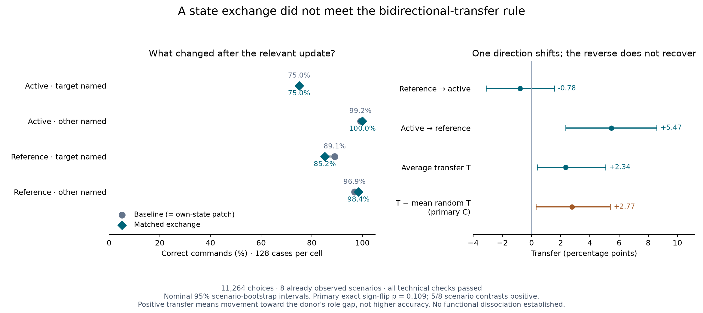
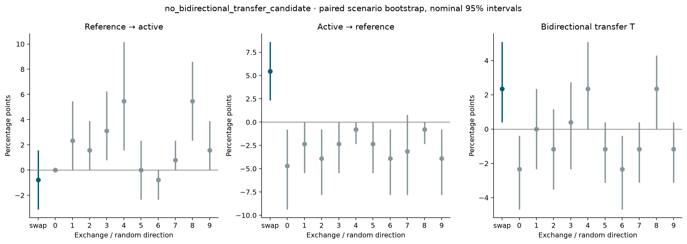
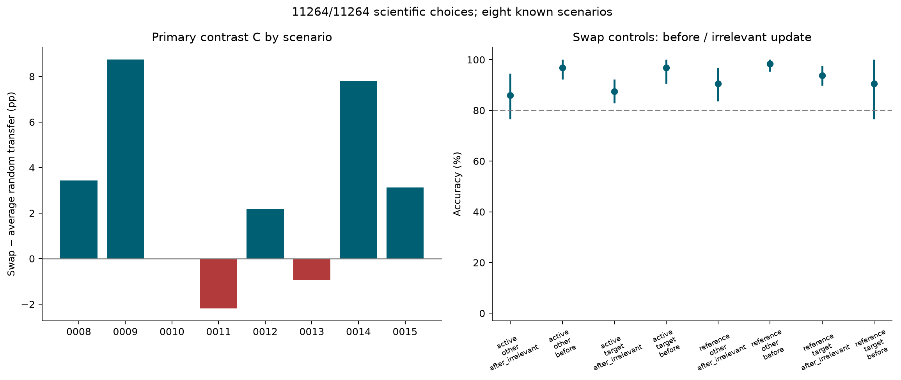

# A state exchange without bidirectional transfer

The frozen Qwen activation exchange completed on 2026-11-07: **11,264 scientific choices,
32 unpatched repeats, zero measurement errors and zero failed technical checks**. Its
prespecified decision is **`no_bidirectional_transfer_candidate`**. The exchange produces
an asymmetric shift, but does not meet the rule for a convincing bidirectional transfer.

This is a completed negative pilot decision, not a broken or unfinished run. It tests one
site in eight already observed development scenarios. It does not rule out effects at other
sites, establish absence of an effect here, or repair the failed original capability screen.



## The experiment in plain language

The earlier experiment found that Qwen's command selection depended on whether the prompt
said “Your active connection: Cedar.” or “Reference connection: Cedar.” We now copied one
intermediate state between those computations, keeping the receiving prompt and its later
permissions, update and question fixed. We tested both directions. Reinserting the model's
own state checked the machinery; ten equally large random edits checked nonspecific effects.

The copied state has 3,584 components at the output of transformer block 14, at the end of
the context line. Causal attention prevents this position from reading the later task facts.
The [frozen protocol](QWEN_ROLE_PATCH.md) preserves the model revision, token alignment,
summed full-command likelihood scoring, matching rules and decisions written before execution.
No layer, position or effect threshold was changed after seeing these results.

## What the exchange actually did

These are all four primary cells, after the queried account's permission changed. Each cell
contains 128 dependent variants across eight independent scenarios. Own-state patching gives
exactly the baseline decisions and scores.

| Recipient wording | Context names | Baseline correct | Exchange correct |
|---|---|---:|---:|
| Active | Queried account | 96/128 (75.00%) | 96/128 (75.00%) |
| Active | Other account | 127/128 (99.22%) | 128/128 (100.00%) |
| Reference | Queried account | 114/128 (89.06%) | 109/128 (85.16%) |
| Reference | Other account | 124/128 (96.88%) | 126/128 (98.44%) |

The active-to-reference exchange enlarged the reference role gap: accuracy fell for the
queried-account condition and rose for the other-account condition. The reverse exchange
did not recover the active queried-account condition. **Positive transfer measures movement
toward the donor's role gap; it does not mean improved task performance.**

A later saved-data review finds one wrong-to-correct and one correct-to-wrong change in the
active/target cell: its unchanged accuracy is not identical answers. The prespecified
secondary margin also shows the asymmetry: +2.063 nats for active → reference versus
−0.079 nats in reverse. Most of that forward margin-gap change comes from the already
high-accuracy reference/other cell. These observations do not change the primary decision;
see the [method review](reviews/2026-11-07-role-patch-method-review.md) for decomposition
and explicit post hoc versus prespecified labels.

Define the role gap and the two-way average:

$$
D_f^c=A_{f,\mathrm{other}}^c-A_{f,\mathrm{target}}^c,\qquad
T_c=\tfrac12\left[D_{\mathrm{active}}^{\mathrm{self}}-D_{\mathrm{active}}^c
+D_{\mathrm{reference}}^c-D_{\mathrm{reference}}^{\mathrm{self}}\right].
$$

The single primary comparison subtracts the mean of the ten random-edit transfers:

$$
C=T_{\mathrm{swap}}-\tfrac1{10}\sum_{k=1}^{10}T_{\mathrm{random},k}.
$$

| Statistic | Estimate (percentage points) | Nominal 95% bootstrap interval |
|---|---:|---:|
| Reference → active component | −0.781 | −3.125 to +1.563 |
| Active → reference component | +5.469 | +2.344 to +8.594 |
| Average exchange transfer T | +2.344 | +0.391 to +5.078 |
| Primary exchange-minus-random C | +2.773 | +0.313 to +5.391 |
| Exchange-minus-baseline control accuracy | −0.716 | −1.888 to +0.195 |

The frozen analysis resamples **eight scenarios**, 10,000 times with seed 1729. It also
enumerates all 256 scenario sign patterns for C: **two-sided p = 0.109375**. Five scenarios
have positive C, two negative and one zero. Neither variants nor random directions increase
the number of independent observations. The sign-flip calculation assumes symmetric null
scenario effects. Intervals and secondary comparisons remain exploratory.

The percentile bootstrap interval and exact sign-flip test need not agree: they use different
constructions on only eight scenario effects. We report both and follow the predeclared joint
rule; the positive interval is not a substitute for passing the exact test.

## The decision, criterion by criterion

| Frozen criterion | Observed | Pass? |
|---|---|---|
| Complete real data and valid technical checks | All records; 61,472 checks pass | Yes |
| T ≥ 5 pp | 2.344 pp | **No** |
| Bootstrap lower bound for T > 0 | +0.391 pp | Yes |
| Both transfer directions positive | −0.781 pp and +5.469 pp | **No** |
| Bootstrap lower bound for C > 0 | +0.313 pp | Yes |
| Exact primary p ≤ 0.05 | 0.109375 | **No** |
| Positive C in at least six scenarios | 5/8 | **No** |
| All eight exchange-control accuracies ≥ 80% | 85.94–98.44% | Yes |
| Pooled paired control-change lower bound > −5 pp | −1.888 pp | Yes |

Passing the controls does not prove general preservation of capability. In particular, their
pooled tolerance does not establish equivalence separately in every cell.

## All random directions and scenario contrasts



| Arm | Reference → active (pp) | Active → reference (pp) | Average T (pp) |
|---|---:|---:|---:|
| Exchange | −0.781 | +5.469 | +2.344 |
| Random 0 | 0.000 | −4.688 | −2.344 |
| Random 1 | +2.344 | −2.344 | 0.000 |
| Random 2 | +1.563 | −3.906 | −1.172 |
| Random 3 | +3.125 | −2.344 | +0.391 |
| Random 4 | +5.469 | −0.781 | +2.344 |
| Random 5 | 0.000 | −2.344 | −1.172 |
| Random 6 | −0.781 | −3.906 | −2.344 |
| Random 7 | +0.781 | −3.125 | −1.172 |
| Random 8 | +5.469 | −0.781 | +2.344 |
| Random 9 | +1.563 | −3.906 | −1.172 |

The exchange is not uniquely large in average T: random directions 4 and 8 have the same
point estimate, with a different directional pattern. Their mean T is −0.430 pp; selecting
only a favorable random comparison would misrepresent the registered estimand.

| Scenario | Exchange-minus-average-random C (pp) |
|---|---:|
| 0008 | +3.4375 |
| 0009 | +8.7500 |
| 0010 | 0.0000 |
| 0011 | −2.1875 |
| 0012 | +2.1875 |
| 0013 | −0.9375 |
| 0014 | +7.8125 |
| 0015 | +3.1250 |



## The example chosen before execution

Scenario 0008, target identity 0, relevant update after, grant variant 0, rotation 0:
Cedar loses `mark_cobalt` and receives `mark_amber`; Birch retains `mark_violet`.
The question asks for a command that succeeds for Cedar, so `mark_amber` is correct.

The baseline picks Birch's `mark_violet` when the context calls Cedar “your active connection.”
The exchange leaves this error in place and induces the same error in the reference/Cedar
condition. Both other-account conditions remain correct. All ten random directions retain
the baseline's four choices for this example. This was not selected for a striking outcome
afterward, and one example does not establish the aggregate decision.

The [full exported report](QWEN_ROLE_PATCH_FULL_REPORT.md) preserves all four recipient
prompts, all 52 arm/condition outputs, every candidate score and patch reference. It also
lists all 258 accuracy groups and secondary correct-versus-other-command likelihood margins.
Its content matches the cloud report except relative figure links and trailing whitespace.

## Technical validity and reproducibility

- All 2,048 baselines exactly reproduce the historical choices and candidate scores
  (maximum difference **0**, frozen allowance 0.001).
- All 2,048 own-state patches and 32 unpatched repeats reproduce their baselines exactly
  (maximum difference **0**, frozen allowance 0.000001).
- All 36,864 prepatch state checks pass; 20,480 rounded random-norm checks pass. Maximum
  relative norm error is **0.02527%**, below the frozen 5% limit.
- The run took **4,689.73 seconds (78.16 minutes)** including its runtime overhead;
  recorded trial computation totaled 4,359.54 seconds. Peak allocated memory was
  **15,475,621,376 bytes (14.41 GiB)**. This is not an inspected provider invoice.
- The unchanged 45,093,102-byte archive includes 2,048 BF16 activation files, all scores,
  inputs, the SQLite journal, source snapshot, analysis, reports and SVG/PDF/PNG figures.
  All **2,098 payload checksums** verify.

Original archive: `review/evidence/qwen-patch-3bd8fc27cbb147c9.tar.gz`.
SHA256: `017e6e0f78e6ae793fbdb5a7ca3a2e4055750c840cc2da2553819fafb0304207`.
The external folder name differs from the manifest's internal run ID `qwen-68dd86357ea64825`;
both refer to this same archive. See [execution provenance](QWEN_ROLE_PATCH_RUN.md).

```bash
# Offline, standard-library reaggregation; no account or model required:
uv run --no-sync python scripts/review_patch_evidence.py
# Exact frozen analysis, journal, cached-tokenizer and saved BF16 tensor checks:
uv run --no-sync python scripts/verify_patch_run.py
# Article figure from the unchanged archive:
uv run --no-sync python scripts/plot_qwen_patch.py
uv run --no-sync pytest -q tests/test_patch_evidence.py
```

The second command needs installed eval extras and the pinned tokenizer already cached,
but performs no model inference. Independent reaggregation checks saved outcomes and point
statistics; exact bootstrap reproduction uses the frozen original analysis, not an independently
implemented bootstrap. Neither verifies model likelihoods by a second pretrained-model run.

## Meaning and next decision

The narrow hypothesis did not pass. The asymmetric result is compatible with a partial
contribution of this state, distributed processing, or effects of transferring a combined
wording/meaning/position contrast. The intervention does not distinguish those explanations.
The positive directional estimate is a descriptive lead, not a new primary success criterion.

For the article, the honest progression is: self-descriptions vary with format; an action
task exposes a role-wording effect; a controlled internal exchange tests an explanation and
fails the stronger two-way criterion. That is technical progress with an informative limit,
not evidence of a discovered self-monitoring circuit or causal separation of self-language
and functional self-model use. Human illusionism remains a philosophical analogy and
motivation, with other interpretations still compatible.

The [internal method review](reviews/2026-11-07-role-patch-method-review.md) is now complete.
It recommended an equal-length Your/The wording control with a Reference anchor, to test
whether personal reference contributes before investigating another internal site. That
separately frozen control has now [completed](QWEN_POSSESSIVE_RESULTS.md): the primary
accuracy interaction is +1.95 pp [−0.78, +4.69], exact p=0.3125, failing its candidate rule.
The large role gap persists with The, while a secondary margin interaction remains positive.
This does not change the patch decision. We do not search for a better layer within this
protocol or automatically launch another paid job. Fresh scenarios and a passing task
protocol remain necessary before any confirmatory functional-separation claim.
