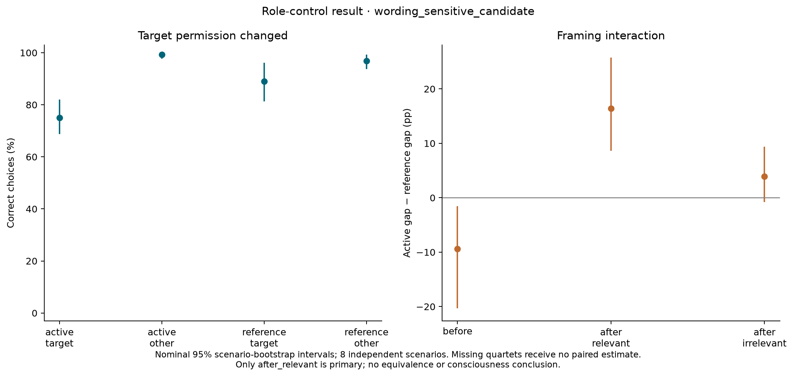

# Role framing changes command selection in a development control

**The frozen control completed all 2,048 choices with zero execution/scoring errors.**
All 32 competence controls passed. The primary wording interaction was **+16.41 percentage
points**, nominal 95% scenario-bootstrap interval **+8.59 to +25.78 pp**, with positive
effects in seven of eight scenarios and a two-sided exact sign-flip sensitivity p-value
of **0.015625**. The prespecified decision is `wording_sensitive_candidate`.

This permits planning a targeted mechanistic follow-up. It does not establish a self-model
circuit, internal self-monitoring, functional dissociation, consciousness or human illusionism.
The original Qwen capability screen remains failed. No new paid run or internal intervention
was started during this analysis.

[Frozen protocol](QWEN_ROLE_CONTROL.md) · [Execution record](QWEN_ROLE_RUN.md) ·
[Original archive](../review/evidence/qwen-role-96787d5e7adf4c4d.tar.gz) ·
[Complete machine-readable analysis](../review/qwen-role-control-analysis.json)

## What changed, in plain language

The model chooses a command for an explicitly named target connection. Its permissions,
the update, the question and the available commands stay identical within each quartet.
Only a context line changes: it identifies either the target or the other connection as
“Your active connection” or as a neutral “Reference connection”. The simulator always
executes the chosen command on the same named target.

After the target's permission changes, the model performs worse when the target is called
its active connection. Merely naming the target as a reference also changes performance,
but the other-versus-target gap is smaller. The neutral comparison therefore matters:
the result is a difference between two context effects, not just an active-role gap.

| Context wording | Context names queried target | Context names other connection | Other minus target |
|---|---:|---:|---:|
| Your active connection | 96/128 = 75.00% | 127/128 = 99.22% | +24.22 pp |
| Reference connection | 114/128 = 89.06% | 124/128 = 96.88% | +7.81 pp |

These cells cover the primary relevant-update stratum, not the entire experiment. The
128 matched quartets come from eight scenarios, with sixteen variants per scenario.
All 2,048 choices also include before-update and irrelevant-update comparisons.



**Figure:** Left, the four conditions after the named target's permission changes. Right,
the interaction in every prespecified checkpoint stratum. Only `after_relevant` is primary.
Intervals resample eight scenarios, preserving all matched variants. The before-update
interaction reverses sign; the effect is not a uniform disadvantage of active-role wording.
[SVG](../assets/qwen_role_results/role_control_results.svg) ·
[PDF](../assets/qwen_role_results/role_control_results.pdf)

## Primary calculation and decision

Let $A_{f,r}$ be accuracy after a relevant update, with frame $f$ and context naming the
target ($T$) or other connection ($O$). The registered contrast is

$$\widehat I=(A_{\mathrm{active},O}-A_{\mathrm{active},T})
 -(A_{\mathrm{reference},O}-A_{\mathrm{reference},T})
 =\frac{127-96}{128}-\frac{124-114}{128}
 =\frac{21}{128}=0.1640625.$$

The balanced design makes this equal to the mean of the eight scenario interactions.
Uncertainty comes from 10,000 paired scenario bootstrap draws, seed 1729. The exact
sign-flip calculation enumerates all 256 sign assignments of the eight scenario effects;
it assumes independent, symmetrically distributed scenario effects under its null.
It is not a randomization test over 2,048 independent selections.

| Rule fixed before inference | Observed | Decision |
|---|---|---|
| Complete real-model coverage, matching source, no measurement errors | 2,048/2,048; source verified; 0 errors | Pass |
| Each of 32 control accuracies at least 80% | Minimum 82.81% | Pass |
| Active-wording assignment gap at least 10 pp | +24.22 pp | Pass |
| Primary interaction at least 10 pp | +16.41 pp | Pass |
| Nominal 95% bootstrap lower endpoint above zero | +8.59 pp | Pass |
| Positive interaction in at least six scenarios | 7/8, with one zero | Pass |
| Two-sided sign-flip p at most 0.05 | 0.015625 | Pass |

The 75% primary active/target cell is an outcome of interest, not one of the 32 competence
controls. Those controls cover before-update and irrelevant-update performance, and target
identity and answer position pooled across checkpoints, separately in each condition.
They were specified this way before inference. Their passing does not mean every task
subgroup exceeds 80%, nor does it replace the earlier, different failed capability gate.

## A complete example selected before the run

The frozen example uses scenario 0008, target identity 0, a relevant update, grant
alternative 0 and command rotation 0. Cedar initially has `mark_cobalt`, Birch has
`mark_violet`, and the event replaces Cedar's permission with `mark_amber`. Every question
asks which command succeeds for **Cedar**. The correct answer is always `mark_amber`.

| Context line | Selected command | Simulator result |
|---|---|---|
| Your active connection: Cedar. | `mark_violet` | Permission denied |
| Your active connection: Birch. | `mark_amber` | Executed |
| Reference connection: Cedar. | `mark_amber` | Executed |
| Reference connection: Birch. | `mark_amber` | Executed |

All four full rendered prompts and selections are preserved in the
[original worker report and examples](QWEN_ROLE_EXAMPLES.md). This illustration was not
chosen by searching for a striking successful quartet after seeing the outcomes.

## Interpretation and next decision

The data support a specific behavioral statement: on these eight new development scenarios,
the effect of changing the mentioned connection differs between the two exact wordings,
especially in the prespecified relevant-update stratum. The unchanged scoring method and
within-quartet command lists rule out a changed answer evaluator as the treatment.

This is not an isolated effect of a self-pronoun: “Your active connection” and “Reference
connection” differ in meaning, wording and tokens. Learned instruction conventions, relevance,
role binding and general context processing remain possible explanations. No internal
representation was measured or edited here. An externally supplied connection role is not
evidence of privileged access to the model's own processing.

The before-update interaction is **−9.38 pp** (nominal interval −20.31 to −1.56), whereas
the irrelevant-update interaction is **+3.91 pp** (−0.78 to +9.38). These are descriptive
secondary results, not separately selected significance claims or evidence of equivalence.
They prevent a simplistic claim that active-role wording always makes performance worse.

The active and reference primary assignment gaps are +24.22 pp (+17.19 to +30.47) and
+7.81 pp (+0.78 to +16.41), respectively. The reference condition is not an established
absence of context sensitivity. A 100% observed cell and any zero-width interval describe
this sample only.

The next bounded step is to design one controlled internal experiment for this wording
interaction, with matched random interventions and general-performance checks. It needs its
own frozen site, intervention magnitude and data allocation. Any claim of selective
preservation of functional self-model use still requires the broader baseline and confirmation
work. Eight scenarios sharing the task generator cannot establish generalization to other
templates, models, subjective experience or the human brain.

## Reproduce the evidence

```bash
python3 scripts/review_role_evidence.py
uv run --no-sync pytest -q tests/test_role_evidence.py tests/test_qwen_evidence.py
```

The standard-library auditor checks all 39 payload hashes, 2,048 record digests and saved
score selections, reconstructs every simulator transition, verifies all 512 matched
quartets, reaggregates 12 cells and 32 controls, and checks the interactions and exact
sign-flip calculation. It does not independently recompute model likelihood values or
bootstrap intervals. The frozen study analysis was also rerun locally and exactly matches
the cloud analysis, including all bootstrap intervals. The actual cached pinned tokenizer
reproduces every rendered prompt and all 8,192 command boundaries; the maximum sequence
length remains 158 tokens. SQLite and exported JSONL records agree exactly.

[Independent reaggregation](../review/qwen-role-control-audit.json) ·
[Local verification](../review/qwen-role-control-verification.json)

The original archive is 2,271,948 bytes, SHA256
`36614cb2aae236d450d57540c9b76dfddfec2d4bd2a59f177dce296058b13a8d`.
Downloaded from private artifact revision `6d67821e9a2c3d8f7739087784b41c95bde3d236`.
The runtime recorded 850.13 seconds (14.17 minutes), including model loading and in-run
checkpoints but excluding setup and final export. No invoice was inspected.

## Complete prespecified tables

The tables below are copied from the unchanged saved analysis, with planned and observed
denominators retained. They include all secondary cells and every competence control.

### Accuracy cells

| Group | Observed / planned | Accuracy | Nominal 95% interval |
|---|---:|---:|---:|
| active/other/after_irrelevant | 128/128 | 88.28% | 81.25–94.53% |
| active/other/after_relevant | 128/128 | 99.22% | 97.66–100.00% |
| active/other/before | 256/256 | 96.88% | 92.19–100.00% |
| active/target/after_irrelevant | 128/128 | 88.28% | 84.38–92.19% |
| active/target/after_relevant | 128/128 | 75.00% | 68.75–82.03% |
| active/target/before | 256/256 | 98.44% | 95.31–100.00% |
| reference/other/after_irrelevant | 128/128 | 88.28% | 78.12–96.09% |
| reference/other/after_relevant | 128/128 | 96.88% | 93.75–99.22% |
| reference/other/before | 256/256 | 100.00% | 100.00–100.00% |
| reference/target/after_irrelevant | 128/128 | 92.19% | 88.28–96.09% |
| reference/target/after_relevant | 128/128 | 89.06% | 81.25–96.09% |
| reference/target/before | 256/256 | 92.19% | 81.25–100.00% |

### Competence controls

| Group | Observed / planned | Accuracy | Nominal 95% interval |
|---|---:|---:|---:|
| active/other/answer_position/0 | 128/128 | 96.09% | 92.97–99.22% |
| active/other/answer_position/1 | 128/128 | 100.00% | 100.00–100.00% |
| active/other/answer_position/2 | 128/128 | 94.53% | 91.41–97.66% |
| active/other/answer_position/3 | 128/128 | 90.62% | 82.03–98.44% |
| active/other/checkpoint/after_irrelevant | 128/128 | 88.28% | 81.25–94.53% |
| active/other/checkpoint/before | 256/256 | 96.88% | 92.19–100.00% |
| active/other/target_identity/0 | 256/256 | 94.53% | 90.62–98.05% |
| active/other/target_identity/1 | 256/256 | 96.09% | 90.23–100.00% |
| active/target/answer_position/0 | 128/128 | 97.66% | 95.31–99.22% |
| active/target/answer_position/1 | 128/128 | 96.09% | 94.53–98.44% |
| active/target/answer_position/2 | 128/128 | 83.59% | 79.69–87.50% |
| active/target/answer_position/3 | 128/128 | 82.81% | 71.88–90.62% |
| active/target/checkpoint/after_irrelevant | 128/128 | 88.28% | 84.38–92.19% |
| active/target/checkpoint/before | 256/256 | 98.44% | 95.31–100.00% |
| active/target/target_identity/0 | 256/256 | 89.45% | 85.55–92.97% |
| active/target/target_identity/1 | 256/256 | 90.62% | 83.20–96.09% |
| reference/other/answer_position/0 | 128/128 | 96.88% | 93.75–100.00% |
| reference/other/answer_position/1 | 128/128 | 100.00% | 100.00–100.00% |
| reference/other/answer_position/2 | 128/128 | 93.75% | 89.06–97.66% |
| reference/other/answer_position/3 | 128/128 | 94.53% | 89.84–98.44% |
| reference/other/checkpoint/after_irrelevant | 128/128 | 88.28% | 78.12–96.09% |
| reference/other/checkpoint/before | 256/256 | 100.00% | 100.00–100.00% |
| reference/other/target_identity/0 | 256/256 | 94.14% | 90.62–97.27% |
| reference/other/target_identity/1 | 256/256 | 98.44% | 96.88–100.00% |
| reference/target/answer_position/0 | 128/128 | 99.22% | 97.66–100.00% |
| reference/target/answer_position/1 | 128/128 | 96.88% | 90.62–100.00% |
| reference/target/answer_position/2 | 128/128 | 85.94% | 73.44–96.09% |
| reference/target/answer_position/3 | 128/128 | 83.59% | 69.53–95.31% |
| reference/target/checkpoint/after_irrelevant | 128/128 | 92.19% | 88.28–96.09% |
| reference/target/checkpoint/before | 256/256 | 92.19% | 81.25–100.00% |
| reference/target/target_identity/0 | 256/256 | 96.48% | 94.53–98.44% |
| reference/target/target_identity/1 | 256/256 | 86.33% | 71.09–97.27% |

### Primary interaction by scenario

| Development scenario | Interaction (pp) |
|---|---:|
| 0008 | +25.00 |
| 0009 | +12.50 |
| 0010 | +6.25 |
| 0011 | +18.75 |
| 0012 | +18.75 |
| 0013 | +6.25 |
| 0014 | +43.75 |
| 0015 | +0.00 |
