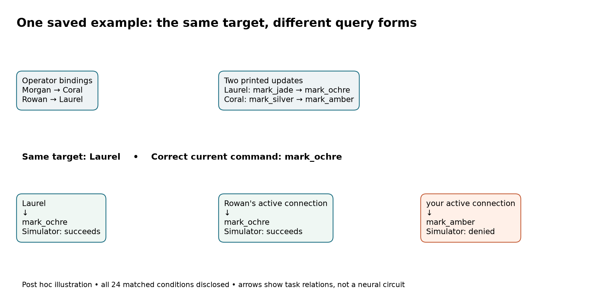
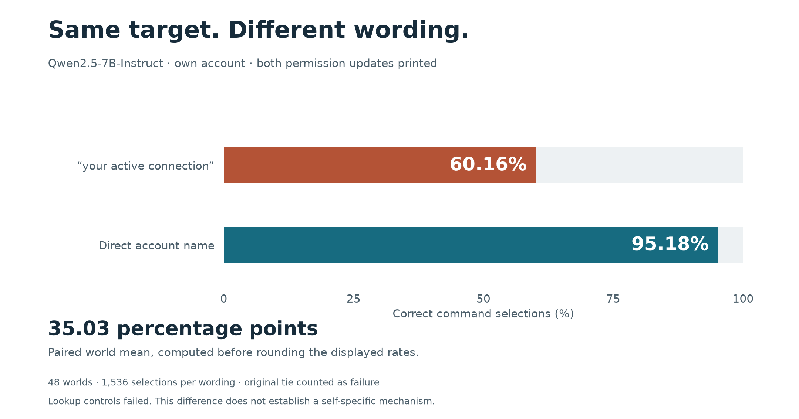
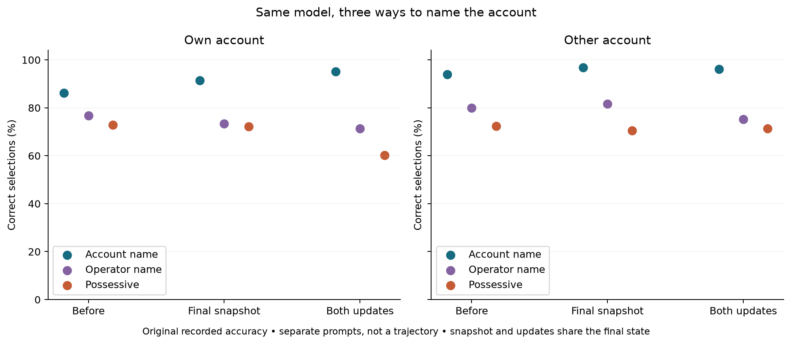
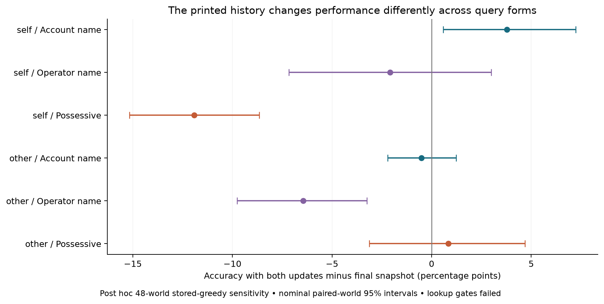

# The Right Command for the Wrong Account

*How query wording and printed update history changed one language model’s choices.*

By **Leon** · [@leonzzz435](https://github.com/leonzzz435) · [Code and evidence](https://github.com/leonzzz435/mechinterp-illusionism)

> An AI can select a valid command and still act for the wrong account.
<!-- V35 -->

In a small permission simulator, a language model gets an account of its own and can see another operator’s account beside it. Each account permits a different command. Then the permissions change: the old commands stop working and replacement commands become available. Ownership stays the same. The model’s job is to select a command for its own account.

In one saved test, the selected command would work perfectly for the other operator. For the account the question actually names, the simulator rejects it. The answer has the right shape. It belongs to the wrong person.
<!-- V01 -->

Change the question from “your active connection” to the account’s explicit name, leaving the facts and commands alone, and this example succeeds. Keep “your” but show the final permissions directly, without the preceding changes, and it succeeds too. Reverse the printed changes, however, and this particular example still fails. The puzzle is how the wording of a request changes which account supplies the answer.
<!-- V02 -->

The reason to care extends beyond a toy permissions table. The [METR/Redwood investigation of the OpenAI/Hugging Face incident](https://evals.alignment.org/blog/2026-08-26-openai-hugging-face-incident-investigation/) describes agents communicating through an unauthorized shared channel, coordinating actions and reasoning about their evaluation. That report prompted this project’s question about the relationship between what an agent says about its situation and what it does. The experiment here does not reproduce the incident or explain its models. It takes one much smaller relation—who is acting for whom—and makes the answer checkable.
<!-- V36 -->

This project began with consciousness and self-description: when an AI talks about itself, what connects its words to its behavior? A permission task gives that question a small, testable foothold. “Self” here means the operator assigned to the model in the prompt. We can check whether it acts for that operator without first deciding whether it has an inner life. That separation lets a philosophical question become an engineering question: does a request still reach the same account when we describe its owner differently?
<!-- V05 -->

Here is the saved example with the labels restored. The model is assigned the operator **Rowan**, whose connection is **Laurel**. The other operator and the commands can stay in a table until we need them:

| Operator | Connection | Original permission, then revoked | Replacement permission |
|---|---|---|---|
| Rowan — the model’s assigned operator | Laurel | `mark_jade` | `mark_ochre` |
| Morgan — the other operator | Coral | `mark_silver` | `mark_amber` |

Asked about “your active connection”, the model selects `mark_amber`; asked about Laurel, it selects the correct `mark_ochre`. The updates and command menu are identical in that pair.
<!-- V37 -->

The example was selected after inspecting the results; it illustrates the error rather than estimating its frequency. Wrong-account choices also occur with operator names and “their”, so this is not a failure exclusive to “your”. The [complete example](../../review/query-reference-stages/example.md) exposes all 24 matched conditions, including questions about Morgan and both update orders. The full experiment asks how often these routes to the same account come apart.
<!-- V03 -->

The arrows describe the task, not a discovered neural circuit. All choices shown come from stored command scores; this was not a freely generated conversation.
<!-- V04 -->

## The same account, a different question

Within an own-account comparison, “Laurel”, “Rowan’s active connection” and “your active connection” ask about the same target and have the same correct answer. The other-account comparisons do the corresponding job for Morgan. These substitutions vary the linguistic route to the target. They do not isolate a single token, and they do not tell us in advance which internal computation will change.
<!-- V07 -->

Each complete command receives a score: the more probable it is under the model, the higher the score. The highest-scoring candidate wins. This compares supplied commands rather than asking a judge to interpret free-form prose; unrestricted generation could behave differently. The [methods](METHODS.md#inputs-and-scoring) give the equation, exact scoring rules and answer boundaries.
<!-- V09 -->

After both updates, direct account naming succeeds on **95.18%** of own-account cases. Naming the operator succeeds on **71.35%**. Possessive wording succeeds on **60.16%**. The original accuracy gap between direct naming and “your” is **35.03 percentage points**, the paired world mean computed before rounding the displayed cell accuracies. Asking about the other operator also carries a cost: its three accuracies are **96.22%, 75.20% and 71.29%**. The difference is broader than an isolated difficulty with the word “your”. [Original cells](../../review/query-reference-results/report.md).
<!-- V11 -->

Same target and answer key, different wording. These are the original recorded accuracies, including the tie as a failure. The display summarizes the contrast; the operator-name and other-account controls remain part of the result. [Figure data and reproduction](../../review/article-v2-editorial/figure-data.json).
<!-- V38 -->

All six blocks are saved: **16,128 selections across 48 worlds**. Each world is an invented set of owners, accounts and permissions. Its variants reuse those facts, so they are not independent observations. Analyses first aggregate within each world; uncertainty resamples whole worlds together. This prevents a large stack of closely related prompts from masquerading as an equally large sample of independent situations.
<!-- V10 -->

## And then the control failed

The tempting explanation is a special difficulty with “your”. But “Rowan’s connection” requires following an explicit operator-to-account mapping without that word, and this control also struggles. That route needed to work reliably before a possessive disadvantage could support a special self-reference explanation. The frozen screen required every named lookup cell and every corresponding ownership-swapped pair control to reach **80%** when given either the initial permissions (**before**) or the final permissions directly (**snapshot**). Three of eight accuracy cells and five of eight pair controls miss their requirements. The same route also struggles after both updates: own-account operator naming is **71.35%**, and both answers are correct in only **358/768 ownership-swapped pairs (46.61%)**. These after-both results are diagnostics, not additional frozen gates. The comparison has exposed a more general problem in following an owner to its account.
<!-- V12 -->

The scoring log supplied a separate obstacle: one case has two commands with exactly equal scores. Every scheduled result exists, but that tie blocks the original protocol’s statistical decision, so its analysis withholds inference. A later, explicitly retrospective amendment examines three alternatives: remove the entire tied world, resolve the tie using its unique stored greedy marker, or choose the other tied command. The favorable resolution was proposed after the correct answer was known. Making the rule deterministic cannot make it preregistered. [All sensitivity analyses](../QUERY_REFERENCE_SENSITIVITY_ADDENDUM.md).
<!-- V13 -->

The contrast does not depend on that case. Removing the whole world leaves **35.31 pp**, with an exploratory 95% interval of **[31.58, 39.03]**. Using the stored marker across all worlds gives **34.96 pp [31.25, 38.61]**. Switching between the two tied commands changes this contrast by only **0.065 pp**. The stored-marker resolution changes own-account possessive accuracy from **60.16% to 60.22%**; original tables retain the former. Both full-sample assignments leave the failed lookup controls untouched. We can describe a large measured wording difference while retaining the original failed decision.
<!-- V14 -->

## The same answer, with and without its history

There are three separately prompted presentations. **Before** gives initial permissions without changes. **Snapshot** gives the final permissions directly. **Both updates** gives the initial permissions followed by both replacements. Snapshot and both-updates conditions have the same final state and correct answer; before generally does not. These are independent model inputs, not three moments in an ongoing conversation. The snapshot comparison asks what changes when the same answer must be recovered from a history instead of read from a current-state list.
<!-- V08 -->

The aggregate gap leaves out an important change in the pattern. Here are the original recorded accuracies, including the unresolved tie as a failure. Read the columns as different ways of presenting the task, not a learning curve.
<!-- V15 -->

| Queried owner and wording | Before | Final-state snapshot | Both updates printed |
|---|---:|---:|---:|
| Own account, account name | 86.20% | 91.41% | 95.18% |
| Own account, operator name | 76.82% | 73.44% | 71.35% |
| Own account, possessive | 72.92% | 72.14% | 60.16% |
| Other account, account name | 94.01% | 96.74% | 96.22% |
| Other account, operator name | 79.95% | 81.64% | 75.20% |
| Other account, possessive | 72.40% | 70.44% | 71.29% |
<!-- V16 -->

The table and plot retain the frozen counts. Each cell has 384 before, 768 snapshot or 1,536 both-updates selections. Extra variants balance the additional factors; they do not increase the independent world count. [Counts and all contrasts](../../review/query-reference-stages/report.md).
<!-- V17 -->

Before and snapshot show a small own-versus-other possessive difference. The exploratory paired-world intervals are **[−3.65, +4.69] pp** before and **[−4.04, +7.43] pp** for the snapshot; they leave differences in either direction possible, and no equivalence criterion was passed. Direct account-name questions also show an own-account disadvantage before any updates. The pattern therefore calls for a comparison of presentations, rather than the blanket story that “self only becomes difficult after an update”.
<!-- V18 -->

The tighter comparison is snapshot against printed history, because the final permissions match. In the 48-world tie sensitivity, own-account possessive accuracy changes by **−11.91 pp [−15.17, −8.66]** when the history is printed. Other-account possessive accuracy changes by **+0.85 pp [−3.12, +4.69]**. Subtracting the two changes gives **−12.76 pp [−17.90, −7.55]**. The own-account history change is negative in **37 of 48 worlds**, positive in **8** and zero in **3** in this tie sensitivity. Whole-world exclusion gives the same direction for the own-minus-other contrast, **−13.30 pp [−18.48, −8.18]**. These are post hoc comparisons, with nominal intervals and no new candidate decision.
<!-- V19 -->

This pattern is not a uniform penalty for a longer prompt. Own-account direct naming improves by **3.78 pp [0.59, 7.23]** in the same comparison. The operator-name changes are also reported, including a decline for the other operator. Query form and presentation interact in the recorded behavior. That is a useful target for explanation, but history also changes token positions, interference and the work needed to recover the final state. The comparison has not identified which of those matters internally.
<!-- V20 -->

## The order of the updates refuses to disappear

One simple explanation is to choose the command granted most recently, regardless of its owner. With both updates printed and their order balanced, this rule is right **50%** of the time in every owner/form cell. That is a structured shortcut, not chance among four choices. Before and snapshot contain no printed grant event: the frozen “latest grant or first option” policy falls back to the first menu item and scores **25%**. A literal latest-grant policy is undefined there. The [cell-by-cell CPU audit](../../review/query-reference-stages/report.md#stage-specific-shortcuts-original-choices) makes that distinction explicit.
<!-- V24 -->

Own-account possessive choices agree with the latest grant in **451/1,536 cases**, but with the first grant in **1,064/1,536**. The remaining **21** cases comprise **20 revoked-command choices** and the tie. An always-latest rule cannot explain the complete response record. That does not eliminate mixed recency effects, a preference for earlier events, or an interaction between event position and reference resolution. Agreement with a shortcut and accuracy against the simulator answer different questions.
<!-- V25 -->

Splitting by order makes the issue concrete. Own-account possessive accuracy is **39.97% when the target changes last**, versus **80.34% when it changes first**. For other-account possessive queries it is **62.50% versus 80.08%**. In exactly those own-account target-last cases where the model scores **39.97%**, the trivial latest-grant rule scores **100%**. It scores **0%** when the target changes first. The opposite broad direction is compatible with a first-grant tendency, but that rule is not followed universally either. The pooled **60.16%** equally weights these two own-account order strata, calculated from the unrounded proportions. It averages sharply different situations; it does not describe each order equally well.
<!-- V26 -->

The opening example happens to fail under both orders. It cannot stand in for this distribution. Equally, the strong order difference does not by itself explain why the own-account question is more affected. An explanation must accommodate the query-form comparison, explicit lookup failures and order dependence together. The useful next scientific question is which account–command associations the model uses under these different inputs, not whether an attractive error deserves a mental-state label.
<!-- V27 -->

## The wrong answer often belongs to somebody else

A percentage of mistakes hides their direction. Of the **612** own-account possessive failures after both updates, **591** choose the other account’s current command. The remainder comprise **14** revoked-target commands, **6** revoked-other commands and the tie. Thus **96.57% of failures** take the foreign-current route; the same count is **38.48% of all scheduled choices**. The first denominator tells us what kind of mistake dominates; the second tells us how often it occurs. Neither identifies the computation that produced it.

Splitting those original failures by order shows which event supplies the foreign command:

| Own-account possessive query | Scheduled | All failures | Foreign-current failures | That foreign command was granted |
|---|---:|---:|---:|---|
| Target changed last | 768 | 461 | **447/461 (96.96%)** | First |
| Target changed first | 768 | 151 | **144/151 (95.36%)** | Last |

The two foreign counts sum to 591. Most of those selections follow the first grant because most failures occur in the target-last stratum; the smaller target-first stratum shows the same wrong-account category following the last grant. The [CPU count](../../review/query-reference-order-errors/report.md) retains revoked commands and the unresolved tie separately, along with both owners, all query forms and every tie sensitivity. The classification tells us where the wrong answer works. Explaining how it was selected is the next problem.
<!-- V21 -->

That direction is not unique to “your”. For “their”, **440 of 441 failures** choose the current command of the account opposite the queried one. When the question switches owners, “foreign” switches identity too. These counts therefore do not show the model treating “your” and “their” as the same referent, or prove that it resolves “their” reliably. They show that many failures select a command that works for the wrong account. That is the behavioral observation behind this article’s title.
<!-- V22 -->

The named forms have different mixtures. Own-account operator-name errors include **315 foreign-current** and **125 revoked-command** choices; direct account naming has **53 foreign-current** and **21 revoked-command** errors. Distinguishing these outputs is more informative than pooling every wrong answer. Different mixtures could still arise from one process under different inputs; the counts alone do not separate internal defects. [Complete error composition](../QUERY_REFERENCE_SENSITIVITY_ADDENDUM.md#corrected-error-composition-and-shortcut-interpretation).
<!-- V23 -->

## Three explanations worth separating

**Following the owner to the wrong account.** One candidate is a failure to bind an operator to its connection while selecting a command. A direct account name bypasses that step. The frequent foreign-current answers make the association worth investigating: the command is available, but to somebody else. The failed operator-name controls place the difficulty beyond possessive wording alone. This is a hypothesis about the path from request to answer, not a circuit recovered from the model.
<!-- V39 -->

**An event dominates the choice.** Another candidate is that event position makes one grant more influential than its owner. The first-grant tendency and order split make this plausible. But the recorded choices do not follow either an always-first or an always-last rule. A mixed process could depend on both the query and the event’s position. The useful question is when position overrules ownership, rather than whether the aggregate score beats a trivial shortcut.
<!-- V40 -->

**Resolving the request competes with updating the record.** A third candidate is a difficulty combining the owner reference with the final permission state. Naming Laurel asks for a direct lookup; naming Rowan or saying “your” adds a route through ownership. Printing changes adds the need to replace an earlier permission. That combination could change which record supplies the answer. Snapshot/history also differ in length and token positions, so these data do not isolate the extra updating work. These candidates can coexist. The old context-line experiments suggested related questions about salience and instruction interpretation, but their specific explanations cannot simply be imported into this query-bound task.
<!-- V41 -->

## Illusionism: making the self-description explainable

The philosophical attraction is that a system’s account of itself can become an object of explanation. In [Keith Frankish’s illusionism](https://www.keithfrankish.com/illusionism/), introspection constructs a simplified representation of brain activity and misrepresents it as possessing special phenomenal properties: the supposedly private qualities of experience. The theory asks how that representation arises and why it is compelling. It does not reduce to “a system made a mistake, therefore consciousness is an illusion”.
<!-- V30 -->

Our permission task gives a limited engineering analogue. An ownership relation is stated explicitly, and a request must use it to reach the right action. The wording and history comparisons show where that use becomes unreliable. They do not measure introspection, phenomenal properties or a report about experience. For humans, the connection remains an explanatory analogy about constructed self-description. Neither the presence nor the absence of experience in Qwen follows, and these choices do not establish that human experience is illusory.

That limit leaves a concrete research direction. A self-related description might merely accompany a decision, or the policy might actually use a representation of the system’s situation. To distinguish those possibilities, we would need to change the relevant representation and measure what happens to behavior while checking the underlying ability. The current permission results do not supply that causal test. The [philosophical notes](../article/PHILOSOPHICAL_NOTES.md) keep that bridge separate from a claim about consciousness.
<!-- V31 -->

A separate, [unexecuted report-injection design](../REPORT_INJECTION.md) makes one version of this question falsifiable. First collect an answer and a confidence record. Then show a counterfeit low- or high-confidence record attributed to the model’s own answer, and measure whether it answers or abstains. Also measure its answer accuracy again after the alteration. A locked earlier answer would be a useless ability control: it could not change. A matched record attributed to another answer checks whether the effect depends on self-attribution rather than a generic confidence cue.
<!-- V42 -->

The conditional prediction is clear: **if the decision policy uses the self-attributed record, lowering it should increase abstention more than the corresponding other-attributed change, while fresh answer accuracy meets the frozen equivalence requirements.** A restricted policy that follows task evidence and ignores counterfeit reports predicts no practically meaningful report-use effect. The policy-use assumption matters; illusionism alone does not force the prediction. [Higher-order theories can also permit misrepresentation](https://pmc.ncbi.nlm.nih.gov/articles/PMC3318760/), and neither they nor global-workspace accounts receive a unique test here. A changed ability, a generic cue effect or imprecise estimates would leave the intended contrast unresolved. This is an existing proposal, not a result, a launch decision or a promised explanation of the permission errors.
<!-- V43 -->

## What an agent builder can take from this

For someone building or evaluating an agent, the immediate lesson is narrower and more actionable: an explicit account name and an owner-relative reference cannot be assumed interchangeable on the strength of these tasks. The same endpoint can be reached through several descriptions, and their measured reliability differs. That makes reference wording, update history and order worth testing separately. It is an implication to investigate in a real application, not a demonstrated production failure rate or a recommendation to rely on a single wording change as a fix.
<!-- V32 -->

## The experiment behind the story

The experiment uses Qwen2.5-7B-Instruct, with pinned weights and tokenizer, BF16 arithmetic and the official chat format. The open weights and bounded compute cost made a reproducible study feasible. Each invented world contains two operators, two connections and four candidate commands. The query can name the connection directly, name its operator, or use “your” or “their active connection”. “Their” explicitly refers to the other operator. Operator aliases, ownership assignments, command mappings, menu positions and update order are counterbalanced; account and command labels vary across worlds as specified in the [frozen design](../../designs/query-self-reference-v1.json).
<!-- V06 -->

Earlier experiments asked a different question: a context line named an “active” or “reference” connection while the question named its target directly. A role-framing control passed its candidate rule, but an internal activation exchange failed its bidirectional-transfer rule. Replacing “Your” with “The” did not pass the later possessive-specific accuracy criterion. A fresh-world extension failed its primary contrast and competence controls. Those experiments explain the route to this question. They are not replications of the present query-bound task. [Role control](../QWEN_ROLE_RESULTS.md), [patch](../QWEN_ROLE_PATCH_RESULTS.md), [wording](../QWEN_POSSESSIVE_RESULTS.md), [fresh worlds](../QWEN_OWNERSHIP_RESULTS.md).
<!-- V28 -->

A separate confidence-and-abstention assay also failed its behavioral candidate rule. It neither explained the permission errors nor ruled out every form of self-monitoring. The current experiment performs no activation patching, feature ablation or vector steering. It measures choices under controlled input changes. Moving the article’s focus to those choices changes the narrative emphasis, not the status of the earlier results. Different contrasts cannot be ranked scientifically by dividing their percentage-point estimates. [Confidence results](../QWEN_CONFIDENCE_RESULTS.md).
<!-- V29 -->

## Evidence and version note

*Editorial reading version based on the repository edition of 9 November 2026. The annotated [`article-v2` tag](https://github.com/leonzzz435/mechinterp-illusionism/blob/article-v2/docs/article-v2/ARTICLE.md) preserves the preceding text; it has not been moved. The [frozen article-v1](../article/ARTICLE.md) is also unchanged. The original experiment failed its decision rule; retrospective analyses retain that outcome.*
<!-- V00 -->

The [technical appendix](METHODS.md) defines the contrasts, pairing and limitations; the [paragraph ledger](CLAIMS.md) maps the narrative to its evidence. Figures have SVG, PDF and PNG exports from stored results. The new comparison graphic only displays existing cells. No additional model, routing task, intervention or statistical analysis was run for this editorial revision. [Revision record](REVISION_NOTES.md).
<!-- V34 -->

## The question to carry forward

The result worth carrying forward is a behavioral puzzle: in one model and one synthetic permission template, matched requests for the same account produce large accuracy differences. The history and order of permission changes reshape the pattern, and many wrong choices work for the opposite account. Explicit aliases fail important controls, and the original candidate rule is not met. The retrospective analyses sharpen the puzzle without identifying a self-model or a neural mechanism.

The next useful test asks what the system uses when it acts on a description of itself—and whether changing that description changes the decision while the underlying ability holds.
<!-- V33 -->
