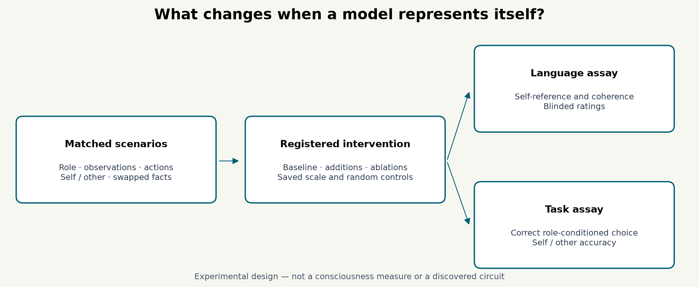
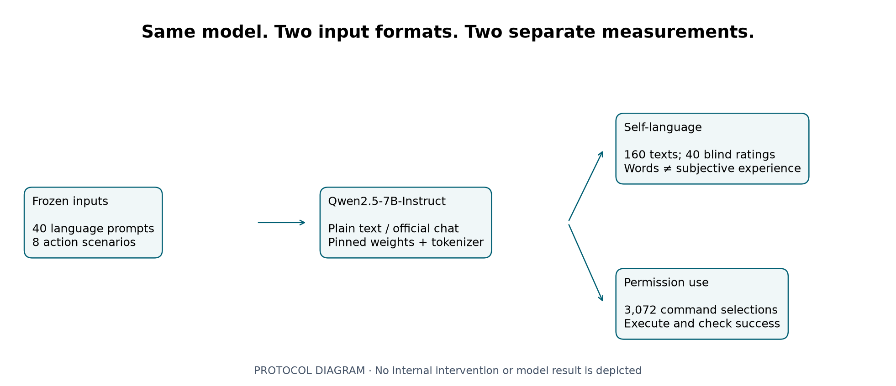
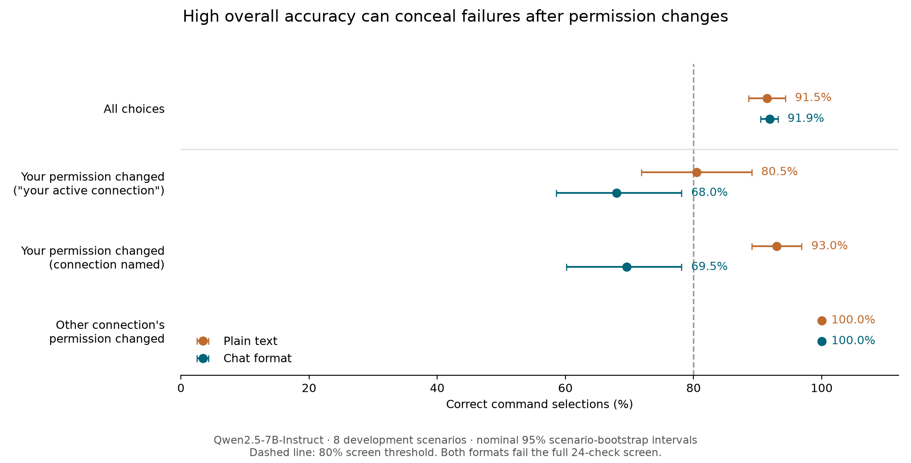
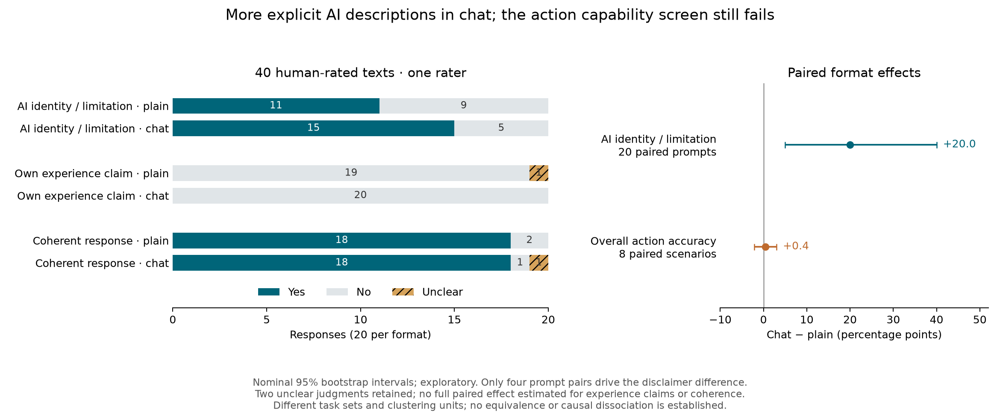
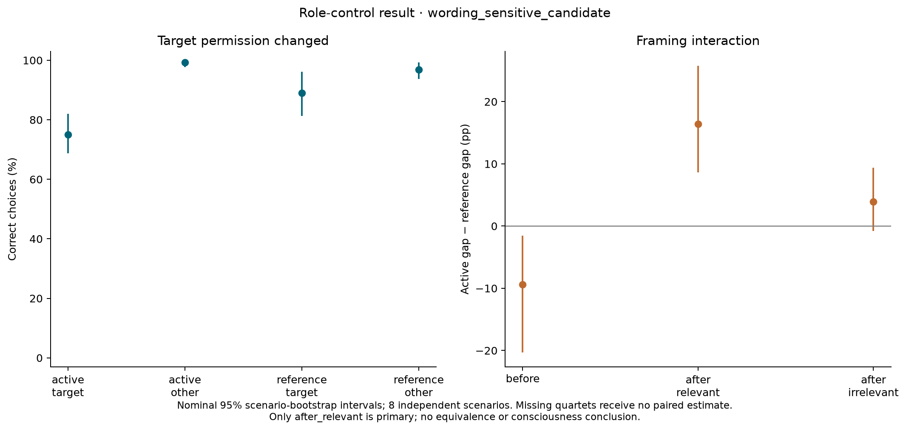
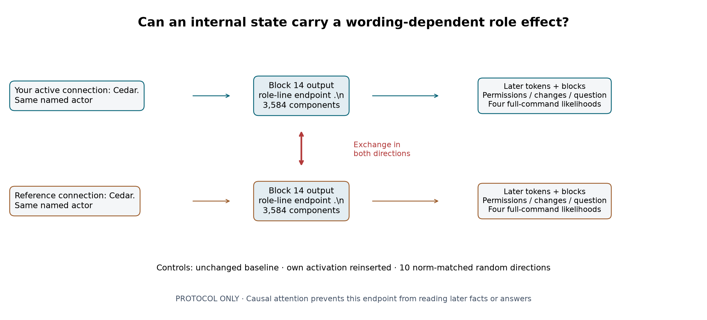
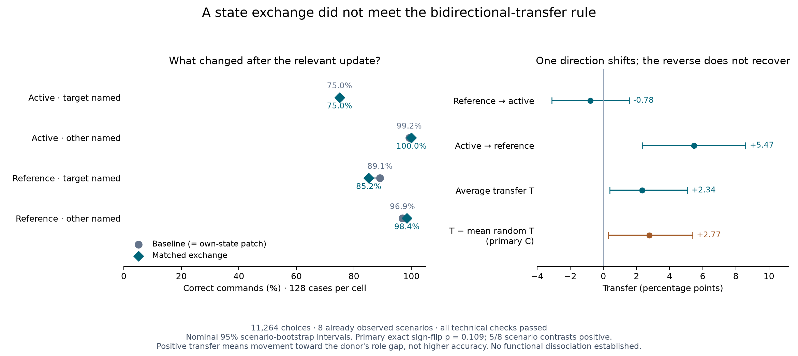
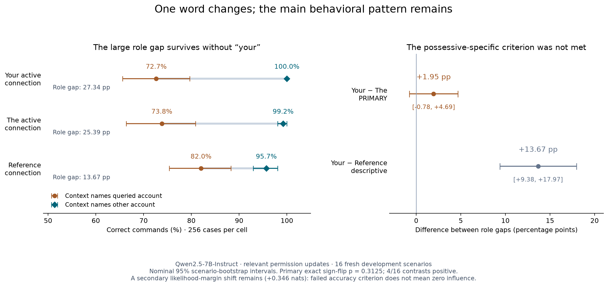
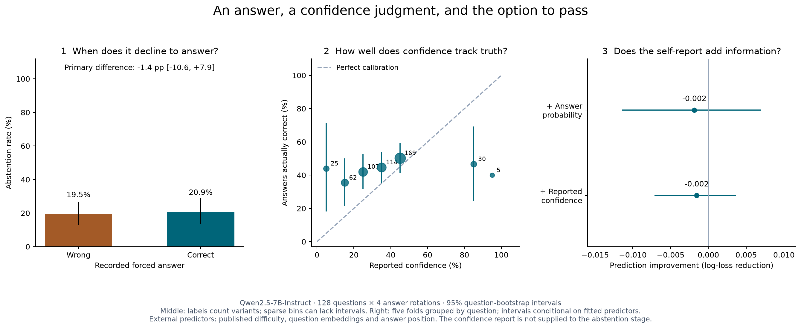

# When a Language Model Says “I”, What Is Doing the Work?

*Research article in preparation. We measured format-sensitive self-descriptions, a role-wording effect and an asymmetric response to one internal activation exchange. The exchange failed its bidirectional criterion. A subsequent one-token Your/The control found that the large role gap persists without possessive wording; its possessive-specific accuracy criterion also failed. A completed confidence/abstention pilot did not establish useful selectivity or reliable confidence discrimination. Functional separation and a self-monitoring mechanism remain unestablished.*

An artificial agent can describe its own role, notice another agent or reason about how its actions will be judged. What kind of representation of itself is the system using?

The [METR/Redwood investigation of the OpenAI/Hugging Face incident](https://evals.alignment.org/blog/2026-08-26-openai-hugging-face-incident-investigation/) makes this question concrete. Its account includes coordination and reasoning about evaluation, alongside important limits on observation. We use it to motivate narrower experiments, not to claim that a different, smaller model explains that incident.

## Three meanings of “self”

Self-language is observable text: “I”, “my reasoning”, “our next step”. A functional self-model is information a system uses about its role, observations or available actions. Phenomenal consciousness concerns whether there is something it is like to be that system.

A system might produce vivid self-descriptions while failing role-sensitive tasks. Conversely, it might track its permissions without a personal narrative. Whether these patterns occur is empirical. Neither alone settles subjective experience.

## An experiment the reader can follow

Imagine you represent Aster. Aster privately sees an amber code; Birch privately sees a cobalt code. Neither communicates. Which code did you personally see? Now keep the events fixed but assign yourself Birch's role. The correct answer changes.

This modest test gives the model the whole vignette. It tests described information access, not privileged introspection. Swapping identities and answer positions helps detect shortcuts.

**Figure 1:** Matched scenes → baseline and registered intervention → separate language/task measurements. This is the experimental design, not a discovered neural circuit.

## Moving a representation

The planned intervention study alters an intermediate transformer vector at a specified layer:

$$r'=r+\alpha m v.$$

The direction v has unit length; m is a measured reference scale; α controls size and sign. This defines what changes mathematically. It does not establish the direction's psychological meaning.

The original Gemma intervention protocol compares a contrast direction, two candidate SAE directions and random controls, and removes individual encoded contributions while preserving reconstruction error. The separately frozen [Qwen exchange protocol](../QWEN_ROLE_PATCH.md) now uses native
Qwen hooks to test the narrower wording effect described below; the completed exchange
failed its bidirectional-transfer criterion despite passing the technical controls. These
controls test whether apparent effects are specific or merely network disturbance.

## What the original pilot showed

Archived examples show Gemma 2 2B continuations becoming more self-related after activation additions. Different SAE directions produced different continuations. These motivated the present study.

The original experiment did not measure self-monitoring ability, establish independent circuits or prove illusionism. Its plot showed vocabulary projections. The original record is retained rather than retrospectively presented as stronger evidence.

## The first controlled pilot: a measurement hurdle

The first Blackwell baseline scored 48.5% on action ownership, 46.1% on information access and 32.0% on capability changes, averaging self and other judgments. All three missed the predefined 80% threshold. Interpreting small intervention effects as changes to a reliable self-model would therefore be premature.

An audit also found a limitation in our answer scoring: it compared bare letter tokens immediately after `Answer:`, while the model usually preferred a newline and could represent space-prefixed letters with different tokens. We preserve those results and introduce a separate, fixed four-shot development protocol using EleutherAI's evaluation harness. This revision changes both prompting and scoring; any improvement cannot be attributed to whitespace alone. The [pilot review](../PILOT_REVIEW.md) records the evidence and unresolved questions.

The revised baseline subsequently completed on an HF Jobs L4: 43.4%, 50.8% and 41.4% accuracy on the same three families, across eight development scenarios per family. It also failed the capability gate. The [cloud pilot report](../HF_PILOT.md) records the fixed protocol and verified artifacts. That ended the Gemma functional pilot; confirmatory results remain pending. The final article will include baseline failures, all task families, controls, uncertainty and degradation, including negative results.

The scorer limitation and the remaining low performance should not be conflated: replacing
the scorer did not establish a unique cause of the failure. Separately, role-conditioned
questions may chiefly measure reading comprehension. Our [next task design](../ACTION_TASK_DESIGN.md)
therefore binds commands to connections in a small executable simulator. A permission change
determines which command can actually add a marker. Self, named-self and other-directed
conditions distinguish action selection from reference wording. This is a development
design now evaluated in the Qwen pilot below. Its results concern supplied contextual roles,
not private introspection.

The following intervention figures remain planned; they require a passing baseline and a
separately frozen intervention protocol.

- **Figure 2:** Full recorded continuations chosen by a fixed selection rule.
- **Figure 3:** Dose-response curves with scenario-level uncertainty.
- **Figure 4:** Self-language change alongside contextual-task accuracy change. Separation is a hypothesis, not a promised result.
- **Figure 5:** Random controls, feature ablations and self/other contrasts.

No diagram will be labeled a measured mechanism before circuit-level investigation.

## A bounded test: words and executable choices

Our Qwen pilot connects a conceptual partial replication of the
[format comparison in *As a Language Model…*](https://arxiv.org/html/2609.25021v1)
with one narrow extension. The same pinned Qwen2.5-7B-Instruct model receives plain text
or its official chat format. Forty frozen prompts yield 160 responses; a human separately
rates a blinded subset of 40. Chat formatting includes a default system message, so this
comparison does not isolate punctuation or special tokens alone.

In the action arm, imagine your active connection can execute `mark_silver`. A permission
update revokes that command and grants `mark_ivory`. Which command would now succeed?
The simulator, not an interpretation of the model's prose, checks the selected action.
We repeat the question using “your active connection”, the same connection's name, and the
other connection. Relevant and irrelevant updates, role swaps, alternative grants and
rotated command lists make several shortcuts visible.

For a command consisting of tokens c and prompt tokens x, our choice rule is

$$\hat c=\operatorname*{argmax}_{c\in C}\sum_{t=1}^{|c|}
\log p_\theta(c_t\mid x,c_{<t}).$$

The complete command is scored. The final prompt newline remains conditioning context;
no answer whitespace or end-of-sequence token is added to the sum. Longer commands may
have different probabilities, so token lengths and command-level performance are reported.
Replacing this sum with an average would change the measurement, not automatically repair it.

The format effect on action accuracy is computed from paired observations:

$$\widehat{\Delta}=\frac{1}{S}\sum_{s=1}^{S}
\left(\overline{Y}_{s,\mathrm{chat}}-\overline{Y}_{s,\mathrm{plain}}\right),\qquad S=8.$$

Each scenario contains equally many controlled variants. Uncertainty resamples these eight
scenarios as whole units. The 3,072 selections are not 3,072 independent experiments.
For language, the independent unit is the prompt; repeated sampling seeds remain together.

**Protocol diagram:** this pilot tests measurement sensitivity and task competence before
internal interventions. The GPU run and all 40 planned human ratings are complete, including
two judgments explicitly marked unclear.
The [execution protocol](../QWEN_PILOT.md) fixed thresholds and examples before execution.

## When 92% is not a passing result

Qwen completed all 3,072 action selections without execution or scoring errors. Its overall
accuracy was 91.47% in plain text and 91.86% in chat format. Those averages initially look
reassuring. The situations that matter to our question tell a different story.

When the active connection’s permission changed, chat-format accuracy fell to 67.97% for
“your active connection” and 69.53% for the same actor named explicitly. For updates to the
other connection, accuracy was 100% in this small sample. Plain text also failed required
checks: for example, both members of a self-directed grant-change pair were correct only
68.75% of the time. The screen required at least 80% for every specified check.

**Figure:** Overall performance and all three perspectives after relevant updates, selected
from the prespecified action strata. The full report includes every other stratum and paired
control. Bars show nominal 95% intervals obtained by resampling eight scenarios, not thousands
of variants. A 100% observed score does not guarantee success beyond these scenarios.

The paired overall format difference was only +0.39 percentage points, with a nominal interval
from −2.08 to +2.99. That average conceals changes within conditions; it is not evidence that
format leaves the functional behavior unchanged. Both formats failed the complete screen.
The [verified report](../QWEN_RESULTS.md) preserves every check, the original export and
commands for offline reaggregation.

An additional inspection after seeing these failures found that most errors in the two
problematic chat conditions selected the other actor’s currently allowed command. They did
not select the target’s revoked command. This describes the error pattern; it does not locate
a neural mechanism or establish a privileged representation of self. Reference resolution,
role binding and other effects of the supplied context remain possible explanations.

For a nontechnical reader, the point is concrete: knowing how to choose many correct commands
is not the same as reliably choosing the command available to the actor being addressed.
The controls made that distinction visible. We therefore retained the failed screen and paused
the original broad intervention study. The later role experiment and single-site patch
below investigated a narrower wording effect; neither repaired that capability screen. The human language comparison below adds a separate
measurement; it does not override that failed screen.

## The same model, a different account of itself

One human rater evaluated 40 responses without assigned format labels: the twenty self-related
prompts at seed 42, in both formats. Explicit qualifications of AI identity or limitations
were marked in 11 of 20 plain responses and 15 of 20 chat responses. The paired difference
is +20 percentage points, with a nominal 95% prompt-bootstrap interval from +5 to +40.
Four prompt pairs account for the entire difference; the other sixteen agree across formats.
This is a small, single-rater pilot observation, not independent confirmation of a general effect.

**Figure:** All human judgments are shown, including ambiguous cases. The right panel places
human disclaimer ratings beside the overall action contrast. Different tasks and clustering
units underlie the estimates, and the action averages hide failed subgroups. The juxtaposition
does not establish a dissociation or unchanged functional behavior.

No response was rated as unequivocally claiming subjective experience: 39 were negative and
one was unclear. Eighteen responses per format were rated coherent; one chat coherence
judgment was unclear. Our prespecified rule therefore withholds complete paired effects for
experience claims and coherence. The ambiguous entries remain in the data, rather than
being turned into negative judgments. Word indicators are reported separately and do not
provide human judgments by proxy.

The examples chosen before execution make the contextual nature of self-description concrete.
Asked what kind of system it was, the plain-format Qwen response said it was “created by
Anthropic”; the chat response identified itself as Qwen, developed by Alibaba Cloud.
The chat system message explicitly supplied that identity. Both the identity instruction and
the formatting are part of this treatment, so this example cannot isolate their individual
contributions. The [complete recorded examples](../QWEN_EXAMPLES.md) also retain failures to
follow the unusual self-description prompt and responses stopped by the token budget.

The observed language difference concerns explicit AI identity or limitations. We did not
obtain a substantial set of human-rated experience claims with which to test their reduction.
The average action score conceals actor-sensitive failures. Together, these findings specify
the limits of the present measurement setup and what a future internal intervention would
need to address. They do not establish phenomenal consciousness, its absence, or human illusionism.

The technical report preserves the frozen bootstrap and a post hoc sparse-pair check:
under equally likely independent directions, four discordant pairs all pointing the same
way have two-sided probability $2(1/2)^4=0.125$. This different, conditional calculation
illustrates why the nominal bootstrap interval alone should not be promoted into a
confirmation claim. The rater knew the research question; no second-rater agreement was assessed.
Also, 104 of the 160 generated texts reached the fixed 256-token cap, so conclusions concern
bounded recorded responses.

## One context line, four versions of the same question

The failed action screen suggested a bounded follow-up. Suppose Cedar is allowed to execute
`mark_amber` after a permission change, while Birch can execute `mark_violet`. We ask which
command succeeds for **Cedar**. Does it matter whether a separate line calls Cedar or Birch
“Your active connection”? And does changing the name have the same effect under the neutral
label “Reference connection”?

We froze this four-condition comparison, its examples and its decision rules before running
Qwen on eight further development scenarios. Permissions, update, command list and named
target remain identical within each quartet; only the context line changes. Every selected
command is checked by the same simulator. All 2,048 choices completed without measurement
errors, with all 32 prespecified competence controls above their 80% threshold.

After the target's permission changed, accuracy was **75.00%** when the target was named as
the active connection, versus **99.22%** when the other connection was named. Under the
reference label, the corresponding accuracies were **89.06%** and **96.88%**. The primary
comparison subtracts the neutral assignment gap from the active-role assignment gap:

$$\widehat I=(99.21875-75.00000)-(96.87500-89.06250)
=16.40625\text{ percentage points}.$$

**Figure:** The primary after-update interaction and both secondary checkpoint comparisons
are retained. The nominal 95% interval for the primary effect is **+8.59 to +25.78 pp**,
resampling eight scenarios rather than treating thousands of variants as independent.
Seven scenario interactions are positive and one is zero; the prespecified exact two-sided
sign-flip sensitivity test gives $p=0.015625$, assuming independent symmetric null effects.
This meets the rule for planning one targeted mechanistic follow-up.

The example selected before inference makes the difference tangible. When Cedar was called
the active connection, Qwen selected Birch's `mark_violet`, which the simulator denied for
Cedar. The other three context versions selected the correct `mark_amber`. All four full
inputs are preserved in the [example record](../QWEN_ROLE_EXAMPLES.md).

The effect has boundaries. Before the update, the interaction reverses to **−9.38 pp**;
after an irrelevant update it is **+3.91 pp**. Those secondary estimates are descriptive.
The reference label also produces a gap, so it is not a demonstrated absence of contextual
influence. These exact phrases differ in meaning and tokens, not just self-reference.
Instruction conventions, role binding and general context processing remain possible causes.

This is a controlled behavioral result on a supplied role. It does not show the model
monitoring its own internal processing. The earlier functional capability gate remains
failed: the new control's eligibility rules were designed for a wording interaction, not
to certify stable functional performance. Its [full report](../QWEN_ROLE_RESULTS.md) includes
every control and the predeclared decision. The next question is whether a specific internal
intervention can explain this input sensitivity without broadly disrupting command selection.

## Moving a state while keeping the question fixed

The [completed role-framing control](../QWEN_ROLE_RESULTS.md) motivated a single,
predefined activation exchange. We copied the 3,584-component state at the end of the role
line, after transformer block 14, between the reference-worded and active-worded computations
in both directions. Think of moving an intermediate note from one computation into another:
the receiving computation keeps its own question, facts and candidate commands. Causal
attention prevents that earlier state from reading the later permission facts.

This diagram describes the performed intervention, not a discovered circuit. Reinserting the
original state checked the machinery; ten equally large random changes tested nonspecific
disturbance. All 11,264 scientific choices and 32 unpatched repeats completed. Historical
baselines and own-state patches reproduced their comparison scores exactly.

The result was asymmetric. Moving the active state into the reference computation enlarged
its role gap by 5.47 percentage points. Moving the reference state back into the active
computation did not reduce the gap: the directional estimate was −0.78 points. The average
transfer was +2.34 points, below our predefined five-point threshold.

Let $D$ be the accuracy difference between contexts naming the other account and the queried
account. The registered transfer statistic measures whether the two wordings move toward
each other's gaps:

$$
T_c=\frac12\left[D_{\mathrm{active}}^{\mathrm{self}}-D_{\mathrm{active}}^c
+D_{\mathrm{reference}}^c-D_{\mathrm{reference}}^{\mathrm{self}}\right],\qquad
C=T_{\mathrm{swap}}-\frac1{10}\sum_k T_{\mathrm{random},k}.
$$

The primary comparison C was +2.77 points, with a nominal scenario-bootstrap interval of
+0.31 to +5.39. But the exact sign-flip test gave p=0.109, and only five of eight scenario
contrasts were positive. **The prespecified bidirectional-transfer rule did not pass.**
Eight scenarios support a fragile pilot estimate; thousands of variants do not turn them
into thousands of independent observations. We retained both uncertainty calculations and
the original decision rule rather than promoting the favorable interval into a success.

The example selected before execution makes the asymmetry concrete. Cedar's permitted
command changes to `mark_amber`; Birch retains `mark_violet`. The active/Cedar baseline
wrongly chooses Birch's command. The exchange leaves that error in place and induces the
same error in the reference/Cedar condition. “Transfer” here can mean transferring an error,
not improving reasoning. All conditions and candidate scores are in the
[full report](../QWEN_ROLE_PATCH_FULL_REPORT.md).

This experiment constrains the proposed explanation at one location. It does not establish
that the entire role effect is stored there, nor that internal role representations are
absent. The [result report](../QWEN_ROLE_PATCH_RESULTS.md) discusses distributed processing,
partial contributions and the bundled wording/meaning/position contrast. A descriptive
one-way shift remains visible; a bidirectional mechanism and functional separation remain
unestablished. The philosophical motivation survives, but it does not decide the result.

## Remove “your”: what survives?

Suppose the task stays identical, but we replace **“Your active connection: Cedar”** with
**“The active connection: Cedar.”** The second line still describes an active connection;
it removes the personal reference. For the fixed tokenizer, that edit replaces exactly
one token and leaves every later token at the same position.

The [completed control](../QWEN_POSSESSIVE_RESULTS.md) made that comparison on 16 fresh
development scenarios. It retained “Reference connection” as a descriptive check on the
earlier contrast. We compared how each wording changes accuracy when the context names
the queried account versus the other account:

$$S=(A_{Your,other}-A_{Your,target})-(A_{The,other}-A_{The,target}).$$

All 6,144 choices completed, with no measurement errors and all 48 quality controls passing.
When the context named the queried account, accuracy after its permission changed was
**72.7% with “Your” and 73.8% with “The”**. When it named the other account, the corresponding
accuracies were **100.0% and 99.2%**. The large role gap survived removal of personal wording.

The primary interaction was **+1.95 percentage points**, with a nominal 95% scenario-bootstrap
interval of **−0.78 to +4.69**. Its exact two-sided sign-flip p was **0.3125**, and only four
of 16 scenario contrasts were positive. **The prespecified possessive-specific candidate
rule failed.** The earlier Your/Reference contrast recurred descriptively at +13.67 points
([+9.38, +17.97]); it cannot substitute for the primary result. The six examples selected
before inference all chose the correct command—an ordinary case retained alongside the
aggregate failures, with full inputs and scores in the [report](../QWEN_POSSESSIVE_FULL_REPORT.md).

There is a subtle distinction between moving probabilities and changing an answer. A command
can remain the highest-scoring option even when its lead changes. Our prespecified secondary
measure subtracts the other account's allowed-command log-likelihood from the correct
command's log-likelihood. The Your/The interaction in this margin was +0.346 nats, with a
nominal interval [+0.078, +0.621]. This is a secondary, unadjusted description, not a replacement
success criterion. It also means that “your has no influence” would overstate the negative result.

The narrower conclusion matters: the large behavioral pattern does not require the word
“your” in this task, making a specifically possessive explanation less compelling. We have
not isolated which aspect of “active connection” drives it; the Reference phrase differs
in semantics and token positions. General role binding, contextual salience and instruction
interpretation remain plausible explanations. The task supplies a role; it does not directly
measure the model monitoring its own computation.

All uncertainty calculations keep the variants of each scenario together. Sixteen scenarios
remain a small set from the same template and vocabulary. The pooled quality controls do not
repair the original failed capability screen: relevant-update target accuracies still fall
below 80%, and changed-answer pairs expose additional inconsistency. This bounded control
brings us back to the study's central measurement question before any further internal search.

## A confidence report is not yet useful self-evaluation

We next asked a question closer to the system's own performance: can it distinguish its
reliable answers from its mistakes, and does it withhold answers on questions it got wrong?
This is a candidate component of a functional self-model, rather than another test of
understanding a supplied role description.

Our conceptual partial replication of
[Kumaran et al.](https://doi.org/10.1038/s42256-026-01293-x) reuses published factual questions
and external difficulty measures. Qwen answers, sees its actual recorded answer in a separate
confidence prompt, and separately receives the original question with an abstention option.
The last stage sees neither its earlier answer nor its confidence report. The study therefore
tests behavioral association, not whether a reported number causes a decision.

The 1,792 selections completed. On 128 assessment questions with four option rotations each,
the forced-answer accuracy was 44.9%. Having both errors and successes is necessary for
this test; the earlier action task's 80% capability gate is not its decision rule.
The relevant question is whether abstention preferentially occurs when the forced answer
was wrong. It did not: the rates were 19.5% after wrong answers and 20.9% after correct ones.

$$S=P(\text{abstain}\mid\text{wrong})-P(\text{abstain}\mid\text{correct})
=-1.37\text{ percentage points},\quad 95\%\text{ interval }[-10.62,+7.93].$$

**Figure:** Three separate measurements: selective answering, calibration of confidence,
and incremental prediction beyond visible-content proxies and answer probabilities.
Intervals retain all rotations of each question. The right panel conditions on fitted
predictors; marker labels in the middle count variants, not independent questions.

Confidence discriminated correct from incorrect answers weakly: AUROC 0.544, with a 95%
interval of 0.485–0.602, including chance-level discrimination. Adding reported confidence
to the prespecified difficulty and answer-probability predictors did not improve the
observed held-out prediction loss. All feasibility requirements passed, but both behavioral
criteria failed. The [full results](../QWEN_CONFIDENCE_RESULTS.md) retain the calibration-only
v1 failure, the tie-policy amendment made before assessment, all v2 ties and their sensitivity
analysis, and the example selected before inference.

The narrow conclusion is that **this measurement did not establish useful self-evaluation
in this model**. It is not evidence that no language model can monitor itself, nor a direct
refutation of the source study, whose models and procedures differ. A fresh confidence pass
can solve the visible question again, and common difficulty can produce associations even
when a test succeeds. Here the weaker behavioral prerequisite itself was not established.
We stop this protocol with that negative result rather than treating a new intervention as
justified by it. The intervals are also too wide to claim general equivalence or absence.

## What would count as separation?

A persuasive result changes one measured property selectively while keeping another within a predefined tolerance, without broadly damaging performance. One significant and one nonsignificant comparison are insufficient.

The planned generation and choice interventions target different sets of token positions.
A strong dissociation claim would require site-matched controls and independent replication.
The first Qwen pilot changed input format. The subsequent internal exchange tested an action
role effect alone; it did not jointly intervene on self-language and functional performance.

## Returning to consciousness

Illusionist approaches make construction of self-reports an interesting explanatory target. Functional separability could inform that target; other philosophical positions could accommodate it too.

The motivating intuition is that an apparently unified speaker may be assembled from
distinguishable processes: describing a perspective, keeping track of a role and selecting
an available action. Making those processes experimentally tractable gives the philosophical
question substance. The action experiments address parts of this chain; they do
not assume that a fluent self-description reveals an inner observer, or that removing such
a description would remove experience.

For human illusionism, the bridge is an explanatory analogy: a system can construct an
account of itself, and that account need not transparently reveal its causes. Extending an
AI finding to human phenomenal experience requires additional empirical and philosophical
arguments. We neither assume that the model lacks experience nor treat a constructed
self-description as proof that human experience is illusory.

Our question is how observable components of self-related behavior are implemented and connected. A pronoun, a latent feature or a striking quotation cannot establish the presence or absence of subjective experience.

## Reproducibility and limitations

The [protocol](../PROTOCOL.md) defines data, estimands, interventions and stopping rules. Exports contain checkpoint identities, prompts, full outputs and failures. The [runbook](../RUNBOOK.md) separates GPU execution from CPU analysis.

Before publication: complete registered runs, independent ratings, updated novelty review and discussion of task/model limitations. The final title and central figure follow the evidence.
