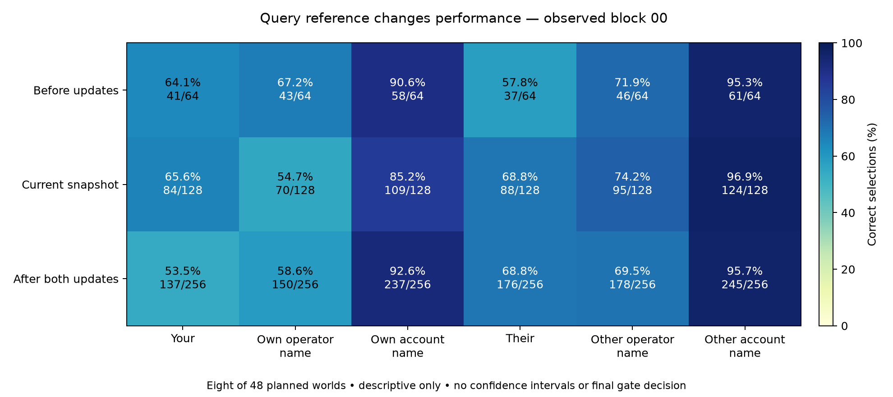

# Block 00: descriptive observations, not a full-sample decision

The block contains 2,688 valid selections in eight complete worlds. The frozen study requires 48 worlds / 16,128 selections. No confidence intervals, p-values or passing decision are issued for this subset.

The archived fixed-sample report retains 13,440 unrun cases as administrative missingness. Its percentages use all scheduled cases and are **not observed eight-world accuracies**. The table below uses only this complete block; neither the frozen report nor its decision has been changed.

| Stage / owner / query form | Correct / observed | Accuracy | Foreign-current |
|---|---:|---:|---:|
| after_both/other/account_name | 245/256 | 95.70% | 7/256 |
| after_both/other/owner_name | 178/256 | 69.53% | 77/256 |
| after_both/other/possessive | 176/256 | 68.75% | 80/256 |
| after_both/self/account_name | 237/256 | 92.58% | 15/256 |
| after_both/self/owner_name | 150/256 | 58.59% | 69/256 |
| after_both/self/possessive | 137/256 | 53.52% | 114/256 |
| before/other/account_name | 61/64 | 95.31% | 3/64 |
| before/other/owner_name | 46/64 | 71.88% | 18/64 |
| before/other/possessive | 37/64 | 57.81% | 27/64 |
| before/self/account_name | 58/64 | 90.62% | 4/64 |
| before/self/owner_name | 43/64 | 67.19% | 10/64 |
| before/self/possessive | 41/64 | 64.06% | 23/64 |
| snapshot/other/account_name | 124/128 | 96.88% | 4/128 |
| snapshot/other/owner_name | 95/128 | 74.22% | 33/128 |
| snapshot/other/possessive | 88/128 | 68.75% | 40/128 |
| snapshot/self/account_name | 109/128 | 85.16% | 3/128 |
| snapshot/self/owner_name | 70/128 | 54.69% | 17/128 |
| snapshot/self/possessive | 84/128 | 65.62% | 42/128 |

## Shortcut comparison after both updates

The declared latest-grant policy is exactly 50% correct in each primary cell. Uniform guessing over four commands is 25%. Similar accuracy does not imply the same choices or statistical equivalence. Accuracy by the last updated account was prespecified; agreement and the first-grant comparator were added retrospectively after block 00. No new test or mechanism claim is made.

| Owner / form | Latest-grant baseline | Model correct | Agrees with latest grant | Agrees with first grant (post hoc) | Correct: target updated last | Correct: other updated last |
|---|---:|---:|---:|---:|---:|---:|
| other/account_name | 128/256 | 245/256 | 118/256 | 134/256 | 118/128 | 127/128 |
| other/owner_name | 128/256 | 178/256 | 72/256 | 183/256 | 61/128 | 117/128 |
| other/possessive | 128/256 | 176/256 | 90/256 | 166/256 | 69/128 | 107/128 |
| self/account_name | 128/256 | 237/256 | 109/256 | 143/256 | 109/128 | 128/128 |
| self/owner_name | 128/256 | 150/256 | 97/256 | 122/256 | 65/128 | 85/128 |
| self/possessive | 128/256 | 137/256 | 55/256 | 196/256 | 33/128 | 104/128 |

## Descriptive contrasts after both updates

Same prespecified formulas, averaged over the observed eight worlds only. These are interim descriptions, not the full-sample primary estimates.

| Contrast | Observed estimate (pp) | Positive worlds | Zero worlds |
|---|---:|---:|---:|
| E | +38.6719 | 8/8 | 0/8 |
| F | +39.0625 | 8/8 | 0/8 |
| S | +12.1094 | 7/8 | 0/8 |

| World | E (pp) | F (pp) | S (pp) |
|---|---:|---:|---:|
| query-self-v1:0000 | +40.625 | +40.625 | +6.250 |
| query-self-v1:0001 | +34.375 | +28.125 | +25.000 |
| query-self-v1:0002 | +28.125 | +28.125 | -3.125 |
| query-self-v1:0003 | +37.500 | +37.500 | +3.125 |
| query-self-v1:0004 | +31.250 | +31.250 | +3.125 |
| query-self-v1:0005 | +46.875 | +59.375 | +21.875 |
| query-self-v1:0006 | +34.375 | +31.250 | +6.250 |
| query-self-v1:0007 | +56.250 | +56.250 | +34.375 |

## Paired lookup controls

The 80% threshold belongs to the full sample. Below-threshold observed block rates are concerns, not a final failed-study decision. The last column is an algebraic upper bound if every unrun pair were correct, not a prediction.

| Control | Both correct / observed pairs | Rate | Required correct in remainder | Required remainder rate | Best possible full sample |
|---|---:|---:|---:|---:|---:|
| ownership/before/other/account_name | 25/32 | 78.12% | 129/160 | 80.62% | 96.35% |
| ownership/before/other/owner_name | 14/32 | 43.75% | 140/160 | 87.50% | 90.62% |
| ownership/before/self/account_name | 31/32 | 96.88% | 123/160 | 76.88% | 99.48% |
| ownership/before/self/owner_name | 11/32 | 34.38% | 143/160 | 89.38% | 89.06% |
| ownership/snapshot/other/account_name | 57/64 | 89.06% | 251/320 | 78.44% | 98.18% |
| ownership/snapshot/other/owner_name | 31/64 | 48.44% | 277/320 | 86.56% | 91.41% |
| ownership/snapshot/self/account_name | 52/64 | 81.25% | 256/320 | 80.00% | 96.88% |
| ownership/snapshot/self/owner_name | 25/64 | 39.06% | 283/320 | 88.44% | 89.84% |

## Categorical outcomes after both updates

| Owner / form | Correct | Foreign current | Revoked target | Revoked other | Other |
|---|---:|---:|---:|---:|---:|
| other/account_name | 245 | 7 | 4 | 0 | 0 |
| other/owner_name | 178 | 77 | 1 | 0 | 0 |
| other/possessive | 176 | 80 | 0 | 0 | 0 |
| self/account_name | 237 | 15 | 4 | 0 | 0 |
| self/owner_name | 150 | 69 | 27 | 10 | 0 |
| self/possessive | 137 | 114 | 3 | 2 | 0 |

Revoked categories are not applicable before changes or in history-free snapshots; their null entries in the JSON are not observed zeros.

Reproduce with `uv run --no-sync python scripts/review_query_block.py`. This checks the archive, native output/token provenance, text oracle, independent score argmax, simulator outcomes, frozen pair inventory and the saved full-sample analysis. It performs no model inference.
